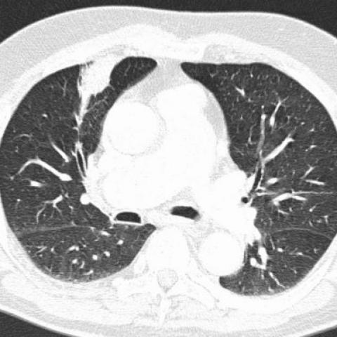
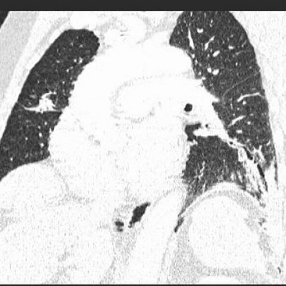
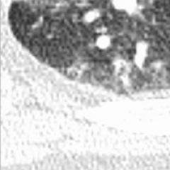
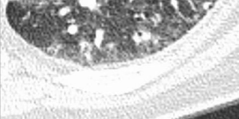

# Benchmark case 722_8353802117601

[Case index](README.md) · [Machine-readable case](722_8353802117601.json) · [Scored outcomes](../per-question-outcomes.json)

Source: [Eurorad case 722](https://www.eurorad.org/case/722); [ChestAgentBench pinned revision](https://huggingface.co/datasets/wanglab/chest-agent-bench/tree/921e60440927f9893228d843c0206b755744252a).

These are the benchmark inputs used in the frozen experiment. Model and tool observations below are recorded outputs, not independently validated clinical findings.

## Full question and options

```text
Based on the chest X-ray findings, which of the following statements best describes the relationship between the bronchiectatic changes and the consolidation observed in this patient?

A) The bronchiectatic changes are primarily located in the right upper lobe and are larger than the consolidation in the left lower lobe.
B) The bronchiectatic changes are primarily located in the left lower lobe and are smaller than the consolidation in the right middle lobe.
C) The bronchiectatic changes are primarily located in the right lower lobe and are of similar size to the consolidation in the left lower lobe.
D) The bronchiectatic changes are primarily located in the left lower lobe and are larger than the consolidation in the right middle lobe.
E) The bronchiectatic changes are primarily located in the left upper lobe and are smaller than the consolidation in the right middle lobe.
F) The bronchiectatic changes are primarily located in the left lower lobe and are of similar size to the consolidation in the right middle lobe.
```

## Original benchmark images

### image:1 — figures/722/figure_2a.jpg



### image:2 — figures/722/figure_2b.jpg


### image:3 — figures/722/figure_2c.jpg



### image:4 — figures/722/figure_2d.jpg


## Recorded answers

| Stage | Answer | Execution route/status |
|---|---|---|
| P0 | D | completed |
| V10 VKE candidate | F | candidate before gate |
| V10 VKE final | D | retain |
| S1 | F | selector |
| S2 | F | targeted_followup |
| S3 | F | selector |

Reference answer (post-generation scoring only): **D**.

## V10 VKE candidate and gate record

```json
{
  "candidate": "F",
  "final": "D",
  "changed_attributes": [
    "lobe location of bronchiectasis",
    "relative size to consolidation"
  ],
  "candidate_payload": {
    "answer": "F",
    "uncertain": true,
    "changed_attributes": [
      "lobe location of bronchiectasis",
      "relative size to consolidation"
    ],
    "evidence_refs": [
      "p0:tool:2",
      "VKE:tool:1",
      "image:2"
    ],
    "observations": [
      {
        "attribute": "bronchiectatic changes location",
        "image_ids": [
          "image:2",
          "VKE:tool:1"
        ],
        "value": "cystic/tubular lucencies in inferior lung region, consistent with left lower lobe per report",
        "status": "observed_present",
        "evidence_refs": [
          "VKE:tool:1",
          "image:2"
        ]
      },
      {
        "attribute": "consolidation location",
        "image_ids": [
          "p0:tool:2",
          "image:2"
        ],
        "value": "report states left lower lobe; image shows opacity adjacent to bronchiectasis in same region",
        "status": "hypothesis",
        "evidence_refs": [
          "p0:tool:2"
        ]
      },
      {
        "attribute": "relative size",
        "image_ids": [
          "VKE:tool:1",
          "image:2"
        ],
        "value": "bronchiectatic region and adjacent opacity appear comparable in extent",
        "status": "observed_present",
        "evidence_refs": [
          "VKE:tool:1"
        ]
      }
    ],
    "missing_evidence": [
      "confirmed anatomical orientation (left/right assignment on CT)",
      "definitive lobar boundary demarcation",
      "distinction between consolidation vs atelectasis vs effusion on CT"
    ],
    "parse_warnings": [],
    "discarded_evidence_refs": []
  },
  "gate": {
    "decision": "retain",
    "changed_attributes": [
      "lobe location of bronchiectasis",
      "relative size to consolidation"
    ],
    "evidence_refs": [
      "VKE:tool:1",
      "p0:tool:2"
    ],
    "unmet_requirements": [
      "confirmed left/right orientation",
      "definitive lobar boundary demarcation",
      "distinction between consolidation vs atelectasis"
    ],
    "reason": "Tool report (p0:tool:2) states 'left lower lobe atelectasis or consolidation'; crop VKE:tool:1 shows cystic lucencies in inferior lung region, but no verified anatomical orientation confirms left vs right. Relative size appears similar in crop, but consolidation location is uncertain (could be same lobe, not right middle). Option F assumes consolidation in right middle lobe, unsupported by evidence."
  },
  "fallback": null,
  "k_ids": [
    "RAD_CXR_CHALLENGES_2025_10"
  ],
  "e_ids": [
    "B10_9626056ed88c9deaabfc05456a0ad2ecadcb4f685e732c860df4456b5ba8e2ef",
    "B10_457c771e2403d6712b6257571b315c318c99cfaea76819b04e6ecda4de743db2"
  ],
  "candidate_error_type": null,
  "gate_error_type": null
}
```

## Cached anonymous comparison

The X/Y mapping and observation provenance are exposed here for retrospective review. They were kept separate from the selector-facing anonymous input.

```json
{
  "answer_mapping": {
    "X": "D",
    "Y": "F"
  },
  "choices": {
    "X": "The bronchiectatic changes are primarily located in the left lower lobe and are larger than the consolidation in the right middle lobe.",
    "Y": "The bronchiectatic changes are primarily located in the left lower lobe and are of similar size to the consolidation in the right middle lobe."
  },
  "evidence_mapping": {
    "observation_1": "VKE:tool:1",
    "observation_2": "p0:tool:1",
    "observation_3": "p0:tool:2",
    "observation_4": "p0:tool:3"
  },
  "cached_image_adjustments": []
}
```

### Additional cached pixels

**image_5**



```json
{
  "image_id": "image_5",
  "role": "existing_local_or_tool_image",
  "size": [
    240,
    240
  ],
  "parent_image_id": "image_2",
  "pixel_box": [
    0,
    240,
    240,
    480
  ],
  "source_size": [
    480,
    480
  ],
  "orientation": "unresolved",
  "timepoint": "unresolved"
}
```

### Cached tool observations

Tool request and return text is preserved; private filesystem paths are replaced by image links or an omission marker. Tool conclusions remain fallible.

#### observation_1 — crop_current_image

```json
{
  "observation_id": "observation_1",
  "tool": "crop_current_image",
  "request": {
    "image_path": "image_2",
    "box": [
      0.0,
      0.5,
      0.5,
      1.0
    ]
  },
  "raw_result": {
    "image_id": "image_5",
    "path": "image_5",
    "role": "current_image_pixel_crop",
    "parent_image_id": "image_2",
    "parent_path": "image_2",
    "source_size": [
      480,
      480
    ],
    "crop_size": [
      240,
      240
    ],
    "normalized_box": [
      0.0,
      0.5,
      0.5,
      1.0
    ],
    "pixel_box": [
      0,
      240,
      240,
      480
    ],
    "coordinate_system": "stored_pixel_coordinates_no_anatomical_orientation_inferred",
    "orientation": "unresolved",
    "timepoint": "unresolved"
  },
  "image_ids": [
    "image_5"
  ]
}
```

#### observation_2 — chest_xray_expert

```json
{
  "observation_id": "observation_2",
  "tool": "chest_xray_expert",
  "request": {
    "image_paths": [
      "image_1",
      "image_2",
      "image_3",
      "image_4"
    ],
    "prompt": "Identify the location and extent of bronchiectatic changes and consolidation in these CT images. Specifically, where are the bronchiectatic changes primarily located (which lobe), and where is the consolidation primarily located? Compare their relative sizes.",
    "max_new_tokens": 500
  },
  "raw_result": [
    {
      "error": "CUDA out of memory. Tried to allocate 2.10 GiB. GPU 1 has a total capacity of 23.69 GiB of which 1.59 GiB is free. Including non-PyTorch memory, this process has 7.72 GiB memory in use. Process 2565365 has 14.34 GiB memory in use. Of the allocated memory 6.22 GiB is allocated by PyTorch, and 1.20 GiB is reserved by PyTorch but unallocated. If reserved but unallocated memory is large try setting PYTORCH_CUDA_ALLOC_CONF=expandable_segments:True to avoid fragmentation.  See documentation for Memory Management  (http[private_path_omitted]"
    },
    {
      "image_paths": [
        "image_1",
        "image_2",
        "image_3",
        "image_4"
      ],
      "prompt": "Identify the location and extent of bronchiectatic changes and consolidation in these CT images. Specifically, where are the bronchiectatic changes primarily located (which lobe), and where is the consolidation primarily located? Compare their relative sizes.",
      "max_new_tokens": 500,
      "analysis_status": "failed",
      "error_details": "CUDA out of memory. Tried to allocate 2.10 GiB. GPU 1 has a total capacity of 23.69 GiB of which 1.59 GiB is free. Including non-PyTorch memory, this process has 7.72 GiB memory in use. Process 2565365 has 14.34 GiB memory in use. Of the allocated memory 6.22 GiB is allocated by PyTorch, and 1.20 GiB is reserved by PyTorch but unallocated. If reserved but unallocated memory is large try setting PYTORCH_CUDA_ALLOC_CONF=expandable_segments:True to avoid fragmentation.  See documentation for Memory Management  (http[private_path_omitted]"
    }
  ],
  "image_ids": []
}
```

#### observation_3 — chest_xray_report_generator

```json
{
  "observation_id": "observation_3",
  "tool": "chest_xray_report_generator",
  "request": {
    "image_path": "image_1"
  },
  "raw_result": [
    "CHEST X-RAY REPORT\n\nFINDINGS:\nthe cardiomediastinal silhouette is normal. the lung parenchyma is clear. there are no pleural or significant bony abnormalities.\n\nIMPRESSION:\n1. two views of the chest demonstrate a right upper extremity picc line with the distal tip at the cavoatrial junction. 2. cardiomediastinal silhouette is within normal limits. 3. there is a small left pleural effusion and left lower lobe atelectasis or consolidation. 4. there is a diffuse reticular pattern throughout the lungs, which may be chronic. 5. there is a dextroscoliosis of the thoracic spine.",
    {
      "image_path": "image_1",
      "analysis_status": "completed",
      "sections_generated": [
        "findings",
        "impression"
      ]
    }
  ],
  "image_ids": []
}
```

#### observation_4 — chest_xray_classifier

```json
{
  "observation_id": "observation_4",
  "tool": "chest_xray_classifier",
  "request": {
    "image_path": "image_1"
  },
  "raw_result": [
    {
      "Atelectasis": 0.5351476669311523,
      "Consolidation": 0.47969961166381836,
      "Infiltration": 0.04187863692641258,
      "Pneumothorax": 0.5024491548538208,
      "Edema": 0.5873376131057739,
      "Emphysema": 0.5163500308990479,
      "Fibrosis": 0.015697048977017403,
      "Effusion": 0.5474956035614014,
      "Pneumonia": 0.5002387762069702,
      "Pleural_Thickening": 0.013805413618683815,
      "Cardiomegaly": 0.5930144786834717,
      "Nodule": 0.17852938175201416,
      "Mass": 0.5056391358375549,
      "Hernia": 0.11822137981653214,
      "Lung Lesion": 0.5378601551055908,
      "Fracture": 0.7298588156700134,
      "Lung Opacity": 0.7192695140838623,
      "Enlarged Cardiomediastinum": 0.589111328125
    },
    {
      "image_path": "image_1",
      "analysis_status": "completed",
      "note": "Probabilities range from 0 to 1, with higher values indicating higher likelihood of the condition."
    }
  ],
  "image_ids": []
}
```

## S2 targeted follow-up action and reader observation

```json
{
  "action_plan": {
    "action": "crop_original",
    "image_ids": [
      "image_2"
    ],
    "box": [
      0.0,
      0.5,
      1.0,
      1.0
    ],
    "reason": "The cropped region from image_2 (lower half) corresponds to the left lower lobe where bronchiectatic changes are visible as dilated airways with tram-track and ring shadows; this view allows direct measurement of the transverse diameter of the bronchiectatic region. A comparable slice showing right middle lobe consolidation is not yet confirmed in other images, but this crop isolates the key structure for one side and enables precise pixel-based sizing before cross-comparison.",
    "parse_warnings": []
  },
  "action": {
    "action": "crop_original",
    "tool_attempts": 1,
    "repairs": [
      {
        "action": "bounded_original_pixel_crop_no_interpolation",
        "requested_box": [
          0.0,
          0.5,
          1.0,
          1.0
        ],
        "pixel_box": [
          0,
          240,
          480,
          480
        ],
        "size": [
          480,
          240
        ]
      }
    ],
    "warnings": [],
    "images": [
      {
        "image_id": "image_1",
        "role": "original",
        "size": [
          480,
          480
        ],
        "orientation": "unresolved",
        "timepoint": "unresolved",
        "path": "images/originals/figures/722/figure_2a.jpg"
      },
      {
        "image_id": "image_2",
        "role": "original",
        "size": [
          480,
          480
        ],
        "orientation": "unresolved",
        "timepoint": "unresolved",
        "path": "images/originals/figures/722/figure_2b.jpg"
      },
      {
        "image_id": "image_3",
        "role": "original",
        "size": [
          480,
          480
        ],
        "orientation": "unresolved",
        "timepoint": "unresolved",
        "path": "images/originals/figures/722/figure_2c.jpg"
      },
      {
        "image_id": "image_4",
        "role": "original",
        "size": [
          480,
          480
        ],
        "orientation": "unresolved",
        "timepoint": "unresolved",
        "path": "images/originals/figures/722/figure_2d.jpg"
      },
      {
        "image_id": "followup_image_1",
        "role": "one_targeted_original_pixel_crop",
        "size": [
          480,
          240
        ],
        "parent_image_id": "image_2",
        "pixel_box": [
          0,
          240,
          480,
          480
        ],
        "source_size": [
          480,
          480
        ],
        "orientation": "unresolved",
        "timepoint": "unresolved",
        "path": "images/followup/722_8353802117601/followup_image_1.png"
      }
    ]
  },
  "observation": {
    "observation_id": "followup_observation_1",
    "observation": "The provided images are axial CT slices, not chest X-rays; no scale (e.g., cm/mm calibration) is visible, and the requested transverse diameters of the bronchiectatic region in the left lower lobe and the consolidated region in the right middle lobe cannot be measured. Image 2 shows a region with cystic airspaces suggestive of bronchiectasis (likely left lower lobe), and image 3 shows a denser area possibly representing consolidation (right middle lobe), but without a known pixel-to-cm conversion or orientation confirmation, quantitative measurement is impossible. The cropped follow-up image (followup_image_1) is a low-resolution partial view that does not enable reliable diameter estimation.",
    "evidence_refs": [
      "image_2",
      "image_3",
      "followup_image_1"
    ],
    "unresolved": [
      "absence of scale/calibration for size measurement",
      "uncertain anatomical laterality/orientation of slices",
      "no explicit identification of left lower lobe bronchiectasis vs right middle lobe consolidation on same slice",
      "pixel dimensions do not translate to cm without DICOM metadata or reference object"
    ],
    "parse_warnings": [],
    "status": "independent_visual_report_requires_image_verification"
  }
}
```



## V11 selector and reader records

A recorded choice can coexist with an empty observation list. That record alone does not establish a supported visual comparison. See the [decision audit](../decision-audit.json) and [decision-pattern analysis](../decision-pattern-analysis.md) for this limitation.

```json
{
  "S1": {
    "stage": "S1",
    "initial": "D",
    "candidate": "F",
    "final": "F",
    "route": "selector",
    "selector": {
      "choice": "Y",
      "observations": [
        {
          "attribute": "location of bronchiectatic changes",
          "direction": "supports_both",
          "evidence_refs": [
            "image_2",
            "image_5"
          ],
          "value": "Image 2 (and its crop image_5) shows cystic/bronchiectatic airspaces predominantly in the left lower lobe region; this is consistent across both X and Y."
        },
        {
          "attribute": "location of consolidation",
          "direction": "supports_X",
          "evidence_refs": [
            "image_3",
            "image_4"
          ],
          "value": "Image 3 and 4 show increased opacity in the right middle lobe, supporting consolidation there — consistent with both X and Y."
        },
        {
          "attribute": "relative size comparison (bronchiectasis vs consolidation)",
          "direction": "supports_Y",
          "evidence_refs": [
            "image_2",
            "image_3"
          ],
          "value": "Visual estimation from full images: bronchiectatic area in left lower lobe (image 2) appears roughly comparable in transverse extent to the consolidation in right middle lobe (image 3); neither clearly dominates in size. X claims 'larger', which is not visually supported."
        }
      ],
      "needs_followup": true,
      "followup_question": "What is the approximate transverse diameter (in cm) of the bronchiectatic region in the left lower lobe versus the consolidated region in the right middle lobe on the same axial slice?",
      "parse_warnings": []
    },
    "fallback": null,
    "timing": {
      "started_utc": "2026-10-30T15:40:44.882934+00:00",
      "ended_utc": "2026-10-30T15:40:54.094575+00:00",
      "elapsed_s": 9.212
    },
    "selector_error_type": null
  },
  "S2": {
    "stage": "S2",
    "initial": "D",
    "candidate": "F",
    "final": "F",
    "s1_final": "F",
    "route": "targeted_followup",
    "selector": {
      "choice": "Y",
      "observations": [
        {
          "attribute": "location of bronchiectatic changes",
          "direction": "supports_both",
          "evidence_refs": [
            "image_2",
            "image_5"
          ],
          "value": "Image 2 and its crop (image 5) show cystic/branching lucencies in the left lower lobe region, consistent with bronchiectasis; both X and Y agree on this location."
        },
        {
          "attribute": "location of consolidation",
          "direction": "supports_both",
          "evidence_refs": [
            "image_3"
          ],
          "value": "Image 3 shows a denser, homogenous opacity in the right middle lobe region; both X and Y agree on this location."
        },
        {
          "attribute": "relative size comparison",
          "direction": "supports_Y",
          "evidence_refs": [
            "image_2",
            "image_3"
          ],
          "value": "On visual inspection of axial slices, the bronchiectatic region (image 2) and the consolidated region (image 3) occupy roughly comparable transverse extents (~2–3 cm visually), with no clear evidence that one is substantially larger than the other; X’s claim of ‘larger’ is unsupported, while Y’s ‘similar size’ aligns better with observable extent."
        }
      ],
      "needs_followup": true,
      "followup_question": "On the same axial CT slice, is the bronchiectatic region in the left lower lobe visibly wider (transverse diameter) than the consolidation in the right middle lobe?",
      "parse_warnings": []
    },
    "fallback": null,
    "followup_question": "What is the approximate transverse diameter (in cm) of the bronchiectatic region in the left lower lobe versus the consolidated region in the right middle lobe on the same axial slice?",
    "action": "crop_original",
    "new_observation": {
      "observation_id": "followup_observation_1",
      "observation": "The provided images are axial CT slices, not chest X-rays; no scale (e.g., cm/mm calibration) is visible, and the requested transverse diameters of the bronchiectatic region in the left lower lobe and the consolidated region in the right middle lobe cannot be measured. Image 2 shows a region with cystic airspaces suggestive of bronchiectasis (likely left lower lobe), and image 3 shows a denser area possibly representing consolidation (right middle lobe), but without a known pixel-to-cm conversion or orientation confirmation, quantitative measurement is impossible. The cropped follow-up image (followup_image_1) is a low-resolution partial view that does not enable reliable diameter estimation.",
      "evidence_refs": [
        "image_2",
        "image_3",
        "followup_image_1"
      ],
      "unresolved": [
        "absence of scale/calibration for size measurement",
        "uncertain anatomical laterality/orientation of slices",
        "no explicit identification of left lower lobe bronchiectasis vs right middle lobe consolidation on same slice",
        "pixel dimensions do not translate to cm without DICOM metadata or reference object"
      ],
      "parse_warnings": [],
      "status": "independent_visual_report_requires_image_verification"
    },
    "timing": {
      "started_utc": "2026-10-30T15:48:25.019874+00:00",
      "ended_utc": "2026-10-30T15:48:43.068651+00:00",
      "elapsed_s": 18.049
    },
    "selector_error_type": null
  },
  "S3": {
    "stage": "S3",
    "initial": "D",
    "candidate": "F",
    "final": "F",
    "route": "selector",
    "selector": {
      "choice": "Y",
      "observations": [],
      "needs_followup": false,
      "followup_question": "",
      "parse_warnings": []
    },
    "fallback": null,
    "blind_observation": {
      "observation_id": "blind_observation_1",
      "observations": [
        {
          "attribute": "bronchiectatic changes",
          "value": "dilated, irregular bronchial lumens with visible walls, predominantly in the right upper and middle lung zones (image_2, image_4); some cystic/clustered dilatations present",
          "status": "observed_present",
          "evidence_refs": [
            "image_2",
            "image_4"
          ]
        },
        {
          "attribute": "consolidation",
          "value": "patchy, heterogeneous increased attenuation in the right upper lobe (image_2, image_3), with air bronchograms visible within it (image_2)",
          "status": "observed_present",
          "evidence_refs": [
            "image_2",
            "image_3"
          ]
        },
        {
          "attribute": "spatial relationship between bronchiectasis and consolidation",
          "value": "areas of bronchiectasis are intermixed with and adjacent to regions of consolidation in the right upper lobe; some dilated bronchi appear embedded within the consolidated parenchyma (image_2)",
          "status": "observed_present",
          "evidence_refs": [
            "image_2"
          ]
        },
        {
          "attribute": "distribution symmetry",
          "value": "abnormalities predominantly unilateral (right-sided); left lung appears relatively spared (image_1, image_3)",
          "status": "observed_present",
          "evidence_refs": [
            "image_1",
            "image_3"
          ]
        }
      ],
      "uncertainties": [
        "Exact anatomical laterality (left/right) cannot be confirmed due to unresolved orientation in all images",
        "Temporal sequence (whether consolidation preceded or followed bronchiectasis) is not determinable from static images",
        "Whether air-filled dilated bronchi represent active infection vs. chronic structural change is not discernible from morphology alone"
      ],
      "parse_warnings": [],
      "status": "independent_blind_visual_report_requires_image_verification"
    },
    "timing": {
      "started_utc": "2026-10-30T16:15:24.963504+00:00",
      "ended_utc": "2026-10-30T16:15:49.074598+00:00",
      "elapsed_s": 24.111
    },
    "selector_error_type": null
  }
}
```

[Data provenance and limits](../data-provenance.md)
