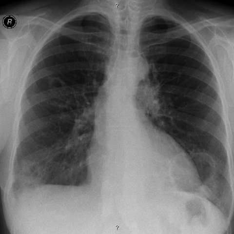

# Benchmark case 7726_8353800871273

[Case index](README.md) · [Machine-readable case](7726_8353800871273.json) · [Scored outcomes](../per-question-outcomes.json)

Source: [Eurorad case 7726](https://www.eurorad.org/case/7726); [ChestAgentBench pinned revision](https://huggingface.co/datasets/wanglab/chest-agent-bench/tree/921e60440927f9893228d843c0206b755744252a).

These are the benchmark inputs used in the frozen experiment. Model and tool observations below are recorded outputs, not independently validated clinical findings.

## Full question and options

```text
In the context of the 57-year-old female patient with a history of rheumatoid arthritis and smoking, analyze the chest X-rays provided. Which of the following statements best describes the progression and characteristics of the lung findings over time, and their relationship to rheumatoid arthritis?

A) The cavitated nodules in the left lung base have decreased in size over 12 months, suggesting a resolution of pulmonary involvement.
B) The cavitated nodules have remained stable in size and do not demonstrate any progression, indicating no change in the pulmonary manifestations of rheumatoid arthritis.
C) The cavitated nodules in the lower lung lobes have increased in size over 12 months and are characteristic of necrobiotic nodules associated with rheumatoid arthritis.
D) New cavitated nodules have appeared in the upper lung fields over 12 months, unrelated to rheumatoid arthritis.
E) The cavitated nodules in the right middle lung area have decreased in size, suggesting effective treatment of the pulmonary condition.
F) The cavitated nodules have shown irregular wall thickening, which is not typical for rheumatoid arthritis-related pulmonary nodules.
```

## Original benchmark images

### image:1 — figures/7726/figure_1a.jpg


### image:2 — figures/7726/figure_1b.jpg



## Recorded answers

| Stage | Answer | Execution route/status |
|---|---|---|
| P0 | C | completed |
| V10 VKE candidate | C | candidate before gate |
| V10 VKE final | C | no_change |
| S1 | C | inherited_agreement |
| S2 | C | inherited_s1 |
| S3 | C | inherited_agreement |

Reference answer (post-generation scoring only): **C**.

## V10 VKE candidate and gate record

```json
{
  "candidate": "C",
  "final": "C",
  "changed_attributes": [
    "size change of cavitated nodules in left lung base",
    "location of nodules (lower lobes)"
  ],
  "candidate_payload": {
    "answer": "C",
    "uncertain": true,
    "changed_attributes": [
      "size change of cavitated nodules in left lung base",
      "location of nodules (lower lobes)"
    ],
    "evidence_refs": [
      "VKE:tool:1",
      "VKE:tool:2",
      "p0:tool:6",
      "p0:tool:7"
    ],
    "observations": [
      {
        "attribute": "cavitated nodule in left lung base",
        "image_ids": [
          "image:1"
        ],
        "value": "hazy opacity without clear cavity in cropped left lower zone",
        "status": "unresolved",
        "evidence_refs": [
          "VKE:tool:1"
        ]
      },
      {
        "attribute": "cavitated nodule in left lung base",
        "image_ids": [
          "image:2"
        ],
        "value": "similar hazy opacity in corresponding region, no clear cavity visible",
        "status": "unresolved",
        "evidence_refs": [
          "VKE:tool:2"
        ]
      },
      {
        "attribute": "phrase grounding result",
        "image_ids": [
          "image:1",
          "image:2"
        ],
        "value": "xray_phrase_grounding detected 'cavitated nodule' but with very small bounding boxes (likely imprecise)",
        "status": "hypothesis",
        "evidence_refs": [
          "p0:tool:6",
          "p0:tool:7"
        ]
      }
    ],
    "missing_evidence": [
      "definitive visualization of cavitated nodules",
      "exact size measurement comparison",
      "wall thickness assessment",
      "confirmation of rheumatoid arthritis-related necrobiotic nodules"
    ],
    "parse_warnings": [],
    "discarded_evidence_refs": []
  },
  "gate": {
    "decision": "no_change"
  },
  "fallback": null,
  "k_ids": [
    "ACR_NODULE_2023_K02",
    "RAD_CXR_CHALLENGES_2025_09"
  ],
  "e_ids": [
    "B10_457c771e2403d6712b6257571b315c318c99cfaea76819b04e6ecda4de743db2",
    "B10_c416ffc694c3db8ba90355ee60321016c8806ff900f60836d71420417baed3b7"
  ],
  "candidate_error_type": null,
  "gate_error_type": null
}
```

## Detailed comparison evidence

This case did not route to the 21-case anonymous disagreement selector. Its original input and recorded answers are included; no selector packet was generated.

## V11 selector and reader records

A recorded choice can coexist with an empty observation list. That record alone does not establish a supported visual comparison. See the [decision audit](../decision-audit.json) and [decision-pattern analysis](../decision-pattern-analysis.md) for this limitation.

```json
{
  "S1": {
    "stage": "S1",
    "initial": "C",
    "candidate": "C",
    "final": "C",
    "route": "inherited_agreement",
    "selector": null,
    "fallback": null,
    "timing": {
      "started_utc": "2026-10-30T15:40:54.105088+00:00",
      "ended_utc": "2026-10-30T15:40:54.105320+00:00",
      "elapsed_s": 0.0
    },
    "selector_error_type": null
  },
  "S2": {
    "stage": "S2",
    "initial": "C",
    "candidate": "C",
    "final": "C",
    "s1_final": "C",
    "route": "inherited_s1",
    "selector": null,
    "fallback": null,
    "timing": {
      "started_utc": "2026-10-30T15:48:43.076964+00:00",
      "ended_utc": "2026-10-30T15:48:43.077708+00:00",
      "elapsed_s": 0.001
    },
    "selector_error_type": null
  },
  "S3": {
    "stage": "S3",
    "initial": "C",
    "candidate": "C",
    "final": "C",
    "route": "inherited_agreement",
    "selector": null,
    "fallback": null,
    "timing": {
      "started_utc": "2026-10-30T16:15:49.081612+00:00",
      "ended_utc": "2026-10-30T16:15:49.081829+00:00",
      "elapsed_s": 0.0
    },
    "selector_error_type": null
  }
}
```

[Data provenance and limits](../data-provenance.md)
