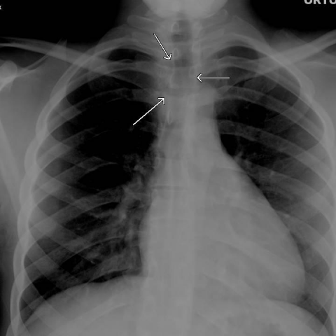

# Benchmark case 9308_8353800801854

[Case index](README.md) · [Machine-readable case](9308_8353800801854.json) · [Scored outcomes](../per-question-outcomes.json)

Source: [Eurorad case 9308](https://www.eurorad.org/case/9308); [ChestAgentBench pinned revision](https://huggingface.co/datasets/wanglab/chest-agent-bench/tree/921e60440927f9893228d843c0206b755744252a).

These are the benchmark inputs used in the frozen experiment. Model and tool observations below are recorded outputs, not independently validated clinical findings.

## Full question and options

```text
A 23-year-old man presents with dyspnea and agitation. Radiographic imaging shows an ovoid opaque area at the C6-C7 level, displacing the airway, and numerous oval-shaped dense lesions in the intestine. Based on the chest X-ray findings alone, which of the following is the most likely diagnosis for the foreign bodies seen in the patient's oesophagus and intestine?

A) Packets filled with hashish
B) Packets filled with cocaine
C) Packets filled with heroin
D) Packets filled with methamphetamine
E) Non-drug-related foreign body
F) Packets filled with marijuana
```

## Original benchmark images

### image:1 — figures/9308/figure_1.jpg


### image:2 — figures/9308/figure_2.jpg


### image:3 — figures/9308/figure_6.jpg



### image:4 — figures/9308/figure_7.jpg


## Recorded answers

| Stage | Answer | Execution route/status |
|---|---|---|
| P0 | B | completed |
| V10 VKE candidate | B | candidate before gate |
| V10 VKE final | B | no_change |
| S1 | B | inherited_agreement |
| S2 | B | inherited_s1 |
| S3 | B | inherited_agreement |

Reference answer (post-generation scoring only): **C**.

## V10 VKE candidate and gate record

```json
{
  "candidate": "B",
  "final": "B",
  "changed_attributes": [
    "radiodensity homogeneity",
    "shape consistency"
  ],
  "candidate_payload": {
    "answer": "B",
    "uncertain": true,
    "changed_attributes": [
      "radiodensity homogeneity",
      "shape consistency"
    ],
    "evidence_refs": [
      "image:1",
      "image:2",
      "image:3",
      "image:4"
    ],
    "observations": [
      {
        "attribute": "radiodensity and internal texture",
        "image_ids": [
          "image:1",
          "image:2"
        ],
        "value": "homogeneous high-density oval objects without internal heterogeneity or air interfaces",
        "status": "observed_present",
        "evidence_refs": [
          "image:1",
          "image:2"
        ]
      },
      {
        "attribute": "shape and size consistency across locations",
        "image_ids": [
          "image:3",
          "image:4"
        ],
        "value": "ovoid opaque structure at C6-C7; multiple similarly sized oval dense lesions in bowel on CT",
        "status": "observed_present",
        "evidence_refs": [
          "image:3",
          "image:4"
        ]
      }
    ],
    "missing_evidence": [
      "exact HU measurements",
      "packet wall thickness",
      "layered appearance or air pockets"
    ],
    "parse_warnings": [],
    "discarded_evidence_refs": []
  },
  "gate": {
    "decision": "no_change"
  },
  "fallback": null,
  "k_ids": [
    "RAD_FLEISCHNER_2024_01"
  ],
  "e_ids": [
    "B10_ba28fd1cdf84e7f173f1ea7db4cb829a6e4b62220aa473a3c219eed89fb3af56",
    "B10_00dd8ce96a864667c9dce9413c7e358d0fd2f4430a81f2833b6000cd0841d8bd"
  ],
  "candidate_error_type": null,
  "gate_error_type": null
}
```

## Detailed comparison evidence

This case did not route to the 21-case anonymous disagreement selector. Its original input and recorded answers are included; no selector packet was generated.

## V11 selector and reader records

A recorded choice can coexist with an empty observation list. That record alone does not establish a supported visual comparison. See the [decision audit](../decision-audit.json) and [decision-pattern analysis](../decision-pattern-analysis.md) for this limitation.

```json
{
  "S1": {
    "stage": "S1",
    "initial": "B",
    "candidate": "B",
    "final": "B",
    "route": "inherited_agreement",
    "selector": null,
    "fallback": null,
    "timing": {
      "started_utc": "2026-10-30T15:41:01.599262+00:00",
      "ended_utc": "2026-10-30T15:41:01.599483+00:00",
      "elapsed_s": 0.0
    },
    "selector_error_type": null
  },
  "S2": {
    "stage": "S2",
    "initial": "B",
    "candidate": "B",
    "final": "B",
    "s1_final": "B",
    "route": "inherited_s1",
    "selector": null,
    "fallback": null,
    "timing": {
      "started_utc": "2026-10-30T15:49:02.035461+00:00",
      "ended_utc": "2026-10-30T15:49:02.035632+00:00",
      "elapsed_s": 0.0
    },
    "selector_error_type": null
  },
  "S3": {
    "stage": "S3",
    "initial": "B",
    "candidate": "B",
    "final": "B",
    "route": "inherited_agreement",
    "selector": null,
    "fallback": null,
    "timing": {
      "started_utc": "2026-10-30T16:16:13.011829+00:00",
      "ended_utc": "2026-10-30T16:16:13.012084+00:00",
      "elapsed_s": 0.0
    },
    "selector_error_type": null
  }
}
```

[Data provenance and limits](../data-provenance.md)
