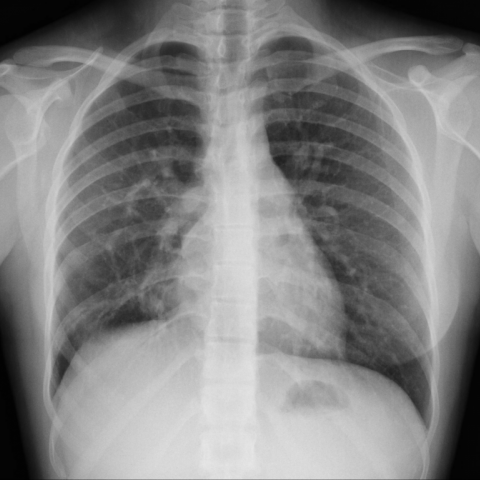

# Benchmark case 9815_8353800828253

[Case index](README.md) · [Machine-readable case](9815_8353800828253.json) · [Scored outcomes](../per-question-outcomes.json)

Source: [Eurorad case 9815](https://www.eurorad.org/case/9815); [ChestAgentBench pinned revision](https://huggingface.co/datasets/wanglab/chest-agent-bench/tree/921e60440927f9893228d843c0206b755744252a).

These are the benchmark inputs used in the frozen experiment. Model and tool observations below are recorded outputs, not independently validated clinical findings.

## Full question and options

```text
Based solely on the chest X-ray findings (Fig. 1), which of the following options most accurately describes the observed condition and its potential implication for the patient's respiratory symptoms?

A) Normal chest X-ray with no significant findings.
B) Presence of a right-sided tracheal bronchus without any significant vascular anomaly.
C) Enlargement of the right cardiac cavities with a possible vascular anomaly, suggestive of a partial anomalous pulmonary venous return.
D) Bilateral enlargement of cardiac cavities with no additional vascular structures.
E) Presence of a pulmonary varix in the left middle pulmonary field.
F) Right-sided pulmonary sequestration with no cardiac enlargement.
```

## Original benchmark images

### image:1 — figures/9815/figure_1a.jpg



### image:2 — figures/9815/figure_1b.jpg


## Recorded answers

| Stage | Answer | Execution route/status |
|---|---|---|
| P0 | C | completed |
| V10 VKE candidate | C | candidate before gate |
| V10 VKE final | C | no_change |
| S1 | C | inherited_agreement |
| S2 | C | inherited_s1 |
| S3 | C | inherited_agreement |

Reference answer (post-generation scoring only): **C**.

## V10 VKE candidate and gate record

```json
{
  "candidate": "C",
  "final": "C",
  "changed_attributes": [
    "right cardiac cavity enlargement",
    "vascular anomaly suggestive of PAPVR"
  ],
  "candidate_payload": {
    "answer": "C",
    "uncertain": true,
    "changed_attributes": [
      "right cardiac cavity enlargement",
      "vascular anomaly suggestive of PAPVR"
    ],
    "evidence_refs": [
      "VKE:tool:1",
      "p0:tool:3",
      "image:1"
    ],
    "observations": [
      {
        "attribute": "vertical soft-tissue opacity near right hilum",
        "image_ids": [
          "image:1"
        ],
        "value": "present — tubular density descending parallel to trachea, not air-filled",
        "status": "observed_present",
        "evidence_refs": [
          "VKE:tool:1"
        ]
      },
      {
        "attribute": "right tracheal bronchus",
        "image_ids": [
          "image:1"
        ],
        "value": "absent — no air-filled anomalous bronchus arising from trachea",
        "status": "observed_absent",
        "evidence_refs": [
          "VKE:tool:1"
        ]
      },
      {
        "attribute": "right cardiac cavity enlargement",
        "image_ids": [
          "image:1"
        ],
        "value": "borderline/mild prominence; cardiothoracic ratio ≤0.5 on PA",
        "status": "unresolved",
        "evidence_refs": [
          "image:1",
          "p0:tool:2"
        ]
      },
      {
        "attribute": "focal left middle lung opacity (varix/sequestration)",
        "image_ids": [
          "image:1"
        ],
        "value": "absent — no rounded or dense mass in left mid-lung",
        "status": "observed_absent",
        "evidence_refs": [
          "image:1"
        ]
      }
    ],
    "missing_evidence": [
      "CT confirmation of anomalous vein course",
      "quantitative cardiothoracic ratio",
      "bronchial tree detail"
    ],
    "parse_warnings": [],
    "discarded_evidence_refs": []
  },
  "gate": {
    "decision": "no_change"
  },
  "fallback": null,
  "k_ids": [
    "RAD_PNEUMOTHORAX_IMAGING_2016_04",
    "ACR_NODULE_2023_K05"
  ],
  "e_ids": [
    "B10_718b9ea09d38fe655c2a4cf2e4b9d3a097be593862aa6f0fe498353ba7e611cf",
    "B10_ea548f88a90ea1f91a3cf00f79aaee751326826a539c8a47915004e54f35fad9"
  ],
  "candidate_error_type": null,
  "gate_error_type": null
}
```

## Detailed comparison evidence

This case did not route to the 21-case anonymous disagreement selector. Its original input and recorded answers are included; no selector packet was generated.

## V11 selector and reader records

A recorded choice can coexist with an empty observation list. That record alone does not establish a supported visual comparison. See the [decision audit](../decision-audit.json) and [decision-pattern analysis](../decision-pattern-analysis.md) for this limitation.

```json
{
  "S1": {
    "stage": "S1",
    "initial": "C",
    "candidate": "C",
    "final": "C",
    "route": "inherited_agreement",
    "selector": null,
    "fallback": null,
    "timing": {
      "started_utc": "2026-10-30T15:41:01.602548+00:00",
      "ended_utc": "2026-10-30T15:41:01.602747+00:00",
      "elapsed_s": 0.0
    },
    "selector_error_type": null
  },
  "S2": {
    "stage": "S2",
    "initial": "C",
    "candidate": "C",
    "final": "C",
    "s1_final": "C",
    "route": "inherited_s1",
    "selector": null,
    "fallback": null,
    "timing": {
      "started_utc": "2026-10-30T15:49:02.038889+00:00",
      "ended_utc": "2026-10-30T15:49:02.039106+00:00",
      "elapsed_s": 0.0
    },
    "selector_error_type": null
  },
  "S3": {
    "stage": "S3",
    "initial": "C",
    "candidate": "C",
    "final": "C",
    "route": "inherited_agreement",
    "selector": null,
    "fallback": null,
    "timing": {
      "started_utc": "2026-10-30T16:16:13.015571+00:00",
      "ended_utc": "2026-10-30T16:16:13.015834+00:00",
      "elapsed_s": 0.0
    },
    "selector_error_type": null
  }
}
```

[Data provenance and limits](../data-provenance.md)
