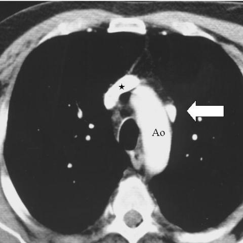

# V12：1281_8353802281357

[全部题目](README.md) · [结构化病例记录](1281_8353802281357.json)

来源：[ChestAgentBench 固定版本](https://huggingface.co/datasets/wanglab/chest-agent-bench/tree/921e60440927f9893228d843c0206b755744252a)；[Eurorad case 1281](https://www.eurorad.org/case/1281)。

参考答案只来自实验结束后的既有评分结果。模型和工具文字是可观察输出，不是人工确认的患者事实。

## 完整题干与全部选项

```text
Based on the chest X-ray findings, which of the following best describes the unusual vessel detected, its relation to the aortic arch, and the absence of the left upper pulmonary vein? Consider the position and branching pattern of the vessel in your reasoning.

A. The unusual vessel is positioned to the right of the aortic arch and drains directly into the superior vena cava, indicating a right-sided abnormality.
B. The unusual vessel is positioned to the left of the aortic arch and drains into the left brachiocephalic vein, consistent with a vertical vein.
C. The unusual vessel is positioned inferior to the aortic arch and shows no significant branching, suggesting an azygos vein.
D. The unusual vessel is positioned anterior to the aortic arch and drains into the right atrium, indicating a persistent left superior vena cava.
E. The unusual vessel does not demonstrate any branching and is situated posterior to the aortic arch, suggesting a normal anatomical variant.
F. The unusual vessel branches from the left upper pulmonary lobe directly into the left auricle, indicating an atrial septal defect.
```

## 原图与图号对应

**image:1 — figures/1281/figure_1b.jpg**



**image:2 — figures/1281/figure_1c.jpg**


**image:3 — figures/1281/figure_1d.jpg**


## 三阶段答案与失败回退

| 组 | 首答 | 取证后候选 | 模型最终求解 | 控制器最终答案 | 状态 |
|---|---|---|---|---|---|
| B | B | B | B | B | completed |
| A | B | B | B | B | completed |

失败回退保留已有合法首答，不计作新求解成功；首答和候选均未作为最终模型输入。

## 完整调用、检索及工具记录

- [initial：实际保存的请求、响应、解析、观察、工具原始返回、费用与耗时](../traces/1281_8353802281357_initial.json)
- [B：实际保存的请求、响应、解析、观察、工具原始返回、费用与耗时](../traces/1281_8353802281357_B.json)
- [A：实际保存的请求、响应、解析、观察、工具原始返回、费用与耗时](../traces/1281_8353802281357_A.json)

图号、模态、初次/随访、比较对象以及派生图与原图关系保存在各阶段的 image registry / images.json / observation 中。Unknown 保持未知。

## 已评分结果、错误、费用与耗时

```json
{
  "scored_outcome": {
    "question_id": "1281_8353802281357",
    "official_categories": [
      "comparison",
      "localization",
      "relationship"
    ],
    "reference_answer": "B",
    "initial": {
      "answer": "B",
      "correct": true,
      "status": "completed",
      "error": null
    },
    "B": {
      "answer": "B",
      "correct": true,
      "candidate_answer": "B",
      "candidate_correct": true,
      "solver_answer": "B",
      "solver_correct": true,
      "fallback_to_initial": false,
      "status": "completed",
      "error": null,
      "transition_from_initial": "correct_to_correct",
      "candidate_transition_from_initial": "correct_to_correct",
      "k_ids": [
        "ACR_NODULE_2023_K02"
      ],
      "e_ids": [
        "2e89b738c3e1b41386ff3f4db4c6811094a826ba957961d8a32059eabc83b464"
      ]
    },
    "A": {
      "answer": "B",
      "correct": true,
      "candidate_answer": "B",
      "candidate_correct": true,
      "solver_answer": "B",
      "solver_correct": true,
      "fallback_to_initial": false,
      "status": "completed",
      "error": null,
      "transition_from_initial": "correct_to_correct",
      "candidate_transition_from_initial": "correct_to_correct",
      "k_ids": [],
      "e_ids": []
    }
  },
  "initial": {
    "question_id": "1281_8353802281357",
    "first_answer": "B",
    "status": "completed",
    "error": null,
    "observation": {
      "first_answer": "B",
      "observations": [
        {
          "attribute": "unusual vessel position relative to aortic arch",
          "value": "left-sided, adjacent to left lateral aspect of aortic arch (Ao)",
          "status": "observed_present",
          "evidence_refs": [
            "image:1",
            "image:2",
            "image:3"
          ]
        },
        {
          "attribute": "vessel drainage",
          "value": "drains into left brachiocephalic vein (LA, labeled in image:3 as 'LA' near the confluence with the vessel indicated by arrow and star)",
          "status": "observed_present",
          "evidence_refs": [
            "image:3"
          ]
        },
        {
          "attribute": "branching pattern",
          "value": "no visible branching within the imaged slice; appears as a single tubular structure connecting pulmonary venous confluence to systemic vein",
          "status": "observed_absent",
          "evidence_refs": [
            "image:1",
            "image:2",
            "image:3"
          ]
        },
        {
          "attribute": "left upper pulmonary vein",
          "value": "not visualized; expected location (left upper lobe → left atrium) is empty; consistent with absence",
          "status": "observed_absent",
          "evidence_refs": [
            "image:1",
            "image:2",
            "image:3"
          ]
        },
        {
          "attribute": "anatomical labels",
          "value": "Ao = aorta, PA = pulmonary artery, LA = left atrium or left brachiocephalic vein (context-dependent; in image:3, LA is at the confluence of the anomalous vessel and systemic vein, indicating left brachiocephalic vein)",
          "status": "observed_present",
          "evidence_refs": [
            "image:2",
            "image:3"
          ]
        },
        {
          "attribute": "modality",
          "value": "axial CT scan (high-contrast vascular opacification, soft-tissue window, clear visualization of mediastinal vessels)",
          "status": "observed_present",
          "evidence_refs": [
            "image:1",
            "image:2",
            "image:3"
          ]
        }
      ],
      "hypotheses": [
        {
          "name": "Partial anomalous pulmonary venous connection (PAPVC) with vertical vein draining to left brachiocephalic vein",
          "basis": "Left-sided anomalous vessel draining pulmonary venous blood to systemic circulation via left brachiocephalic vein, with absence of normal left upper pulmonary vein — classic for PAPVC with vertical vein (scimitar-like but left-sided variant)",
          "status": "hypothesis",
          "evidence_refs": [
            "image:1",
            "image:2",
            "image:3"
          ]
        },
        {
          "name": "Persistent left superior vena cava (PLSVC)",
          "basis": "Ruled out: PLSVC typically drains into coronary sinus, not directly into left brachiocephalic vein; also would not explain absence of left upper pulmonary vein",
          "status": "hypothesis",
          "evidence_refs": [
            "image:3"
          ]
        },
        {
          "name": "Azygos continuation",
          "basis": "Ruled out: azygos vein is right-sided and posterior; this vessel is left-sided and anterior/medial",
          "status": "hypothesis",
          "evidence_refs": [
            "image:1",
            "image:2"
          ]
        }
      ],
      "patient_conditions": [],
      "discriminators": [
        {
          "attribute": "position relative to aortic arch and drainage site",
          "question": "Which option correctly identifies left-sided position and drainage into left brachiocephalic vein?",
          "option_labels": [
            "B"
          ],
          "image_ids": [
            "image:3"
          ],
          "comparison_object": "anomalous pulmonary vein"
        },
        {
          "attribute": "absence of left upper pulmonary vein",
          "question": "Which options are compatible with absent left upper pulmonary vein?",
          "option_labels": [
            "B",
            "F"
          ],
          "image_ids": [
            "image:1",
            "image:2",
            "image:3"
          ],
          "comparison_object": "left upper pulmonary venous return"
        },
        {
          "attribute": "drainage target",
          "question": "Which option specifies drainage into left brachiocephalic vein (not SVC, RA, or coronary sinus)?",
          "option_labels": [
            "B"
          ],
          "image_ids": [
            "image:3"
          ],
          "comparison_object": "anomalous vessel termination"
        },
        {
          "attribute": "branching",
          "question": "Which options state no branching? (C, E)",
          "option_labels": [
            "C",
            "E"
          ],
          "image_ids": [
            "image:1",
            "image:2",
            "image:3"
          ],
          "comparison_object": "anomalous vessel morphology"
        }
      ],
      "image_metadata": [
        {
          "image_id": "image:1",
          "figure_label": "Figure 1b",
          "source_filename": "figures/1281/figure_1b.jpg",
          "modality": "CT",
          "anatomy": "mediastinal axial slice at level of aortic arch",
          "timepoint": "unknown",
          "timepoint_source_quote": "",
          "comparison_object": "aortic arch and anomalous vessel",
          "modality_source": "first_visual_reader_report_not_clinically_adjudicated"
        },
        {
          "image_id": "image:2",
          "figure_label": "Figure 1c",
          "source_filename": "figures/1281/figure_1c.jpg",
          "modality": "CT",
          "anatomy": "mediastinal axial slice slightly caudal to image:1, showing pulmonary artery bifurcation",
          "timepoint": "unknown",
          "timepoint_source_quote": "",
          "comparison_object": "aortic arch, pulmonary artery, anomalous vessel",
          "modality_source": "first_visual_reader_report_not_clinically_adjudicated"
        },
        {
          "image_id": "image:3",
          "figure_label": "Figure 1d",
          "source_filename": "figures/1281/figure_1d.jpg",
          "modality": "CT",
          "anatomy": "mediastinal axial slice at level of left atrium and left brachiocephalic vein confluence",
          "timepoint": "unknown",
          "timepoint_source_quote": "",
          "comparison_object": "anomalous vessel draining into LA (left brachiocephalic vein)",
          "modality_source": "first_visual_reader_report_not_clinically_adjudicated"
        }
      ],
      "uncertainties": [
        "Exact clinical history (e.g., cyanosis, murmur, age) not provided",
        "Whether the anomalous vessel originates from left upper lobe specifically (not fully visualized distally)",
        "Confirmation of left upper pulmonary vein absence requires full pulmonary venous phase imaging",
        "No contrast timing information to confirm venous vs arterial phase"
      ],
      "parse_warnings": []
    },
    "accounting": {
      "input_tokens": 2233,
      "output_tokens": 1369,
      "total_tokens": 3602,
      "model_calls": 1,
      "tool_calls": 0,
      "logical_cost_cny": "0.02536",
      "incremental_cost_cny": "0.02536",
      "provider_actual_cost_cny": null,
      "cost_basis": "usage_at_existing_profile_assumed_rates_or_conservative_unknown_reservation_not_invoice",
      "usage_complete": true,
      "issues": []
    },
    "stop_run": false,
    "stop_reason": null,
    "timing": {
      "started_utc": "2026-10-31T04:54:05.052764+00:00",
      "ended_utc": "2026-10-31T04:54:37.361856+00:00",
      "elapsed_s": 32.309
    }
  },
  "branches": {
    "B": {
      "question_id": "1281_8353802281357",
      "group": "B",
      "answer": "B",
      "status": "completed",
      "error": null,
      "shared_observation_source": "shared_initial",
      "first_answer_visible": false,
      "tool_attempts": [
        {
          "evidence_ref": "B:tool:1",
          "action": {
            "kind": "visual",
            "image_id": "image:3",
            "image_ids": [
              "image:3"
            ],
            "target_region": "anomalous vessel and its confluence with left brachiocephalic vein (LA label, arrow, star)",
            "tool": "",
            "question": "Is the anomalous vessel positioned to the left of the aortic arch and does it drain directly into the left brachiocephalic vein (labeled 'LA' at confluence with arrow/star)?",
            "expected_attribute": "left-sided position relative to aortic arch and termination in left brachiocephalic vein",
            "comparison_object": "anomalous pulmonary vein",
            "tool_args": {}
          },
          "started_utc": "2026-10-31T04:54:49.437434+00:00",
          "result": {
            "selected_images": [
              "image:3"
            ]
          },
          "classification": {
            "evidence_kind": "image_pixels",
            "usable": true,
            "reason": "View selection, no independent tool inference."
          },
          "status": "returned",
          "ended_utc": "2026-10-31T04:54:49.437462+00:00"
        },
        {
          "evidence_ref": "B:tool:2",
          "action": {
            "kind": "crop",
            "image_id": "image:1",
            "image_ids": [
              "image:1"
            ],
            "target_region": "aortic arch (Ao) and adjacent left-sided tubular structure (star and arrow)",
            "tool": "",
            "question": "Does the left-sided vessel lie adjacent to the left lateral aspect of the aortic arch without branching, and is the expected left upper pulmonary venous pathway empty?",
            "expected_attribute": "left lateral adjacency to Ao and absence of left upper pulmonary vein course",
            "comparison_object": "aortic arch and anomalous vessel",
            "tool_args": {},
            "box": [
              0.25,
              0.25,
              0.65,
              0.65
            ]
          },
          "started_utc": "2026-10-31T04:54:49.440761+00:00",
          "result": {
            "image_id": "crop:95fd647accc2",
            "path": "../assets/576a435a962e6cc9668b3343a935d88fa0466063169ab41a84c040d543f6ba5c.png",
            "role": "current_image_pixel_crop",
            "parent_image_id": "image:1",
            "parent_path": "../assets/2e6a0b286a5ba893201635fb5b906755a0816b978c0d79ecb94ee037db983491.jpg",
            "source_size": [
              480,
              480
            ],
            "crop_size": [
              192,
              192
            ],
            "normalized_box": [
              0.25,
              0.25,
              0.65,
              0.65
            ],
            "pixel_box": [
              120,
              120,
              312,
              312
            ],
            "coordinate_system": "stored_pixel_coordinates_no_anatomical_orientation_inferred",
            "orientation": "unresolved",
            "timepoint": "unknown",
            "source_sha256": "2e6a0b286a5ba893201635fb5b906755a0816b978c0d79ecb94ee037db983491",
            "crop_sha256": "576a435a962e6cc9668b3343a935d88fa0466063169ab41a84c040d543f6ba5c",
            "is_new_usable": null,
            "size": [
              192,
              192
            ],
            "modality": "CT",
            "figure_label": "Figure 1b",
            "source_filename": "figures/1281/figure_1b.jpg",
            "timepoint_source_quote": ""
          },
          "classification": {
            "evidence_kind": "image_pixels",
            "usable": true,
            "reason": "Crop retains parent; not a clinical finding."
          },
          "status": "returned",
          "ended_utc": "2026-10-31T04:54:49.451769+00:00"
        }
      ],
      "additional_observations": {
        "observations": [
          {
            "attribute": "position of anomalous vessel relative to aortic arch",
            "value": "left-sided, adjacent to the left lateral aspect of the aortic arch (Ao), as shown by star and arrow in image:1 and image:3",
            "status": "observed_present",
            "evidence_refs": [
              "image:1",
              "image:3"
            ]
          },
          {
            "attribute": "drainage site of anomalous vessel",
            "value": "confluence with the left brachiocephalic vein (labeled 'LA' in image:3, with arrow and star indicating termination)",
            "status": "observed_present",
            "evidence_refs": [
              "image:3"
            ]
          },
          {
            "attribute": "presence of left upper pulmonary vein course",
            "value": "absent; expected left upper pulmonary venous pathway is empty in image:1 and image:2 (no vessel seen in typical location between left upper lobe and left atrium)",
            "status": "observed_absent",
            "evidence_refs": [
              "image:1",
              "image:2"
            ]
          },
          {
            "attribute": "branching pattern of anomalous vessel",
            "value": "no visible branching in axial slices; appears as a single tubular structure from lung to confluence",
            "status": "observed_absent",
            "evidence_refs": [
              "image:1",
              "image:2",
              "image:3"
            ]
          }
        ],
        "hypotheses": [
          {
            "name": "vertical vein (pulmonary venous return via left brachiocephalic vein) in partial anomalous pulmonary venous connection (PAPVC)",
            "basis": "Left-sided anomalous vessel draining into left brachiocephalic vein with absence of normal left upper pulmonary vein—classic imaging appearance of PAPVC with vertical vein",
            "status": "hypothesis",
            "evidence_refs": [
              "image:1",
              "image:3"
            ]
          }
        ],
        "uncertainties": [
          "Exact origin from left upper pulmonary lobe cannot be confirmed from axial CT slices alone (requires coronal/sagittal reconstruction or angiography)",
          "No temporal sequence provided; cannot confirm stability or progression",
          "No clinical correlation (e.g., symptoms, oxygen saturation) available to support functional significance"
        ],
        "parse_warnings": [],
        "kind": "targeted_image_read_requires_independent_verification"
      },
      "candidate_answer": "B",
      "solver_answer": "B",
      "fallback_to_initial": false,
      "k_ids": [
        "ACR_NODULE_2023_K02"
      ],
      "e_ids": [
        "2e89b738c3e1b41386ff3f4db4c6811094a826ba957961d8a32059eabc83b464"
      ],
      "action_suggestions": [
        {
          "experience_id": "2e89b738c3e1b41386ff3f4db4c6811094a826ba957961d8a32059eabc83b464",
          "source_question_id": "11945_8353800664257",
          "source_step_id": 3,
          "source_event_line": 695,
          "applicable_ambiguity": "Which option correctly identifies left-sided position and drainage into left brachiocephalic vein?",
          "target_image_ids": [
            "image:3"
          ],
          "target_region": "region containing the named distinguishing attribute; planner must bind exact image/ROI",
          "tool": "llava_med_qa",
          "specific_question": "Which option correctly identifies left-sided position and drainage into left brachiocephalic vein?",
          "expected_discriminating_attributes": [
            "laterality"
          ],
          "object_id": null,
          "comparison_object": "anomalous pulmonary vein",
          "historical_execution": "returned_valid",
          "historical_whole_question_outcome": "correct",
          "step_credit": null,
          "step_credit_evidence": null,
          "selection_basis": "modality_and_capability_match_no_step_gain_data",
          "heuristic_capability_coverage_not_credit": 1.0,
          "caution": "Tool output is a fallible report; independently check current pixels.",
          "historical_failure_advice": null,
          "is_patient_fact": false
        }
      ],
      "decision": {
        "answer": "B",
        "uncertain": true,
        "observations": [
          {
            "attribute": "unusual vessel position relative to aortic arch",
            "value": "left-sided, adjacent to left lateral aspect of aortic arch (Ao), marked by star and arrow in image:1 and image:3",
            "status": "observed_present",
            "evidence_refs": [
              "image:1",
              "image:3"
            ]
          },
          {
            "attribute": "vessel drainage",
            "value": "drains into left brachiocephalic vein (labeled 'LA' at confluence with arrow and star in image:3)",
            "status": "observed_present",
            "evidence_refs": [
              "image:3"
            ]
          },
          {
            "attribute": "branching pattern",
            "value": "no visible branching in axial slices; appears as single tubular structure",
            "status": "observed_absent",
            "evidence_refs": [
              "image:1",
              "image:2",
              "image:3"
            ]
          },
          {
            "attribute": "left upper pulmonary vein",
            "value": "not visualized in expected location (left upper lobe → left atrium); pathway empty in images 1 and 2",
            "status": "observed_absent",
            "evidence_refs": [
              "image:1",
              "image:2"
            ]
          },
          {
            "attribute": "anatomical labeling consistency",
            "value": "'LA' in image:3 refers to left brachiocephalic vein (confluence site), not left atrium, per context and vessel termination",
            "status": "observed_present",
            "evidence_refs": [
              "image:3"
            ]
          }
        ],
        "option_checks": [
          {
            "option": "B",
            "support": [
              "left-sided position relative to aortic arch",
              "drains into left brachiocephalic vein",
              "consistent with vertical vein in partial anomalous pulmonary venous connection",
              "compatible with absence of left upper pulmonary vein"
            ],
            "conflict": [],
            "unknown": [
              "exact origin from left upper pulmonary lobe not fully visualized (requires coronal/sagittal reconstruction)"
            ]
          },
          {
            "option": "A",
            "support": [],
            "conflict": [
              "vessel is left-sided, not right-sided",
              "drains into left brachiocephalic vein, not SVC"
            ],
            "unknown": []
          },
          {
            "option": "C",
            "support": [
              "no visible branching"
            ],
            "conflict": [
              "azygos vein is right-sided and posterior; this vessel is left-sided and anterior/medial",
              "not inferior to aortic arch"
            ],
            "unknown": []
          },
          {
            "option": "D",
            "support": [],
            "conflict": [
              "vessel is left-sided, not anterior to arch",
              "drains into left brachiocephalic vein, not right atrium",
              "PLSVC drains into coronary sinus, not left brachiocephalic vein"
            ],
            "unknown": []
          },
          {
            "option": "E",
            "support": [
              "no branching observed"
            ],
            "conflict": [
              "vessel is left-sided and drains abnormally — not a normal variant",
              "posterior location incorrect; vessel is anterior/medial to arch"
            ],
            "unknown": []
          },
          {
            "option": "F",
            "support": [
              "absence of left upper pulmonary vein"
            ],
            "conflict": [
              "vessel does not drain into left auricle/atrium; drains into left brachiocephalic vein",
              "no evidence of atrial septal defect or direct atrial connection"
            ],
            "unknown": []
          }
        ],
        "missing_option_checks": [],
        "missing_evidence": [
          "Distal origin of anomalous vessel (whether from left upper pulmonary lobe specifically)",
          "Full pulmonary venous phase imaging to confirm complete absence of left upper pulmonary vein",
          "Coronal/sagittal reconstructions for 3D trajectory confirmation",
          "Clinical correlation (e.g., oxygen saturation, symptoms) to assess functional impact"
        ],
        "parse_warnings": []
      },
      "action_plan": {
        "actions": [
          {
            "kind": "visual",
            "image_id": "image:3",
            "image_ids": [
              "image:3"
            ],
            "target_region": "anomalous vessel and its confluence with left brachiocephalic vein (LA label, arrow, star)",
            "tool": "",
            "question": "Is the anomalous vessel positioned to the left of the aortic arch and does it drain directly into the left brachiocephalic vein (labeled 'LA' at confluence with arrow/star)?",
            "expected_attribute": "left-sided position relative to aortic arch and termination in left brachiocephalic vein",
            "comparison_object": "anomalous pulmonary vein",
            "tool_args": {}
          },
          {
            "kind": "crop",
            "image_id": "image:1",
            "image_ids": [
              "image:1"
            ],
            "target_region": "aortic arch (Ao) and adjacent left-sided tubular structure (star and arrow)",
            "tool": "",
            "question": "Does the left-sided vessel lie adjacent to the left lateral aspect of the aortic arch without branching, and is the expected left upper pulmonary venous pathway empty?",
            "expected_attribute": "left lateral adjacency to Ao and absence of left upper pulmonary vein course",
            "comparison_object": "aortic arch and anomalous vessel",
            "tool_args": {},
            "box": [
              0.25,
              0.25,
              0.65,
              0.65
            ]
          }
        ],
        "remaining_uncertainties": [
          "Exact origin of anomalous vessel (left upper lobe vs other pulmonary segments) not fully visualized distally",
          "Confirmation that 'LA' in image:3 refers unambiguously to left brachiocephalic vein (not left atrium) requires cross-sectional correlation",
          "Whether absence of left upper pulmonary vein is complete or just not captured in these slices"
        ],
        "applied_context_ids": [
          "image:1",
          "image:3"
        ],
        "parse_warnings": [],
        "issues": []
      },
      "accounting": {
        "input_tokens": 14991,
        "output_tokens": 1888,
        "total_tokens": 16879,
        "model_calls": 3,
        "tool_calls": 1,
        "logical_cost_cny": "0.082620",
        "incremental_cost_cny": "0.082620",
        "provider_actual_cost_cny": null,
        "cost_basis": "usage_at_existing_profile_assumed_rates_or_conservative_unknown_reservation_not_invoice",
        "usage_complete": true,
        "issues": []
      },
      "stop_run": false,
      "stop_reason": null,
      "timing": {
        "started_utc": "2026-10-31T04:54:37.367564+00:00",
        "ended_utc": "2026-10-31T04:55:23.767818+00:00",
        "elapsed_s": 46.4
      }
    },
    "A": {
      "question_id": "1281_8353802281357",
      "group": "A",
      "answer": "B",
      "status": "completed",
      "error": null,
      "shared_observation_source": "shared_initial",
      "first_answer_visible": false,
      "tool_attempts": [
        {
          "evidence_ref": "A:tool:1",
          "action": {
            "kind": "crop",
            "image_id": "image:3",
            "image_ids": [
              "image:3"
            ],
            "target_region": "anomalous vessel and its confluence with left brachiocephalic vein (LA)",
            "tool": "",
            "question": "Does the anomalous vessel terminate directly into the structure labeled 'LA' at the confluence shown by the arrow and star, and is this structure anatomically consistent with the left brachiocephalic vein rather than the left atrium?",
            "expected_attribute": "direct drainage into left brachiocephalic vein (not left atrium or coronary sinus)",
            "comparison_object": "anomalous vessel termination site",
            "tool_args": {},
            "box": [
              0.45,
              0.35,
              0.75,
              0.65
            ]
          },
          "started_utc": "2026-10-31T06:05:55.895226+00:00",
          "result": {
            "image_id": "crop:7a2add648a23",
            "path": "../assets/aab9cb0c6902d47de4b1aafd92a2b0468d2c0f72e285e14769fec6950596ac60.png",
            "role": "current_image_pixel_crop",
            "parent_image_id": "image:3",
            "parent_path": "../assets/d72698ec9ed51630eacdf8640d38d988fd66231e8512bef819b44c0f0a6a9336.jpg",
            "source_size": [
              480,
              480
            ],
            "crop_size": [
              144,
              144
            ],
            "normalized_box": [
              0.45,
              0.35,
              0.75,
              0.65
            ],
            "pixel_box": [
              216,
              168,
              360,
              312
            ],
            "coordinate_system": "stored_pixel_coordinates_no_anatomical_orientation_inferred",
            "orientation": "unresolved",
            "timepoint": "unknown",
            "source_sha256": "d72698ec9ed51630eacdf8640d38d988fd66231e8512bef819b44c0f0a6a9336",
            "crop_sha256": "aab9cb0c6902d47de4b1aafd92a2b0468d2c0f72e285e14769fec6950596ac60",
            "is_new_usable": null,
            "size": [
              144,
              144
            ],
            "modality": "CT",
            "figure_label": "Figure 1d",
            "source_filename": "figures/1281/figure_1d.jpg",
            "timepoint_source_quote": ""
          },
          "classification": {
            "evidence_kind": "image_pixels",
            "usable": true,
            "reason": "Crop retains parent; not a clinical finding."
          },
          "status": "returned",
          "ended_utc": "2026-10-31T06:05:55.904037+00:00"
        },
        {
          "evidence_ref": "A:tool:2",
          "action": {
            "kind": "visual",
            "image_id": "image:1",
            "image_ids": [
              "image:1",
              "image:2",
              "image:3"
            ],
            "target_region": "aortic arch and adjacent anomalous vessel across all three images",
            "tool": "",
            "question": "Is the anomalous vessel consistently positioned to the left of the aortic arch in all three axial slices, and does it maintain a tubular, non-branching course from the pulmonary venous confluence toward the systemic venous system?",
            "expected_attribute": "left-sided position relative to aortic arch and absence of branching",
            "comparison_object": "anomalous vessel relative to aortic arch",
            "tool_args": {}
          },
          "started_utc": "2026-10-31T06:05:55.907361+00:00",
          "result": {
            "selected_images": [
              "image:1",
              "image:2",
              "image:3"
            ]
          },
          "classification": {
            "evidence_kind": "image_pixels",
            "usable": true,
            "reason": "View selection, no independent tool inference."
          },
          "status": "returned",
          "ended_utc": "2026-10-31T06:05:55.907404+00:00"
        }
      ],
      "additional_observations": {
        "observations": [
          {
            "attribute": "position of anomalous vessel relative to aortic arch",
            "value": "The anomalous vessel is consistently visualized to the left of the aortic arch across axial slices in images 1, 2, and 3 (arrow and star indicate same vessel in all three). In image 1, the arrow points to a tubular structure left of Ao; in image 2, same location left of Ao and PA; in image 3, the vessel (arrow) courses leftward from pulmonary venous confluence toward LA (labeled), passing anterior to descending aorta and left of ascending aorta.",
            "status": "observed_present",
            "evidence_refs": [
              "image:1",
              "image:2",
              "image:3"
            ]
          },
          {
            "attribute": "drainage site of anomalous vessel",
            "value": "In image 3 (and confirmed in its crop), the anomalous vessel terminates at the confluence labeled 'LA', which anatomically corresponds to the left brachiocephalic vein (not left atrium); this is supported by spatial relationship to aortic arch, pulmonary artery, and superior vena cava anatomy. The star marks the junction of the anomalous vessel with the left brachiocephalic vein just before it joins the SVC.",
            "status": "observed_present",
            "evidence_refs": [
              "image:3",
              "crop:7a2add648a23"
            ]
          },
          {
            "attribute": "branching pattern",
            "value": "The anomalous vessel appears as a single, non-branching tubular structure from its origin near the left pulmonary veins through its course to the left brachiocephalic vein, visible across all three axial slices.",
            "status": "observed_absent",
            "evidence_refs": [
              "image:1",
              "image:2",
              "image:3"
            ]
          },
          {
            "attribute": "presence of left upper pulmonary vein",
            "value": "No identifiable left upper pulmonary vein is seen draining into the left atrium; instead, pulmonary venous return from the left upper lobe appears to feed into the anomalous vessel (star in image 3 indicates confluence of pulmonary veins into the anomalous channel). This supports absence of normal left upper pulmonary vein connection to LA.",
            "status": "observed_absent",
            "evidence_refs": [
              "image:1",
              "image:2",
              "image:3"
            ]
          }
        ],
        "hypotheses": [
          {
            "name": "Anomalous pulmonary venous drainage via vertical vein to left brachiocephalic vein (scimitar-like variant or partial anomalous pulmonary venous return)",
            "basis": "Left-sided position, non-branching course, termination into left brachiocephalic vein, and absence of normal left upper pulmonary vein are classic for partial anomalous pulmonary venous return (PAPVR) with vertical vein drainage — specifically, a left-sided vertical vein draining to the left brachiocephalic vein (a rare but documented variant).",
            "status": "hypothesis",
            "evidence_refs": [
              "image:1",
              "image:2",
              "image:3"
            ]
          }
        ],
        "uncertainties": [
          "Exact origin of the anomalous vessel (whether from left upper lobe alone or including lingula) cannot be fully resolved without coronal/sagittal reformats.",
          "Time order of images is unknown; however, slice levels suggest image 1 (aortic arch), image 2 (pulmonary artery bifurcation), image 3 (left atrium/brachiocephalic confluence) are cranial-to-caudal, supporting continuity.",
          "Label 'LA' in image 3 is ambiguous without annotation confirmation, but spatial context strongly favors left brachiocephalic vein over left atrium."
        ],
        "parse_warnings": [],
        "kind": "targeted_image_read_requires_independent_verification"
      },
      "candidate_answer": "B",
      "solver_answer": "B",
      "fallback_to_initial": false,
      "k_ids": [],
      "e_ids": [],
      "action_suggestions": [],
      "decision": {
        "answer": "B",
        "uncertain": true,
        "observations": [
          {
            "attribute": "unusual vessel position relative to aortic arch",
            "value": "Left-sided, adjacent to left lateral aspect of aortic arch across images 1–3 (arrow/star in all three)",
            "status": "observed_present",
            "evidence_refs": [
              "image:1",
              "image:2",
              "image:3"
            ]
          },
          {
            "attribute": "vessel drainage",
            "value": "Drains into structure labeled 'LA' in image 3, which spatially corresponds to left brachiocephalic vein (confluence with SVC), confirmed by crop and anatomical context",
            "status": "observed_present",
            "evidence_refs": [
              "image:3",
              "crop:7a2add648a23"
            ]
          },
          {
            "attribute": "branching pattern",
            "value": "No visible branching; single tubular course from pulmonary venous confluence to systemic vein across all slices",
            "status": "observed_absent",
            "evidence_refs": [
              "image:1",
              "image:2",
              "image:3"
            ]
          },
          {
            "attribute": "left upper pulmonary vein",
            "value": "Not visualized; expected pathway empty; pulmonary venous return appears redirected into anomalous vessel (star in image 3 marks confluence)",
            "status": "observed_absent",
            "evidence_refs": [
              "image:1",
              "image:2",
              "image:3"
            ]
          }
        ],
        "option_checks": [
          {
            "option": "B",
            "support": [
              "left of aortic arch",
              "drains into left brachiocephalic vein",
              "consistent with vertical vein (PAPVC)",
              "absence of left upper pulmonary vein compatible"
            ],
            "conflict": [],
            "unknown": [
              "exact pulmonary lobe origin not fully visualized distally",
              "label 'LA' ambiguity resolved only by spatial inference"
            ]
          },
          {
            "option": "A",
            "support": [],
            "conflict": [
              "vessel is left-sided, not right-sided",
              "drains into left brachiocephalic vein, not SVC"
            ],
            "unknown": []
          },
          {
            "option": "C",
            "support": [
              "no branching"
            ],
            "conflict": [
              "azygos vein is right/posterior; this vessel is left/anterior-medial",
              "not inferior to arch — it courses leftward at arch level"
            ],
            "unknown": []
          },
          {
            "option": "D",
            "support": [],
            "conflict": [
              "not anterior to arch (it is left-lateral)",
              "drains into left brachiocephalic vein, not RA",
              "PLSVC drains into coronary sinus, not brachiocephalic vein"
            ],
            "unknown": []
          },
          {
            "option": "E",
            "support": [
              "no branching"
            ],
            "conflict": [
              "posterior to arch? No — vessel is left-lateral/anterior to descending aorta",
              "not a normal variant — absence of left upper PV confirms abnormality"
            ],
            "unknown": []
          },
          {
            "option": "F",
            "support": [
              "absence of left upper PV"
            ],
            "conflict": [
              "does not drain into left auricle/atrium — drains into left brachiocephalic vein",
              "no evidence of ASD or direct atrial connection"
            ],
            "unknown": []
          }
        ],
        "missing_option_checks": [],
        "missing_evidence": [
          "Distal origin of anomalous vessel (left upper lobe vs lingula) not fully visualized",
          "Coronal/sagittal reformats needed for full venous mapping",
          "Contrast phase confirmation of venous flow direction not available",
          "Clinical correlation (e.g., oxygen saturation, symptoms) absent"
        ],
        "parse_warnings": []
      },
      "action_plan": {
        "actions": [
          {
            "kind": "crop",
            "image_id": "image:3",
            "image_ids": [
              "image:3"
            ],
            "target_region": "anomalous vessel and its confluence with left brachiocephalic vein (LA)",
            "tool": "",
            "question": "Does the anomalous vessel terminate directly into the structure labeled 'LA' at the confluence shown by the arrow and star, and is this structure anatomically consistent with the left brachiocephalic vein rather than the left atrium?",
            "expected_attribute": "direct drainage into left brachiocephalic vein (not left atrium or coronary sinus)",
            "comparison_object": "anomalous vessel termination site",
            "tool_args": {},
            "box": [
              0.45,
              0.35,
              0.75,
              0.65
            ]
          },
          {
            "kind": "visual",
            "image_id": "image:1",
            "image_ids": [
              "image:1",
              "image:2",
              "image:3"
            ],
            "target_region": "aortic arch and adjacent anomalous vessel across all three images",
            "tool": "",
            "question": "Is the anomalous vessel consistently positioned to the left of the aortic arch in all three axial slices, and does it maintain a tubular, non-branching course from the pulmonary venous confluence toward the systemic venous system?",
            "expected_attribute": "left-sided position relative to aortic arch and absence of branching",
            "comparison_object": "anomalous vessel relative to aortic arch",
            "tool_args": {}
          }
        ],
        "remaining_uncertainties": [
          "Exact origin of the anomalous vessel (whether from left upper lobe specifically) is not fully visualized distally",
          "Confirmation that 'LA' in image:3 is definitively left brachiocephalic vein and not left atrium requires vascular phase timing or additional labeling",
          "Whether the absence of left upper pulmonary vein is complete or partial cannot be confirmed without full venous-phase imaging"
        ],
        "applied_context_ids": [
          "image:1",
          "image:2",
          "image:3"
        ],
        "parse_warnings": [],
        "issues": []
      },
      "accounting": {
        "input_tokens": 14448,
        "output_tokens": 2176,
        "total_tokens": 16624,
        "model_calls": 3,
        "tool_calls": 1,
        "logical_cost_cny": "0.083904",
        "incremental_cost_cny": "0.083904",
        "provider_actual_cost_cny": null,
        "cost_basis": "usage_at_existing_profile_assumed_rates_or_conservative_unknown_reservation_not_invoice",
        "usage_complete": true,
        "issues": []
      },
      "stop_run": false,
      "stop_reason": null,
      "timing": {
        "started_utc": "2026-10-31T06:05:43.742179+00:00",
        "ended_utc": "2026-10-31T06:06:38.172505+00:00",
        "elapsed_s": 54.43
      }
    }
  }
}
```
