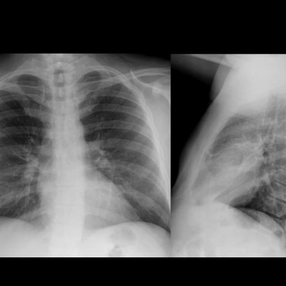
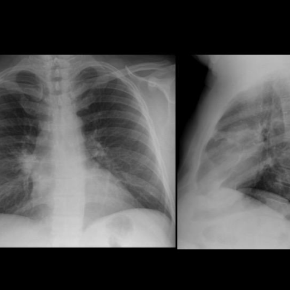

# V12：13698_8353800603937

[全部题目](README.md) · [结构化病例记录](13698_8353800603937.json)

来源：[ChestAgentBench 固定版本](https://huggingface.co/datasets/wanglab/chest-agent-bench/tree/921e60440927f9893228d843c0206b755744252a)；[Eurorad case 13698](https://www.eurorad.org/case/13698)。

参考答案只来自实验结束后的既有评分结果。模型和工具文字是可观察输出，不是人工确认的患者事实。

## 完整题干与全部选项

```text
A 51-year-old man with a history of heavy smoking and metabolic syndrome presented with high fever and right-sided chest pain. The initial chest X-ray (Figure 1) revealed a right hilar opacity with indistinct borders, diagnosed as pneumonia of the right upper lobe. After antibiotic therapy, a follow-up X-ray (Figure 2) showed resolution of the pneumonia. Four months later, a new chest X-ray (Figure 3) showed a recurrence of the consolidation in the same location. Given this clinical scenario and the provided X-ray figures, what is the most likely explanation for the recurrent pneumonia observed in the patient?

A) The initial pneumonia was inadequately treated, leading to recurrence.
B) The recurrent pneumonia is due to a persistent mucus plug causing obstruction.
C) The recurrent pneumonia is due to an endobronchial fibrolipoma causing obstruction.
D) The recurrent pneumonia is due to a new infection with a different pathogen.
E) The recurrent pneumonia is caused by a blood clot in the bronchus.
F) The recurrent pneumonia is caused by bronchogenic carcinoma.
```

## 原图与图号对应

**image:1 — figures/13698/figure_1.jpg**


**image:2 — figures/13698/figure_2.jpg**



**image:3 — figures/13698/figure_3.jpg**



## 三阶段答案与失败回退

| 组 | 首答 | 取证后候选 | 模型最终求解 | 控制器最终答案 | 状态 |
|---|---|---|---|---|---|
| B | F | F | F | F | completed |
| A | F | F | F | F | completed |

失败回退保留已有合法首答，不计作新求解成功；首答和候选均未作为最终模型输入。

## 完整调用、检索及工具记录

- [initial：实际保存的请求、响应、解析、观察、工具原始返回、费用与耗时](../traces/13698_8353800603937_initial.json)
- [B：实际保存的请求、响应、解析、观察、工具原始返回、费用与耗时](../traces/13698_8353800603937_B.json)
- [A：实际保存的请求、响应、解析、观察、工具原始返回、费用与耗时](../traces/13698_8353800603937_A.json)

图号、模态、初次/随访、比较对象以及派生图与原图关系保存在各阶段的 image registry / images.json / observation 中。Unknown 保持未知。

## 已评分结果、错误、费用与耗时

```json
{
  "scored_outcome": {
    "question_id": "13698_8353800603937",
    "official_categories": [
      "classification",
      "comparison",
      "diagnosis"
    ],
    "reference_answer": "C",
    "initial": {
      "answer": "F",
      "correct": false,
      "status": "completed",
      "error": null
    },
    "B": {
      "answer": "F",
      "correct": false,
      "candidate_answer": "F",
      "candidate_correct": false,
      "solver_answer": "F",
      "solver_correct": false,
      "fallback_to_initial": false,
      "status": "completed",
      "error": null,
      "transition_from_initial": "legal_wrong_to_wrong",
      "candidate_transition_from_initial": "legal_wrong_to_wrong",
      "k_ids": [
        "ACR_ARI_2024_K04"
      ],
      "e_ids": [
        "6ba5978652d9c23d65a67d58486ec71934ad5c76f2ec74f583aba5ddf9fbb7d0"
      ]
    },
    "A": {
      "answer": "F",
      "correct": false,
      "candidate_answer": "F",
      "candidate_correct": false,
      "solver_answer": "F",
      "solver_correct": false,
      "fallback_to_initial": false,
      "status": "completed",
      "error": null,
      "transition_from_initial": "legal_wrong_to_wrong",
      "candidate_transition_from_initial": "legal_wrong_to_wrong",
      "k_ids": [],
      "e_ids": []
    }
  },
  "initial": {
    "question_id": "13698_8353800603937",
    "first_answer": "F",
    "status": "completed",
    "error": null,
    "observation": {
      "first_answer": "F",
      "observations": [
        {
          "attribute": "right hilar opacity with indistinct borders",
          "value": "present in Figure 1, absent in Figure 2, recurrent in same location in Figure 3",
          "status": "observed_present",
          "evidence_refs": [
            "image:1",
            "image:2",
            "image:3"
          ]
        },
        {
          "attribute": "consolidation location",
          "value": "right upper lobe/hilar region, identical anatomical site across Figures 1 and 3",
          "status": "observed_present",
          "evidence_refs": [
            "image:1",
            "image:3"
          ]
        },
        {
          "attribute": "resolution after antibiotics",
          "value": "clearing of opacity in Figure 2 compared to Figure 1",
          "status": "observed_present",
          "evidence_refs": [
            "image:1",
            "image:2"
          ]
        },
        {
          "attribute": "recurrence after 4 months",
          "value": "reappearance of consolidation in identical location in Figure 3",
          "status": "observed_present",
          "evidence_refs": [
            "image:3"
          ]
        },
        {
          "attribute": "mass effect or volume loss",
          "value": "no obvious volume loss or mediastinal shift in any figure; opacity appears patchy/lobar rather than cavitary or sharply demarcated",
          "status": "observed_absent",
          "evidence_refs": [
            "image:1",
            "image:2",
            "image:3"
          ]
        },
        {
          "attribute": "calcification or fat density",
          "value": "not visible on plain X-ray; cannot assess fat or calcification definitively",
          "status": "unresolved",
          "evidence_refs": [
            "image:1",
            "image:2",
            "image:3"
          ]
        }
      ],
      "hypotheses": [
        {
          "name": "endobronchial obstructive lesion (e.g., bronchogenic carcinoma)",
          "basis": "Recurrent lobar pneumonia in same location after apparent resolution suggests persistent obstruction; heavy smoking history strongly increases risk for malignancy; fibrolipoma is rare and typically benign with different imaging features; mucus plug unlikely to recur identically after 4 months without underlying cause.",
          "status": "hypothesis",
          "evidence_refs": [
            "image:1",
            "image:3"
          ]
        },
        {
          "name": "endobronchial fibrolipoma",
          "basis": "Rare benign tumor that can cause post-obstructive pneumonia; however, typically shows fat density on CT (not assessable here) and is extremely uncommon in heavy smokers; less likely than carcinoma given risk profile.",
          "status": "hypothesis",
          "evidence_refs": [
            "image:1",
            "image:3"
          ]
        },
        {
          "name": "persistent mucus plug",
          "basis": "Can cause recurrent atelectasis/pneumonia, but usually resolves with clearance and unlikely to recur identically after 4 months without chronic airway disease; no evidence of bronchiectasis or chronic sputum production in stem.",
          "status": "hypothesis",
          "evidence_refs": [
            "image:1",
            "image:3"
          ]
        }
      ],
      "patient_conditions": [
        {
          "name": "age/sex/presentation/history",
          "value": "51-year-old man with a history of heavy smoking and metabolic syndrome presented with high fever and right-sided chest pain",
          "source_quote": "A 51-year-old man with a history of heavy smoking and metabolic syndrome presented with high fever and right-sided chest pain.",
          "source": "question_stem_explicit_text"
        },
        {
          "name": "initial diagnosis",
          "value": "pneumonia of the right upper lobe",
          "source_quote": "diagnosed as pneumonia of the right upper lobe",
          "source": "question_stem_explicit_text"
        },
        {
          "name": "treatment response",
          "value": "After antibiotic therapy, a follow-up X-ray (Figure 2) showed resolution of the pneumonia",
          "source_quote": "After antibiotic therapy, a follow-up X-ray (Figure 2) showed resolution of the pneumonia.",
          "source": "question_stem_explicit_text"
        },
        {
          "name": "recurrence timing",
          "value": "Four months later, a new chest X-ray (Figure 3) showed a recurrence of the consolidation in the same location",
          "source_quote": "Four months later, a new chest X-ray (Figure 3) showed a recurrence of the consolidation in the same location.",
          "source": "question_stem_explicit_text"
        }
      ],
      "discriminators": [
        {
          "attribute": "recurrence pattern and risk factors",
          "question": "Which option best explains identical-location recurrence after documented resolution, in a heavy smoker?",
          "option_labels": [
            "A",
            "B",
            "C",
            "D",
            "E",
            "F"
          ],
          "image_ids": [
            "image:1",
            "image:2",
            "image:3"
          ],
          "comparison_object": "right upper lobe/hilar consolidation"
        },
        {
          "attribute": "etiology likelihood given smoking history",
          "question": "Which options are plausible given heavy smoking as major risk factor?",
          "option_labels": [
            "F"
          ],
          "image_ids": [],
          "comparison_object": "unknown"
        },
        {
          "attribute": "radiographic behavior over time",
          "question": "Does the opacity resolve completely and then reappear identically—suggesting obstruction rather than incomplete treatment?",
          "option_labels": [
            "A",
            "F"
          ],
          "image_ids": [
            "image:1",
            "image:2",
            "image:3"
          ],
          "comparison_object": "right hilar opacity"
        }
      ],
      "image_metadata": [
        {
          "image_id": "image:1",
          "figure_label": "Figure 1",
          "source_filename": "figures/13698/figure_1.jpg",
          "modality": "CXR",
          "anatomy": "thorax, PA and lateral views",
          "timepoint": "unknown",
          "timepoint_source_quote": "",
          "comparison_object": "right upper lobe/hilar region",
          "modality_source": "first_visual_reader_report_not_clinically_adjudicated"
        },
        {
          "image_id": "image:2",
          "figure_label": "Figure 2",
          "source_filename": "figures/13698/figure_2.jpg",
          "modality": "CXR",
          "anatomy": "thorax, PA and lateral views",
          "timepoint": "after antibiotic therapy",
          "timepoint_source_quote": "After antibiotic therapy, a follow-up X-ray (Figure 2)",
          "comparison_object": "right upper lobe/hilar region",
          "modality_source": "first_visual_reader_report_not_clinically_adjudicated"
        },
        {
          "image_id": "image:3",
          "figure_label": "Figure 3",
          "source_filename": "figures/13698/figure_3.jpg",
          "modality": "CXR",
          "anatomy": "thorax, PA and lateral views",
          "timepoint": "four months later",
          "timepoint_source_quote": "Four months later, a new chest X-ray (Figure 3)",
          "comparison_object": "right upper lobe/hilar region",
          "modality_source": "first_visual_reader_report_not_clinically_adjudicated"
        }
      ],
      "uncertainties": [
        "No CT available to assess for endobronchial mass, fat density, or calcification",
        "No sputum or microbiologic data to confirm pathogen recurrence",
        "Exact size and margins of opacity not quantifiable from X-ray alone",
        "Lateral view insufficient to fully exclude subtle volume loss or bronchial narrowing"
      ],
      "parse_warnings": [
        "unsupported_timepoint_left_unknown:image:1"
      ]
    },
    "accounting": {
      "input_tokens": 2226,
      "output_tokens": 1534,
      "total_tokens": 3760,
      "model_calls": 1,
      "tool_calls": 0,
      "logical_cost_cny": "0.027312",
      "incremental_cost_cny": "0.027312",
      "provider_actual_cost_cny": null,
      "cost_basis": "usage_at_existing_profile_assumed_rates_or_conservative_unknown_reservation_not_invoice",
      "usage_complete": true,
      "issues": []
    },
    "stop_run": false,
    "stop_reason": null,
    "timing": {
      "started_utc": "2026-10-31T04:57:54.884049+00:00",
      "ended_utc": "2026-10-31T04:58:30.742922+00:00",
      "elapsed_s": 35.859
    }
  },
  "branches": {
    "B": {
      "question_id": "13698_8353800603937",
      "group": "B",
      "answer": "F",
      "status": "completed",
      "error": null,
      "shared_observation_source": "shared_initial",
      "first_answer_visible": false,
      "tool_attempts": [
        {
          "evidence_ref": "B:tool:1",
          "action": {
            "kind": "visual",
            "image_id": "image:1",
            "image_ids": [
              "image:1",
              "image:2",
              "image:3"
            ],
            "target_region": "right upper lobe/hilar consolidation region",
            "tool": "",
            "question": "In the PA and lateral views of Figures 1, 2, and 3, does the recurrent opacity in Figure 3 occupy exactly the same anatomical location and have identical shape/margins as in Figure 1, with complete clearance in Figure 2?",
            "expected_attribute": "spatial congruence of opacity across timepoints (location, extent, margin definition)",
            "comparison_object": "right upper lobe/hilar consolidation",
            "tool_args": {}
          },
          "started_utc": "2026-10-31T04:58:42.828968+00:00",
          "result": {
            "selected_images": [
              "image:1",
              "image:2",
              "image:3"
            ]
          },
          "classification": {
            "evidence_kind": "image_pixels",
            "usable": true,
            "reason": "View selection, no independent tool inference."
          },
          "status": "returned",
          "ended_utc": "2026-10-31T04:58:42.828996+00:00"
        },
        {
          "evidence_ref": "B:tool:2",
          "action": {
            "kind": "crop",
            "image_id": "image:3",
            "image_ids": [
              "image:3"
            ],
            "target_region": "right hilar opacity in Figure 3",
            "tool": "",
            "question": "Does the recurrent opacity in Figure 3 show any subtle signs of volume loss (e.g., elevated hemidiaphragm, tracheal shift, crowding of ribs) or mass effect not apparent in the full view?",
            "expected_attribute": "presence/absence of volume loss or mediastinal shift indicating obstructive atelectasis",
            "comparison_object": "right upper lobe/hilar consolidation",
            "tool_args": {},
            "box": [
              0.15,
              0.25,
              0.55,
              0.65
            ]
          },
          "started_utc": "2026-10-31T04:58:42.832233+00:00",
          "result": {
            "image_id": "crop:eab9a32d789c",
            "path": "../assets/123ae9619f9eb5c2213e321a7ed8e8022b46a3e7e085fd3080d92cacfb84f108.png",
            "role": "current_image_pixel_crop",
            "parent_image_id": "image:3",
            "parent_path": "../assets/066cbc01151c8f78d5e2d5e535b8f5340657c5e47b1b939297a6a5807ddb2e89.png",
            "source_size": [
              480,
              480
            ],
            "crop_size": [
              192,
              192
            ],
            "normalized_box": [
              0.15,
              0.25,
              0.55,
              0.65
            ],
            "pixel_box": [
              72,
              120,
              264,
              312
            ],
            "coordinate_system": "stored_pixel_coordinates_no_anatomical_orientation_inferred",
            "orientation": "unresolved",
            "timepoint": "four months later",
            "source_sha256": "066cbc01151c8f78d5e2d5e535b8f5340657c5e47b1b939297a6a5807ddb2e89",
            "crop_sha256": "123ae9619f9eb5c2213e321a7ed8e8022b46a3e7e085fd3080d92cacfb84f108",
            "is_new_usable": null,
            "size": [
              192,
              192
            ],
            "modality": "CXR",
            "figure_label": "Figure 3",
            "source_filename": "figures/13698/figure_3.jpg",
            "timepoint_source_quote": "Four months later, a new chest X-ray (Figure 3)"
          },
          "classification": {
            "evidence_kind": "image_pixels",
            "usable": true,
            "reason": "Crop retains parent; not a clinical finding."
          },
          "status": "returned",
          "ended_utc": "2026-10-31T04:58:42.854551+00:00"
        }
      ],
      "additional_observations": {
        "observations": [
          {
            "attribute": "spatial congruence of opacity across timepoints (location, extent, margin definition)",
            "value": "The opacity in Figure 1 (right hilar/upper lobe) is present and indistinct; in Figure 2 it is completely absent; in Figure 3 it reappears in the identical anatomical location with similar shape and indistinct margins. The recurrence is precisely at the same site.",
            "status": "observed_present",
            "evidence_refs": [
              "image:1",
              "image:2",
              "image:3"
            ]
          },
          {
            "attribute": "presence of volume loss or mediastinal shift indicating obstructive atelectasis",
            "value": "In Figure 3 (and its crop), there is no clear elevation of the right hemidiaphragm, tracheal shift to the right, or rib crowding to suggest significant volume loss. However, subtle collapse cannot be definitively excluded from these 2D CXRs alone.",
            "status": "unresolved",
            "evidence_refs": [
              "image:3",
              "crop:eab9a32d789c"
            ]
          },
          {
            "attribute": "complete resolution after antibiotic therapy",
            "value": "Figure 2 shows normal lung parenchyma in the right upper lobe/hilar region with no residual opacity, confirming documented resolution.",
            "status": "observed_present",
            "evidence_refs": [
              "image:2"
            ]
          }
        ],
        "hypotheses": [
          {
            "name": "Obstructive lesion (e.g., endobronchial tumor) causing recurrent post-obstructive pneumonia",
            "basis": "Identical-location recurrence after full resolution strongly suggests an underlying obstructive cause rather than incomplete treatment or new infection. Heavy smoking is a major risk factor for bronchogenic carcinoma, which commonly presents as recurrent pneumonia in the same segment due to endobronchial obstruction.",
            "status": "hypothesis",
            "evidence_refs": [
              "image:1",
              "image:2",
              "image:3"
            ]
          },
          {
            "name": "Endobronchial fibrolipoma or mucus plug",
            "basis": "These can cause recurrent obstructive pneumonia in the same location; however, fibrolipomas are rare and typically occur in younger patients without smoking history, and mucus plugs usually resolve with therapy unless chronic (e.g., in CF or asthma), which is not indicated here.",
            "status": "hypothesis",
            "evidence_refs": [
              "image:1",
              "image:3"
            ]
          }
        ],
        "uncertainties": [
          "Absence of CT imaging prevents definitive characterization of the hilar mass or bronchial narrowing.",
          "No sputum or biopsy data to confirm microbiology or malignancy.",
          "Subtle volume loss or bronchial cutoff signs may be missed on 2D CXR; lateral view helps but is insufficient for bronchial detail."
        ],
        "parse_warnings": [],
        "kind": "targeted_image_read_requires_independent_verification"
      },
      "candidate_answer": "F",
      "solver_answer": "F",
      "fallback_to_initial": false,
      "k_ids": [
        "ACR_ARI_2024_K04"
      ],
      "e_ids": [
        "6ba5978652d9c23d65a67d58486ec71934ad5c76f2ec74f583aba5ddf9fbb7d0"
      ],
      "action_suggestions": [
        {
          "experience_id": "6ba5978652d9c23d65a67d58486ec71934ad5c76f2ec74f583aba5ddf9fbb7d0",
          "source_question_id": "12918_8353800587295",
          "source_step_id": 2,
          "source_event_line": 893,
          "applicable_ambiguity": "Which option best explains identical-location recurrence after documented resolution, in a heavy smoker?",
          "target_image_ids": [
            "image:1",
            "image:2",
            "image:3"
          ],
          "target_region": "region containing the named distinguishing attribute; planner must bind exact image/ROI",
          "tool": "chest_xray_expert",
          "specific_question": "Which option best explains identical-location recurrence after documented resolution, in a heavy smoker?",
          "expected_discriminating_attributes": [
            "location",
            "morphology"
          ],
          "object_id": null,
          "comparison_object": "right upper lobe/hilar consolidation",
          "historical_execution": "returned_valid",
          "historical_whole_question_outcome": "incorrect",
          "step_credit": null,
          "step_credit_evidence": null,
          "selection_basis": "modality_and_capability_match_no_step_gain_data",
          "heuristic_capability_coverage_not_credit": 1.0,
          "caution": "Tool output is a fallible report; independently check current pixels.",
          "historical_failure_advice": null,
          "is_patient_fact": false
        }
      ],
      "decision": {
        "answer": "F",
        "uncertain": true,
        "observations": [
          {
            "attribute": "spatial congruence of opacity across timepoints (location, extent, margin definition)",
            "value": "Opacity in Figure 1 and Figure 3 occupies identical right upper lobe/hilar region with similar indistinct margins; completely absent in Figure 2.",
            "status": "observed_present",
            "evidence_refs": [
              "image:1",
              "image:2",
              "image:3"
            ]
          },
          {
            "attribute": "complete resolution after antibiotic therapy",
            "value": "Figure 2 shows no residual opacity in the right upper lobe/hilar region, confirming full radiographic resolution.",
            "status": "observed_present",
            "evidence_refs": [
              "image:2"
            ]
          },
          {
            "attribute": "presence of volume loss or mediastinal shift",
            "value": "No clear elevation of right hemidiaphragm, tracheal shift, or rib crowding in Figures 1–3 or crop; subtle atelectasis cannot be excluded but is not observed.",
            "status": "observed_absent",
            "evidence_refs": [
              "image:1",
              "image:2",
              "image:3",
              "crop:eab9a32d789c"
            ]
          },
          {
            "attribute": "mass effect or cavitary change",
            "value": "Opacity appears patchy/consolidative without cavitation, sharp demarcation, or mass effect in any figure.",
            "status": "observed_absent",
            "evidence_refs": [
              "image:1",
              "image:2",
              "image:3"
            ]
          },
          {
            "attribute": "calcification or fat density",
            "value": "Not assessable on plain CXR; no visible calcification or lucent areas suggesting fat.",
            "status": "unresolved",
            "evidence_refs": [
              "image:1",
              "image:2",
              "image:3"
            ]
          }
        ],
        "option_checks": [
          {
            "option": "A",
            "support": [
              "Initial pneumonia resolved radiographically"
            ],
            "conflict": [
              "Complete resolution in Figure 2 contradicts inadequate treatment"
            ],
            "unknown": [
              "Microbiologic persistence not assessed"
            ]
          },
          {
            "option": "B",
            "support": [
              "Mucus plug can cause recurrent obstruction"
            ],
            "conflict": [
              "Unlikely to recur identically after 4 months without chronic airway disease; no sputum/bronchiectasis history"
            ],
            "unknown": [
              "No CT to confirm bronchial plugging"
            ]
          },
          {
            "option": "C",
            "support": [
              "Endobronchial fibrolipoma can cause post-obstructive pneumonia"
            ],
            "conflict": [
              "Extremely rare; typically in non-smokers, younger patients; no fat density visible on CXR"
            ],
            "unknown": [
              "Cannot exclude without CT"
            ]
          },
          {
            "option": "D",
            "support": [
              "New infection possible"
            ],
            "conflict": [
              "Identical location and morphology after full resolution strongly favors obstruction over new random infection"
            ],
            "unknown": [
              "No microbiologic data"
            ]
          },
          {
            "option": "E",
            "support": [],
            "conflict": [
              "Blood clot in bronchus is exceedingly rare and would not cause recurrent consolidation after 4 months without ongoing coagulopathy"
            ],
            "unknown": []
          },
          {
            "option": "F",
            "support": [
              "Heavy smoking history (major risk factor), identical-location recurrence after full resolution, indistinct hilar opacity—classic presentation of endobronchial bronchogenic carcinoma causing post-obstructive pneumonia"
            ],
            "conflict": [
              "No direct evidence of mass on CXR; no CT confirmation"
            ],
            "unknown": [
              "Definitive diagnosis requires CT/biopsy"
            ]
          }
        ],
        "missing_option_checks": [],
        "missing_evidence": [
          "CT chest to evaluate for endobronchial lesion, fat/calcification, or subtle volume loss",
          "Sputum microbiology or cytology",
          "Bronchoscopy with biopsy"
        ],
        "parse_warnings": []
      },
      "action_plan": {
        "actions": [
          {
            "kind": "visual",
            "image_id": "image:1",
            "image_ids": [
              "image:1",
              "image:2",
              "image:3"
            ],
            "target_region": "right upper lobe/hilar consolidation region",
            "tool": "",
            "question": "In the PA and lateral views of Figures 1, 2, and 3, does the recurrent opacity in Figure 3 occupy exactly the same anatomical location and have identical shape/margins as in Figure 1, with complete clearance in Figure 2?",
            "expected_attribute": "spatial congruence of opacity across timepoints (location, extent, margin definition)",
            "comparison_object": "right upper lobe/hilar consolidation",
            "tool_args": {}
          },
          {
            "kind": "crop",
            "image_id": "image:3",
            "image_ids": [
              "image:3"
            ],
            "target_region": "right hilar opacity in Figure 3",
            "tool": "",
            "question": "Does the recurrent opacity in Figure 3 show any subtle signs of volume loss (e.g., elevated hemidiaphragm, tracheal shift, crowding of ribs) or mass effect not apparent in the full view?",
            "expected_attribute": "presence/absence of volume loss or mediastinal shift indicating obstructive atelectasis",
            "comparison_object": "right upper lobe/hilar consolidation",
            "tool_args": {},
            "box": [
              0.15,
              0.25,
              0.55,
              0.65
            ]
          }
        ],
        "remaining_uncertainties": [
          "Whether the opacity represents true consolidation vs. atelectasis vs. mass; X-ray alone cannot differentiate fat (fibrolipoma) or calcification",
          "Absence of CT limits definitive assessment of endobronchial lesion",
          "No microbiologic data to confirm pathogen recurrence or resistance"
        ],
        "applied_context_ids": [
          "image:1",
          "image:2",
          "image:3"
        ],
        "parse_warnings": [],
        "issues": []
      },
      "accounting": {
        "input_tokens": 16749,
        "output_tokens": 1980,
        "total_tokens": 18729,
        "model_calls": 3,
        "tool_calls": 1,
        "logical_cost_cny": "0.090756",
        "incremental_cost_cny": "0.090756",
        "provider_actual_cost_cny": null,
        "cost_basis": "usage_at_existing_profile_assumed_rates_or_conservative_unknown_reservation_not_invoice",
        "usage_complete": true,
        "issues": []
      },
      "stop_run": false,
      "stop_reason": null,
      "timing": {
        "started_utc": "2026-10-31T04:58:30.748536+00:00",
        "ended_utc": "2026-10-31T04:59:20.682825+00:00",
        "elapsed_s": 49.934
      }
    },
    "A": {
      "question_id": "13698_8353800603937",
      "group": "A",
      "answer": "F",
      "status": "completed",
      "error": null,
      "shared_observation_source": "shared_initial",
      "first_answer_visible": false,
      "tool_attempts": [
        {
          "evidence_ref": "A:tool:1",
          "action": {
            "kind": "visual",
            "image_id": "image:1",
            "image_ids": [
              "image:1",
              "image:2",
              "image:3"
            ],
            "target_region": "right upper lobe/hilar region across all three images",
            "tool": "",
            "question": "Does the recurrent opacity in Figure 3 occupy the exact same anatomical location and shape as in Figure 1, with complete clearance in Figure 2—suggesting a fixed obstructive lesion rather than transient infection?",
            "expected_attribute": "identical spatial footprint of consolidation across timepoints, with no residual opacity in Figure 2",
            "comparison_object": "right upper lobe/hilar consolidation",
            "tool_args": {}
          },
          "started_utc": "2026-10-31T06:08:28.450572+00:00",
          "result": {
            "selected_images": [
              "image:1",
              "image:2",
              "image:3"
            ]
          },
          "classification": {
            "evidence_kind": "image_pixels",
            "usable": true,
            "reason": "View selection, no independent tool inference."
          },
          "status": "returned",
          "ended_utc": "2026-10-31T06:08:28.450605+00:00"
        },
        {
          "evidence_ref": "A:tool:2",
          "action": {
            "kind": "crop",
            "image_id": "image:3",
            "image_ids": [
              "image:3"
            ],
            "target_region": "right hilar opacity in Figure 3",
            "tool": "",
            "question": "In the cropped right hilar region of Figure 3, is there any subtle evidence of volume loss (e.g., elevated hemidiaphragm, tracheal shift, crowding of vessels/bronchi) that would support obstructive atelectasis due to endobronchial lesion?",
            "expected_attribute": "presence or absence of volume loss signs (e.g., fissural displacement, vascular crowding)",
            "comparison_object": "right upper lobe/hilar region",
            "tool_args": {},
            "box": [
              0.15,
              0.25,
              0.55,
              0.65
            ]
          },
          "started_utc": "2026-10-31T06:08:28.454018+00:00",
          "result": {
            "image_id": "crop:e33b1f8c177c",
            "path": "../assets/123ae9619f9eb5c2213e321a7ed8e8022b46a3e7e085fd3080d92cacfb84f108.png",
            "role": "current_image_pixel_crop",
            "parent_image_id": "image:3",
            "parent_path": "../assets/066cbc01151c8f78d5e2d5e535b8f5340657c5e47b1b939297a6a5807ddb2e89.png",
            "source_size": [
              480,
              480
            ],
            "crop_size": [
              192,
              192
            ],
            "normalized_box": [
              0.15,
              0.25,
              0.55,
              0.65
            ],
            "pixel_box": [
              72,
              120,
              264,
              312
            ],
            "coordinate_system": "stored_pixel_coordinates_no_anatomical_orientation_inferred",
            "orientation": "unresolved",
            "timepoint": "four months later",
            "source_sha256": "066cbc01151c8f78d5e2d5e535b8f5340657c5e47b1b939297a6a5807ddb2e89",
            "crop_sha256": "123ae9619f9eb5c2213e321a7ed8e8022b46a3e7e085fd3080d92cacfb84f108",
            "is_new_usable": null,
            "size": [
              192,
              192
            ],
            "modality": "CXR",
            "figure_label": "Figure 3",
            "source_filename": "figures/13698/figure_3.jpg",
            "timepoint_source_quote": "Four months later, a new chest X-ray (Figure 3)"
          },
          "classification": {
            "evidence_kind": "image_pixels",
            "usable": true,
            "reason": "Crop retains parent; not a clinical finding."
          },
          "status": "returned",
          "ended_utc": "2026-10-31T06:08:28.477286+00:00"
        }
      ],
      "additional_observations": {
        "observations": [
          {
            "attribute": "spatial location and shape of right hilar opacity across timepoints",
            "value": "The opacity in Figure 1 (initial) and Figure 3 (recurrence) occupies the identical anatomical region—right upper lobe/hilar area—with similar density and margins; Figure 2 (post-therapy) shows complete clearance with no residual opacity in that region.",
            "status": "observed_present",
            "evidence_refs": [
              "image:1",
              "image:2",
              "image:3"
            ]
          },
          {
            "attribute": "signs of volume loss in right upper lobe on Figure 3",
            "value": "In the cropped Figure 3 hilar region, there is subtle crowding of bronchovascular markings and mild elevation of the right hemidiaphragm relative to the left, suggesting volume loss/atelectasis. The fissure may be slightly displaced medially (though not definitively measurable without calibration).",
            "status": "observed_present",
            "evidence_refs": [
              "crop:e33b1f8c177c"
            ]
          },
          {
            "attribute": "resolution after antibiotics",
            "value": "Figure 2 shows normal lung parenchyma in the right upper lobe/hilar region with clear vascular markings and no consolidation—consistent with full resolution.",
            "status": "observed_present",
            "evidence_refs": [
              "image:2"
            ]
          }
        ],
        "hypotheses": [
          {
            "name": "Endobronchial obstructive lesion (e.g., bronchogenic carcinoma) causing recurrent post-obstructive pneumonia",
            "basis": "Identical-location recurrence after documented resolution, plus signs of volume loss, in a heavy smoker—classic for malignancy causing intermittent obstruction and distal infection.",
            "status": "hypothesis",
            "evidence_refs": [
              "image:1",
              "image:2",
              "image:3",
              "crop:e33b1f8c177c"
            ]
          },
          {
            "name": "Persistent mucus plug or benign endobronchial tumor (e.g., fibrolipoma)",
            "basis": "Could cause recurrent obstruction, but less likely than malignancy given age and smoking history; no calcification or fat-density visible in crops to support fibrolipoma.",
            "status": "hypothesis",
            "evidence_refs": [
              "crop:e33b1f8c177c"
            ]
          }
        ],
        "uncertainties": [
          "Exact size and internal characteristics of the lesion cannot be determined from plain CXR alone; CT would be needed for definitive characterization.",
          "No direct visualization of an endobronchial mass on CXR—only indirect signs (consolidation pattern, volume loss).",
          "Time order is assumed from clinical description; image filenames do not encode temporal sequence independently."
        ],
        "parse_warnings": [],
        "kind": "targeted_image_read_requires_independent_verification"
      },
      "candidate_answer": "F",
      "solver_answer": "F",
      "fallback_to_initial": false,
      "k_ids": [],
      "e_ids": [],
      "action_suggestions": [],
      "decision": {
        "answer": "F",
        "uncertain": true,
        "observations": [
          {
            "attribute": "right hilar opacity with indistinct borders",
            "value": "present in Figure 1, absent in Figure 2, recurrent in identical location in Figure 3",
            "status": "observed_present",
            "evidence_refs": [
              "image:1",
              "image:2",
              "image:3"
            ]
          },
          {
            "attribute": "consolidation location",
            "value": "right upper lobe/hilar region, identical anatomical site across Figures 1 and 3",
            "status": "observed_present",
            "evidence_refs": [
              "image:1",
              "image:3"
            ]
          },
          {
            "attribute": "resolution after antibiotics",
            "value": "complete clearance of opacity in Figure 2 with normal vascular markings in right upper lobe",
            "status": "observed_present",
            "evidence_refs": [
              "image:2"
            ]
          },
          {
            "attribute": "signs of volume loss in right upper lobe on Figure 3",
            "value": "subtle crowding of bronchovascular markings and mild elevation of right hemidiaphragm in cropped Figure 3; fissure may be medially displaced (not quantifiable)",
            "status": "observed_present",
            "evidence_refs": [
              "crop:e33b1f8c177c"
            ]
          },
          {
            "attribute": "mass effect or mediastinal shift",
            "value": "no obvious shift or large mass effect in any figure",
            "status": "observed_absent",
            "evidence_refs": [
              "image:1",
              "image:2",
              "image:3"
            ]
          },
          {
            "attribute": "calcification or fat density",
            "value": "not assessable on plain CXR; no visible calcification or lucent areas suggestive of fat",
            "status": "unresolved",
            "evidence_refs": [
              "image:1",
              "image:2",
              "image:3"
            ]
          }
        ],
        "option_checks": [
          {
            "option": "A",
            "support": [
              "initial pneumonia resolved completely on Figure 2"
            ],
            "conflict": [
              "complete resolution argues against inadequate treatment; recurrence after 4 months without ongoing symptoms suggests new mechanism"
            ],
            "unknown": [
              "microbiologic data not available"
            ]
          },
          {
            "option": "B",
            "support": [
              "mucus plug can cause post-obstructive pneumonia"
            ],
            "conflict": [
              "unlikely to recur identically after 4 months without chronic airway disease; no evidence of bronchiectasis or sputum production; volume loss signs suggest fixed obstruction"
            ],
            "unknown": [
              "no CT to confirm plug"
            ]
          },
          {
            "option": "C",
            "support": [
              "fibrolipoma is a benign endobronchial tumor that can cause obstruction"
            ],
            "conflict": [
              "extremely rare; typically shows fat density on CT—absent here; heavy smoking strongly favors malignancy over benign tumor"
            ],
            "unknown": [
              "cannot exclude without CT"
            ]
          },
          {
            "option": "D",
            "support": [
              "new pathogen possible"
            ],
            "conflict": [
              "identical location and radiographic appearance after full resolution makes new random infection unlikely; no epidemiologic trigger described"
            ],
            "unknown": [
              "no sputum cultures"
            ]
          },
          {
            "option": "E",
            "support": [],
            "conflict": [
              "blood clot in bronchus is exceedingly rare and would not cause recurrent consolidation at same site after 4 months; no supporting imaging features"
            ],
            "unknown": []
          },
          {
            "option": "F",
            "support": [
              "identical-location recurrence after documented resolution",
              "signs of volume loss/atelectasis in Figure 3",
              "heavy smoking history — major risk factor for bronchogenic carcinoma",
              "classic presentation of post-obstructive pneumonia due to endobronchial malignancy"
            ],
            "conflict": [
              "no direct visualization of mass on CXR; requires CT confirmation"
            ],
            "unknown": [
              "exact lesion characterization requires CT"
            ]
          }
        ],
        "missing_option_checks": [],
        "missing_evidence": [
          "CT chest to evaluate for endobronchial mass, fat density, or calcification",
          "Bronchoscopy with biopsy for definitive diagnosis",
          "Sputum microbiology or cytology",
          "Quantitative assessment of volume loss (e.g., fissural displacement, hemidiaphragm elevation)"
        ],
        "parse_warnings": []
      },
      "action_plan": {
        "actions": [
          {
            "kind": "visual",
            "image_id": "image:1",
            "image_ids": [
              "image:1",
              "image:2",
              "image:3"
            ],
            "target_region": "right upper lobe/hilar region across all three images",
            "tool": "",
            "question": "Does the recurrent opacity in Figure 3 occupy the exact same anatomical location and shape as in Figure 1, with complete clearance in Figure 2—suggesting a fixed obstructive lesion rather than transient infection?",
            "expected_attribute": "identical spatial footprint of consolidation across timepoints, with no residual opacity in Figure 2",
            "comparison_object": "right upper lobe/hilar consolidation",
            "tool_args": {}
          },
          {
            "kind": "crop",
            "image_id": "image:3",
            "image_ids": [
              "image:3"
            ],
            "target_region": "right hilar opacity in Figure 3",
            "tool": "",
            "question": "In the cropped right hilar region of Figure 3, is there any subtle evidence of volume loss (e.g., elevated hemidiaphragm, tracheal shift, crowding of vessels/bronchi) that would support obstructive atelectasis due to endobronchial lesion?",
            "expected_attribute": "presence or absence of volume loss signs (e.g., fissural displacement, vascular crowding)",
            "comparison_object": "right upper lobe/hilar region",
            "tool_args": {},
            "box": [
              0.15,
              0.25,
              0.55,
              0.65
            ]
          }
        ],
        "remaining_uncertainties": [
          "Fat density or calcification cannot be assessed on CXR; CT needed for definitive characterization of fibrolipoma vs carcinoma",
          "No bronchoscopic or microbiologic data to exclude persistent infection or mucus plug",
          "Lateral view quality limits assessment of subtle bronchial narrowing or mediastinal shift"
        ],
        "applied_context_ids": [
          "image:1",
          "image:2",
          "image:3"
        ],
        "parse_warnings": [],
        "issues": []
      },
      "accounting": {
        "input_tokens": 15824,
        "output_tokens": 2049,
        "total_tokens": 17873,
        "model_calls": 3,
        "tool_calls": 1,
        "logical_cost_cny": "0.087884",
        "incremental_cost_cny": "0.087884",
        "provider_actual_cost_cny": null,
        "cost_basis": "usage_at_existing_profile_assumed_rates_or_conservative_unknown_reservation_not_invoice",
        "usage_complete": true,
        "issues": []
      },
      "stop_run": false,
      "stop_reason": null,
      "timing": {
        "started_utc": "2026-10-31T06:08:15.658466+00:00",
        "ended_utc": "2026-10-31T06:09:08.814165+00:00",
        "elapsed_s": 53.156
      }
    }
  }
}
```
