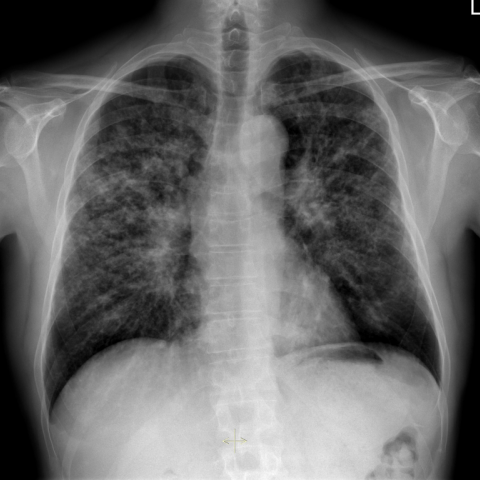

# V12：14838_8353800529839

[全部题目](README.md) · [结构化病例记录](14838_8353800529839.json)

来源：[ChestAgentBench 固定版本](https://huggingface.co/datasets/wanglab/chest-agent-bench/tree/921e60440927f9893228d843c0206b755744252a)；[Eurorad case 14838](https://www.eurorad.org/case/14838)。

参考答案只来自实验结束后的既有评分结果。模型和工具文字是可观察输出，不是人工确认的患者事实。

## 完整题干与全部选项

```text
Based on the chest X-ray findings in Figure 1a and 1b, which of the following statements best aligns with the diagnosis of stage 2 sarcoidosis, and what is the rationale behind this conclusion?

A) Diffuse nodular opacities are predominantly located in the lower lung lobes, which is consistent with stage 2 sarcoidosis due to the presence of bilateral hilar lymphadenopathy.
B) Diffuse nodular opacities are predominantly located in the upper lung lobes with moderate bilateral hilar lymphadenopathy, which is consistent with stage 2 sarcoidosis.
C) Diffuse nodular opacities are predominantly located in the lower lung lobes with moderate unilateral hilar lymphadenopathy, suggesting an alternative diagnosis rather than stage 2 sarcoidosis.
D) There are no nodular opacities present, but moderate bilateral hilar lymphadenopathy suggests stage 1 sarcoidosis.
E) Diffuse nodular opacities are predominantly located in the middle lung lobes with no hilar lymphadenopathy, suggesting stage 0 sarcoidosis.
F) Diffuse nodular opacities are present throughout all lung zones with massive pleural effusion, indicating advanced sarcoidosis.
```

## 原图与图号对应

**image:1 — figures/14838/figure_1a.jpg**



**image:2 — figures/14838/figure_1b.jpg**


## 三阶段答案与失败回退

| 组 | 首答 | 取证后候选 | 模型最终求解 | 控制器最终答案 | 状态 |
|---|---|---|---|---|---|
| B | B | B | B | B | completed |
| A | B | B | B | B | completed |

失败回退保留已有合法首答，不计作新求解成功；首答和候选均未作为最终模型输入。

## 完整调用、检索及工具记录

- [initial：实际保存的请求、响应、解析、观察、工具原始返回、费用与耗时](../traces/14838_8353800529839_initial.json)
- [B：实际保存的请求、响应、解析、观察、工具原始返回、费用与耗时](../traces/14838_8353800529839_B.json)
- [A：实际保存的请求、响应、解析、观察、工具原始返回、费用与耗时](../traces/14838_8353800529839_A.json)

图号、模态、初次/随访、比较对象以及派生图与原图关系保存在各阶段的 image registry / images.json / observation 中。Unknown 保持未知。

## 已评分结果、错误、费用与耗时

```json
{
  "scored_outcome": {
    "question_id": "14838_8353800529839",
    "official_categories": [
      "classification",
      "comparison",
      "diagnosis"
    ],
    "reference_answer": "B",
    "initial": {
      "answer": "B",
      "correct": true,
      "status": "completed",
      "error": null
    },
    "B": {
      "answer": "B",
      "correct": true,
      "candidate_answer": "B",
      "candidate_correct": true,
      "solver_answer": "B",
      "solver_correct": true,
      "fallback_to_initial": false,
      "status": "completed",
      "error": null,
      "transition_from_initial": "correct_to_correct",
      "candidate_transition_from_initial": "correct_to_correct",
      "k_ids": [
        "BTS_PLEURAL_2023_K01"
      ],
      "e_ids": [
        "039bf4ec8536eef67cd5d58153db3a62501b8917816066e57e7b2d66d4b05d43"
      ]
    },
    "A": {
      "answer": "B",
      "correct": true,
      "candidate_answer": "B",
      "candidate_correct": true,
      "solver_answer": "B",
      "solver_correct": true,
      "fallback_to_initial": false,
      "status": "completed",
      "error": null,
      "transition_from_initial": "correct_to_correct",
      "candidate_transition_from_initial": "correct_to_correct",
      "k_ids": [],
      "e_ids": []
    }
  },
  "initial": {
    "question_id": "14838_8353800529839",
    "first_answer": "B",
    "status": "completed",
    "error": null,
    "observation": {
      "first_answer": "B",
      "observations": [
        {
          "attribute": "bilateral hilar lymphadenopathy",
          "value": "present and moderate in size, symmetrically enlarged hila visible on PA view (Figure 1a)",
          "status": "observed_present",
          "evidence_refs": [
            "image:1"
          ]
        },
        {
          "attribute": "nodular opacities distribution",
          "value": "diffuse fine nodular opacities predominantly in upper and mid lung zones, sparing lower zones; more prominent in upper lobes on both PA and lateral views",
          "status": "observed_present",
          "evidence_refs": [
            "image:1",
            "image:2"
          ]
        },
        {
          "attribute": "pleural effusion",
          "value": "absent; no blunting of costophrenic angles or meniscus sign",
          "status": "observed_absent",
          "evidence_refs": [
            "image:1"
          ]
        },
        {
          "attribute": "unilateral vs bilateral hilar involvement",
          "value": "bilateral, symmetric hilar enlargement",
          "status": "observed_present",
          "evidence_refs": [
            "image:1"
          ]
        },
        {
          "attribute": "middle lobe predominance",
          "value": "not observed; middle lobe not selectively involved",
          "status": "observed_absent",
          "evidence_refs": [
            "image:1",
            "image:2"
          ]
        },
        {
          "attribute": "lower lobe predominance",
          "value": "not observed; lower zones relatively spared compared to upper/mid zones",
          "status": "observed_absent",
          "evidence_refs": [
            "image:1",
            "image:2"
          ]
        }
      ],
      "hypotheses": [
        {
          "name": "Stage 2 sarcoidosis (bilateral hilar lymphadenopathy + parenchymal infiltrates)",
          "basis": "Classic radiographic pattern: symmetric bilateral hilar adenopathy plus diffuse micronodular opacities with upper lobe predominance matches Scadding staging criteria for stage 2",
          "status": "hypothesis",
          "evidence_refs": [
            "image:1",
            "image:2"
          ]
        },
        {
          "name": "Infectious granulomatous disease (e.g., tuberculosis, fungal infection)",
          "basis": "Upper lobe predominant nodularity with hilar adenopathy can mimic sarcoidosis; requires clinical correlation and microbiologic workup",
          "status": "hypothesis",
          "evidence_refs": [
            "image:1",
            "image:2"
          ]
        }
      ],
      "patient_conditions": [],
      "discriminators": [
        {
          "attribute": "lobar distribution of nodular opacities",
          "question": "Which option correctly identifies upper lobe predominance of nodules?",
          "option_labels": [
            "A",
            "B",
            "C",
            "E",
            "F"
          ],
          "image_ids": [
            "image:1",
            "image:2"
          ],
          "comparison_object": "lung parenchyma"
        },
        {
          "attribute": "hilar lymphadenopathy laterality and severity",
          "question": "Which option correctly specifies bilateral and moderate hilar adenopathy?",
          "option_labels": [
            "A",
            "B",
            "D"
          ],
          "image_ids": [
            "image:1"
          ],
          "comparison_object": "hilar regions"
        },
        {
          "attribute": "presence of pleural effusion",
          "question": "Which option incorrectly includes massive pleural effusion?",
          "option_labels": [
            "F"
          ],
          "image_ids": [
            "image:1"
          ],
          "comparison_object": "pleural spaces"
        },
        {
          "attribute": "stage classification match",
          "question": "Which option aligns with Scadding stage 2 (hilar adenopathy + parenchymal disease)?",
          "option_labels": [
            "B"
          ],
          "image_ids": [
            "image:1",
            "image:2"
          ],
          "comparison_object": "overall radiographic pattern"
        }
      ],
      "image_metadata": [
        {
          "image_id": "image:1",
          "figure_label": "Figure 1a",
          "source_filename": "figures/14838/figure_1a.jpg",
          "modality": "CXR",
          "anatomy": "thorax, PA view",
          "timepoint": "unknown",
          "timepoint_source_quote": "",
          "comparison_object": "chest",
          "modality_source": "first_visual_reader_report_not_clinically_adjudicated"
        },
        {
          "image_id": "image:2",
          "figure_label": "Figure 1b",
          "source_filename": "figures/14838/figure_1b.jpg",
          "modality": "CXR",
          "anatomy": "thorax, lateral view",
          "timepoint": "unknown",
          "timepoint_source_quote": "",
          "comparison_object": "chest",
          "modality_source": "first_visual_reader_report_not_clinically_adjudicated"
        }
      ],
      "uncertainties": [
        "No clinical history, labs, or biopsy provided; diagnosis remains radiographic impression only",
        "Exact timing between Figure 1a and 1b not specified; assumed same exam (PA and lateral)",
        "No confirmation of granulomatous etiology; alternative diagnoses not ruled out",
        "Quantitative assessment of lymph node size not possible from images alone"
      ],
      "parse_warnings": []
    },
    "accounting": {
      "input_tokens": 1777,
      "output_tokens": 1063,
      "total_tokens": 2840,
      "model_calls": 1,
      "tool_calls": 0,
      "logical_cost_cny": "0.019864",
      "incremental_cost_cny": "0.019864",
      "provider_actual_cost_cny": null,
      "cost_basis": "usage_at_existing_profile_assumed_rates_or_conservative_unknown_reservation_not_invoice",
      "usage_complete": true,
      "issues": []
    },
    "stop_run": false,
    "stop_reason": null,
    "timing": {
      "started_utc": "2026-10-31T05:01:50.253769+00:00",
      "ended_utc": "2026-10-31T05:02:14.761953+00:00",
      "elapsed_s": 24.508
    }
  },
  "branches": {
    "B": {
      "question_id": "14838_8353800529839",
      "group": "B",
      "answer": "B",
      "status": "completed",
      "error": null,
      "shared_observation_source": "shared_initial",
      "first_answer_visible": false,
      "tool_attempts": [
        {
          "evidence_ref": "B:tool:1",
          "action": {
            "kind": "visual",
            "image_id": "image:1",
            "image_ids": [
              "image:1",
              "image:2"
            ],
            "target_region": "upper lung zones (above the level of the carina) on PA and lateral views to confirm nodular opacity predominance",
            "tool": "",
            "question": "Are diffuse fine nodular opacities predominantly located in the upper lung lobes, as opposed to lower or middle lobes?",
            "expected_attribute": "upper lobe predominance of micronodules",
            "comparison_object": "lung parenchyma",
            "tool_args": {}
          },
          "started_utc": "2026-10-31T05:02:25.305498+00:00",
          "result": {
            "selected_images": [
              "image:1",
              "image:2"
            ]
          },
          "classification": {
            "evidence_kind": "image_pixels",
            "usable": true,
            "reason": "View selection, no independent tool inference."
          },
          "status": "returned",
          "ended_utc": "2026-10-31T05:02:25.305527+00:00"
        },
        {
          "evidence_ref": "B:tool:2",
          "action": {
            "kind": "crop",
            "image_id": "image:2",
            "image_ids": [
              "image:2"
            ],
            "target_region": "hilar regions on lateral view to verify bilateral symmetric enlargement and exclude unilateral dominance",
            "tool": "",
            "question": "Does the lateral view confirm bilateral hilar lymphadenopathy with symmetric enlargement, and is there any evidence of pleural effusion?",
            "expected_attribute": "bilateral symmetric hilar adenopathy; absence of pleural effusion",
            "comparison_object": "hilar regions and costophrenic angles",
            "tool_args": {},
            "box": [
              0.2,
              0.2,
              0.8,
              0.7
            ]
          },
          "started_utc": "2026-10-31T05:02:25.308888+00:00",
          "result": {
            "image_id": "crop:d06bad31ecd8",
            "path": "../assets/5547dbb5fa77601dc80d4d87362f7807e61da3c7f0c4056f44a8ffe204dae212.png",
            "role": "current_image_pixel_crop",
            "parent_image_id": "image:2",
            "parent_path": "../assets/0a228d67768a7e2a1a93691a5ff00d36c5bd784ced1ff2f0fc0009f53d350fa6.png",
            "source_size": [
              480,
              480
            ],
            "crop_size": [
              288,
              240
            ],
            "normalized_box": [
              0.2,
              0.2,
              0.8,
              0.7
            ],
            "pixel_box": [
              96,
              96,
              384,
              336
            ],
            "coordinate_system": "stored_pixel_coordinates_no_anatomical_orientation_inferred",
            "orientation": "unresolved",
            "timepoint": "unknown",
            "source_sha256": "0a228d67768a7e2a1a93691a5ff00d36c5bd784ced1ff2f0fc0009f53d350fa6",
            "crop_sha256": "5547dbb5fa77601dc80d4d87362f7807e61da3c7f0c4056f44a8ffe204dae212",
            "is_new_usable": null,
            "size": [
              288,
              240
            ],
            "modality": "CXR",
            "figure_label": "Figure 1b",
            "source_filename": "figures/14838/figure_1b.jpg",
            "timepoint_source_quote": ""
          },
          "classification": {
            "evidence_kind": "image_pixels",
            "usable": true,
            "reason": "Crop retains parent; not a clinical finding."
          },
          "status": "returned",
          "ended_utc": "2026-10-31T05:02:25.340595+00:00"
        }
      ],
      "additional_observations": {
        "observations": [
          {
            "attribute": "lobar distribution of nodular opacities",
            "value": "Diffuse fine nodular opacities are predominantly in the upper lung zones (above the carina), visible on both PA (Figure 1a) and lateral (Figure 1b) views; lower zones show relatively less involvement.",
            "status": "observed_present",
            "evidence_refs": [
              "image:1",
              "image:2"
            ]
          },
          {
            "attribute": "hilar lymphadenopathy laterality and severity",
            "value": "Bilateral symmetric hilar enlargement is present on PA view (Figure 1a); the lateral view crop (crop:d06bad31ecd8) confirms symmetric soft-tissue density at both hila without unilateral dominance. No pleural effusion is seen (costophrenic angles are sharp).",
            "status": "observed_present",
            "evidence_refs": [
              "image:1",
              "crop:d06bad31ecd8"
            ]
          },
          {
            "attribute": "presence of pleural effusion",
            "value": "No blunting of costophrenic angles or meniscus sign; pleural spaces appear clear on both PA and lateral views.",
            "status": "observed_absent",
            "evidence_refs": [
              "image:1",
              "image:2"
            ]
          },
          {
            "attribute": "parenchymal disease extent",
            "value": "Diffuse micronodular opacities involve both lungs, with upper lobe predominance; no consolidation, cavitation, or fibrosis evident.",
            "status": "observed_present",
            "evidence_refs": [
              "image:1",
              "image:2"
            ]
          }
        ],
        "hypotheses": [
          {
            "name": "Stage 2 sarcoidosis (bilateral hilar lymphadenopathy + parenchymal infiltrates)",
            "basis": "Radiographic pattern matches Scadding stage 2: bilateral hilar adenopathy plus diffuse upper-lobe–predominant micronodules, without pleural effusion or advanced fibrosis.",
            "status": "hypothesis",
            "evidence_refs": [
              "image:1",
              "image:2"
            ]
          }
        ],
        "uncertainties": [
          "Exact size of lymph nodes cannot be quantified without calibration; 'moderate' is a qualitative assessment.",
          "Timepoint relationship between Figure 1a and 1b is unknown; they are assumed contemporaneous per standard figure pairing, but not confirmed.",
          "Histopathologic confirmation is absent; radiographic diagnosis remains presumptive."
        ],
        "parse_warnings": [],
        "kind": "targeted_image_read_requires_independent_verification"
      },
      "candidate_answer": "B",
      "solver_answer": "B",
      "fallback_to_initial": false,
      "k_ids": [
        "BTS_PLEURAL_2023_K01"
      ],
      "e_ids": [
        "039bf4ec8536eef67cd5d58153db3a62501b8917816066e57e7b2d66d4b05d43"
      ],
      "action_suggestions": [
        {
          "experience_id": "039bf4ec8536eef67cd5d58153db3a62501b8917816066e57e7b2d66d4b05d43",
          "source_question_id": "11491_8353800763489",
          "source_step_id": 3,
          "source_event_line": 513,
          "applicable_ambiguity": "Which option correctly identifies upper lobe predominance of nodules?",
          "target_image_ids": [
            "image:1",
            "image:2"
          ],
          "target_region": "region containing the named distinguishing attribute; planner must bind exact image/ROI",
          "tool": "chest_xray_expert",
          "specific_question": "Which option correctly identifies upper lobe predominance of nodules?",
          "expected_discriminating_attributes": [
            "location",
            "morphology"
          ],
          "object_id": null,
          "comparison_object": "lung parenchyma",
          "historical_execution": "returned_valid",
          "historical_whole_question_outcome": "correct",
          "step_credit": null,
          "step_credit_evidence": null,
          "selection_basis": "modality_and_capability_match_no_step_gain_data",
          "heuristic_capability_coverage_not_credit": 1.0,
          "caution": "Tool output is a fallible report; independently check current pixels.",
          "historical_failure_advice": null,
          "is_patient_fact": false
        }
      ],
      "decision": {
        "answer": "B",
        "uncertain": true,
        "observations": [
          {
            "attribute": "bilateral hilar lymphadenopathy",
            "value": "Present and moderate, symmetrically enlarged hila visible on PA view (Figure 1a) and confirmed on lateral view crop (crop:d06bad31ecd8)",
            "status": "observed_present",
            "evidence_refs": [
              "image:1",
              "crop:d06bad31ecd8"
            ]
          },
          {
            "attribute": "nodular opacities distribution",
            "value": "Diffuse fine nodular opacities predominantly in upper lung zones (above carina), visible on both PA (Figure 1a) and lateral (Figure 1b) views; lower zones relatively spared",
            "status": "observed_present",
            "evidence_refs": [
              "image:1",
              "image:2"
            ]
          },
          {
            "attribute": "pleural effusion",
            "value": "Absent—no blunting of costophrenic angles or meniscus sign on either view",
            "status": "observed_absent",
            "evidence_refs": [
              "image:1",
              "image:2"
            ]
          },
          {
            "attribute": "unilateral vs bilateral hilar involvement",
            "value": "Bilateral and symmetric; no unilateral dominance",
            "status": "observed_present",
            "evidence_refs": [
              "image:1",
              "crop:d06bad31ecd8"
            ]
          },
          {
            "attribute": "middle lobe predominance",
            "value": "Not observed; middle lobe not selectively involved",
            "status": "observed_absent",
            "evidence_refs": [
              "image:1",
              "image:2"
            ]
          },
          {
            "attribute": "lower lobe predominance",
            "value": "Not observed; lower zones show less involvement than upper/mid zones",
            "status": "observed_absent",
            "evidence_refs": [
              "image:1",
              "image:2"
            ]
          }
        ],
        "option_checks": [
          {
            "option": "A",
            "support": [
              "bilateral hilar lymphadenopathy"
            ],
            "conflict": [
              "lower lobe predominance (observed absent)",
              "stage 2 requires parenchymal disease + hilar adenopathy, but lower lobe predominance is atypical for sarcoidosis"
            ],
            "unknown": []
          },
          {
            "option": "B",
            "support": [
              "diffuse nodular opacities",
              "upper lobe predominance",
              "moderate bilateral hilar lymphadenopathy",
              "matches Scadding stage 2 criteria"
            ],
            "conflict": [],
            "unknown": [
              "histopathologic confirmation missing",
              "exact lymph node size unquantified"
            ]
          },
          {
            "option": "C",
            "support": [],
            "conflict": [
              "unilateral hilar lymphadenopathy (observed absent)",
              "lower lobe predominance (observed absent)"
            ],
            "unknown": []
          },
          {
            "option": "D",
            "support": [
              "bilateral hilar lymphadenopathy"
            ],
            "conflict": [
              "nodular opacities are present (observed present)"
            ],
            "unknown": []
          },
          {
            "option": "E",
            "support": [],
            "conflict": [
              "middle lobe predominance (observed absent)",
              "no hilar lymphadenopathy (observed present)"
            ],
            "unknown": []
          },
          {
            "option": "F",
            "support": [],
            "conflict": [
              "massive pleural effusion (observed absent)",
              "no evidence of advanced fibrosis or consolidation"
            ],
            "unknown": []
          }
        ],
        "missing_option_checks": [],
        "missing_evidence": [
          "Histopathologic confirmation of granulomatous inflammation",
          "Quantitative lymph node size measurement (e.g., short-axis diameter)",
          "Temporal relationship between Figure 1a and 1b (assumed same exam, not confirmed)",
          "Clinical correlation (e.g., serum ACE, symptoms, exposure history)"
        ],
        "parse_warnings": []
      },
      "action_plan": {
        "actions": [
          {
            "kind": "visual",
            "image_id": "image:1",
            "image_ids": [
              "image:1",
              "image:2"
            ],
            "target_region": "upper lung zones (above the level of the carina) on PA and lateral views to confirm nodular opacity predominance",
            "tool": "",
            "question": "Are diffuse fine nodular opacities predominantly located in the upper lung lobes, as opposed to lower or middle lobes?",
            "expected_attribute": "upper lobe predominance of micronodules",
            "comparison_object": "lung parenchyma",
            "tool_args": {}
          },
          {
            "kind": "crop",
            "image_id": "image:2",
            "image_ids": [
              "image:2"
            ],
            "target_region": "hilar regions on lateral view to verify bilateral symmetric enlargement and exclude unilateral dominance",
            "tool": "",
            "question": "Does the lateral view confirm bilateral hilar lymphadenopathy with symmetric enlargement, and is there any evidence of pleural effusion?",
            "expected_attribute": "bilateral symmetric hilar adenopathy; absence of pleural effusion",
            "comparison_object": "hilar regions and costophrenic angles",
            "tool_args": {},
            "box": [
              0.2,
              0.2,
              0.8,
              0.7
            ]
          }
        ],
        "remaining_uncertainties": [
          "Exact stage classification requires clinical correlation; radiographic pattern alone cannot confirm sarcoidosis etiology",
          "No quantitative lymph node size measurement available from images",
          "Timing between PA and lateral views not confirmed, though assumed same exam"
        ],
        "applied_context_ids": [
          "image:1",
          "image:2"
        ],
        "parse_warnings": [],
        "issues": []
      },
      "accounting": {
        "input_tokens": 13272,
        "output_tokens": 1828,
        "total_tokens": 15100,
        "model_calls": 3,
        "tool_calls": 1,
        "logical_cost_cny": "0.075024",
        "incremental_cost_cny": "0.075024",
        "provider_actual_cost_cny": null,
        "cost_basis": "usage_at_existing_profile_assumed_rates_or_conservative_unknown_reservation_not_invoice",
        "usage_complete": true,
        "issues": []
      },
      "stop_run": false,
      "stop_reason": null,
      "timing": {
        "started_utc": "2026-10-31T05:02:14.767331+00:00",
        "ended_utc": "2026-10-31T05:03:00.381166+00:00",
        "elapsed_s": 45.614
      }
    },
    "A": {
      "question_id": "14838_8353800529839",
      "group": "A",
      "answer": "B",
      "status": "completed",
      "error": null,
      "shared_observation_source": "shared_initial",
      "first_answer_visible": false,
      "tool_attempts": [
        {
          "evidence_ref": "A:tool:1",
          "action": {
            "kind": "crop",
            "image_id": "image:1",
            "image_ids": [
              "image:1"
            ],
            "target_region": "upper lung zones bilaterally including apices and upper lobes to confirm nodular opacity predominance",
            "tool": "",
            "question": "Are diffuse fine nodular opacities predominantly located in the upper lung lobes on the PA view?",
            "expected_attribute": "upper lobe predominance of nodular opacities",
            "comparison_object": "lung parenchyma",
            "tool_args": {},
            "box": [
              0.1,
              0.1,
              0.9,
              0.5
            ]
          },
          "started_utc": "2026-10-31T06:10:57.261326+00:00",
          "result": {
            "image_id": "crop:47aeaf36c199",
            "path": "../assets/3b008fda06b6add6e6629d03afe432a4ea156b5563b1650ed7f4cec42b2f0639.png",
            "role": "current_image_pixel_crop",
            "parent_image_id": "image:1",
            "parent_path": "../assets/e253719976b693d4288b1aadf869b78e58af8c401cbc9f5720cfbb808223959e.png",
            "source_size": [
              480,
              480
            ],
            "crop_size": [
              384,
              192
            ],
            "normalized_box": [
              0.1,
              0.1,
              0.9,
              0.5
            ],
            "pixel_box": [
              48,
              48,
              432,
              240
            ],
            "coordinate_system": "stored_pixel_coordinates_no_anatomical_orientation_inferred",
            "orientation": "unresolved",
            "timepoint": "unknown",
            "source_sha256": "e253719976b693d4288b1aadf869b78e58af8c401cbc9f5720cfbb808223959e",
            "crop_sha256": "3b008fda06b6add6e6629d03afe432a4ea156b5563b1650ed7f4cec42b2f0639",
            "is_new_usable": null,
            "size": [
              384,
              192
            ],
            "modality": "CXR",
            "figure_label": "Figure 1a",
            "source_filename": "figures/14838/figure_1a.jpg",
            "timepoint_source_quote": ""
          },
          "classification": {
            "evidence_kind": "image_pixels",
            "usable": true,
            "reason": "Crop retains parent; not a clinical finding."
          },
          "status": "returned",
          "ended_utc": "2026-10-31T06:10:57.285408+00:00"
        },
        {
          "evidence_ref": "A:tool:2",
          "action": {
            "kind": "visual",
            "image_id": "image:2",
            "image_ids": [
              "image:2",
              "image:1"
            ],
            "target_region": "hilar regions and upper/mid/lower lung zones across PA and lateral views",
            "tool": "",
            "question": "Does the lateral view confirm bilateral hilar lymphadenopathy and upper/mid zone nodularity with relative sparing of lower zones?",
            "expected_attribute": "bilateral hilar adenopathy + upper/mid zone nodularity, lower zones spared",
            "comparison_object": "chest (same exam, PA + lateral)",
            "tool_args": {}
          },
          "started_utc": "2026-10-31T06:10:57.289195+00:00",
          "result": {
            "selected_images": [
              "image:2",
              "image:1"
            ]
          },
          "classification": {
            "evidence_kind": "image_pixels",
            "usable": true,
            "reason": "View selection, no independent tool inference."
          },
          "status": "returned",
          "ended_utc": "2026-10-31T06:10:57.289258+00:00"
        }
      ],
      "additional_observations": {
        "observations": [
          {
            "attribute": "lobar distribution of nodular opacities",
            "value": "diffuse fine nodular opacities are predominantly in the upper and mid lung zones, with relative sparing of the lower zones",
            "status": "observed_present",
            "evidence_refs": [
              "image:1",
              "image:2",
              "crop:47aeaf36c199"
            ]
          },
          {
            "attribute": "hilar lymphadenopathy laterality and severity",
            "value": "moderate bilateral hilar lymphadenopathy is present (enlarged, dense hilar shadows bilaterally on PA view; confirmed by lateral view as anteriorly displaced, enlarged hilar masses)",
            "status": "observed_present",
            "evidence_refs": [
              "image:1",
              "image:2"
            ]
          },
          {
            "attribute": "presence of pleural effusion",
            "value": "no pleural effusion visible (costophrenic angles are sharp, no meniscus sign)",
            "status": "observed_absent",
            "evidence_refs": [
              "image:1"
            ]
          },
          {
            "attribute": "unilateral vs bilateral hilar involvement",
            "value": "bilateral involvement confirmed",
            "status": "observed_present",
            "evidence_refs": [
              "image:1",
              "image:2"
            ]
          }
        ],
        "hypotheses": [
          {
            "name": "Stage 2 sarcoidosis (bilateral hilar lymphadenopathy + parenchymal infiltrates)",
            "basis": "Radiographic pattern matches Scadding stage 2: bilateral hilar adenopathy plus diffuse upper/mid zone micronodular opacities, without lower lobe predominance or pleural effusion",
            "status": "hypothesis",
            "evidence_refs": [
              "image:1",
              "image:2"
            ]
          }
        ],
        "uncertainties": [
          "Exact timepoint and clinical correlation (e.g., symptoms, labs, biopsy) not available; radiographic staging alone does not confirm diagnosis",
          "Nodule size and density cannot be precisely quantified without calibration; classification as 'fine nodular' is visual estimation",
          "No CT confirmation; differential diagnoses (e.g., hypersensitivity pneumonitis, silicosis, tuberculosis) cannot be excluded from CXR alone"
        ],
        "parse_warnings": [],
        "kind": "targeted_image_read_requires_independent_verification"
      },
      "candidate_answer": "B",
      "solver_answer": "B",
      "fallback_to_initial": false,
      "k_ids": [],
      "e_ids": [],
      "action_suggestions": [],
      "decision": {
        "answer": "B",
        "uncertain": true,
        "observations": [
          {
            "attribute": "bilateral hilar lymphadenopathy",
            "value": "moderate, symmetrically enlarged hila visible on PA (Figure 1a) and confirmed as anteriorly displaced masses on lateral view (Figure 1b)",
            "status": "observed_present",
            "evidence_refs": [
              "image:1",
              "image:2"
            ]
          },
          {
            "attribute": "nodular opacities distribution",
            "value": "diffuse fine nodular opacities predominantly in upper and mid lung zones; lower zones relatively spared — visible on both PA and lateral views, and confirmed in upper-zone crop (crop:47aeaf36c199)",
            "status": "observed_present",
            "evidence_refs": [
              "image:1",
              "image:2",
              "crop:47aeaf36c199"
            ]
          },
          {
            "attribute": "pleural effusion",
            "value": "absent — sharp costophrenic angles, no meniscus sign on PA view",
            "status": "observed_absent",
            "evidence_refs": [
              "image:1"
            ]
          },
          {
            "attribute": "unilateral vs bilateral hilar involvement",
            "value": "bilateral, symmetric",
            "status": "observed_present",
            "evidence_refs": [
              "image:1",
              "image:2"
            ]
          },
          {
            "attribute": "lower lobe predominance",
            "value": "not observed; lower zones are relatively spared",
            "status": "observed_absent",
            "evidence_refs": [
              "image:1",
              "image:2"
            ]
          },
          {
            "attribute": "middle lobe predominance",
            "value": "not observed",
            "status": "observed_absent",
            "evidence_refs": [
              "image:1",
              "image:2"
            ]
          }
        ],
        "option_checks": [
          {
            "option": "A",
            "support": [
              "bilateral hilar lymphadenopathy"
            ],
            "conflict": [
              "lower lobe predominance — contradicted by upper/mid zone predominance"
            ],
            "unknown": []
          },
          {
            "option": "B",
            "support": [
              "diffuse nodular opacities predominantly in upper lung lobes",
              "moderate bilateral hilar lymphadenopathy",
              "consistent with Scadding stage 2"
            ],
            "conflict": [],
            "unknown": []
          },
          {
            "option": "C",
            "support": [],
            "conflict": [
              "unilateral hilar lymphadenopathy — contradicted by bilateral finding",
              "lower lobe predominance — contradicted"
            ],
            "unknown": []
          },
          {
            "option": "D",
            "support": [
              "bilateral hilar lymphadenopathy"
            ],
            "conflict": [
              "no nodular opacities — contradicted by diffuse fine nodules present"
            ],
            "unknown": []
          },
          {
            "option": "E",
            "support": [],
            "conflict": [
              "middle lobe predominance — not observed",
              "no hilar lymphadenopathy — contradicted"
            ],
            "unknown": []
          },
          {
            "option": "F",
            "support": [],
            "conflict": [
              "massive pleural effusion — absent",
              "no stage 0/advanced classification basis from CXR alone"
            ],
            "unknown": []
          }
        ],
        "missing_option_checks": [],
        "missing_evidence": [
          "Clinical history (symptoms, duration)",
          "Laboratory data (ACE, calcium, LFTs)",
          "Microbiologic workup (AFB, fungal serologies)",
          "Histopathologic confirmation (biopsy)",
          "CT chest for nodule characterization and lymph node mapping",
          "Exact timing of imaging (to confirm same exam)"
        ],
        "parse_warnings": []
      },
      "action_plan": {
        "actions": [
          {
            "kind": "crop",
            "image_id": "image:1",
            "image_ids": [
              "image:1"
            ],
            "target_region": "upper lung zones bilaterally including apices and upper lobes to confirm nodular opacity predominance",
            "tool": "",
            "question": "Are diffuse fine nodular opacities predominantly located in the upper lung lobes on the PA view?",
            "expected_attribute": "upper lobe predominance of nodular opacities",
            "comparison_object": "lung parenchyma",
            "tool_args": {},
            "box": [
              0.1,
              0.1,
              0.9,
              0.5
            ]
          },
          {
            "kind": "visual",
            "image_id": "image:2",
            "image_ids": [
              "image:2",
              "image:1"
            ],
            "target_region": "hilar regions and upper/mid/lower lung zones across PA and lateral views",
            "tool": "",
            "question": "Does the lateral view confirm bilateral hilar lymphadenopathy and upper/mid zone nodularity with relative sparing of lower zones?",
            "expected_attribute": "bilateral hilar adenopathy + upper/mid zone nodularity, lower zones spared",
            "comparison_object": "chest (same exam, PA + lateral)",
            "tool_args": {}
          }
        ],
        "remaining_uncertainties": [
          "Exact quantitative size of hilar lymph nodes not measurable from images alone",
          "No histopathologic or clinical correlation available to confirm granulomatous etiology",
          "Timing between Figure 1a and 1b not explicitly confirmed as same exam (though assumed)"
        ],
        "applied_context_ids": [
          "image:1",
          "image:2"
        ],
        "parse_warnings": [],
        "issues": []
      },
      "accounting": {
        "input_tokens": 12307,
        "output_tokens": 1713,
        "total_tokens": 14020,
        "model_calls": 3,
        "tool_calls": 1,
        "logical_cost_cny": "0.069784",
        "incremental_cost_cny": "0.069784",
        "provider_actual_cost_cny": null,
        "cost_basis": "usage_at_existing_profile_assumed_rates_or_conservative_unknown_reservation_not_invoice",
        "usage_complete": true,
        "issues": []
      },
      "stop_run": false,
      "stop_reason": null,
      "timing": {
        "started_utc": "2026-10-31T06:10:47.233304+00:00",
        "ended_utc": "2026-10-31T06:11:31.648467+00:00",
        "elapsed_s": 44.415
      }
    }
  }
}
```
