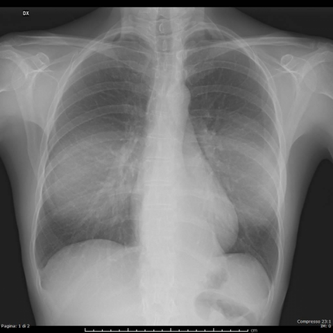

# V12：15189_8353800545058

[全部题目](README.md) · [结构化病例记录](15189_8353800545058.json)

来源：[ChestAgentBench 固定版本](https://huggingface.co/datasets/wanglab/chest-agent-bench/tree/921e60440927f9893228d843c0206b755744252a)；[Eurorad case 15189](https://www.eurorad.org/case/15189)。

参考答案只来自实验结束后的既有评分结果。模型和工具文字是可观察输出，不是人工确认的患者事实。

## 完整题干与全部选项

```text
Based solely on the PA and LL projection chest X-rays (Fig. 5a and Fig. 5b), what is the most likely diagnosis for the mediastinal changes observed in the patient, and what characteristics support this diagnosis?
A. Intrathoracic lipoma, characterized by a soft tissue density opacity with well-defined margins and no evidence of compression phenomena.
B. Liposarcoma, suggested by the presence of an irregular mass with mixed density and signs of local invasion.
C. Mediastinal lymphadenopathy, indicated by multiple discrete nodular opacities with varying densities.
D. Pneumomediastinum, evidenced by linear radiolucencies outlining mediastinal structures.
E. Hiatal hernia, suggested by the presence of a soft tissue mass in the retrocardiac space with air-fluid levels.
F. Left lower lobe pneumonia, indicated by a homogenous opacity with air bronchograms in the retrocardiac region.
```

## 原图与图号对应

**image:1 — figures/15189/figure_5a.jpg**



**image:2 — figures/15189/figure_5b.jpg**


## 三阶段答案与失败回退

| 组 | 首答 | 取证后候选 | 模型最终求解 | 控制器最终答案 | 状态 |
|---|---|---|---|---|---|
| B | A | A | A | A | completed |
| A | A | A | A | A | completed |

失败回退保留已有合法首答，不计作新求解成功；首答和候选均未作为最终模型输入。

## 完整调用、检索及工具记录

- [initial：实际保存的请求、响应、解析、观察、工具原始返回、费用与耗时](../traces/15189_8353800545058_initial.json)
- [B：实际保存的请求、响应、解析、观察、工具原始返回、费用与耗时](../traces/15189_8353800545058_B.json)
- [A：实际保存的请求、响应、解析、观察、工具原始返回、费用与耗时](../traces/15189_8353800545058_A.json)

图号、模态、初次/随访、比较对象以及派生图与原图关系保存在各阶段的 image registry / images.json / observation 中。Unknown 保持未知。

## 已评分结果、错误、费用与耗时

```json
{
  "scored_outcome": {
    "question_id": "15189_8353800545058",
    "official_categories": [
      "characterization",
      "classification",
      "diagnosis"
    ],
    "reference_answer": "A",
    "initial": {
      "answer": "A",
      "correct": true,
      "status": "completed",
      "error": null
    },
    "B": {
      "answer": "A",
      "correct": true,
      "candidate_answer": "A",
      "candidate_correct": true,
      "solver_answer": "A",
      "solver_correct": true,
      "fallback_to_initial": false,
      "status": "completed",
      "error": null,
      "transition_from_initial": "correct_to_correct",
      "candidate_transition_from_initial": "correct_to_correct",
      "k_ids": [
        "ACR_ARI_2024_K03"
      ],
      "e_ids": [
        "c416ffc694c3db8ba90355ee60321016c8806ff900f60836d71420417baed3b7"
      ]
    },
    "A": {
      "answer": "A",
      "correct": true,
      "candidate_answer": "A",
      "candidate_correct": true,
      "solver_answer": "A",
      "solver_correct": true,
      "fallback_to_initial": false,
      "status": "completed",
      "error": null,
      "transition_from_initial": "correct_to_correct",
      "candidate_transition_from_initial": "correct_to_correct",
      "k_ids": [],
      "e_ids": []
    }
  },
  "initial": {
    "question_id": "15189_8353800545058",
    "first_answer": "A",
    "status": "completed",
    "error": null,
    "observation": {
      "first_answer": "A",
      "observations": [
        {
          "attribute": "mediastinal opacity",
          "value": "well-circumscribed, homogeneous soft-tissue density mass in the anterior/upper mediastinum, more prominent on PA view (Fig. 5a), with smooth margins and no evidence of invasion or compression of adjacent structures",
          "status": "observed_present",
          "evidence_refs": [
            "image:1"
          ]
        },
        {
          "attribute": "lateral projection appearance",
          "value": "mass projects over the retrosternal space, consistent with anterior mediastinal location; no air-fluid levels, no linear lucencies, no nodular clusters",
          "status": "observed_present",
          "evidence_refs": [
            "image:2"
          ]
        },
        {
          "attribute": "air bronchograms",
          "value": "absent",
          "status": "observed_absent",
          "evidence_refs": [
            "image:1",
            "image:2"
          ]
        },
        {
          "attribute": "linear radiolucencies outlining mediastinal structures",
          "value": "absent",
          "status": "observed_absent",
          "evidence_refs": [
            "image:1",
            "image:2"
          ]
        },
        {
          "attribute": "multiple discrete nodular opacities",
          "value": "absent",
          "status": "observed_absent",
          "evidence_refs": [
            "image:1",
            "image:2"
          ]
        },
        {
          "attribute": "air-fluid levels in retrocardiac region",
          "value": "absent",
          "status": "observed_absent",
          "evidence_refs": [
            "image:1",
            "image:2"
          ]
        },
        {
          "attribute": "irregular mixed-density mass with invasion signs",
          "value": "absent",
          "status": "observed_absent",
          "evidence_refs": [
            "image:1",
            "image:2"
          ]
        }
      ],
      "hypotheses": [
        {
          "name": "Intrathoracic lipoma",
          "basis": "Well-defined, homogeneous soft-tissue density mass in anterior mediastinum without mass effect or invasion—classic for benign fatty tumor; fat density not directly visible on plain film but inferred by lack of calcification, homogeneity, and sharp margins",
          "status": "hypothesis",
          "evidence_refs": [
            "image:1",
            "image:2"
          ]
        },
        {
          "name": "Thymoma or other benign anterior mediastinal tumor",
          "basis": "Anterior mediastinal mass with smooth borders; however, thymomas often show slightly less homogeneous density and may have cystic components—less likely given uniform appearance",
          "status": "hypothesis",
          "evidence_refs": [
            "image:1",
            "image:2"
          ]
        }
      ],
      "patient_conditions": [],
      "discriminators": [
        {
          "attribute": "margin definition and internal density",
          "question": "Which option matches a well-defined, homogeneous soft-tissue opacity without invasion, air-fluid levels, or nodularity?",
          "option_labels": [
            "A",
            "B",
            "C",
            "D",
            "E",
            "F"
          ],
          "image_ids": [
            "image:1",
            "image:2"
          ],
          "comparison_object": "anterior mediastinal mass"
        },
        {
          "attribute": "presence of air-fluid levels",
          "question": "Does the retrocardiac opacity contain air-fluid levels (supporting hiatal hernia)?",
          "option_labels": [
            "E"
          ],
          "image_ids": [
            "image:1",
            "image:2"
          ],
          "comparison_object": "retrocardiac opacity"
        },
        {
          "attribute": "linear radiolucencies",
          "question": "Are there lucent lines outlining mediastinal structures (pneumomediastinum)?",
          "option_labels": [
            "D"
          ],
          "image_ids": [
            "image:1",
            "image:2"
          ],
          "comparison_object": "mediastinal contour"
        },
        {
          "attribute": "nodularity and multiplicity",
          "question": "Are there multiple discrete nodular opacities (lymphadenopathy)?",
          "option_labels": [
            "C"
          ],
          "image_ids": [
            "image:1",
            "image:2"
          ],
          "comparison_object": "mediastinal opacities"
        },
        {
          "attribute": "air bronchograms and lobar consolidation pattern",
          "question": "Is there homogeneous opacity with air bronchograms in left lower lobe?",
          "option_labels": [
            "F"
          ],
          "image_ids": [
            "image:1",
            "image:2"
          ],
          "comparison_object": "left lower lung zone"
        }
      ],
      "image_metadata": [
        {
          "image_id": "image:1",
          "figure_label": "Figure 5a",
          "source_filename": "figures/15189/figure_5a.jpg",
          "modality": "CXR",
          "anatomy": "thorax, PA projection",
          "timepoint": "unknown",
          "timepoint_source_quote": "",
          "comparison_object": "anterior mediastinum",
          "modality_source": "first_visual_reader_report_not_clinically_adjudicated"
        },
        {
          "image_id": "image:2",
          "figure_label": "Figure 5b",
          "source_filename": "figures/15189/figure_5b.jpg",
          "modality": "CXR",
          "anatomy": "thorax, LL (lateral) projection",
          "timepoint": "unknown",
          "timepoint_source_quote": "",
          "comparison_object": "anterior mediastinum",
          "modality_source": "first_visual_reader_report_not_clinically_adjudicated"
        }
      ],
      "uncertainties": [
        "Exact tissue composition (fat vs soft tissue) cannot be confirmed without CT attenuation values",
        "No clinical history, age, or symptoms provided to refine differential",
        "Timepoint and whether images are from same exam not specified in stem"
      ],
      "parse_warnings": []
    },
    "accounting": {
      "input_tokens": 1725,
      "output_tokens": 1211,
      "total_tokens": 2936,
      "model_calls": 1,
      "tool_calls": 0,
      "logical_cost_cny": "0.021432",
      "incremental_cost_cny": "0.021432",
      "provider_actual_cost_cny": null,
      "cost_basis": "usage_at_existing_profile_assumed_rates_or_conservative_unknown_reservation_not_invoice",
      "usage_complete": true,
      "issues": []
    },
    "stop_run": false,
    "stop_reason": null,
    "timing": {
      "started_utc": "2026-10-31T05:03:00.389360+00:00",
      "ended_utc": "2026-10-31T05:03:30.672278+00:00",
      "elapsed_s": 30.283
    }
  },
  "branches": {
    "B": {
      "question_id": "15189_8353800545058",
      "group": "B",
      "answer": "A",
      "status": "completed",
      "error": null,
      "shared_observation_source": "shared_initial",
      "first_answer_visible": false,
      "tool_attempts": [
        {
          "evidence_ref": "B:tool:1",
          "action": {
            "kind": "crop",
            "image_id": "image:1",
            "image_ids": [
              "image:1"
            ],
            "target_region": "anterior mediastinal mass on PA view",
            "tool": "",
            "question": "What is the internal density homogeneity and margin definition of the anterior mediastinal mass on the PA chest X-ray?",
            "expected_attribute": "homogeneous soft-tissue density with smooth, well-defined margins",
            "comparison_object": "anterior mediastinal mass",
            "tool_args": {},
            "box": [
              0.25,
              0.2,
              0.75,
              0.6
            ]
          },
          "started_utc": "2026-10-31T05:03:40.933473+00:00",
          "result": {
            "image_id": "crop:997e68559d4c",
            "path": "../assets/bdbad99393320ca80f2c1b1e55f411d192e9b0caeea381cf0d69aeb5571adf0c.png",
            "role": "current_image_pixel_crop",
            "parent_image_id": "image:1",
            "parent_path": "../assets/7e8739de204e47dc71b79e4721daead320a3804d995de04964d6c51ec5f214fd.png",
            "source_size": [
              480,
              480
            ],
            "crop_size": [
              240,
              192
            ],
            "normalized_box": [
              0.25,
              0.2,
              0.75,
              0.6
            ],
            "pixel_box": [
              120,
              96,
              360,
              288
            ],
            "coordinate_system": "stored_pixel_coordinates_no_anatomical_orientation_inferred",
            "orientation": "unresolved",
            "timepoint": "unknown",
            "source_sha256": "7e8739de204e47dc71b79e4721daead320a3804d995de04964d6c51ec5f214fd",
            "crop_sha256": "bdbad99393320ca80f2c1b1e55f411d192e9b0caeea381cf0d69aeb5571adf0c",
            "is_new_usable": null,
            "size": [
              240,
              192
            ],
            "modality": "CXR",
            "figure_label": "Figure 5a",
            "source_filename": "figures/15189/figure_5a.jpg",
            "timepoint_source_quote": ""
          },
          "classification": {
            "evidence_kind": "image_pixels",
            "usable": true,
            "reason": "Crop retains parent; not a clinical finding."
          },
          "status": "returned",
          "ended_utc": "2026-10-31T05:03:40.949955+00:00"
        },
        {
          "evidence_ref": "B:tool:2",
          "action": {
            "kind": "visual",
            "image_id": "image:2",
            "image_ids": [
              "image:2"
            ],
            "target_region": "retrosternal mass on lateral view",
            "tool": "",
            "question": "Does the lateral projection confirm an anterior mediastinal location without air-fluid levels, linear lucencies, or invasion signs?",
            "expected_attribute": "mass projects over retrosternal space, no air-fluid levels, no linear lucencies, no irregular margins or spiculation",
            "comparison_object": "anterior mediastinal mass",
            "tool_args": {}
          },
          "started_utc": "2026-10-31T05:03:40.953421+00:00",
          "result": {
            "selected_images": [
              "image:2"
            ]
          },
          "classification": {
            "evidence_kind": "image_pixels",
            "usable": true,
            "reason": "View selection, no independent tool inference."
          },
          "status": "returned",
          "ended_utc": "2026-10-31T05:03:40.953457+00:00"
        }
      ],
      "additional_observations": {
        "observations": [
          {
            "attribute": "margin definition and internal density of anterior mediastinal mass on PA view",
            "value": "homogeneous soft-tissue density with smooth, well-defined margins",
            "status": "observed_present",
            "evidence_refs": [
              "image:1",
              "crop:997e68559d4c"
            ]
          },
          {
            "attribute": "location on lateral view",
            "value": "mass projects over retrosternal space (anterior mediastinum)",
            "status": "observed_present",
            "evidence_refs": [
              "image:2"
            ]
          },
          {
            "attribute": "air-fluid levels",
            "value": "absent",
            "status": "observed_absent",
            "evidence_refs": [
              "image:1",
              "image:2"
            ]
          },
          {
            "attribute": "linear radiolucencies outlining mediastinal structures",
            "value": "absent",
            "status": "observed_absent",
            "evidence_refs": [
              "image:1",
              "image:2"
            ]
          },
          {
            "attribute": "nodularity/multiplicity of mediastinal opacities",
            "value": "single mass, no discrete nodules",
            "status": "observed_absent",
            "evidence_refs": [
              "image:1",
              "image:2"
            ]
          },
          {
            "attribute": "air bronchograms in left lower lobe",
            "value": "absent; no lobar consolidation pattern",
            "status": "observed_absent",
            "evidence_refs": [
              "image:1",
              "image:2"
            ]
          },
          {
            "attribute": "irregular margins or signs of local invasion",
            "value": "absent; margins are smooth and well-defined",
            "status": "observed_absent",
            "evidence_refs": [
              "image:1",
              "crop:997e68559d4c",
              "image:2"
            ]
          }
        ],
        "hypotheses": [
          {
            "name": "Intrathoracic lipoma",
            "basis": "Well-circumscribed, homogeneous soft-tissue density mass in the anterior mediastinum without mass effect, invasion, or air-fluid levels—classic radiographic appearance of benign fatty tumor.",
            "status": "hypothesis",
            "evidence_refs": [
              "image:1",
              "image:2"
            ]
          }
        ],
        "uncertainties": [
          "Exact tissue composition (fat vs. other soft tissue) cannot be confirmed without CT attenuation measurement (Hounsfield units).",
          "No clinical history or follow-up imaging provided to assess stability or growth.",
          "Lateral view is slightly underpenetrated; subtle spiculation or interface detail may be limited but no abnormality is visible."
        ],
        "parse_warnings": [],
        "kind": "targeted_image_read_requires_independent_verification"
      },
      "candidate_answer": "A",
      "solver_answer": "A",
      "fallback_to_initial": false,
      "k_ids": [
        "ACR_ARI_2024_K03"
      ],
      "e_ids": [
        "c416ffc694c3db8ba90355ee60321016c8806ff900f60836d71420417baed3b7"
      ],
      "action_suggestions": [
        {
          "experience_id": "c416ffc694c3db8ba90355ee60321016c8806ff900f60836d71420417baed3b7",
          "source_question_id": "12127_8353800664893",
          "source_step_id": 3,
          "source_event_line": 719,
          "applicable_ambiguity": "Which option matches a well-defined, homogeneous soft-tissue opacity without invasion, air-fluid levels, or nodularity?",
          "target_image_ids": [
            "image:1",
            "image:2"
          ],
          "target_region": "region containing the named distinguishing attribute; planner must bind exact image/ROI",
          "tool": "chest_xray_expert",
          "specific_question": "Which option matches a well-defined, homogeneous soft-tissue opacity without invasion, air-fluid levels, or nodularity?",
          "expected_discriminating_attributes": [
            "morphology"
          ],
          "object_id": null,
          "comparison_object": "anterior mediastinal mass",
          "historical_execution": "returned_valid",
          "historical_whole_question_outcome": "error",
          "step_credit": null,
          "step_credit_evidence": null,
          "selection_basis": "modality_and_capability_match_no_step_gain_data",
          "heuristic_capability_coverage_not_credit": 1.0,
          "caution": "Tool output is a fallible report; independently check current pixels.",
          "historical_failure_advice": null,
          "is_patient_fact": false
        }
      ],
      "decision": {
        "answer": "A",
        "uncertain": true,
        "observations": [
          {
            "attribute": "mediastinal opacity",
            "value": "well-circumscribed, homogeneous soft-tissue density mass in the anterior/upper mediastinum, smooth margins, no compression or invasion",
            "status": "observed_present",
            "evidence_refs": [
              "image:1",
              "crop:997e68559d4c"
            ]
          },
          {
            "attribute": "lateral projection location",
            "value": "mass projects over retrosternal space, confirming anterior mediastinal origin",
            "status": "observed_present",
            "evidence_refs": [
              "image:2"
            ]
          },
          {
            "attribute": "air-fluid levels",
            "value": "absent in retrocardiac region",
            "status": "observed_absent",
            "evidence_refs": [
              "image:1",
              "image:2"
            ]
          },
          {
            "attribute": "linear radiolucencies outlining mediastinal structures",
            "value": "absent",
            "status": "observed_absent",
            "evidence_refs": [
              "image:1",
              "image:2"
            ]
          },
          {
            "attribute": "multiple discrete nodular opacities",
            "value": "absent; single mass only",
            "status": "observed_absent",
            "evidence_refs": [
              "image:1",
              "image:2"
            ]
          },
          {
            "attribute": "air bronchograms",
            "value": "absent",
            "status": "observed_absent",
            "evidence_refs": [
              "image:1",
              "image:2"
            ]
          },
          {
            "attribute": "irregular margins or local invasion signs",
            "value": "absent; margins are smooth and well-defined",
            "status": "observed_absent",
            "evidence_refs": [
              "image:1",
              "crop:997e68559d4c",
              "image:2"
            ]
          }
        ],
        "option_checks": [
          {
            "option": "A",
            "support": [
              "well-defined margins",
              "homogeneous soft-tissue density",
              "anterior mediastinal location",
              "no compression/invasion"
            ],
            "conflict": [],
            "unknown": [
              "fat composition not confirmed (requires CT HU)",
              "no clinical context"
            ]
          },
          {
            "option": "B",
            "support": [],
            "conflict": [
              "no irregular margins",
              "no mixed density",
              "no local invasion"
            ],
            "unknown": []
          },
          {
            "option": "C",
            "support": [],
            "conflict": [
              "no multiple discrete nodules",
              "single mass only"
            ],
            "unknown": []
          },
          {
            "option": "D",
            "support": [],
            "conflict": [
              "no linear radiolucencies"
            ],
            "unknown": []
          },
          {
            "option": "E",
            "support": [],
            "conflict": [
              "no air-fluid levels",
              "mass not in retrocardiac space (it's anterior/retrosternal)"
            ],
            "unknown": []
          },
          {
            "option": "F",
            "support": [],
            "conflict": [
              "no air bronchograms",
              "no lobar consolidation pattern",
              "opacity is mediastinal, not pulmonary"
            ],
            "unknown": []
          }
        ],
        "missing_option_checks": [],
        "missing_evidence": [
          "CT attenuation (Hounsfield units) to confirm fat content",
          "Clinical history (age, symptoms, growth rate)",
          "Follow-up imaging to assess stability"
        ],
        "parse_warnings": []
      },
      "action_plan": {
        "actions": [
          {
            "kind": "crop",
            "image_id": "image:1",
            "image_ids": [
              "image:1"
            ],
            "target_region": "anterior mediastinal mass on PA view",
            "tool": "",
            "question": "What is the internal density homogeneity and margin definition of the anterior mediastinal mass on the PA chest X-ray?",
            "expected_attribute": "homogeneous soft-tissue density with smooth, well-defined margins",
            "comparison_object": "anterior mediastinal mass",
            "tool_args": {},
            "box": [
              0.25,
              0.2,
              0.75,
              0.6
            ]
          },
          {
            "kind": "visual",
            "image_id": "image:2",
            "image_ids": [
              "image:2"
            ],
            "target_region": "retrosternal mass on lateral view",
            "tool": "",
            "question": "Does the lateral projection confirm an anterior mediastinal location without air-fluid levels, linear lucencies, or invasion signs?",
            "expected_attribute": "mass projects over retrosternal space, no air-fluid levels, no linear lucencies, no irregular margins or spiculation",
            "comparison_object": "anterior mediastinal mass",
            "tool_args": {}
          }
        ],
        "remaining_uncertainties": [
          "Exact tissue composition (fat vs soft tissue) cannot be confirmed without CT attenuation values",
          "No clinical history, age, or symptoms provided to refine differential"
        ],
        "applied_context_ids": [
          "image:1",
          "image:2"
        ],
        "parse_warnings": [],
        "issues": []
      },
      "accounting": {
        "input_tokens": 13633,
        "output_tokens": 1785,
        "total_tokens": 15418,
        "model_calls": 3,
        "tool_calls": 1,
        "logical_cost_cny": "0.075952",
        "incremental_cost_cny": "0.075952",
        "provider_actual_cost_cny": null,
        "cost_basis": "usage_at_existing_profile_assumed_rates_or_conservative_unknown_reservation_not_invoice",
        "usage_complete": true,
        "issues": []
      },
      "stop_run": false,
      "stop_reason": null,
      "timing": {
        "started_utc": "2026-10-31T05:03:30.677968+00:00",
        "ended_utc": "2026-10-31T05:04:16.794169+00:00",
        "elapsed_s": 46.116
      }
    },
    "A": {
      "question_id": "15189_8353800545058",
      "group": "A",
      "answer": "A",
      "status": "completed",
      "error": null,
      "shared_observation_source": "shared_initial",
      "first_answer_visible": false,
      "tool_attempts": [
        {
          "evidence_ref": "A:tool:1",
          "action": {
            "kind": "crop",
            "image_id": "image:1",
            "image_ids": [
              "image:1"
            ],
            "target_region": "anterior mediastinal mass on PA view",
            "tool": "",
            "question": "What is the internal density homogeneity and margin definition of the anterior mediastinal mass on the PA chest X-ray?",
            "expected_attribute": "well-defined, homogeneous soft-tissue density without calcification, fat lucency, or irregularity",
            "comparison_object": "anterior mediastinal mass",
            "tool_args": {},
            "box": [
              0.3,
              0.2,
              0.7,
              0.6
            ]
          },
          "started_utc": "2026-10-31T06:11:41.219594+00:00",
          "result": {
            "image_id": "crop:9526d6ea02cb",
            "path": "../assets/47d0bc8e1280d73cb151dd98bcff2aad4c8b9b34717ddef05176d32cb46beeaf.png",
            "role": "current_image_pixel_crop",
            "parent_image_id": "image:1",
            "parent_path": "../assets/7e8739de204e47dc71b79e4721daead320a3804d995de04964d6c51ec5f214fd.png",
            "source_size": [
              480,
              480
            ],
            "crop_size": [
              192,
              192
            ],
            "normalized_box": [
              0.3,
              0.2,
              0.7,
              0.6
            ],
            "pixel_box": [
              144,
              96,
              336,
              288
            ],
            "coordinate_system": "stored_pixel_coordinates_no_anatomical_orientation_inferred",
            "orientation": "unresolved",
            "timepoint": "unknown",
            "source_sha256": "7e8739de204e47dc71b79e4721daead320a3804d995de04964d6c51ec5f214fd",
            "crop_sha256": "47d0bc8e1280d73cb151dd98bcff2aad4c8b9b34717ddef05176d32cb46beeaf",
            "is_new_usable": null,
            "size": [
              192,
              192
            ],
            "modality": "CXR",
            "figure_label": "Figure 5a",
            "source_filename": "figures/15189/figure_5a.jpg",
            "timepoint_source_quote": ""
          },
          "classification": {
            "evidence_kind": "image_pixels",
            "usable": true,
            "reason": "Crop retains parent; not a clinical finding."
          },
          "status": "returned",
          "ended_utc": "2026-10-31T06:11:41.231926+00:00"
        },
        {
          "evidence_ref": "A:tool:2",
          "action": {
            "kind": "visual",
            "image_id": "image:2",
            "image_ids": [
              "image:2",
              "image:1"
            ],
            "target_region": "retrosternal mass on lateral view",
            "tool": "",
            "question": "Does the lateral projection confirm the mass lies in the retrosternal (anterior) mediastinum and show absence of air-fluid levels, linear lucencies, or invasion?",
            "expected_attribute": "mass projects over retrosternal space with smooth margins, no air-fluid levels, no linear lucencies, no distortion of adjacent structures",
            "comparison_object": "anterior mediastinal mass",
            "tool_args": {}
          },
          "started_utc": "2026-10-31T06:11:41.235153+00:00",
          "result": {
            "selected_images": [
              "image:2",
              "image:1"
            ]
          },
          "classification": {
            "evidence_kind": "image_pixels",
            "usable": true,
            "reason": "View selection, no independent tool inference."
          },
          "status": "returned",
          "ended_utc": "2026-10-31T06:11:41.235201+00:00"
        }
      ],
      "additional_observations": {
        "observations": [
          {
            "attribute": "margin definition and internal density of anterior mediastinal mass on PA view",
            "value": "well-defined, homogeneous soft-tissue density opacity without calcification, fat lucency, irregularity, or invasion",
            "status": "observed_present",
            "evidence_refs": [
              "image:1",
              "crop:9526d6ea02cb"
            ]
          },
          {
            "attribute": "location on lateral view",
            "value": "mass projects within retrosternal (anterior) mediastinal space, not retrocardiac",
            "status": "observed_present",
            "evidence_refs": [
              "image:2"
            ]
          },
          {
            "attribute": "air-fluid levels",
            "value": "absent in the mediastinal opacity",
            "status": "observed_absent",
            "evidence_refs": [
              "image:1",
              "image:2"
            ]
          },
          {
            "attribute": "linear radiolucencies outlining mediastinal structures",
            "value": "absent",
            "status": "observed_absent",
            "evidence_refs": [
              "image:1",
              "image:2"
            ]
          },
          {
            "attribute": "nodularity/multiplicity of mediastinal opacities",
            "value": "single, non-nodular mass; no discrete nodules",
            "status": "observed_absent",
            "evidence_refs": [
              "image:1",
              "image:2"
            ]
          },
          {
            "attribute": "air bronchograms and lobar consolidation pattern",
            "value": "no homogenous opacity with air bronchograms in left lower lobe; lung fields appear clear",
            "status": "observed_absent",
            "evidence_refs": [
              "image:1",
              "image:2"
            ]
          }
        ],
        "hypotheses": [
          {
            "name": "Intrathoracic lipoma",
            "basis": "Well-defined, homogeneous soft-tissue mass in anterior mediastinum without signs of invasion, calcification, fat lucency (though fat density not confirmed), or compression—consistent with benign fatty tumor; however, definitive fat density cannot be confirmed on plain X-ray alone.",
            "status": "hypothesis",
            "evidence_refs": [
              "image:1",
              "image:2"
            ]
          }
        ],
        "uncertainties": [
          "Internal composition (e.g., fat vs. soft tissue) cannot be definitively established on plain CXR without CT correlation; absence of fat lucency in this projection does not rule out lipoma but makes it less typical.",
          "Exact size and effect on adjacent structures (e.g., tracheal deviation, vascular displacement) are limited by 2D projection and lack of measurement scale.",
          "Timepoint is unknown; no comparison to prior imaging available."
        ],
        "parse_warnings": [],
        "kind": "targeted_image_read_requires_independent_verification"
      },
      "candidate_answer": "A",
      "solver_answer": "A",
      "fallback_to_initial": false,
      "k_ids": [],
      "e_ids": [],
      "action_suggestions": [],
      "decision": {
        "answer": "A",
        "uncertain": true,
        "observations": [
          {
            "attribute": "mediastinal opacity",
            "value": "well-circumscribed, homogeneous soft-tissue density mass in the anterior/upper mediastinum, smooth margins, no invasion or compression",
            "status": "observed_present",
            "evidence_refs": [
              "image:1",
              "crop:9526d6ea02cb"
            ]
          },
          {
            "attribute": "lateral projection location",
            "value": "mass projects over retrosternal space, confirming anterior mediastinal origin",
            "status": "observed_present",
            "evidence_refs": [
              "image:2"
            ]
          },
          {
            "attribute": "air-fluid levels",
            "value": "absent in mediastinal opacity",
            "status": "observed_absent",
            "evidence_refs": [
              "image:1",
              "image:2"
            ]
          },
          {
            "attribute": "linear radiolucencies outlining mediastinal structures",
            "value": "absent",
            "status": "observed_absent",
            "evidence_refs": [
              "image:1",
              "image:2"
            ]
          },
          {
            "attribute": "multiple discrete nodular opacities",
            "value": "absent; single mass only",
            "status": "observed_absent",
            "evidence_refs": [
              "image:1",
              "image:2"
            ]
          },
          {
            "attribute": "air bronchograms",
            "value": "absent",
            "status": "observed_absent",
            "evidence_refs": [
              "image:1",
              "image:2"
            ]
          },
          {
            "attribute": "irregular mixed-density mass with invasion signs",
            "value": "absent",
            "status": "observed_absent",
            "evidence_refs": [
              "image:1",
              "image:2"
            ]
          }
        ],
        "option_checks": [
          {
            "option": "A",
            "support": [
              "well-defined margins",
              "homogeneous soft-tissue density",
              "anterior mediastinal location (retrosternal on LL)",
              "no compression/invasion"
            ],
            "conflict": [
              "fat density not directly visible on CXR (no lucency); diagnosis inferred, not confirmed"
            ],
            "unknown": [
              "exact tissue composition (fat vs. other benign soft tissue)",
              "size quantification",
              "effect on adjacent structures beyond visual impression"
            ]
          },
          {
            "option": "B",
            "support": [],
            "conflict": [
              "mass is not irregular",
              "no mixed density",
              "no local invasion signs"
            ],
            "unknown": []
          },
          {
            "option": "C",
            "support": [],
            "conflict": [
              "no multiple discrete nodules",
              "single mass only"
            ],
            "unknown": []
          },
          {
            "option": "D",
            "support": [],
            "conflict": [
              "no linear radiolucencies"
            ],
            "unknown": []
          },
          {
            "option": "E",
            "support": [],
            "conflict": [
              "mass is anterior (retrosternal), not retrocardiac",
              "no air-fluid levels"
            ],
            "unknown": []
          },
          {
            "option": "F",
            "support": [],
            "conflict": [
              "no homogenous opacity in left lower lobe",
              "no air bronchograms",
              "lung fields clear"
            ],
            "unknown": []
          }
        ],
        "missing_option_checks": [],
        "missing_evidence": [
          "CT attenuation to confirm fat content (required for definitive lipoma diagnosis)",
          "Clinical history (age, symptoms) to support benign etiology",
          "Measurement of mass size and effect on trachea/vessels",
          "Prior imaging for interval change assessment"
        ],
        "parse_warnings": []
      },
      "action_plan": {
        "actions": [
          {
            "kind": "crop",
            "image_id": "image:1",
            "image_ids": [
              "image:1"
            ],
            "target_region": "anterior mediastinal mass on PA view",
            "tool": "",
            "question": "What is the internal density homogeneity and margin definition of the anterior mediastinal mass on the PA chest X-ray?",
            "expected_attribute": "well-defined, homogeneous soft-tissue density without calcification, fat lucency, or irregularity",
            "comparison_object": "anterior mediastinal mass",
            "tool_args": {},
            "box": [
              0.3,
              0.2,
              0.7,
              0.6
            ]
          },
          {
            "kind": "visual",
            "image_id": "image:2",
            "image_ids": [
              "image:2",
              "image:1"
            ],
            "target_region": "retrosternal mass on lateral view",
            "tool": "",
            "question": "Does the lateral projection confirm the mass lies in the retrosternal (anterior) mediastinum and show absence of air-fluid levels, linear lucencies, or invasion?",
            "expected_attribute": "mass projects over retrosternal space with smooth margins, no air-fluid levels, no linear lucencies, no distortion of adjacent structures",
            "comparison_object": "anterior mediastinal mass",
            "tool_args": {}
          }
        ],
        "remaining_uncertainties": [
          "Exact tissue composition (fat vs soft tissue) cannot be confirmed without CT attenuation values",
          "No clinical history, age, or symptoms provided to refine differential"
        ],
        "applied_context_ids": [
          "image:1",
          "image:2"
        ],
        "parse_warnings": [],
        "issues": []
      },
      "accounting": {
        "input_tokens": 12694,
        "output_tokens": 1842,
        "total_tokens": 14536,
        "model_calls": 3,
        "tool_calls": 1,
        "logical_cost_cny": "0.072880",
        "incremental_cost_cny": "0.072880",
        "provider_actual_cost_cny": null,
        "cost_basis": "usage_at_existing_profile_assumed_rates_or_conservative_unknown_reservation_not_invoice",
        "usage_complete": true,
        "issues": []
      },
      "stop_run": false,
      "stop_reason": null,
      "timing": {
        "started_utc": "2026-10-31T06:11:31.655790+00:00",
        "ended_utc": "2026-10-31T06:12:17.308920+00:00",
        "elapsed_s": 45.653
      }
    }
  }
}
```
