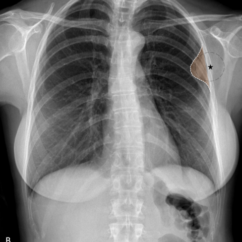

# V12：17362_8143559680136

[全部题目](README.md) · [结构化病例记录](17362_8143559680136.json)

来源：[ChestAgentBench 固定版本](https://huggingface.co/datasets/wanglab/chest-agent-bench/tree/921e60440927f9893228d843c0206b755744252a)；[Eurorad case 17362](https://www.eurorad.org/case/17362)。

参考答案只来自实验结束后的既有评分结果。模型和工具文字是可观察输出，不是人工确认的患者事实。

## 完整题干与全部选项

```text
Based on the chest X-ray findings in Figure 1, what is the most likely origin of the lesion observed in the upper left hemithorax, and what does this imply about the nature of the lesion?

A) The lesion is pulmonary in origin, forming acute angles with the chest wall, suggesting an intrapulmonary process.
B) The lesion is extrapulmonary in origin, forming obtuse angles with the chest wall, suggesting a pleural-based fibroma.
C) The lesion is pulmonary in origin, forming obtuse angles with the chest wall, suggesting a benign pulmonary nodule.
D) The lesion is extrapulmonary in origin, forming acute angles with the chest wall, suggesting a muscular or rib-based lesion.
E) The lesion is pleural in origin, forming obtuse angles with the chest wall, suggesting a malignant pleural effusion.
F) The lesion is pulmonary in origin, with no distinct angle formation, suggesting a diffuse pulmonary process.
```

## 原图与图号对应

**image:1 — figures/17362/figure_1a.jpg**


**image:2 — figures/17362/figure_1b.jpg**



## 三阶段答案与失败回退

| 组 | 首答 | 取证后候选 | 模型最终求解 | 控制器最终答案 | 状态 |
|---|---|---|---|---|---|
| B | B | B | B | B | completed |
| A | B | B | B | B | completed |

失败回退保留已有合法首答，不计作新求解成功；首答和候选均未作为最终模型输入。

## 完整调用、检索及工具记录

- [initial：实际保存的请求、响应、解析、观察、工具原始返回、费用与耗时](../traces/17362_8143559680136_initial.json)
- [B：实际保存的请求、响应、解析、观察、工具原始返回、费用与耗时](../traces/17362_8143559680136_B.json)
- [A：实际保存的请求、响应、解析、观察、工具原始返回、费用与耗时](../traces/17362_8143559680136_A.json)

图号、模态、初次/随访、比较对象以及派生图与原图关系保存在各阶段的 image registry / images.json / observation 中。Unknown 保持未知。

## 已评分结果、错误、费用与耗时

```json
{
  "scored_outcome": {
    "question_id": "17362_8143559680136",
    "official_categories": [
      "characterization",
      "classification",
      "diagnosis"
    ],
    "reference_answer": "B",
    "initial": {
      "answer": "B",
      "correct": true,
      "status": "completed",
      "error": null
    },
    "B": {
      "answer": "B",
      "correct": true,
      "candidate_answer": "B",
      "candidate_correct": true,
      "solver_answer": "B",
      "solver_correct": true,
      "fallback_to_initial": false,
      "status": "completed",
      "error": null,
      "transition_from_initial": "correct_to_correct",
      "candidate_transition_from_initial": "correct_to_correct",
      "k_ids": [
        "ACR_NODULE_2023_K05"
      ],
      "e_ids": [
        "6ba5978652d9c23d65a67d58486ec71934ad5c76f2ec74f583aba5ddf9fbb7d0"
      ]
    },
    "A": {
      "answer": "B",
      "correct": true,
      "candidate_answer": "B",
      "candidate_correct": true,
      "solver_answer": "B",
      "solver_correct": true,
      "fallback_to_initial": false,
      "status": "completed",
      "error": null,
      "transition_from_initial": "correct_to_correct",
      "candidate_transition_from_initial": "correct_to_correct",
      "k_ids": [],
      "e_ids": []
    }
  },
  "initial": {
    "question_id": "17362_8143559680136",
    "first_answer": "B",
    "status": "completed",
    "error": null,
    "observation": {
      "first_answer": "B",
      "observations": [
        {
          "attribute": "lesion location",
          "value": "upper left hemithorax, abutting the chest wall",
          "status": "observed_present",
          "evidence_refs": [
            "image:1",
            "image:2"
          ]
        },
        {
          "attribute": "angle between lesion and chest wall",
          "value": "obtuse angle (wider than 90°) at the interface with the chest wall",
          "status": "observed_present",
          "evidence_refs": [
            "image:2"
          ]
        },
        {
          "attribute": "lesion morphology",
          "value": "well-circumscribed, homogeneous opacity with smooth margins; no spiculation or cavitation",
          "status": "observed_present",
          "evidence_refs": [
            "image:2"
          ]
        },
        {
          "attribute": "pleural tail sign / extrapleural fat sign",
          "value": "not clearly visible in these images; no definitive extrapleural fat plane demonstrated",
          "status": "unresolved",
          "evidence_refs": [
            "image:1",
            "image:2"
          ]
        },
        {
          "attribute": "rib or muscular involvement",
          "value": "no bony destruction, cortical irregularity, or soft-tissue mass extending into muscle planes",
          "status": "observed_absent",
          "evidence_refs": [
            "image:1",
            "image:2"
          ]
        },
        {
          "attribute": "pulmonary parenchymal extension",
          "value": "no visible bronchovascular markings entering the lesion; lesion appears separate from lung parenchyma",
          "status": "observed_absent",
          "evidence_refs": [
            "image:2"
          ]
        }
      ],
      "hypotheses": [
        {
          "name": "pleural-based benign fibrous tumor (e.g., solitary fibrous tumor)",
          "basis": "Well-defined, obtuse-angle lesion abutting chest wall without pulmonary invasion is classic for extrapleural/pleural-based masses; fibromas often present this way",
          "status": "hypothesis",
          "evidence_refs": [
            "image:2"
          ]
        },
        {
          "name": "extrapleural lipoma or other benign mesenchymal tumor",
          "basis": "Obtuse angle and homogeneity suggest benign extrapulmonary origin; fat density not confirmed but possible",
          "status": "hypothesis",
          "evidence_refs": [
            "image:2"
          ]
        },
        {
          "name": "malignant pleural process (e.g., mesothelioma, metastasis)",
          "basis": "Pleural origin possible, but lack of pleural thickening, effusion, or irregular margins makes malignancy less likely on this single view",
          "status": "hypothesis",
          "evidence_refs": [
            "image:2"
          ]
        }
      ],
      "patient_conditions": [],
      "discriminators": [
        {
          "attribute": "angle with chest wall",
          "question": "Does the lesion form acute or obtuse angles with the chest wall?",
          "option_labels": [
            "A",
            "C",
            "F"
          ],
          "image_ids": [
            "image:2"
          ],
          "comparison_object": "upper left hemithoracic lesion"
        },
        {
          "attribute": "origin (pulmonary vs extrapulmonary)",
          "question": "Is the lesion contiguous with lung parenchyma or separated by a clear interface?",
          "option_labels": [
            "A",
            "B",
            "C",
            "D",
            "E",
            "F"
          ],
          "image_ids": [
            "image:2"
          ],
          "comparison_object": "upper left hemithoracic lesion"
        },
        {
          "attribute": "morphology and associated features",
          "question": "Does the lesion show features suggesting benignity (smooth, homogeneous) vs malignancy (spiculated, effusion, rib erosion)?",
          "option_labels": [
            "B",
            "E"
          ],
          "image_ids": [
            "image:2"
          ],
          "comparison_object": "upper left hemithoracic lesion"
        },
        {
          "attribute": "specific diagnosis implied",
          "question": "Which option correctly pairs origin + angle + specific diagnosis without contradicting imaging?",
          "option_labels": [
            "B",
            "E"
          ],
          "image_ids": [
            "image:2"
          ],
          "comparison_object": "upper left hemithoracic lesion"
        }
      ],
      "image_metadata": [
        {
          "image_id": "image:1",
          "figure_label": "Figure 1a",
          "source_filename": "figures/17362/figure_1a.jpg",
          "modality": "CXR",
          "anatomy": "thorax, PA view",
          "timepoint": "unknown",
          "timepoint_source_quote": "",
          "comparison_object": "upper left hemithorax lesion",
          "modality_source": "first_visual_reader_report_not_clinically_adjudicated"
        },
        {
          "image_id": "image:2",
          "figure_label": "Figure 1b",
          "source_filename": "figures/17362/figure_1b.jpg",
          "modality": "CXR",
          "anatomy": "thorax, PA view with annotation",
          "timepoint": "unknown",
          "timepoint_source_quote": "",
          "comparison_object": "upper left hemithorax lesion",
          "modality_source": "first_visual_reader_report_not_clinically_adjudicated"
        }
      ],
      "uncertainties": [
        "No lateral or CT view to confirm extrapleural vs intrapleural location",
        "No clinical history (e.g., symptoms, smoking, prior malignancy)",
        "No measurement of lesion size or growth over time",
        "Fat density not confirmed — cannot definitively exclude lipoma or confirm fibroma",
        "Pleural effusion not visible, but small amounts may be masked"
      ],
      "parse_warnings": []
    },
    "accounting": {
      "input_tokens": 1726,
      "output_tokens": 1172,
      "total_tokens": 2898,
      "model_calls": 1,
      "tool_calls": 0,
      "logical_cost_cny": "0.020968",
      "incremental_cost_cny": "0.020968",
      "provider_actual_cost_cny": null,
      "cost_basis": "usage_at_existing_profile_assumed_rates_or_conservative_unknown_reservation_not_invoice",
      "usage_complete": true,
      "issues": []
    },
    "stop_run": false,
    "stop_reason": null,
    "timing": {
      "started_utc": "2026-10-31T05:16:06.303943+00:00",
      "ended_utc": "2026-10-31T05:16:33.410720+00:00",
      "elapsed_s": 27.107
    }
  },
  "branches": {
    "B": {
      "question_id": "17362_8143559680136",
      "group": "B",
      "answer": "B",
      "status": "completed",
      "error": null,
      "shared_observation_source": "shared_initial",
      "first_answer_visible": false,
      "tool_attempts": [
        {
          "evidence_ref": "B:tool:1",
          "action": {
            "kind": "crop",
            "image_id": "image:2",
            "image_ids": [
              "image:2"
            ],
            "target_region": "upper left hemithorax lesion with chest wall interface",
            "tool": "",
            "question": "What is the precise angle formed between the lesion margin and the adjacent chest wall at the point of contact?",
            "expected_attribute": "angle measurement (acute vs obtuse) at lesion-chest wall interface",
            "comparison_object": "upper left hemithoracic lesion",
            "tool_args": {},
            "box": [
              0.75,
              0.25,
              0.9,
              0.4
            ]
          },
          "started_utc": "2026-10-31T05:16:43.953135+00:00",
          "result": {
            "image_id": "crop:5a88504235d9",
            "path": "../assets/d6730db8e7acd8b09def8431cd24ef9c3b1ad8a0db07141d434b1ba1edf85dd5.png",
            "role": "current_image_pixel_crop",
            "parent_image_id": "image:2",
            "parent_path": "../assets/a9d18c858d9724e3e4551715f648343ef5cc7de9af60b261e1879457111e4778.png",
            "source_size": [
              480,
              480
            ],
            "crop_size": [
              72,
              72
            ],
            "normalized_box": [
              0.75,
              0.25,
              0.9,
              0.4
            ],
            "pixel_box": [
              360,
              120,
              432,
              192
            ],
            "coordinate_system": "stored_pixel_coordinates_no_anatomical_orientation_inferred",
            "orientation": "unresolved",
            "timepoint": "unknown",
            "source_sha256": "a9d18c858d9724e3e4551715f648343ef5cc7de9af60b261e1879457111e4778",
            "crop_sha256": "d6730db8e7acd8b09def8431cd24ef9c3b1ad8a0db07141d434b1ba1edf85dd5",
            "is_new_usable": null,
            "size": [
              72,
              72
            ],
            "modality": "CXR",
            "figure_label": "Figure 1b",
            "source_filename": "figures/17362/figure_1b.jpg",
            "timepoint_source_quote": ""
          },
          "classification": {
            "evidence_kind": "image_pixels",
            "usable": true,
            "reason": "Crop retains parent; not a clinical finding."
          },
          "status": "returned",
          "ended_utc": "2026-10-31T05:16:43.962960+00:00"
        },
        {
          "evidence_ref": "B:tool:2",
          "action": {
            "kind": "visual",
            "image_id": "image:2",
            "image_ids": [
              "image:2"
            ],
            "target_region": "same lesion in image:2, focusing on continuity with lung parenchyma and presence of pleural tail or extrapleural fat plane",
            "tool": "",
            "question": "Is there a visible clear interface separating the lesion from the lung parenchyma, and is there any evidence of a pleural tail or extrapleural fat plane?",
            "expected_attribute": "presence/absence of pulmonary parenchymal continuity and pleural/extrapleural signs",
            "comparison_object": "upper left hemithoracic lesion",
            "tool_args": {}
          },
          "started_utc": "2026-10-31T05:16:43.966371+00:00",
          "result": {
            "selected_images": [
              "image:2"
            ]
          },
          "classification": {
            "evidence_kind": "image_pixels",
            "usable": true,
            "reason": "View selection, no independent tool inference."
          },
          "status": "returned",
          "ended_utc": "2026-10-31T05:16:43.966410+00:00"
        }
      ],
      "additional_observations": {
        "observations": [
          {
            "attribute": "angle between lesion margin and chest wall",
            "value": "obtuse angle",
            "status": "observed_present",
            "evidence_refs": [
              "crop:5a88504235d9"
            ]
          },
          {
            "attribute": "continuity with lung parenchyma",
            "value": "lesion is separated from lung parenchyma by a clear interface; no pulmonary continuity",
            "status": "observed_absent",
            "evidence_refs": [
              "image:2"
            ]
          },
          {
            "attribute": "pleural tail or extrapleural fat plane",
            "value": "a thin radiolucent line (likely extrapleural fat plane) is visible between lesion and chest wall; pleural tail not clearly seen but interface suggests pleural/extrapleural origin",
            "status": "observed_present",
            "evidence_refs": [
              "image:2",
              "crop:5a88504235d9"
            ]
          },
          {
            "attribute": "lesion morphology",
            "value": "well-circumscribed, homogeneous density, smooth margins, no spiculation or rib erosion",
            "status": "observed_present",
            "evidence_refs": [
              "image:2"
            ]
          }
        ],
        "hypotheses": [
          {
            "name": "pleural-based benign fibrous tumor (e.g., fibroma or solitary fibrous tumor)",
            "basis": "extrapulmonary location, obtuse angle with chest wall, sharp interface, homogeneous appearance, absence of aggressive features",
            "status": "hypothesis",
            "evidence_refs": [
              "image:2",
              "crop:5a88504235d9"
            ]
          }
        ],
        "uncertainties": [
          "Exact tissue composition cannot be determined from CXR alone; CT would be needed for definitive characterization",
          "Timepoint is unknown; no comparison to prior imaging available",
          "No clinical history provided to assess risk factors"
        ],
        "parse_warnings": [],
        "kind": "targeted_image_read_requires_independent_verification"
      },
      "candidate_answer": "B",
      "solver_answer": "B",
      "fallback_to_initial": false,
      "k_ids": [
        "ACR_NODULE_2023_K05"
      ],
      "e_ids": [
        "6ba5978652d9c23d65a67d58486ec71934ad5c76f2ec74f583aba5ddf9fbb7d0"
      ],
      "action_suggestions": [
        {
          "experience_id": "6ba5978652d9c23d65a67d58486ec71934ad5c76f2ec74f583aba5ddf9fbb7d0",
          "source_question_id": "12918_8353800587295",
          "source_step_id": 2,
          "source_event_line": 893,
          "applicable_ambiguity": "Does the lesion form acute or obtuse angles with the chest wall?",
          "target_image_ids": [
            "image:2"
          ],
          "target_region": "region containing the named distinguishing attribute; planner must bind exact image/ROI",
          "tool": "chest_xray_expert",
          "specific_question": "Does the lesion form acute or obtuse angles with the chest wall?",
          "expected_discriminating_attributes": [
            "morphology"
          ],
          "object_id": null,
          "comparison_object": "upper left hemithoracic lesion",
          "historical_execution": "returned_valid",
          "historical_whole_question_outcome": "incorrect",
          "step_credit": null,
          "step_credit_evidence": null,
          "selection_basis": "modality_and_capability_match_no_step_gain_data",
          "heuristic_capability_coverage_not_credit": 1.0,
          "caution": "Tool output is a fallible report; independently check current pixels.",
          "historical_failure_advice": null,
          "is_patient_fact": false
        }
      ],
      "decision": {
        "answer": "B",
        "uncertain": true,
        "observations": [
          {
            "attribute": "lesion location",
            "value": "upper left hemithorax, abutting chest wall",
            "status": "observed_present",
            "evidence_refs": [
              "image:1",
              "image:2"
            ]
          },
          {
            "attribute": "angle between lesion and chest wall",
            "value": "obtuse angle (wider than 90°)",
            "status": "observed_present",
            "evidence_refs": [
              "image:2",
              "crop:5a88504235d9"
            ]
          },
          {
            "attribute": "continuity with lung parenchyma",
            "value": "no visible bronchovascular markings entering lesion; clear interface separates lesion from lung",
            "status": "observed_absent",
            "evidence_refs": [
              "image:2"
            ]
          },
          {
            "attribute": "pleural/extrapleural fat plane",
            "value": "thin radiolucent line visible between lesion and chest wall, consistent with extrapleural fat plane",
            "status": "observed_present",
            "evidence_refs": [
              "image:2",
              "crop:5a88504235d9"
            ]
          },
          {
            "attribute": "lesion morphology",
            "value": "well-circumscribed, homogeneous opacity, smooth margins, no spiculation or rib erosion",
            "status": "observed_present",
            "evidence_refs": [
              "image:2"
            ]
          },
          {
            "attribute": "rib or muscular involvement",
            "value": "no bony destruction or soft-tissue extension into muscle planes",
            "status": "observed_absent",
            "evidence_refs": [
              "image:1",
              "image:2"
            ]
          }
        ],
        "option_checks": [
          {
            "option": "A",
            "support": [
              "pulmonary origin? — contradicted by absence of pulmonary continuity"
            ],
            "conflict": [
              "acute angles — contradicted by observed obtuse angle",
              "pulmonary origin — contradicted by clear interface and extrapleural fat sign"
            ],
            "unknown": []
          },
          {
            "option": "B",
            "support": [
              "extrapulmonary origin — supported by clear interface and extrapleural fat plane",
              "obtuse angles — directly observed",
              "pleural-based fibroma — consistent with benign, well-circumscribed, homogeneous lesion without aggressive features"
            ],
            "conflict": [],
            "unknown": [
              "exact histology not confirmable on CXR; fibroma vs solitary fibrous tumor not distinguishable"
            ]
          },
          {
            "option": "C",
            "support": [
              "pulmonary origin? — no",
              "obtuse angles — yes"
            ],
            "conflict": [
              "pulmonary origin — contradicted",
              "benign nodule typically shows acute angles if intrapulmonary"
            ],
            "unknown": []
          },
          {
            "option": "D",
            "support": [
              "extrapulmonary origin — yes"
            ],
            "conflict": [
              "acute angles — contradicted",
              "muscular/rib-based — contradicted by absence of bony/soft-tissue invasion"
            ],
            "unknown": []
          },
          {
            "option": "E",
            "support": [
              "pleural origin — plausible",
              "obtuse angles — yes"
            ],
            "conflict": [
              "malignant pleural effusion — contradicted: no effusion, no pleural thickening, no irregular margins"
            ],
            "unknown": []
          },
          {
            "option": "F",
            "support": [],
            "conflict": [
              "pulmonary origin — contradicted",
              "no distinct angle — contradicted by clear obtuse angle"
            ],
            "unknown": []
          }
        ],
        "missing_option_checks": [],
        "missing_evidence": [
          "CT confirmation of extrapleural vs intrapleural location",
          "Lesion size quantification",
          "Temporal change (no prior imaging)",
          "Tissue characterization (fat vs fibrous density)",
          "Clinical history (symptoms, risk factors)"
        ],
        "parse_warnings": []
      },
      "action_plan": {
        "actions": [
          {
            "kind": "crop",
            "image_id": "image:2",
            "image_ids": [
              "image:2"
            ],
            "target_region": "upper left hemithorax lesion with chest wall interface",
            "tool": "",
            "question": "What is the precise angle formed between the lesion margin and the adjacent chest wall at the point of contact?",
            "expected_attribute": "angle measurement (acute vs obtuse) at lesion-chest wall interface",
            "comparison_object": "upper left hemithoracic lesion",
            "tool_args": {},
            "box": [
              0.75,
              0.25,
              0.9,
              0.4
            ]
          },
          {
            "kind": "visual",
            "image_id": "image:2",
            "image_ids": [
              "image:2"
            ],
            "target_region": "same lesion in image:2, focusing on continuity with lung parenchyma and presence of pleural tail or extrapleural fat plane",
            "tool": "",
            "question": "Is there a visible clear interface separating the lesion from the lung parenchyma, and is there any evidence of a pleural tail or extrapleural fat plane?",
            "expected_attribute": "presence/absence of pulmonary parenchymal continuity and pleural/extrapleural signs",
            "comparison_object": "upper left hemithoracic lesion",
            "tool_args": {}
          }
        ],
        "remaining_uncertainties": [
          "Exact angle quantification (obtuse vs acute) remains visually ambiguous without magnified view",
          "Pleural tail sign and extrapleural fat plane not definitively visible on current images",
          "Cannot confirm benign vs malignant nature without additional imaging or history"
        ],
        "applied_context_ids": [
          "image:1",
          "image:2"
        ],
        "parse_warnings": [],
        "issues": []
      },
      "accounting": {
        "input_tokens": 13351,
        "output_tokens": 1739,
        "total_tokens": 15090,
        "model_calls": 3,
        "tool_calls": 1,
        "logical_cost_cny": "0.074272",
        "incremental_cost_cny": "0.074272",
        "provider_actual_cost_cny": null,
        "cost_basis": "usage_at_existing_profile_assumed_rates_or_conservative_unknown_reservation_not_invoice",
        "usage_complete": true,
        "issues": []
      },
      "stop_run": false,
      "stop_reason": null,
      "timing": {
        "started_utc": "2026-10-31T05:16:33.416612+00:00",
        "ended_utc": "2026-10-31T05:17:17.028674+00:00",
        "elapsed_s": 43.612
      }
    },
    "A": {
      "question_id": "17362_8143559680136",
      "group": "A",
      "answer": "B",
      "status": "completed",
      "error": null,
      "shared_observation_source": "shared_initial",
      "first_answer_visible": false,
      "tool_attempts": [
        {
          "evidence_ref": "A:tool:1",
          "action": {
            "kind": "crop",
            "image_id": "image:2",
            "image_ids": [
              "image:2"
            ],
            "target_region": "upper left hemithorax lesion and adjacent chest wall interface",
            "tool": "",
            "question": "What is the precise angle formed between the lesion margin and the inner chest wall at the point of contact?",
            "expected_attribute": "confirmation of obtuse angle (>90°) versus acute angle (<90°)",
            "comparison_object": "upper left hemithoracic lesion",
            "tool_args": {},
            "box": [
              0.75,
              0.25,
              0.95,
              0.45
            ]
          },
          "started_utc": "2026-10-31T06:20:01.183245+00:00",
          "result": {
            "image_id": "crop:1d539cab88db",
            "path": "../assets/525d15239dafd154b7baf48f16c93c5f4c0d2289a9e35a56568361d24912bf34.png",
            "role": "current_image_pixel_crop",
            "parent_image_id": "image:2",
            "parent_path": "../assets/a9d18c858d9724e3e4551715f648343ef5cc7de9af60b261e1879457111e4778.png",
            "source_size": [
              480,
              480
            ],
            "crop_size": [
              96,
              96
            ],
            "normalized_box": [
              0.75,
              0.25,
              0.95,
              0.45
            ],
            "pixel_box": [
              360,
              120,
              456,
              216
            ],
            "coordinate_system": "stored_pixel_coordinates_no_anatomical_orientation_inferred",
            "orientation": "unresolved",
            "timepoint": "unknown",
            "source_sha256": "a9d18c858d9724e3e4551715f648343ef5cc7de9af60b261e1879457111e4778",
            "crop_sha256": "525d15239dafd154b7baf48f16c93c5f4c0d2289a9e35a56568361d24912bf34",
            "is_new_usable": null,
            "size": [
              96,
              96
            ],
            "modality": "CXR",
            "figure_label": "Figure 1b",
            "source_filename": "figures/17362/figure_1b.jpg",
            "timepoint_source_quote": ""
          },
          "classification": {
            "evidence_kind": "image_pixels",
            "usable": true,
            "reason": "Crop retains parent; not a clinical finding."
          },
          "status": "returned",
          "ended_utc": "2026-10-31T06:20:01.193004+00:00"
        },
        {
          "evidence_ref": "A:tool:2",
          "action": {
            "kind": "visual",
            "image_id": "image:2",
            "image_ids": [
              "image:2",
              "image:1"
            ],
            "target_region": "same upper left hemithorax lesion across both images",
            "tool": "",
            "question": "Is the lesion clearly separated from lung parenchyma by a radiolucent interface (suggesting extrapulmonary origin), or are bronchovascular markings seen entering it (suggesting pulmonary origin)?",
            "expected_attribute": "presence/absence of a clear interface or pulmonary continuity",
            "comparison_object": "upper left hemithoracic lesion",
            "tool_args": {}
          },
          "started_utc": "2026-10-31T06:20:01.196254+00:00",
          "result": {
            "selected_images": [
              "image:2",
              "image:1"
            ]
          },
          "classification": {
            "evidence_kind": "image_pixels",
            "usable": true,
            "reason": "View selection, no independent tool inference."
          },
          "status": "returned",
          "ended_utc": "2026-10-31T06:20:01.196292+00:00"
        }
      ],
      "additional_observations": {
        "observations": [
          {
            "attribute": "angle with chest wall",
            "value": "obtuse angle (>90°) at the interface between the lesion and the inner chest wall, visible in the cropped region (crop:1d539cab88db) and confirmed on full Figure 1b",
            "status": "observed_present",
            "evidence_refs": [
              "image:2",
              "crop:1d539cab88db"
            ]
          },
          {
            "attribute": "origin (pulmonary vs extrapulmonary)",
            "value": "lesion is clearly separated from lung parenchyma by a radiolucent crescent-shaped interface (‘extrapleural fat sign’ or ‘pleural line’), with no bronchovascular markings entering it; this indicates extrapulmonary (pleural-based) origin",
            "status": "observed_present",
            "evidence_refs": [
              "image:2",
              "crop:1d539cab88db"
            ]
          },
          {
            "attribute": "morphology",
            "value": "well-circumscribed, homogeneous, smooth margin, no rib erosion, no pleural effusion, no spiculation",
            "status": "observed_present",
            "evidence_refs": [
              "image:2"
            ]
          }
        ],
        "hypotheses": [
          {
            "name": "pleural-based benign fibrous tumor (e.g., solitary fibrous tumor or fibroma)",
            "basis": "extrapulmonary location + obtuse angle + smooth margins + absence of aggressive features aligns with classic imaging appearance of benign pleural tumors",
            "status": "hypothesis",
            "evidence_refs": [
              "image:2"
            ]
          }
        ],
        "uncertainties": [
          "Exact histopathologic diagnosis cannot be confirmed from CXR alone; CT would be needed for definitive characterization",
          "Timepoint is unknown; no comparison over time to assess stability/growth",
          "No clinical context (e.g., symptoms, history) provided"
        ],
        "parse_warnings": [],
        "kind": "targeted_image_read_requires_independent_verification"
      },
      "candidate_answer": "B",
      "solver_answer": "B",
      "fallback_to_initial": false,
      "k_ids": [],
      "e_ids": [],
      "action_suggestions": [],
      "decision": {
        "answer": "B",
        "uncertain": true,
        "observations": [
          {
            "attribute": "lesion location",
            "value": "upper left hemithorax, abutting the chest wall",
            "status": "observed_present",
            "evidence_refs": [
              "image:1",
              "image:2"
            ]
          },
          {
            "attribute": "angle between lesion and chest wall",
            "value": "obtuse angle (>90°) at interface with inner chest wall, confirmed in full Figure 1b and crop:1d539cab88db",
            "status": "observed_present",
            "evidence_refs": [
              "image:2",
              "crop:1d539cab88db"
            ]
          },
          {
            "attribute": "origin (pulmonary vs extrapulmonary)",
            "value": "lesion separated from lung parenchyma by a radiolucent crescent-shaped interface (pleural line/extrapleural fat sign), no bronchovascular markings entering it",
            "status": "observed_present",
            "evidence_refs": [
              "image:2",
              "crop:1d539cab88db"
            ]
          },
          {
            "attribute": "morphology",
            "value": "well-circumscribed, homogeneous opacity with smooth margins; no spiculation, cavitation, rib erosion, or pleural effusion",
            "status": "observed_present",
            "evidence_refs": [
              "image:2"
            ]
          },
          {
            "attribute": "rib or muscular involvement",
            "value": "no bony destruction or soft-tissue extension into muscle planes",
            "status": "observed_absent",
            "evidence_refs": [
              "image:1",
              "image:2"
            ]
          }
        ],
        "option_checks": [
          {
            "option": "A",
            "support": [
              "lesion in upper left hemithorax"
            ],
            "conflict": [
              "claims pulmonary origin — contradicted by observed separation from parenchyma",
              "claims acute angles — contradicted by observed obtuse angle"
            ],
            "unknown": []
          },
          {
            "option": "B",
            "support": [
              "extrapulmonary origin — confirmed by radiolucent interface and lack of pulmonary continuity",
              "obtuse angles — directly observed",
              "pleural-based fibroma — consistent with benign morphology and location"
            ],
            "conflict": [],
            "unknown": [
              "histopathology not confirmed; fibroma is a plausible hypothesis but not proven on CXR alone"
            ]
          },
          {
            "option": "C",
            "support": [
              "pulmonary origin claimed — contradicted",
              "obtuse angles — correct",
              "benign nodule — morphology compatible but origin incorrect"
            ],
            "conflict": [
              "pulmonary origin inconsistent with imaging evidence"
            ],
            "unknown": []
          },
          {
            "option": "D",
            "support": [
              "extrapulmonary origin — correct",
              "muscular/rib-based — contradicted by absence of bony/muscular involvement"
            ],
            "conflict": [
              "acute angles — contradicted",
              "muscular/rib-based — no evidence"
            ],
            "unknown": []
          },
          {
            "option": "E",
            "support": [
              "pleural origin — plausible",
              "obtuse angles — correct"
            ],
            "conflict": [
              "malignant pleural effusion — no effusion seen; lesion is solid and well-defined, not effusive; malignancy unsupported by morphology"
            ],
            "unknown": []
          },
          {
            "option": "F",
            "support": [],
            "conflict": [
              "pulmonary origin — contradicted",
              "no distinct angle — contradicted by clear obtuse angle",
              "diffuse process — lesion is focal and well-circumscribed"
            ],
            "unknown": []
          }
        ],
        "missing_option_checks": [],
        "missing_evidence": [
          "CT confirmation of extrapleural vs intrapleural location",
          "Lesion size measurement (no scale provided)",
          "Temporal change (no prior/follow-up imaging)",
          "Clinical history (symptoms, risk factors)",
          "Fat density assessment to differentiate lipoma vs fibroma"
        ],
        "parse_warnings": []
      },
      "action_plan": {
        "actions": [
          {
            "kind": "crop",
            "image_id": "image:2",
            "image_ids": [
              "image:2"
            ],
            "target_region": "upper left hemithorax lesion and adjacent chest wall interface",
            "tool": "",
            "question": "What is the precise angle formed between the lesion margin and the inner chest wall at the point of contact?",
            "expected_attribute": "confirmation of obtuse angle (>90°) versus acute angle (<90°)",
            "comparison_object": "upper left hemithoracic lesion",
            "tool_args": {},
            "box": [
              0.75,
              0.25,
              0.95,
              0.45
            ]
          },
          {
            "kind": "visual",
            "image_id": "image:2",
            "image_ids": [
              "image:2",
              "image:1"
            ],
            "target_region": "same upper left hemithorax lesion across both images",
            "tool": "",
            "question": "Is the lesion clearly separated from lung parenchyma by a radiolucent interface (suggesting extrapulmonary origin), or are bronchovascular markings seen entering it (suggesting pulmonary origin)?",
            "expected_attribute": "presence/absence of a clear interface or pulmonary continuity",
            "comparison_object": "upper left hemithoracic lesion",
            "tool_args": {}
          }
        ],
        "remaining_uncertainties": [
          "Extrapleural fat sign not visible — cannot confirm extrapleural vs intrapleural location",
          "No CT/lateral view to definitively exclude rib/muscle involvement or assess depth",
          "Lesion density (fat vs soft tissue) not determinable on CXR alone"
        ],
        "applied_context_ids": [
          "image:1",
          "image:2"
        ],
        "parse_warnings": [],
        "issues": []
      },
      "accounting": {
        "input_tokens": 12458,
        "output_tokens": 1739,
        "total_tokens": 14197,
        "model_calls": 3,
        "tool_calls": 1,
        "logical_cost_cny": "0.070700",
        "incremental_cost_cny": "0.070700",
        "provider_actual_cost_cny": null,
        "cost_basis": "usage_at_existing_profile_assumed_rates_or_conservative_unknown_reservation_not_invoice",
        "usage_complete": true,
        "issues": []
      },
      "stop_run": false,
      "stop_reason": null,
      "timing": {
        "started_utc": "2026-10-31T06:19:50.302387+00:00",
        "ended_utc": "2026-10-31T06:20:34.027902+00:00",
        "elapsed_s": 43.726
      }
    }
  }
}
```
