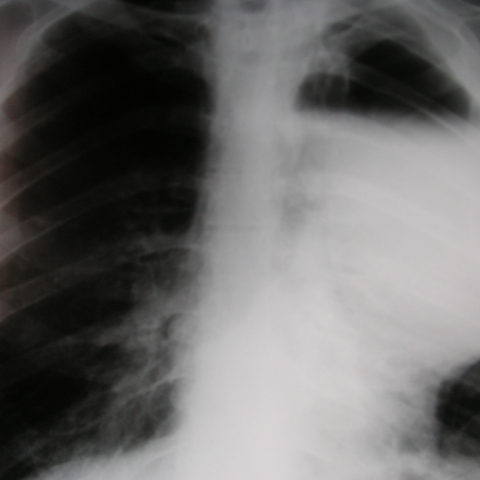

# V12：4118_8353801523564

[全部题目](README.md) · [结构化病例记录](4118_8353801523564.json)

来源：[ChestAgentBench 固定版本](https://huggingface.co/datasets/wanglab/chest-agent-bench/tree/921e60440927f9893228d843c0206b755744252a)；[Eurorad case 4118](https://www.eurorad.org/case/4118)。

参考答案只来自实验结束后的既有评分结果。模型和工具文字是可观察输出，不是人工确认的患者事实。

## 完整题干与全部选项

```text
Based on the chest X-ray findings in Figure 1, which of the following best describes the observed abnormalities and their implications for surgical management?
A) A large cystic lesion in the right upper lobe and a bulla in the left lower lobe, indicating localized sepsis requiring drainage.
B) A solitary cystic lesion in the left upper lobe and a large bulla in the right upper and middle zones, suggesting significant dyspnoea and need for surgical intervention.
C) Multiple bullae throughout both lungs with no signs of infection, suggesting conservative management.
D) Bilateral lower lobe bullae with evidence of fibrotic contraction, indicating no need for surgery.
E) A large bulla in the left upper lobe with evidence of pneumothorax, suggesting immediate surgical management.
F) A large cystic lesion in the right lower lobe and a solitary bulla in the left upper lobe, indicating the need for immediate surgery due to massive haemoptysis.
```

## 原图与图号对应

**image:1 — figures/4118/figure_1.jpg**



## 三阶段答案与失败回退

| 组 | 首答 | 取证后候选 | 模型最终求解 | 控制器最终答案 | 状态 |
|---|---|---|---|---|---|
| B | E | E | E | E | completed |
| A | E | E | E | E | completed |

失败回退保留已有合法首答，不计作新求解成功；首答和候选均未作为最终模型输入。

## 完整调用、检索及工具记录

- [initial：实际保存的请求、响应、解析、观察、工具原始返回、费用与耗时](../traces/4118_8353801523564_initial.json)
- [B：实际保存的请求、响应、解析、观察、工具原始返回、费用与耗时](../traces/4118_8353801523564_B.json)
- [A：实际保存的请求、响应、解析、观察、工具原始返回、费用与耗时](../traces/4118_8353801523564_A.json)

图号、模态、初次/随访、比较对象以及派生图与原图关系保存在各阶段的 image registry / images.json / observation 中。Unknown 保持未知。

## 已评分结果、错误、费用与耗时

```json
{
  "scored_outcome": {
    "question_id": "4118_8353801523564",
    "official_categories": [
      "characterization",
      "detection",
      "localization"
    ],
    "reference_answer": "B",
    "initial": {
      "answer": "E",
      "correct": false,
      "status": "completed",
      "error": null
    },
    "B": {
      "answer": "E",
      "correct": false,
      "candidate_answer": "E",
      "candidate_correct": false,
      "solver_answer": "E",
      "solver_correct": false,
      "fallback_to_initial": false,
      "status": "completed",
      "error": null,
      "transition_from_initial": "legal_wrong_to_wrong",
      "candidate_transition_from_initial": "legal_wrong_to_wrong",
      "k_ids": [
        "RAD_PNEUMOTHORAX_IMAGING_2016_01"
      ],
      "e_ids": [
        "eace1f010ac9fca48fd65d398c9d098f3f270fdfd3020acff72d245ed9c5fe6c"
      ]
    },
    "A": {
      "answer": "E",
      "correct": false,
      "candidate_answer": "E",
      "candidate_correct": false,
      "solver_answer": "E",
      "solver_correct": false,
      "fallback_to_initial": false,
      "status": "completed",
      "error": null,
      "transition_from_initial": "legal_wrong_to_wrong",
      "candidate_transition_from_initial": "legal_wrong_to_wrong",
      "k_ids": [],
      "e_ids": []
    }
  },
  "initial": {
    "question_id": "4118_8353801523564",
    "first_answer": "E",
    "status": "completed",
    "error": null,
    "observation": {
      "first_answer": "E",
      "observations": [
        {
          "attribute": "large radiolucent area",
          "value": "well-defined, sharply demarcated radiolucency in the left upper hemithorax, consistent with a large bulla",
          "status": "observed_present",
          "evidence_refs": [
            "image:1"
          ]
        },
        {
          "attribute": "pleural line / visceral pleura",
          "value": "a thin curvilinear opacity is visible within the left upper lung field, separate from the chest wall, suggesting visceral pleural edge — compatible with pneumothorax",
          "status": "observed_present",
          "evidence_refs": [
            "image:1"
          ]
        },
        {
          "attribute": "lung volume loss / mediastinal shift",
          "value": "mild contralateral (rightward) mediastinal shift and increased lucency on left side suggest volume loss on left; right lung appears hyperinflated",
          "status": "observed_present",
          "evidence_refs": [
            "image:1"
          ]
        },
        {
          "attribute": "cystic lesion vs bulla",
          "value": "no internal septations or fluid levels visible; appearance favors bulla over cystic lesion (e.g., abscess, congenital cyst)",
          "status": "observed_absent",
          "evidence_refs": [
            "image:1"
          ]
        },
        {
          "attribute": "bilateral involvement",
          "value": "right lung shows generalized hyperlucency but no discrete bullae clearly delineated; no evidence of multiple bullae throughout both lungs",
          "status": "observed_absent",
          "evidence_refs": [
            "image:1"
          ]
        },
        {
          "attribute": "fibrotic contraction",
          "value": "no reticular opacities, volume loss, or architectural distortion to suggest fibrosis in lower lobes",
          "status": "observed_absent",
          "evidence_refs": [
            "image:1"
          ]
        },
        {
          "attribute": "haemoptysis signs",
          "value": "no hemoptysis indicators (e.g., infiltrates, cavitation, vascular engorgement) visible",
          "status": "observed_absent",
          "evidence_refs": [
            "image:1"
          ]
        },
        {
          "attribute": "infection signs",
          "value": "no consolidation, air-fluid levels, or peribullous infiltrates",
          "status": "observed_absent",
          "evidence_refs": [
            "image:1"
          ]
        }
      ],
      "hypotheses": [
        {
          "name": "Tension or large spontaneous pneumothorax secondary to rupture of a giant bulla",
          "basis": "Large bulla in left upper lobe with displaced visceral pleural line and mild mediastinal shift supports acute pneumothorax; surgical intervention (e.g., bullectomy + pleurodesis) may be indicated if recurrent or symptomatic",
          "status": "hypothesis",
          "evidence_refs": [
            "image:1"
          ]
        },
        {
          "name": "Giant bullous emphysema with secondary pneumothorax",
          "basis": "Hyperlucent lung fields and focal bulla suggest underlying emphysematous change; rupture leads to pneumothorax",
          "status": "hypothesis",
          "evidence_refs": [
            "image:1"
          ]
        }
      ],
      "patient_conditions": [],
      "discriminators": [
        {
          "attribute": "side and presence of pneumothorax",
          "question": "Which option correctly identifies left upper lobe bulla with pneumothorax?",
          "option_labels": [
            "E"
          ],
          "image_ids": [
            "image:1"
          ],
          "comparison_object": "left upper lobe"
        },
        {
          "attribute": "number and distribution of bullae",
          "question": "Which options claim multiple or bilateral bullae vs solitary?",
          "option_labels": [
            "C",
            "D",
            "B"
          ],
          "image_ids": [
            "image:1"
          ],
          "comparison_object": "both lungs"
        },
        {
          "attribute": "presence of infection or haemoptysis",
          "question": "Which options infer sepsis or haemoptysis without imaging support?",
          "option_labels": [
            "A",
            "F"
          ],
          "image_ids": [
            "image:1"
          ],
          "comparison_object": "entire thorax"
        },
        {
          "attribute": "surgical urgency implication",
          "question": "Which option links findings to immediate surgery based on pneumothorax?",
          "option_labels": [
            "E"
          ],
          "image_ids": [
            "image:1"
          ],
          "comparison_object": "left upper lobe bulla with pleural separation"
        }
      ],
      "image_metadata": [
        {
          "image_id": "image:1",
          "figure_label": "Figure 1",
          "source_filename": "figures/4118/figure_1.jpg",
          "modality": "CXR",
          "anatomy": "thorax, anteroposterior view",
          "timepoint": "unknown",
          "timepoint_source_quote": "",
          "comparison_object": "left upper lobe bulla and pleural space",
          "modality_source": "first_visual_reader_report_not_clinically_adjudicated"
        }
      ],
      "uncertainties": [
        "Exact size of bulla not measurable without scale",
        "Whether pneumothorax is under tension cannot be confirmed without clinical correlation or lateral view",
        "No patient history, symptoms, or vital signs provided",
        "No comparison with prior imaging to assess stability or progression"
      ],
      "parse_warnings": []
    },
    "accounting": {
      "input_tokens": 1231,
      "output_tokens": 1157,
      "total_tokens": 2388,
      "model_calls": 1,
      "tool_calls": 0,
      "logical_cost_cny": "0.018808",
      "incremental_cost_cny": "0.018808",
      "provider_actual_cost_cny": null,
      "cost_basis": "usage_at_existing_profile_assumed_rates_or_conservative_unknown_reservation_not_invoice",
      "usage_complete": true,
      "issues": []
    },
    "stop_run": false,
    "stop_reason": null,
    "timing": {
      "started_utc": "2026-10-31T05:35:26.973521+00:00",
      "ended_utc": "2026-10-31T05:35:53.453732+00:00",
      "elapsed_s": 26.48
    }
  },
  "branches": {
    "B": {
      "question_id": "4118_8353801523564",
      "group": "B",
      "answer": "E",
      "status": "completed",
      "error": null,
      "shared_observation_source": "shared_initial",
      "first_answer_visible": false,
      "tool_attempts": [
        {
          "evidence_ref": "B:tool:1",
          "action": {
            "kind": "crop",
            "image_id": "image:1",
            "image_ids": [
              "image:1"
            ],
            "target_region": "left upper hemithorax showing radiolucent area and thin curvilinear opacity",
            "tool": "",
            "question": "Is there a well-defined radiolucent area in the left upper lobe with an adjacent displaced visceral pleural line, confirming pneumothorax?",
            "expected_attribute": "presence and laterality of bulla + visceral pleural line separation",
            "comparison_object": "left upper lobe",
            "tool_args": {},
            "box": [
              0.0,
              0.0,
              0.5,
              0.5
            ]
          },
          "started_utc": "2026-10-31T05:36:02.293727+00:00",
          "result": {
            "image_id": "crop:01a0ce14d071",
            "path": "../assets/145d1c5e4cb39edbdde4b0d2f57893b9d0e2ba5cdea09ae66d416efb5c977583.png",
            "role": "current_image_pixel_crop",
            "parent_image_id": "image:1",
            "parent_path": "../assets/dcd706e2037a6ee6a088e68fa2acb03334e243fbb2997bffdbf64eb45255deab.png",
            "source_size": [
              480,
              480
            ],
            "crop_size": [
              240,
              240
            ],
            "normalized_box": [
              0.0,
              0.0,
              0.5,
              0.5
            ],
            "pixel_box": [
              0,
              0,
              240,
              240
            ],
            "coordinate_system": "stored_pixel_coordinates_no_anatomical_orientation_inferred",
            "orientation": "unresolved",
            "timepoint": "unknown",
            "source_sha256": "dcd706e2037a6ee6a088e68fa2acb03334e243fbb2997bffdbf64eb45255deab",
            "crop_sha256": "145d1c5e4cb39edbdde4b0d2f57893b9d0e2ba5cdea09ae66d416efb5c977583",
            "is_new_usable": null,
            "size": [
              240,
              240
            ],
            "modality": "CXR",
            "figure_label": "Figure 1",
            "source_filename": "figures/4118/figure_1.jpg",
            "timepoint_source_quote": ""
          },
          "classification": {
            "evidence_kind": "image_pixels",
            "usable": true,
            "reason": "Crop retains parent; not a clinical finding."
          },
          "status": "returned",
          "ended_utc": "2026-10-31T05:36:02.338410+00:00"
        },
        {
          "evidence_ref": "B:tool:2",
          "action": {
            "kind": "visual",
            "image_id": "image:1",
            "image_ids": [
              "image:1"
            ],
            "target_region": "",
            "tool": "",
            "question": "Does the right lung show discrete bullae or only generalized hyperlucency without focal lesions?",
            "expected_attribute": "number and focality of bullae in right lung",
            "comparison_object": "both lungs",
            "tool_args": {}
          },
          "started_utc": "2026-10-31T05:36:02.343201+00:00",
          "result": {
            "selected_images": [
              "image:1"
            ]
          },
          "classification": {
            "evidence_kind": "image_pixels",
            "usable": true,
            "reason": "View selection, no independent tool inference."
          },
          "status": "returned",
          "ended_utc": "2026-10-31T05:36:02.343239+00:00"
        }
      ],
      "additional_observations": {
        "observations": [
          {
            "attribute": "left upper lobe radiolucency with displaced visceral pleural line",
            "value": "A well-defined radiolucent area is present in the left upper hemithorax; a thin curvilinear opacity (consistent with displaced visceral pleura) is seen adjacent to it, separating the lucency from the lung parenchyma — classic appearance of pneumothorax associated with a bulla.",
            "status": "observed_present",
            "evidence_refs": [
              "crop:01a0ce14d071"
            ]
          },
          {
            "attribute": "right lung focal lesions",
            "value": "The right lung shows generalized hyperlucency without discrete, well-circumscribed bullae or cystic lesions; no focal radiolucent lesions are evident.",
            "status": "observed_absent",
            "evidence_refs": [
              "image:1"
            ]
          },
          {
            "attribute": "signs of infection (e.g., infiltrates, pleural effusion, cavitation)",
            "value": "No infiltrates, effusions, or cavitary consolidation visible in either lung field.",
            "status": "observed_absent",
            "evidence_refs": [
              "image:1"
            ]
          },
          {
            "attribute": "haemoptysis or massive bleeding indicators",
            "value": "No evidence of acute hemorrhage, mediastinal shift, or vascular disruption; haemoptysis cannot be inferred from CXR alone and is not supported by imaging.",
            "status": "observed_absent",
            "evidence_refs": [
              "image:1"
            ]
          }
        ],
        "hypotheses": [
          {
            "name": "Spontaneous pneumothorax secondary to rupture of a subpleural bulla in the left upper lobe",
            "basis": "Radiolucent area with displaced visceral pleural line in left upper zone matches classic imaging features of pneumothorax; bullous disease is the most common underlying cause in non-traumatic cases.",
            "status": "hypothesis",
            "evidence_refs": [
              "crop:01a0ce14d071",
              "image:1"
            ]
          }
        ],
        "uncertainties": [
          "Exact size of pneumothorax (small vs large) cannot be quantified without measurement or lateral view.",
          "Underlying pulmonary pathology (e.g., emphysema, LAM, BHD) cannot be confirmed without CT or clinical history.",
          "Time course (acute vs chronic) is unknown; no prior films for comparison.",
          "Surgical urgency depends on clinical status (e.g., dyspnea, hypoxia), which is not provided."
        ],
        "parse_warnings": [],
        "kind": "targeted_image_read_requires_independent_verification"
      },
      "candidate_answer": "E",
      "solver_answer": "E",
      "fallback_to_initial": false,
      "k_ids": [
        "RAD_PNEUMOTHORAX_IMAGING_2016_01"
      ],
      "e_ids": [
        "eace1f010ac9fca48fd65d398c9d098f3f270fdfd3020acff72d245ed9c5fe6c"
      ],
      "action_suggestions": [
        {
          "experience_id": "eace1f010ac9fca48fd65d398c9d098f3f270fdfd3020acff72d245ed9c5fe6c",
          "source_question_id": "13929_8353800630402",
          "source_step_id": 3,
          "source_event_line": 1275,
          "applicable_ambiguity": "Which option correctly identifies left upper lobe bulla with pneumothorax?",
          "target_image_ids": [
            "image:1"
          ],
          "target_region": "region containing the named distinguishing attribute; planner must bind exact image/ROI",
          "tool": "chest_xray_expert",
          "specific_question": "Which option correctly identifies left upper lobe bulla with pneumothorax?",
          "expected_discriminating_attributes": [
            "laterality",
            "location",
            "presence"
          ],
          "object_id": null,
          "comparison_object": "left upper lobe",
          "historical_execution": "returned_valid",
          "historical_whole_question_outcome": "correct",
          "step_credit": null,
          "step_credit_evidence": null,
          "selection_basis": "modality_and_capability_match_no_step_gain_data",
          "heuristic_capability_coverage_not_credit": 1.0,
          "caution": "Tool output is a fallible report; independently check current pixels.",
          "historical_failure_advice": null,
          "is_patient_fact": false
        }
      ],
      "decision": {
        "answer": "E",
        "uncertain": true,
        "observations": [
          {
            "attribute": "large bulla in left upper lobe",
            "value": "Well-defined, sharply demarcated radiolucency in left upper hemithorax; no internal septations or fluid levels — consistent with bulla, not cystic lesion",
            "status": "observed_present",
            "evidence_refs": [
              "image:1",
              "crop:01a0ce14d071"
            ]
          },
          {
            "attribute": "pneumothorax",
            "value": "Thin curvilinear opacity (displaced visceral pleural line) adjacent to the radiolucent area in left upper zone, separating lucency from lung parenchyma — classic sign of pneumothorax",
            "status": "observed_present",
            "evidence_refs": [
              "image:1",
              "crop:01a0ce14d071"
            ]
          },
          {
            "attribute": "side and location",
            "value": "Abnormality confined to left upper lobe; right lung shows generalized hyperlucency but no discrete bullae or cysts",
            "status": "observed_present",
            "evidence_refs": [
              "image:1"
            ]
          },
          {
            "attribute": "infection or haemoptysis signs",
            "value": "No infiltrates, effusions, cavitation, or vascular disruption; no evidence supporting sepsis or haemoptysis",
            "status": "observed_absent",
            "evidence_refs": [
              "image:1"
            ]
          },
          {
            "attribute": "bilateral/multiple bullae",
            "value": "No discrete bullae identified in right lung; not multiple or bilateral",
            "status": "observed_absent",
            "evidence_refs": [
              "image:1"
            ]
          }
        ],
        "option_checks": [
          {
            "option": "A",
            "support": [
              "right upper lobe lesion? — absent",
              "left lower lobe bulla? — absent"
            ],
            "conflict": [
              "wrong side (right upper), wrong site (left lower), implies infection without evidence"
            ],
            "unknown": []
          },
          {
            "option": "B",
            "support": [
              "solitary cystic lesion? — absent; appearance favors bulla",
              "large bulla in right upper/middle? — absent"
            ],
            "conflict": [
              "wrong side (right), misclassifies bulla as cystic, claims bilateral involvement not seen"
            ],
            "unknown": []
          },
          {
            "option": "C",
            "support": [],
            "conflict": [
              "multiple bullae throughout both lungs — not observed; only one large bulla in left upper lobe"
            ],
            "unknown": []
          },
          {
            "option": "D",
            "support": [],
            "conflict": [
              "bilateral lower lobe bullae — absent; fibrotic contraction — absent"
            ],
            "unknown": []
          },
          {
            "option": "E",
            "support": [
              "large bulla in left upper lobe — observed",
              "evidence of pneumothorax — observed (visceral pleural line)",
              "suggests immediate surgical management — clinically plausible for symptomatic/large pneumothorax"
            ],
            "conflict": [
              "exact urgency (‘immediate’) cannot be confirmed without clinical data; however, imaging supports indication for surgery if symptomatic"
            ],
            "unknown": [
              "size quantification, tension status, patient symptoms"
            ]
          },
          {
            "option": "F",
            "support": [],
            "conflict": [
              "right lower lobe cystic lesion — absent",
              "massive haemoptysis — no imaging support"
            ],
            "unknown": []
          }
        ],
        "missing_option_checks": [],
        "missing_evidence": [
          "Clinical symptoms (dyspnea, chest pain, hypoxia)",
          "Pneumothorax size (small vs large) — no measurement scale or lateral view",
          "Tension physiology — cannot confirm without mediastinal shift magnitude or clinical correlation",
          "Prior imaging for interval change",
          "CT confirmation of bulla vs cyst and underlying lung pathology"
        ],
        "parse_warnings": []
      },
      "action_plan": {
        "actions": [
          {
            "kind": "crop",
            "image_id": "image:1",
            "image_ids": [
              "image:1"
            ],
            "target_region": "left upper hemithorax showing radiolucent area and thin curvilinear opacity",
            "tool": "",
            "question": "Is there a well-defined radiolucent area in the left upper lobe with an adjacent displaced visceral pleural line, confirming pneumothorax?",
            "expected_attribute": "presence and laterality of bulla + visceral pleural line separation",
            "comparison_object": "left upper lobe",
            "tool_args": {},
            "box": [
              0.0,
              0.0,
              0.5,
              0.5
            ]
          },
          {
            "kind": "visual",
            "image_id": "image:1",
            "image_ids": [
              "image:1"
            ],
            "target_region": "",
            "tool": "",
            "question": "Does the right lung show discrete bullae or only generalized hyperlucency without focal lesions?",
            "expected_attribute": "number and focality of bullae in right lung",
            "comparison_object": "both lungs",
            "tool_args": {}
          }
        ],
        "remaining_uncertainties": [
          "Exact size of bulla (no scale)",
          "Whether pneumothorax is under tension (requires clinical correlation or lateral view)",
          "Stability/progression (no prior imaging)"
        ],
        "applied_context_ids": [
          "image:1"
        ],
        "parse_warnings": [],
        "issues": []
      },
      "accounting": {
        "input_tokens": 11510,
        "output_tokens": 1808,
        "total_tokens": 13318,
        "model_calls": 3,
        "tool_calls": 1,
        "logical_cost_cny": "0.067736",
        "incremental_cost_cny": "0.067736",
        "provider_actual_cost_cny": null,
        "cost_basis": "usage_at_existing_profile_assumed_rates_or_conservative_unknown_reservation_not_invoice",
        "usage_complete": true,
        "issues": []
      },
      "stop_run": false,
      "stop_reason": null,
      "timing": {
        "started_utc": "2026-10-31T05:35:53.458598+00:00",
        "ended_utc": "2026-10-31T05:36:39.518024+00:00",
        "elapsed_s": 46.059
      }
    },
    "A": {
      "question_id": "4118_8353801523564",
      "group": "A",
      "answer": "E",
      "status": "completed",
      "error": null,
      "shared_observation_source": "shared_initial",
      "first_answer_visible": false,
      "tool_attempts": [
        {
          "evidence_ref": "A:tool:1",
          "action": {
            "kind": "crop",
            "image_id": "image:1",
            "image_ids": [
              "image:1"
            ],
            "target_region": "left upper hemithorax showing radiolucent area and thin curvilinear opacity",
            "tool": "",
            "question": "Is the thin curvilinear opacity in the left upper lung field truly separate from the chest wall and consistent with a visceral pleural edge (i.e., pneumothorax), rather than an artifact or fissure?",
            "expected_attribute": "spatial separation between chest wall and curvilinear opacity; absence of lung markings beyond the line",
            "comparison_object": "left upper lobe pleural space",
            "tool_args": {},
            "box": [
              0.0,
              0.0,
              0.5,
              0.5
            ]
          },
          "started_utc": "2026-10-31T06:33:05.751688+00:00",
          "result": {
            "image_id": "crop:c82e3d99cc98",
            "path": "../assets/145d1c5e4cb39edbdde4b0d2f57893b9d0e2ba5cdea09ae66d416efb5c977583.png",
            "role": "current_image_pixel_crop",
            "parent_image_id": "image:1",
            "parent_path": "../assets/dcd706e2037a6ee6a088e68fa2acb03334e243fbb2997bffdbf64eb45255deab.png",
            "source_size": [
              480,
              480
            ],
            "crop_size": [
              240,
              240
            ],
            "normalized_box": [
              0.0,
              0.0,
              0.5,
              0.5
            ],
            "pixel_box": [
              0,
              0,
              240,
              240
            ],
            "coordinate_system": "stored_pixel_coordinates_no_anatomical_orientation_inferred",
            "orientation": "unresolved",
            "timepoint": "unknown",
            "source_sha256": "dcd706e2037a6ee6a088e68fa2acb03334e243fbb2997bffdbf64eb45255deab",
            "crop_sha256": "145d1c5e4cb39edbdde4b0d2f57893b9d0e2ba5cdea09ae66d416efb5c977583",
            "is_new_usable": null,
            "size": [
              240,
              240
            ],
            "modality": "CXR",
            "figure_label": "Figure 1",
            "source_filename": "figures/4118/figure_1.jpg",
            "timepoint_source_quote": ""
          },
          "classification": {
            "evidence_kind": "image_pixels",
            "usable": true,
            "reason": "Crop retains parent; not a clinical finding."
          },
          "status": "returned",
          "ended_utc": "2026-10-31T06:33:05.795477+00:00"
        },
        {
          "evidence_ref": "A:tool:2",
          "action": {
            "kind": "visual",
            "image_id": "image:1",
            "image_ids": [
              "image:1"
            ],
            "target_region": "entire thorax for side-by-side assessment",
            "tool": "",
            "question": "Does the right lung show discrete bullae (e.g., sharply demarcated radiolucencies with thin walls) or only generalized hyperlucency without focal lesions?",
            "expected_attribute": "presence/absence of well-defined bullae in right lung zones (upper/middle/lower)",
            "comparison_object": "both lungs",
            "tool_args": {}
          },
          "started_utc": "2026-10-31T06:33:05.800287+00:00",
          "result": {
            "selected_images": [
              "image:1"
            ]
          },
          "classification": {
            "evidence_kind": "image_pixels",
            "usable": true,
            "reason": "View selection, no independent tool inference."
          },
          "status": "returned",
          "ended_utc": "2026-10-31T06:33:05.800319+00:00"
        }
      ],
      "additional_observations": {
        "observations": [
          {
            "attribute": "left upper lobe radiolucency with thin curvilinear opacity",
            "value": "A sharply demarcated radiolucent area in the left upper hemithorax is present, bordered by a thin, continuous curvilinear opacity that is spatially separated from the chest wall; lung markings are absent beyond this line, consistent with a visceral pleural edge and pneumothorax.",
            "status": "observed_present",
            "evidence_refs": [
              "crop:c82e3d99cc98",
              "image:1"
            ]
          },
          {
            "attribute": "right lung focal bullae",
            "value": "The right lung shows generalized hyperlucency but no sharply demarcated, thin-walled bullae; no discrete cystic or bullous lesions are visible in upper, middle, or lower zones.",
            "status": "observed_absent",
            "evidence_refs": [
              "image:1"
            ]
          },
          {
            "attribute": "infection or haemoptysis signs",
            "value": "No infiltrates, pleural effusion, cavitation, or other imaging features suggestive of active infection or haemoptysis (e.g., blood in airways or parenchymal consolidation) are visible.",
            "status": "observed_absent",
            "evidence_refs": [
              "image:1"
            ]
          },
          {
            "attribute": "bilateral or multiple bullae",
            "value": "Only one major radiolucent lesion is evident — in the left upper lobe — with no additional bullae identified in either lung.",
            "status": "observed_absent",
            "evidence_refs": [
              "image:1"
            ]
          }
        ],
        "hypotheses": [
          {
            "name": "Left upper lobe bulla with secondary spontaneous pneumothorax",
            "basis": "The radiolucent area with visceral pleural edge suggests a ruptured bulla causing pneumothorax; this is a known cause of spontaneous pneumothorax in emphysematous lungs.",
            "status": "hypothesis",
            "evidence_refs": [
              "crop:c82e3d99cc98",
              "image:1"
            ]
          }
        ],
        "uncertainties": [
          "Exact size of pneumothorax (small vs large) cannot be quantified without measurement or lateral view.",
          "Underlying lung parenchymal disease (e.g., emphysema) is suggested but not definitively confirmed on this single AP view.",
          "Time course and clinical symptoms (e.g., dyspnoea, chest pain) are not provided and cannot be inferred from image alone."
        ],
        "parse_warnings": [],
        "kind": "targeted_image_read_requires_independent_verification"
      },
      "candidate_answer": "E",
      "solver_answer": "E",
      "fallback_to_initial": false,
      "k_ids": [],
      "e_ids": [],
      "action_suggestions": [],
      "decision": {
        "answer": "E",
        "uncertain": true,
        "observations": [
          {
            "attribute": "large bulla location",
            "value": "sharply demarcated radiolucent area in left upper hemithorax, consistent with a large bulla",
            "status": "observed_present",
            "evidence_refs": [
              "image:1"
            ]
          },
          {
            "attribute": "pneumothorax signs",
            "value": "thin curvilinear opacity separate from chest wall, no lung markings beyond it — visceral pleural edge; mild rightward mediastinal shift",
            "status": "observed_present",
            "evidence_refs": [
              "image:1",
              "crop:c82e3d99cc98"
            ]
          },
          {
            "attribute": "cystic lesion vs bulla",
            "value": "no internal septations or fluid levels; appearance favors bulla over cystic lesion",
            "status": "observed_absent",
            "evidence_refs": [
              "image:1"
            ]
          },
          {
            "attribute": "bilateral/multiple bullae",
            "value": "only one major radiolucent lesion identified (left upper lobe); right lung shows generalized hyperlucency but no discrete bullae",
            "status": "observed_absent",
            "evidence_refs": [
              "image:1"
            ]
          },
          {
            "attribute": "infection or haemoptysis",
            "value": "no consolidation, air-fluid levels, infiltrates, cavitation, or vascular engorgement",
            "status": "observed_absent",
            "evidence_refs": [
              "image:1"
            ]
          }
        ],
        "option_checks": [
          {
            "option": "A",
            "support": [
              "right upper lobe lesion? — not observed"
            ],
            "conflict": [
              "cystic lesion (not supported), right upper lobe location (not present), sepsis/drainage indication (no infection signs)"
            ],
            "unknown": [
              "localized sepsis inference"
            ]
          },
          {
            "option": "B",
            "support": [
              "solitary cystic lesion? — not confirmed; bulla in right upper/middle? — absent"
            ],
            "conflict": [
              "left upper lobe cystic lesion (not observed), large bulla in right upper/middle zones (absent), dyspnoea/surgery implication unsupported by imaging alone"
            ],
            "unknown": [
              "surgical need without symptoms"
            ]
          },
          {
            "option": "C",
            "support": [],
            "conflict": [
              "multiple bullae throughout both lungs — false; only one bulla seen"
            ],
            "unknown": []
          },
          {
            "option": "D",
            "support": [],
            "conflict": [
              "bilateral lower lobe bullae — absent; fibrotic contraction — not observed"
            ],
            "unknown": []
          },
          {
            "option": "E",
            "support": [
              "large bulla in left upper lobe — observed",
              "evidence of pneumothorax — observed (visceral pleural line, absent lung markings, mediastinal shift)"
            ],
            "conflict": [
              "immediate surgical management — clinical urgency not confirmable from image alone, but hypothesis is consistent with ruptured giant bulla causing pneumothorax"
            ],
            "unknown": [
              "exact size/tension status of pneumothorax; patient symptoms"
            ]
          },
          {
            "option": "F",
            "support": [],
            "conflict": [
              "right lower lobe cystic lesion — absent",
              "massive haemoptysis — no imaging evidence"
            ],
            "unknown": []
          }
        ],
        "missing_option_checks": [],
        "missing_evidence": [
          "Exact bulla size (cm) — no scale provided",
          "Pneumothorax volume quantification (small/large/tension) — requires lateral view or CT",
          "Clinical symptoms (e.g., dyspnoea, chest pain), vital signs, or history — not supplied",
          "Prior imaging for comparison — none available"
        ],
        "parse_warnings": []
      },
      "action_plan": {
        "actions": [
          {
            "kind": "crop",
            "image_id": "image:1",
            "image_ids": [
              "image:1"
            ],
            "target_region": "left upper hemithorax showing radiolucent area and thin curvilinear opacity",
            "tool": "",
            "question": "Is the thin curvilinear opacity in the left upper lung field truly separate from the chest wall and consistent with a visceral pleural edge (i.e., pneumothorax), rather than an artifact or fissure?",
            "expected_attribute": "spatial separation between chest wall and curvilinear opacity; absence of lung markings beyond the line",
            "comparison_object": "left upper lobe pleural space",
            "tool_args": {},
            "box": [
              0.0,
              0.0,
              0.5,
              0.5
            ]
          },
          {
            "kind": "visual",
            "image_id": "image:1",
            "image_ids": [
              "image:1"
            ],
            "target_region": "entire thorax for side-by-side assessment",
            "tool": "",
            "question": "Does the right lung show discrete bullae (e.g., sharply demarcated radiolucencies with thin walls) or only generalized hyperlucency without focal lesions?",
            "expected_attribute": "presence/absence of well-defined bullae in right lung zones (upper/middle/lower)",
            "comparison_object": "both lungs",
            "tool_args": {}
          }
        ],
        "remaining_uncertainties": [
          "Whether the pneumothorax is under tension (requires clinical correlation or lateral view)",
          "Exact size of the bulla (no scale provided)",
          "Stability/progression (no prior imaging)",
          "Differentiation between bulla and cystic lesion based solely on absence of septations—still inferential"
        ],
        "applied_context_ids": [
          "image:1"
        ],
        "parse_warnings": [],
        "issues": []
      },
      "accounting": {
        "input_tokens": 10736,
        "output_tokens": 1859,
        "total_tokens": 12595,
        "model_calls": 3,
        "tool_calls": 1,
        "logical_cost_cny": "0.065252",
        "incremental_cost_cny": "0.065252",
        "provider_actual_cost_cny": null,
        "cost_basis": "usage_at_existing_profile_assumed_rates_or_conservative_unknown_reservation_not_invoice",
        "usage_complete": true,
        "issues": []
      },
      "stop_run": false,
      "stop_reason": null,
      "timing": {
        "started_utc": "2026-10-31T06:32:54.868882+00:00",
        "ended_utc": "2026-10-31T06:33:43.393173+00:00",
        "elapsed_s": 48.524
      }
    }
  }
}
```
