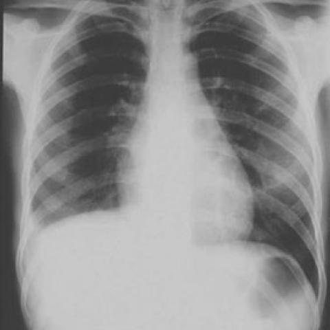

# V12：528_8353802130481

[全部题目](README.md) · [结构化病例记录](528_8353802130481.json)

来源：[ChestAgentBench 固定版本](https://huggingface.co/datasets/wanglab/chest-agent-bench/tree/921e60440927f9893228d843c0206b755744252a)；[Eurorad case 528](https://www.eurorad.org/case/528)。

参考答案只来自实验结束后的既有评分结果。模型和工具文字是可观察输出，不是人工确认的患者事实。

## 完整题干与全部选项

```text
Based on the chest X-ray findings from the first and second admissions, which of the following best describes the progression of the patient's condition and the most likely diagnosis?

A) The right costophrenic angle became more pronounced, indicating resolution of pleural effusion; likely diagnosis is resolved pneumonia.
B) The right hemidiaphragm is elevated and there is a noticeable increase in pleural effusion, suggesting progression to pulmonary angiosarcoma.
C) There is no significant change in the right lung findings, indicating chronic stable condition; likely diagnosis is chronic pulmonary embolism.
D) The vascular markings in the right lung improved, suggesting successful thrombolysis; likely diagnosis is resolved pulmonary embolism.
E) There is a decrease in right pleural effusion, indicating effective treatment; likely diagnosis is resolved heart failure.
F) The right lung shows new infiltrates and decreased vascular markings, suggesting development of a secondary infection; likely diagnosis is secondary bacterial pneumonia.
```

## 原图与图号对应

**image:1 — figures/528/figure_1a.jpg**



**image:2 — figures/528/figure_1b.jpg**


## 三阶段答案与失败回退

| 组 | 首答 | 取证后候选 | 模型最终求解 | 控制器最终答案 | 状态 |
|---|---|---|---|---|---|
| B | B | B | B | B | completed |
| A | B | 缺答 | 缺答 | B | fallback_initial |

失败回退保留已有合法首答，不计作新求解成功；首答和候选均未作为最终模型输入。

## 完整调用、检索及工具记录

- [initial：实际保存的请求、响应、解析、观察、工具原始返回、费用与耗时](../traces/528_8353802130481_initial.json)
- [B：实际保存的请求、响应、解析、观察、工具原始返回、费用与耗时](../traces/528_8353802130481_B.json)
- [A：实际保存的请求、响应、解析、观察、工具原始返回、费用与耗时](../traces/528_8353802130481_A.json)

图号、模态、初次/随访、比较对象以及派生图与原图关系保存在各阶段的 image registry / images.json / observation 中。Unknown 保持未知。

## 已评分结果、错误、费用与耗时

```json
{
  "scored_outcome": {
    "question_id": "528_8353802130481",
    "official_categories": [
      "classification",
      "comparison",
      "diagnosis"
    ],
    "reference_answer": "B",
    "initial": {
      "answer": "B",
      "correct": true,
      "status": "completed",
      "error": null
    },
    "B": {
      "answer": "B",
      "correct": true,
      "candidate_answer": "B",
      "candidate_correct": true,
      "solver_answer": "B",
      "solver_correct": true,
      "fallback_to_initial": false,
      "status": "completed",
      "error": null,
      "transition_from_initial": "correct_to_correct",
      "candidate_transition_from_initial": "correct_to_correct",
      "k_ids": [
        "BTS_PLEURAL_2023_K01"
      ],
      "e_ids": [
        "eace1f010ac9fca48fd65d398c9d098f3f270fdfd3020acff72d245ed9c5fe6c"
      ]
    },
    "A": {
      "answer": "B",
      "correct": true,
      "candidate_answer": null,
      "candidate_correct": false,
      "solver_answer": null,
      "solver_correct": false,
      "fallback_to_initial": true,
      "status": "fallback_initial",
      "error": "MonetaryStop: monetary_guard_error",
      "transition_from_initial": "correct_to_correct",
      "candidate_transition_from_initial": "correct_to_missing",
      "k_ids": [],
      "e_ids": []
    }
  },
  "initial": {
    "question_id": "528_8353802130481",
    "first_answer": "B",
    "status": "completed",
    "error": null,
    "observation": {
      "first_answer": "B",
      "observations": [
        {
          "attribute": "right costophrenic angle",
          "value": "blunted in Figure 1a; more obscured in Figure 1b",
          "status": "observed_present",
          "evidence_refs": [
            "image:1",
            "image:2"
          ]
        },
        {
          "attribute": "right hemidiaphragm position",
          "value": "elevated in both images, more so in Figure 1b",
          "status": "observed_present",
          "evidence_refs": [
            "image:1",
            "image:2"
          ]
        },
        {
          "attribute": "pleural effusion volume",
          "value": "moderate right pleural effusion in Figure 1a; increased volume in Figure 1b with meniscus higher and more lateral extension",
          "status": "observed_present",
          "evidence_refs": [
            "image:1",
            "image:2"
          ]
        },
        {
          "attribute": "right lung vascular markings",
          "value": "decreased in right lower zone in both images; further reduced in Figure 1b",
          "status": "observed_present",
          "evidence_refs": [
            "image:1",
            "image:2"
          ]
        },
        {
          "attribute": "right lung infiltrates",
          "value": "no discrete infiltrates visible in either image; diffuse opacity consistent with effusion/compression",
          "status": "observed_absent",
          "evidence_refs": [
            "image:1",
            "image:2"
          ]
        },
        {
          "attribute": "mediastinal shift",
          "value": "none apparent in either image",
          "status": "observed_absent",
          "evidence_refs": [
            "image:1",
            "image:2"
          ]
        }
      ],
      "hypotheses": [
        {
          "name": "malignant pleural disease (e.g., pulmonary angiosarcoma or metastatic disease)",
          "basis": "Progressive increase in pleural effusion with diaphragmatic elevation and loss of vascular markings without clear infectious infiltrates suggests exudative, possibly malignant, effusion",
          "status": "hypothesis",
          "evidence_refs": [
            "image:1",
            "image:2"
          ]
        },
        {
          "name": "chronic organizing effusion with trapped lung",
          "basis": "Elevated hemidiaphragm and progressive effusion may indicate fibrothorax or trapped lung, though less likely without prior history",
          "status": "hypothesis",
          "evidence_refs": [
            "image:1",
            "image:2"
          ]
        }
      ],
      "patient_conditions": [],
      "discriminators": [
        {
          "attribute": "change in pleural effusion volume and hemidiaphragm position",
          "question": "Which option correctly identifies increasing effusion and diaphragmatic elevation?",
          "option_labels": [
            "B"
          ],
          "image_ids": [
            "image:1",
            "image:2"
          ],
          "comparison_object": "right pleural space"
        },
        {
          "attribute": "presence of new infiltrates",
          "question": "Does any option claim new infiltrates that are not observed?",
          "option_labels": [
            "F"
          ],
          "image_ids": [
            "image:1",
            "image:2"
          ],
          "comparison_object": "right lung parenchyma"
        },
        {
          "attribute": "improvement vs worsening",
          "question": "Which options assert resolution/improvement contrary to observed progression?",
          "option_labels": [
            "A",
            "D",
            "E"
          ],
          "image_ids": [
            "image:1",
            "image:2"
          ],
          "comparison_object": "right pleural effusion and vascular markings"
        },
        {
          "attribute": "stability",
          "question": "Which option claims no significant change when change is evident?",
          "option_labels": [
            "C"
          ],
          "image_ids": [
            "image:1",
            "image:2"
          ],
          "comparison_object": "right lung findings"
        }
      ],
      "image_metadata": [
        {
          "image_id": "image:1",
          "figure_label": "Figure 1a",
          "source_filename": "figures/528/figure_1a.jpg",
          "modality": "CXR",
          "anatomy": "thorax, PA view",
          "timepoint": "unknown",
          "timepoint_source_quote": "",
          "comparison_object": "right pleural space",
          "modality_source": "first_visual_reader_report_not_clinically_adjudicated"
        },
        {
          "image_id": "image:2",
          "figure_label": "Figure 1b",
          "source_filename": "figures/528/figure_1b.jpg",
          "modality": "CXR",
          "anatomy": "thorax, PA view",
          "timepoint": "second admission",
          "timepoint_source_quote": "second admission",
          "comparison_object": "right pleural space",
          "modality_source": "first_visual_reader_report_not_clinically_adjudicated"
        }
      ],
      "uncertainties": [
        "Exact clinical history (e.g., malignancy risk, prior thromboembolism, heart failure status) not provided",
        "No lab or ultrasound confirmation of effusion character",
        "Time interval between admissions unknown",
        "Laterality of cardiac silhouette not fully assessable for mediastinal shift"
      ],
      "parse_warnings": [
        "unsupported_timepoint_left_unknown:image:1"
      ]
    },
    "accounting": {
      "input_tokens": 1708,
      "output_tokens": 1065,
      "total_tokens": 2773,
      "model_calls": 1,
      "tool_calls": 0,
      "logical_cost_cny": "0.019612",
      "incremental_cost_cny": "0.019612",
      "provider_actual_cost_cny": null,
      "cost_basis": "usage_at_existing_profile_assumed_rates_or_conservative_unknown_reservation_not_invoice",
      "usage_complete": true,
      "issues": []
    },
    "stop_run": false,
    "stop_reason": null,
    "timing": {
      "started_utc": "2026-10-31T05:40:47.338957+00:00",
      "ended_utc": "2026-10-31T05:41:12.329271+00:00",
      "elapsed_s": 24.99
    }
  },
  "branches": {
    "B": {
      "question_id": "528_8353802130481",
      "group": "B",
      "answer": "B",
      "status": "completed",
      "error": null,
      "shared_observation_source": "shared_initial",
      "first_answer_visible": false,
      "tool_attempts": [
        {
          "evidence_ref": "B:tool:1",
          "action": {
            "kind": "visual",
            "image_id": "image:1",
            "image_ids": [
              "image:1",
              "image:2"
            ],
            "target_region": "right lower lung zone including costophrenic angle and hemidiaphragm",
            "tool": "",
            "question": "Compare the right costophrenic angle and hemidiaphragm position between Figure 1a and Figure 1b to confirm blunting progression and elevation increase",
            "expected_attribute": "increased obscuration of right costophrenic angle and higher right hemidiaphragm in Figure 1b vs Figure 1a",
            "comparison_object": "right pleural space",
            "tool_args": {}
          },
          "started_utc": "2026-10-31T05:41:23.369427+00:00",
          "result": {
            "selected_images": [
              "image:1",
              "image:2"
            ]
          },
          "classification": {
            "evidence_kind": "image_pixels",
            "usable": true,
            "reason": "View selection, no independent tool inference."
          },
          "status": "returned",
          "ended_utc": "2026-10-31T05:41:23.369456+00:00"
        },
        {
          "evidence_ref": "B:tool:2",
          "action": {
            "kind": "crop",
            "image_id": "image:2",
            "image_ids": [
              "image:2"
            ],
            "target_region": "right lung parenchyma excluding effusion-affected basal zone",
            "tool": "",
            "question": "Is there any new discrete infiltrate in the right lung parenchyma in Figure 1b that was absent in Figure 1a?",
            "expected_attribute": "absence of new focal infiltrates (only diffuse opacity from effusion/compression)",
            "comparison_object": "right lung parenchyma",
            "tool_args": {},
            "box": [
              0.15,
              0.2,
              0.55,
              0.7
            ]
          },
          "started_utc": "2026-10-31T05:41:23.372883+00:00",
          "result": {
            "image_id": "crop:145a5d00c256",
            "path": "../assets/b9eebdc508501d5bbbf5b19c53044ee6f08a47a207b458f82ab44574a0fdf112.png",
            "role": "current_image_pixel_crop",
            "parent_image_id": "image:2",
            "parent_path": "../assets/290e57999514c6e4ffad17deeb7b8500417ff7c039262680ea99bab7d2c7a9bb.jpg",
            "source_size": [
              480,
              480
            ],
            "crop_size": [
              192,
              240
            ],
            "normalized_box": [
              0.15,
              0.2,
              0.55,
              0.7
            ],
            "pixel_box": [
              72,
              96,
              264,
              336
            ],
            "coordinate_system": "stored_pixel_coordinates_no_anatomical_orientation_inferred",
            "orientation": "unresolved",
            "timepoint": "second admission",
            "source_sha256": "290e57999514c6e4ffad17deeb7b8500417ff7c039262680ea99bab7d2c7a9bb",
            "crop_sha256": "b9eebdc508501d5bbbf5b19c53044ee6f08a47a207b458f82ab44574a0fdf112",
            "is_new_usable": null,
            "size": [
              192,
              240
            ],
            "modality": "CXR",
            "figure_label": "Figure 1b",
            "source_filename": "figures/528/figure_1b.jpg",
            "timepoint_source_quote": "second admission"
          },
          "classification": {
            "evidence_kind": "image_pixels",
            "usable": true,
            "reason": "Crop retains parent; not a clinical finding."
          },
          "status": "returned",
          "ended_utc": "2026-10-31T05:41:23.393131+00:00"
        }
      ],
      "additional_observations": {
        "observations": [
          {
            "attribute": "right costophrenic angle",
            "value": "blunted in Figure 1a; more obscured/lost in Figure 1b",
            "status": "observed_present",
            "evidence_refs": [
              "image:1",
              "image:2"
            ]
          },
          {
            "attribute": "right hemidiaphragm position",
            "value": "visible but slightly elevated in Figure 1a; markedly elevated and less distinct in Figure 1b",
            "status": "observed_present",
            "evidence_refs": [
              "image:1",
              "image:2"
            ]
          },
          {
            "attribute": "pleural effusion volume (right side)",
            "value": "moderate opacity at lung base in Figure 1a; larger, more homogeneous opacity extending higher in Figure 1b",
            "status": "observed_present",
            "evidence_refs": [
              "image:1",
              "image:2"
            ]
          },
          {
            "attribute": "new discrete infiltrates in right lung parenchyma (excluding basal effusion zone)",
            "value": "no focal or patchy infiltrates visible in the mid-to-upper right lung on Figure 1b; background opacity is diffuse and consistent with compressive atelectasis from effusion",
            "status": "observed_absent",
            "evidence_refs": [
              "image:2",
              "crop:145a5d00c256"
            ]
          },
          {
            "attribute": "vascular markings in right lung",
            "value": "reduced in lower zone due to effusion/compression in both images; no improvement in Figure 1b",
            "status": "observed_absent",
            "evidence_refs": [
              "image:1",
              "image:2"
            ]
          }
        ],
        "hypotheses": [
          {
            "name": "progressive unilateral pleural effusion with diaphragmatic elevation",
            "basis": "Findings consistent with increasing fluid accumulation, possibly exudative (e.g., malignancy, infection, pulmonary embolism with infarction), though specific etiology not determinable from CXR alone",
            "status": "hypothesis",
            "evidence_refs": [
              "image:1",
              "image:2"
            ]
          },
          {
            "name": "pulmonary angiosarcoma",
            "basis": "Option B proposes this diagnosis; however, CXR cannot confirm sarcoma—this remains a speculative hypothesis without histopathology or CT/MRI correlation",
            "status": "hypothesis",
            "evidence_refs": [
              "image:1",
              "image:2"
            ]
          }
        ],
        "uncertainties": [
          "Exact time interval between admissions not specified; temporal progression inferred only from labeling (Figure 1a = first, Figure 1b = second).",
          "No lateral view or CT available to distinguish pleural fluid from consolidation or mass.",
          "Cause of effusion (transudate vs exudate) cannot be determined from CXR alone.",
          "Diaphragmatic elevation could reflect phrenic nerve involvement, subdiaphragmatic process, or passive elevation from large effusion—imaging alone does not differentiate."
        ],
        "parse_warnings": [],
        "kind": "targeted_image_read_requires_independent_verification"
      },
      "candidate_answer": "B",
      "solver_answer": "B",
      "fallback_to_initial": false,
      "k_ids": [
        "BTS_PLEURAL_2023_K01"
      ],
      "e_ids": [
        "eace1f010ac9fca48fd65d398c9d098f3f270fdfd3020acff72d245ed9c5fe6c"
      ],
      "action_suggestions": [
        {
          "experience_id": "eace1f010ac9fca48fd65d398c9d098f3f270fdfd3020acff72d245ed9c5fe6c",
          "source_question_id": "13929_8353800630402",
          "source_step_id": 3,
          "source_event_line": 1275,
          "applicable_ambiguity": "Does any option claim new infiltrates that are not observed?",
          "target_image_ids": [
            "image:1",
            "image:2"
          ],
          "target_region": "region containing the named distinguishing attribute; planner must bind exact image/ROI",
          "tool": "chest_xray_expert",
          "specific_question": "Does any option claim new infiltrates that are not observed?",
          "expected_discriminating_attributes": [
            "presence"
          ],
          "object_id": null,
          "comparison_object": "right lung parenchyma",
          "historical_execution": "returned_valid",
          "historical_whole_question_outcome": "correct",
          "step_credit": null,
          "step_credit_evidence": null,
          "selection_basis": "modality_and_capability_match_no_step_gain_data",
          "heuristic_capability_coverage_not_credit": 1.0,
          "caution": "Tool output is a fallible report; independently check current pixels.",
          "historical_failure_advice": null,
          "is_patient_fact": false
        }
      ],
      "decision": {
        "answer": "B",
        "uncertain": true,
        "observations": [
          {
            "attribute": "right costophrenic angle",
            "value": "blunted in Figure 1a; more obscured/lost in Figure 1b",
            "status": "observed_present",
            "evidence_refs": [
              "image:1",
              "image:2"
            ]
          },
          {
            "attribute": "right hemidiaphragm position",
            "value": "elevated in both images, more so in Figure 1b",
            "status": "observed_present",
            "evidence_refs": [
              "image:1",
              "image:2"
            ]
          },
          {
            "attribute": "pleural effusion volume (right side)",
            "value": "moderate in Figure 1a; increased volume in Figure 1b with higher meniscus and greater lateral extension",
            "status": "observed_present",
            "evidence_refs": [
              "image:1",
              "image:2"
            ]
          },
          {
            "attribute": "right lung vascular markings",
            "value": "decreased in lower zone in both images; further reduced in Figure 1b",
            "status": "observed_present",
            "evidence_refs": [
              "image:1",
              "image:2"
            ]
          },
          {
            "attribute": "new discrete infiltrates in right lung parenchyma",
            "value": "absent in both images; diffuse opacity consistent with effusion/compression only",
            "status": "observed_absent",
            "evidence_refs": [
              "image:1",
              "image:2",
              "crop:145a5d00c256"
            ]
          }
        ],
        "option_checks": [
          {
            "option": "A",
            "support": [],
            "conflict": [
              "right costophrenic angle became less pronounced (more obscured), not more pronounced",
              "pleural effusion increased, not resolved"
            ],
            "unknown": []
          },
          {
            "option": "B",
            "support": [
              "right hemidiaphragm elevated and more so in second admission",
              "pleural effusion increased in volume and extent",
              "no infiltrates contradicting malignant exudate hypothesis"
            ],
            "conflict": [
              "diagnosis of pulmonary angiosarcoma is not confirmable by CXR alone; remains speculative"
            ],
            "unknown": [
              "etiology of effusion (malignant vs other exudative causes) not definitively established"
            ]
          },
          {
            "option": "C",
            "support": [],
            "conflict": [
              "significant change observed: increased effusion, greater diaphragmatic elevation, worsening vascular loss"
            ],
            "unknown": []
          },
          {
            "option": "D",
            "support": [],
            "conflict": [
              "vascular markings worsened (further decreased), not improved",
              "no evidence of thrombolysis or resolution"
            ],
            "unknown": []
          },
          {
            "option": "E",
            "support": [],
            "conflict": [
              "pleural effusion increased, not decreased",
              "no evidence of heart failure etiology"
            ],
            "unknown": []
          },
          {
            "option": "F",
            "support": [],
            "conflict": [
              "no new discrete infiltrates observed in right lung parenchyma",
              "opacity is diffuse and consistent with compressive atelectasis from effusion"
            ],
            "unknown": []
          }
        ],
        "missing_option_checks": [],
        "missing_evidence": [
          "Time interval between admissions",
          "Clinical history (e.g., malignancy, PE, heart failure)",
          "Effusion fluid analysis (transudate vs exudate)",
          "CT/MRI to exclude mass or confirm diagnosis",
          "Phrenic nerve function or subdiaphragmatic pathology"
        ],
        "parse_warnings": []
      },
      "action_plan": {
        "actions": [
          {
            "kind": "visual",
            "image_id": "image:1",
            "image_ids": [
              "image:1",
              "image:2"
            ],
            "target_region": "right lower lung zone including costophrenic angle and hemidiaphragm",
            "tool": "",
            "question": "Compare the right costophrenic angle and hemidiaphragm position between Figure 1a and Figure 1b to confirm blunting progression and elevation increase",
            "expected_attribute": "increased obscuration of right costophrenic angle and higher right hemidiaphragm in Figure 1b vs Figure 1a",
            "comparison_object": "right pleural space",
            "tool_args": {}
          },
          {
            "kind": "crop",
            "image_id": "image:2",
            "image_ids": [
              "image:2"
            ],
            "target_region": "right lung parenchyma excluding effusion-affected basal zone",
            "tool": "",
            "question": "Is there any new discrete infiltrate in the right lung parenchyma in Figure 1b that was absent in Figure 1a?",
            "expected_attribute": "absence of new focal infiltrates (only diffuse opacity from effusion/compression)",
            "comparison_object": "right lung parenchyma",
            "tool_args": {},
            "box": [
              0.15,
              0.2,
              0.55,
              0.7
            ]
          }
        ],
        "remaining_uncertainties": [
          "Exact nature of pleural effusion (exudative vs transudative) not confirmed",
          "No clinical history to support malignancy vs other exudative causes",
          "Time interval between admissions unknown"
        ],
        "applied_context_ids": [
          "image:1",
          "image:2"
        ],
        "parse_warnings": [],
        "issues": []
      },
      "accounting": {
        "input_tokens": 13282,
        "output_tokens": 1934,
        "total_tokens": 15216,
        "model_calls": 3,
        "tool_calls": 1,
        "logical_cost_cny": "0.076336",
        "incremental_cost_cny": "0.076336",
        "provider_actual_cost_cny": null,
        "cost_basis": "usage_at_existing_profile_assumed_rates_or_conservative_unknown_reservation_not_invoice",
        "usage_complete": true,
        "issues": []
      },
      "stop_run": false,
      "stop_reason": null,
      "timing": {
        "started_utc": "2026-10-31T05:41:12.333525+00:00",
        "ended_utc": "2026-10-31T05:42:01.735979+00:00",
        "elapsed_s": 49.402
      }
    },
    "A": {
      "question_id": "528_8353802130481",
      "group": "A",
      "answer": "B",
      "status": "fallback_initial",
      "error": "MonetaryStop: monetary_guard_error",
      "shared_observation_source": "shared_initial",
      "first_answer_visible": false,
      "tool_attempts": [],
      "additional_observations": null,
      "candidate_answer": null,
      "solver_answer": null,
      "fallback_to_initial": true,
      "k_ids": [],
      "e_ids": [],
      "action_suggestions": [],
      "error_phase": "action_planning",
      "error_chain": [
        {
          "type": "MonetaryStop",
          "message": "monetary_guard_error"
        },
        {
          "type": "LedgerIntegrityError",
          "message": "Invalid reservation schema"
        }
      ],
      "fallback_reason": "Downstream solving failed; retained existing legal initial answer without exposing it to the model.",
      "accounting": {
        "input_tokens": 0,
        "output_tokens": 0,
        "total_tokens": 0,
        "model_calls": 0,
        "tool_calls": 0,
        "logical_cost_cny": "0",
        "incremental_cost_cny": "0",
        "provider_actual_cost_cny": null,
        "cost_basis": "usage_at_existing_profile_assumed_rates_or_conservative_unknown_reservation_not_invoice",
        "usage_complete": true,
        "issues": [
          "monetary_guard_error"
        ]
      },
      "stop_run": true,
      "stop_reason": "monetary_guard_error",
      "timing": {
        "started_utc": "2026-10-31T06:36:18.959508+00:00",
        "ended_utc": "2026-10-31T06:36:19.102228+00:00",
        "elapsed_s": 0.143
      }
    }
  }
}
```
