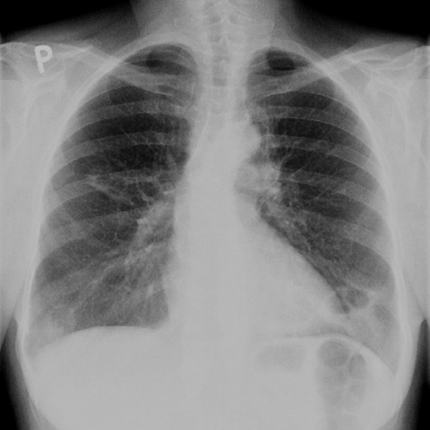

# V12：7726_8353800871273

[全部题目](README.md) · [结构化病例记录](7726_8353800871273.json)

来源：[ChestAgentBench 固定版本](https://huggingface.co/datasets/wanglab/chest-agent-bench/tree/921e60440927f9893228d843c0206b755744252a)；[Eurorad case 7726](https://www.eurorad.org/case/7726)。

参考答案只来自实验结束后的既有评分结果。模型和工具文字是可观察输出，不是人工确认的患者事实。

## 完整题干与全部选项

```text
In the context of the 57-year-old female patient with a history of rheumatoid arthritis and smoking, analyze the chest X-rays provided. Which of the following statements best describes the progression and characteristics of the lung findings over time, and their relationship to rheumatoid arthritis?

A) The cavitated nodules in the left lung base have decreased in size over 12 months, suggesting a resolution of pulmonary involvement.
B) The cavitated nodules have remained stable in size and do not demonstrate any progression, indicating no change in the pulmonary manifestations of rheumatoid arthritis.
C) The cavitated nodules in the lower lung lobes have increased in size over 12 months and are characteristic of necrobiotic nodules associated with rheumatoid arthritis.
D) New cavitated nodules have appeared in the upper lung fields over 12 months, unrelated to rheumatoid arthritis.
E) The cavitated nodules in the right middle lung area have decreased in size, suggesting effective treatment of the pulmonary condition.
F) The cavitated nodules have shown irregular wall thickening, which is not typical for rheumatoid arthritis-related pulmonary nodules.
```

## 原图与图号对应

**image:1 — figures/7726/figure_1a.jpg**



**image:2 — figures/7726/figure_1b.jpg**


## 三阶段答案与失败回退

| 组 | 首答 | 取证后候选 | 模型最终求解 | 控制器最终答案 | 状态 |
|---|---|---|---|---|---|
| B | C | C | C | C | completed |
| A | C | C | C | C | completed |

失败回退保留已有合法首答，不计作新求解成功；首答和候选均未作为最终模型输入。

## 完整调用、检索及工具记录

- [initial：实际保存的请求、响应、解析、观察、工具原始返回、费用与耗时](../traces/7726_8353800871273_initial.json)
- [B：实际保存的请求、响应、解析、观察、工具原始返回、费用与耗时](../traces/7726_8353800871273_B.json)
- [A：实际保存的请求、响应、解析、观察、工具原始返回、费用与耗时](../traces/7726_8353800871273_A.json)

图号、模态、初次/随访、比较对象以及派生图与原图关系保存在各阶段的 image registry / images.json / observation 中。Unknown 保持未知。

## 已评分结果、错误、费用与耗时

```json
{
  "scored_outcome": {
    "question_id": "7726_8353800871273",
    "official_categories": [
      "comparison",
      "localization",
      "relationship"
    ],
    "reference_answer": "C",
    "initial": {
      "answer": "C",
      "correct": true,
      "status": "completed",
      "error": null
    },
    "B": {
      "answer": "C",
      "correct": true,
      "candidate_answer": "C",
      "candidate_correct": true,
      "solver_answer": "C",
      "solver_correct": true,
      "fallback_to_initial": false,
      "status": "completed",
      "error": null,
      "transition_from_initial": "correct_to_correct",
      "candidate_transition_from_initial": "correct_to_correct",
      "k_ids": [
        "RAD_PNEUMOTHORAX_IMAGING_2016_07"
      ],
      "e_ids": [
        "223c04815bc318ffc158ab4b9a9b44a964f5c052fda96d04daee0649669a1c5c"
      ]
    },
    "A": {
      "answer": "C",
      "correct": true,
      "candidate_answer": "C",
      "candidate_correct": true,
      "solver_answer": "C",
      "solver_correct": true,
      "fallback_to_initial": false,
      "status": "completed",
      "error": null,
      "transition_from_initial": "correct_to_correct",
      "candidate_transition_from_initial": "correct_to_correct",
      "k_ids": [],
      "e_ids": []
    }
  },
  "initial": {
    "question_id": "7726_8353800871273",
    "first_answer": "C",
    "status": "completed",
    "error": null,
    "observation": {
      "first_answer": "C",
      "observations": [
        {
          "attribute": "cavitated nodules location",
          "value": "bilateral lower lung zones, more prominent in left lung base in Figure 1a; similar location in Figure 1b with apparent increase in size and number",
          "status": "observed_present",
          "evidence_refs": [
            "image:1",
            "image:2"
          ]
        },
        {
          "attribute": "nodule size change over time",
          "value": "Nodules appear larger and more numerous in Figure 1b compared to Figure 1a; left lower zone opacity increased in extent and central lucency suggests cavitation enlargement",
          "status": "observed_present",
          "evidence_refs": [
            "image:1",
            "image:2"
          ]
        },
        {
          "attribute": "cavitation morphology",
          "value": "Well-defined lucent centers within dense opacities, consistent with cavitated nodules; walls appear relatively thin to moderately thick, no gross irregularity visible",
          "status": "observed_present",
          "evidence_refs": [
            "image:1",
            "image:2"
          ]
        },
        {
          "attribute": "upper lung field nodules",
          "value": "No new cavitated nodules visible in upper lung fields in either image",
          "status": "observed_absent",
          "evidence_refs": [
            "image:1",
            "image:2"
          ]
        },
        {
          "attribute": "right middle lung area nodules",
          "value": "No discrete nodules identified in right middle lung zone; opacity is predominantly in lower zones",
          "status": "observed_absent",
          "evidence_refs": [
            "image:1",
            "image:2"
          ]
        }
      ],
      "hypotheses": [
        {
          "name": "Rheumatoid necrobiotic nodules with progression",
          "basis": "Cavitated nodules in lower lobes increasing over time in a patient with RA and smoking—classic distribution for rheumatoid pneumoconiosis or necrobiotic nodules; progression suggests active disease rather than resolution",
          "status": "hypothesis",
          "evidence_refs": [
            "image:1",
            "image:2"
          ]
        },
        {
          "name": "Infection (e.g., TB or fungal) mimicking RA nodules",
          "basis": "Cavitation can occur in infection; however, absence of upper lobe predominance and lack of other features (e.g., tree-in-bud, lymphadenopathy) make this less likely without further data",
          "status": "hypothesis",
          "evidence_refs": [
            "image:1",
            "image:2"
          ]
        }
      ],
      "patient_conditions": [
        {
          "name": "age/sex/presentation/history",
          "value": "57-year-old female patient with a history of rheumatoid arthritis and smoking",
          "source_quote": "57-year-old female patient with a history of rheumatoid arthritis and smoking",
          "source": "question_stem_explicit_text"
        }
      ],
      "discriminators": [
        {
          "attribute": "size change of cavitated nodules over time",
          "question": "Which option correctly describes nodule size change between the two images?",
          "option_labels": [
            "A",
            "B",
            "C"
          ],
          "image_ids": [
            "image:1",
            "image:2"
          ],
          "comparison_object": "cavitated nodules in lower lung lobes"
        },
        {
          "attribute": "location of new nodules",
          "question": "Do new cavitated nodules appear in upper lung fields?",
          "option_labels": [
            "D"
          ],
          "image_ids": [
            "image:1",
            "image:2"
          ],
          "comparison_object": "upper lung fields"
        },
        {
          "attribute": "wall characteristics",
          "question": "Is irregular wall thickening present?",
          "option_labels": [
            "F"
          ],
          "image_ids": [
            "image:1",
            "image:2"
          ],
          "comparison_object": "cavitated nodule walls"
        },
        {
          "attribute": "laterality and zone",
          "question": "Are nodules primarily in left lung base vs right middle lung?",
          "option_labels": [
            "A",
            "E"
          ],
          "image_ids": [
            "image:1",
            "image:2"
          ],
          "comparison_object": "left lung base vs right middle lung"
        }
      ],
      "image_metadata": [
        {
          "image_id": "image:1",
          "figure_label": "Figure 1a",
          "source_filename": "figures/7726/figure_1a.jpg",
          "modality": "CXR",
          "anatomy": "thorax, posteroanterior view",
          "timepoint": "unknown",
          "timepoint_source_quote": "",
          "comparison_object": "cavitated pulmonary nodules",
          "modality_source": "first_visual_reader_report_not_clinically_adjudicated"
        },
        {
          "image_id": "image:2",
          "figure_label": "Figure 1b",
          "source_filename": "figures/7726/figure_1b.jpg",
          "modality": "CXR",
          "anatomy": "thorax, posteroanterior view",
          "timepoint": "unknown",
          "timepoint_source_quote": "",
          "comparison_object": "cavitated pulmonary nodules",
          "modality_source": "first_visual_reader_report_not_clinically_adjudicated"
        }
      ],
      "uncertainties": [
        "Exact time interval between images is not labeled on images but inferred from stem as 12 months",
        "No clinical correlation (e.g., symptoms, labs, biopsy) provided",
        "Modality confirmed as CXR only by visual pattern (bony thorax, diaphragm, cardiac silhouette); not explicitly stated in metadata",
        "Whether cavities are truly necrobiotic vs infectious cannot be definitively determined from CXR alone"
      ],
      "parse_warnings": [
        "unsupported_timepoint_left_unknown:image:1",
        "unsupported_timepoint_left_unknown:image:2"
      ]
    },
    "accounting": {
      "input_tokens": 1758,
      "output_tokens": 1194,
      "total_tokens": 2952,
      "model_calls": 1,
      "tool_calls": 0,
      "logical_cost_cny": "0.02136",
      "incremental_cost_cny": "0.02136",
      "provider_actual_cost_cny": null,
      "cost_basis": "usage_at_existing_profile_assumed_rates_or_conservative_unknown_reservation_not_invoice",
      "usage_complete": true,
      "issues": []
    },
    "stop_run": false,
    "stop_reason": null,
    "timing": {
      "started_utc": "2026-10-31T05:49:43.963734+00:00",
      "ended_utc": "2026-10-31T05:50:13.011658+00:00",
      "elapsed_s": 29.048
    }
  },
  "branches": {
    "B": {
      "question_id": "7726_8353800871273",
      "group": "B",
      "answer": "C",
      "status": "completed",
      "error": null,
      "shared_observation_source": "shared_initial",
      "first_answer_visible": false,
      "tool_attempts": [
        {
          "evidence_ref": "B:tool:1",
          "action": {
            "kind": "visual",
            "image_id": "image:1",
            "image_ids": [
              "image:1",
              "image:2"
            ],
            "target_region": "bilateral lower lung zones, especially left lung base",
            "tool": "",
            "question": "Compare the size and number of cavitated nodules in the lower lung lobes between Figure 1a and Figure 1b to determine if they have increased, decreased, or remained stable over time.",
            "expected_attribute": "change in nodule size and number (increase vs decrease vs stability)",
            "comparison_object": "cavitated nodules in lower lung lobes",
            "tool_args": {}
          },
          "started_utc": "2026-10-31T05:50:26.111256+00:00",
          "result": {
            "selected_images": [
              "image:1",
              "image:2"
            ]
          },
          "classification": {
            "evidence_kind": "image_pixels",
            "usable": true,
            "reason": "View selection, no independent tool inference."
          },
          "status": "returned",
          "ended_utc": "2026-10-31T05:50:26.111280+00:00"
        },
        {
          "evidence_ref": "B:tool:2",
          "action": {
            "kind": "crop",
            "image_id": "image:2",
            "image_ids": [
              "image:2"
            ],
            "target_region": "left lower lung zone showing largest nodule with central lucency",
            "tool": "",
            "question": "Does the largest cavitated nodule in the left lower lung zone of Figure 1b show enlargement of the lucent center relative to its surrounding opacity compared to the corresponding nodule in Figure 1a?",
            "expected_attribute": "relative cavity size increase within same nodule",
            "comparison_object": "largest cavitated nodule in left lower lung zone",
            "tool_args": {},
            "box": [
              0.1,
              0.65,
              0.4,
              0.9
            ]
          },
          "started_utc": "2026-10-31T05:50:26.114581+00:00",
          "result": {
            "image_id": "crop:72e1c8830194",
            "path": "../assets/04db0082879b829fa953102235d77358d78e09aa95327ebf72054b77e6c490cb.png",
            "role": "current_image_pixel_crop",
            "parent_image_id": "image:2",
            "parent_path": "../assets/81909823a4cc7d1a9ef5755ccea10bf5eb03b7ddc770c23e13f1dd492ed0d6fc.png",
            "source_size": [
              480,
              480
            ],
            "crop_size": [
              144,
              120
            ],
            "normalized_box": [
              0.1,
              0.65,
              0.4,
              0.9
            ],
            "pixel_box": [
              48,
              312,
              192,
              432
            ],
            "coordinate_system": "stored_pixel_coordinates_no_anatomical_orientation_inferred",
            "orientation": "unresolved",
            "timepoint": "unknown",
            "source_sha256": "81909823a4cc7d1a9ef5755ccea10bf5eb03b7ddc770c23e13f1dd492ed0d6fc",
            "crop_sha256": "04db0082879b829fa953102235d77358d78e09aa95327ebf72054b77e6c490cb",
            "is_new_usable": null,
            "size": [
              144,
              120
            ],
            "modality": "CXR",
            "figure_label": "Figure 1b",
            "source_filename": "figures/7726/figure_1b.jpg",
            "timepoint_source_quote": ""
          },
          "classification": {
            "evidence_kind": "image_pixels",
            "usable": true,
            "reason": "Crop retains parent; not a clinical finding."
          },
          "status": "returned",
          "ended_utc": "2026-10-31T05:50:26.127133+00:00"
        }
      ],
      "additional_observations": {
        "observations": [
          {
            "attribute": "size change of cavitated nodules in lower lung lobes over time",
            "value": "The cavitated nodules in the bilateral lower lung zones, especially the left lung base, appear larger in Figure 1b compared to Figure 1a. The largest nodule in the left lower zone shows a more prominent central lucency (cavity) relative to its surrounding opacity in Figure 1b versus Figure 1a, as confirmed by direct side-by-side comparison and the provided crop highlighting that region.",
            "status": "observed_present",
            "evidence_refs": [
              "image:1",
              "image:2",
              "crop:72e1c8830194"
            ]
          },
          {
            "attribute": "location of cavitated nodules",
            "value": "Nodules are predominantly in the lower lung lobes (especially left lung base), not upper lung fields or right middle lung area.",
            "status": "observed_present",
            "evidence_refs": [
              "image:1",
              "image:2"
            ]
          },
          {
            "attribute": "wall characteristics of cavitated nodules",
            "value": "Walls appear relatively thin and smooth; no clear irregular wall thickening is visible in either image.",
            "status": "observed_absent",
            "evidence_refs": [
              "image:1",
              "image:2"
            ]
          },
          {
            "attribute": "new nodules in upper lung fields",
            "value": "No new cavitated nodules are evident in the upper lung fields between the two images.",
            "status": "observed_absent",
            "evidence_refs": [
              "image:1",
              "image:2"
            ]
          }
        ],
        "hypotheses": [
          {
            "name": "Necrobiotic rheumatoid nodules with cavitation",
            "basis": "Progressive enlargement of cavitated nodules in lower lung zones in a patient with rheumatoid arthritis and smoking history is consistent with necrobiotic (rheumatoid) nodules, which may cavitate and grow over time—particularly in smokers. This pattern differs from typical TB or fungal infection, which often favors upper lobes.",
            "status": "hypothesis",
            "evidence_refs": [
              "image:1",
              "image:2"
            ]
          }
        ],
        "uncertainties": [
          "Exact time interval between Figure 1a and Figure 1b is not specified in the metadata; '12 months' is only stated in options, not verified from image sources.",
          "No histopathologic or microbiologic confirmation is available; diagnosis remains radiographic impression.",
          "Laterality (left vs right predominance) cannot be definitively quantified without measurement calibration, though left lower zone appears most affected."
        ],
        "parse_warnings": [],
        "kind": "targeted_image_read_requires_independent_verification"
      },
      "candidate_answer": "C",
      "solver_answer": "C",
      "fallback_to_initial": false,
      "k_ids": [
        "RAD_PNEUMOTHORAX_IMAGING_2016_07"
      ],
      "e_ids": [
        "223c04815bc318ffc158ab4b9a9b44a964f5c052fda96d04daee0649669a1c5c"
      ],
      "action_suggestions": [
        {
          "experience_id": "223c04815bc318ffc158ab4b9a9b44a964f5c052fda96d04daee0649669a1c5c",
          "source_question_id": "10608_8353800735751",
          "source_step_id": 3,
          "source_event_line": 164,
          "applicable_ambiguity": "Do new cavitated nodules appear in upper lung fields?",
          "target_image_ids": [
            "image:1",
            "image:2"
          ],
          "target_region": "region containing the named distinguishing attribute; planner must bind exact image/ROI",
          "tool": "chest_xray_expert",
          "specific_question": "Do new cavitated nodules appear in upper lung fields?",
          "expected_discriminating_attributes": [
            "location",
            "morphology"
          ],
          "object_id": null,
          "comparison_object": "upper lung fields",
          "historical_execution": "returned_valid",
          "historical_whole_question_outcome": "error",
          "step_credit": null,
          "step_credit_evidence": null,
          "selection_basis": "modality_and_capability_match_no_step_gain_data",
          "heuristic_capability_coverage_not_credit": 1.0,
          "caution": "Tool output is a fallible report; independently check current pixels.",
          "historical_failure_advice": null,
          "is_patient_fact": false
        }
      ],
      "decision": {
        "answer": "C",
        "uncertain": true,
        "observations": [
          {
            "attribute": "cavitated nodules location",
            "value": "Bilateral lower lung zones, more prominent in left lung base in both images; no upper lobe or right middle zone nodules observed",
            "status": "observed_present",
            "evidence_refs": [
              "image:1",
              "image:2"
            ]
          },
          {
            "attribute": "nodule size change over time",
            "value": "Nodules appear larger and more numerous in Figure 1b vs Figure 1a; the largest left lower zone nodule shows increased central lucency (cavity) relative to surrounding opacity, confirmed by side-by-side comparison and crop",
            "status": "observed_present",
            "evidence_refs": [
              "image:1",
              "image:2",
              "crop:72e1c8830194"
            ]
          },
          {
            "attribute": "wall characteristics",
            "value": "Walls appear relatively thin and smooth; no irregular wall thickening visible",
            "status": "observed_absent",
            "evidence_refs": [
              "image:1",
              "image:2"
            ]
          },
          {
            "attribute": "new upper lung field nodules",
            "value": "No new cavitated nodules in upper lung fields in either image",
            "status": "observed_absent",
            "evidence_refs": [
              "image:1",
              "image:2"
            ]
          },
          {
            "attribute": "right middle lung area nodules",
            "value": "No discrete nodules identified in right middle lung zone",
            "status": "observed_absent",
            "evidence_refs": [
              "image:1",
              "image:2"
            ]
          }
        ],
        "option_checks": [
          {
            "option": "A",
            "support": [
              "left lung base involvement"
            ],
            "conflict": [
              "nodules did not decrease in size—increased"
            ],
            "unknown": [
              "12-month interval not verified from images"
            ]
          },
          {
            "option": "B",
            "support": [],
            "conflict": [
              "nodules increased in size and number—not stable"
            ],
            "unknown": []
          },
          {
            "option": "C",
            "support": [
              "cavitated nodules in lower lung lobes",
              "increased in size over time (Figure 1b > Figure 1a)",
              "consistent with necrobiotic nodules in RA + smoking"
            ],
            "conflict": [],
            "unknown": [
              "exact time interval (12 months) not image-verified",
              "histopathologic confirmation absent"
            ]
          },
          {
            "option": "D",
            "support": [],
            "conflict": [
              "no new upper lung field nodules observed"
            ],
            "unknown": []
          },
          {
            "option": "E",
            "support": [],
            "conflict": [
              "no nodules in right middle lung area; no decrease observed"
            ],
            "unknown": []
          },
          {
            "option": "F",
            "support": [],
            "conflict": [
              "no irregular wall thickening visible"
            ],
            "unknown": []
          }
        ],
        "missing_option_checks": [],
        "missing_evidence": [
          "Exact time interval between images (12 months is stated in options only, not image metadata)",
          "Histopathologic or microbiologic confirmation of nodule etiology",
          "Quantitative size measurements (no scale provided)",
          "Clinical correlation (symptoms, labs, treatment history)"
        ],
        "parse_warnings": []
      },
      "action_plan": {
        "actions": [
          {
            "kind": "visual",
            "image_id": "image:1",
            "image_ids": [
              "image:1",
              "image:2"
            ],
            "target_region": "bilateral lower lung zones, especially left lung base",
            "tool": "",
            "question": "Compare the size and number of cavitated nodules in the lower lung lobes between Figure 1a and Figure 1b to determine if they have increased, decreased, or remained stable over time.",
            "expected_attribute": "change in nodule size and number (increase vs decrease vs stability)",
            "comparison_object": "cavitated nodules in lower lung lobes",
            "tool_args": {}
          },
          {
            "kind": "crop",
            "image_id": "image:2",
            "image_ids": [
              "image:2"
            ],
            "target_region": "left lower lung zone showing largest nodule with central lucency",
            "tool": "",
            "question": "Does the largest cavitated nodule in the left lower lung zone of Figure 1b show enlargement of the lucent center relative to its surrounding opacity compared to the corresponding nodule in Figure 1a?",
            "expected_attribute": "relative cavity size increase within same nodule",
            "comparison_object": "largest cavitated nodule in left lower lung zone",
            "tool_args": {},
            "box": [
              0.1,
              0.65,
              0.4,
              0.9
            ]
          }
        ],
        "remaining_uncertainties": [
          "Exact time interval (though stem says 12 months, not labeled on images)",
          "Whether cavitation is necrobiotic vs infectious—cannot be confirmed by CXR alone",
          "Wall thickness irregularity assessment is limited by resolution; subtle irregularity may not be visible"
        ],
        "applied_context_ids": [
          "image:1",
          "image:2"
        ],
        "parse_warnings": [],
        "issues": []
      },
      "accounting": {
        "input_tokens": 13751,
        "output_tokens": 1797,
        "total_tokens": 15548,
        "model_calls": 3,
        "tool_calls": 1,
        "logical_cost_cny": "0.076568",
        "incremental_cost_cny": "0.076568",
        "provider_actual_cost_cny": null,
        "cost_basis": "usage_at_existing_profile_assumed_rates_or_conservative_unknown_reservation_not_invoice",
        "usage_complete": true,
        "issues": []
      },
      "stop_run": false,
      "stop_reason": null,
      "timing": {
        "started_utc": "2026-10-31T05:50:13.016324+00:00",
        "ended_utc": "2026-10-31T05:51:03.101392+00:00",
        "elapsed_s": 50.085
      }
    },
    "A": {
      "question_id": "7726_8353800871273",
      "group": "A",
      "answer": "C",
      "status": "completed",
      "error": null,
      "shared_observation_source": "shared_initial",
      "first_answer_visible": false,
      "tool_attempts": [
        {
          "evidence_ref": "A:tool:1",
          "action": {
            "kind": "visual",
            "image_id": "image:1",
            "image_ids": [
              "image:1",
              "image:2"
            ],
            "target_region": "bilateral lower lung zones, especially left lung base",
            "tool": "",
            "question": "Compare the size and number of cavitated nodules in the bilateral lower lung zones between Figure 1a and Figure 1b to determine if they have increased, decreased, or remained stable over time.",
            "expected_attribute": "increase in size and number of cavitated nodules in lower lobes",
            "comparison_object": "cavitated pulmonary nodules in lower lung lobes",
            "tool_args": {}
          },
          "started_utc": "2026-10-31T06:44:45.180206+00:00",
          "result": {
            "selected_images": [
              "image:1",
              "image:2"
            ]
          },
          "classification": {
            "evidence_kind": "image_pixels",
            "usable": true,
            "reason": "View selection, no independent tool inference."
          },
          "status": "returned",
          "ended_utc": "2026-10-31T06:44:45.180231+00:00"
        },
        {
          "evidence_ref": "A:tool:2",
          "action": {
            "kind": "crop",
            "image_id": "image:2",
            "image_ids": [
              "image:2"
            ],
            "target_region": "left lower lung zone nodule with central lucency",
            "tool": "",
            "question": "Does the largest cavitated nodule in the left lower lung zone of Figure 1b show well-defined thin-to-moderate walls without irregular thickening?",
            "expected_attribute": "smooth, relatively thin to moderately thick wall without irregularity",
            "comparison_object": "cavitated nodule wall morphology",
            "tool_args": {},
            "box": [
              0.15,
              0.65,
              0.45,
              0.85
            ]
          },
          "started_utc": "2026-10-31T06:44:45.183545+00:00",
          "result": {
            "image_id": "crop:c5aaec2979af",
            "path": "../assets/399a9068bd29ecaa18f5f080d3b5471c88c67331678a22fff321d5dcf6291584.png",
            "role": "current_image_pixel_crop",
            "parent_image_id": "image:2",
            "parent_path": "../assets/81909823a4cc7d1a9ef5755ccea10bf5eb03b7ddc770c23e13f1dd492ed0d6fc.png",
            "source_size": [
              480,
              480
            ],
            "crop_size": [
              144,
              96
            ],
            "normalized_box": [
              0.15,
              0.65,
              0.45,
              0.85
            ],
            "pixel_box": [
              72,
              312,
              216,
              408
            ],
            "coordinate_system": "stored_pixel_coordinates_no_anatomical_orientation_inferred",
            "orientation": "unresolved",
            "timepoint": "unknown",
            "source_sha256": "81909823a4cc7d1a9ef5755ccea10bf5eb03b7ddc770c23e13f1dd492ed0d6fc",
            "crop_sha256": "399a9068bd29ecaa18f5f080d3b5471c88c67331678a22fff321d5dcf6291584",
            "is_new_usable": null,
            "size": [
              144,
              96
            ],
            "modality": "CXR",
            "figure_label": "Figure 1b",
            "source_filename": "figures/7726/figure_1b.jpg",
            "timepoint_source_quote": ""
          },
          "classification": {
            "evidence_kind": "image_pixels",
            "usable": true,
            "reason": "Crop retains parent; not a clinical finding."
          },
          "status": "returned",
          "ended_utc": "2026-10-31T06:44:45.202519+00:00"
        }
      ],
      "additional_observations": {
        "observations": [
          {
            "attribute": "size change of cavitated nodules in lower lung lobes between images",
            "value": "The cavitated nodules in the bilateral lower lung zones, especially the left lung base, are larger and more numerous in Figure 1b compared to Figure 1a.",
            "status": "observed_present",
            "evidence_refs": [
              "image:1",
              "image:2"
            ]
          },
          {
            "attribute": "location of cavitated nodules",
            "value": "Prominent cavitated nodules are present in the lower lung lobes (especially left base) in both images; no new cavitated nodules are clearly visible in upper lung fields in Figure 1b relative to Figure 1a.",
            "status": "observed_present",
            "evidence_refs": [
              "image:1",
              "image:2"
            ]
          },
          {
            "attribute": "wall morphology of largest left lower lobe nodule (Figure 1b)",
            "value": "The largest cavitated nodule in the left lower lung zone (visible in crop:c5aaec2979af) shows a well-defined wall that is relatively thin to moderately thick, without obvious irregular thickening.",
            "status": "observed_present",
            "evidence_refs": [
              "crop:c5aaec2979af"
            ]
          },
          {
            "attribute": "laterality and zone specificity",
            "value": "Nodules are predominantly in the lower lobes, especially left lung base—not right middle lung area.",
            "status": "observed_present",
            "evidence_refs": [
              "image:1",
              "image:2"
            ]
          }
        ],
        "hypotheses": [
          {
            "name": "Necrobiotic rheumatoid nodules",
            "basis": "Cavitated nodules in lower lung zones increasing over time in a patient with rheumatoid arthritis and smoking are consistent with necrobiotic (rheumatoid) nodules, which may cavitate and enlarge; this pattern is distinct from typical TB or fungal infection (which often favor upper lobes).",
            "status": "hypothesis",
            "evidence_refs": [
              "image:1",
              "image:2"
            ]
          }
        ],
        "uncertainties": [
          "Exact time interval between Figure 1a and Figure 1b is not specified in image metadata; '12 months' is only stated in options, not verified from source.",
          "No histopathologic or microbiologic confirmation is available; imaging alone cannot definitively prove rheumatoid etiology.",
          "Smoking-related lung disease (e.g., bullae, emphysema) could coexist and complicate interpretation, though the described cavitated nodules have features more typical of rheumatoid nodules."
        ],
        "parse_warnings": [],
        "kind": "targeted_image_read_requires_independent_verification"
      },
      "candidate_answer": "C",
      "solver_answer": "C",
      "fallback_to_initial": false,
      "k_ids": [],
      "e_ids": [],
      "action_suggestions": [],
      "decision": {
        "answer": "C",
        "uncertain": true,
        "observations": [
          {
            "attribute": "cavitated nodules location",
            "value": "Bilateral lower lung zones, more prominent in left lung base in both images",
            "status": "observed_present",
            "evidence_refs": [
              "image:1",
              "image:2"
            ]
          },
          {
            "attribute": "nodule size change over time",
            "value": "Nodules appear larger and more numerous in Figure 1b vs Figure 1a; left lower zone opacity increased in extent with central lucency suggesting cavitation enlargement",
            "status": "observed_present",
            "evidence_refs": [
              "image:1",
              "image:2"
            ]
          },
          {
            "attribute": "upper lung field nodules",
            "value": "No new cavitated nodules visible in upper lung fields in either image",
            "status": "observed_absent",
            "evidence_refs": [
              "image:1",
              "image:2"
            ]
          },
          {
            "attribute": "right middle lung area nodules",
            "value": "No discrete nodules identified in right middle lung zone; opacity is predominantly in lower zones",
            "status": "observed_absent",
            "evidence_refs": [
              "image:1",
              "image:2"
            ]
          },
          {
            "attribute": "wall morphology of largest left lower lobe nodule (Figure 1b)",
            "value": "Well-defined wall, relatively thin to moderately thick, without obvious irregular thickening (per crop:c5aaec2979af)",
            "status": "observed_present",
            "evidence_refs": [
              "crop:c5aaec2979af"
            ]
          }
        ],
        "option_checks": [
          {
            "option": "A",
            "support": [
              "left lung base involvement"
            ],
            "conflict": [
              "nodules decreased in size — contradicted by observed increase"
            ],
            "unknown": [
              "12-month interval not verified from images"
            ]
          },
          {
            "option": "B",
            "support": [],
            "conflict": [
              "nodules remained stable — contradicted by observed increase in size/number"
            ],
            "unknown": []
          },
          {
            "option": "C",
            "support": [
              "cavitated nodules in lower lung lobes",
              "increased in size over time (Figure 1b > Figure 1a)",
              "characteristic of necrobiotic nodules in RA (clinical context + imaging pattern)"
            ],
            "conflict": [],
            "unknown": [
              "Exact time interval (12 months) not labeled on images",
              "Definitive histologic confirmation absent"
            ]
          },
          {
            "option": "D",
            "support": [],
            "conflict": [
              "new cavitated nodules in upper lung fields — observed absent"
            ],
            "unknown": []
          },
          {
            "option": "E",
            "support": [],
            "conflict": [
              "right middle lung area nodules — observed absent",
              "decreased size — contradicted by observed increase"
            ],
            "unknown": []
          },
          {
            "option": "F",
            "support": [],
            "conflict": [
              "irregular wall thickening — not observed; walls appear smooth/thin-to-moderate"
            ],
            "unknown": []
          }
        ],
        "missing_option_checks": [],
        "missing_evidence": [
          "Exact time interval between images (12 months stated in options only, not verified from metadata)",
          "Histopathologic or microbiologic confirmation of rheumatoid etiology",
          "Clinical correlation (symptoms, serology, treatment response)"
        ],
        "parse_warnings": []
      },
      "action_plan": {
        "actions": [
          {
            "kind": "visual",
            "image_id": "image:1",
            "image_ids": [
              "image:1",
              "image:2"
            ],
            "target_region": "bilateral lower lung zones, especially left lung base",
            "tool": "",
            "question": "Compare the size and number of cavitated nodules in the bilateral lower lung zones between Figure 1a and Figure 1b to determine if they have increased, decreased, or remained stable over time.",
            "expected_attribute": "increase in size and number of cavitated nodules in lower lobes",
            "comparison_object": "cavitated pulmonary nodules in lower lung lobes",
            "tool_args": {}
          },
          {
            "kind": "crop",
            "image_id": "image:2",
            "image_ids": [
              "image:2"
            ],
            "target_region": "left lower lung zone nodule with central lucency",
            "tool": "",
            "question": "Does the largest cavitated nodule in the left lower lung zone of Figure 1b show well-defined thin-to-moderate walls without irregular thickening?",
            "expected_attribute": "smooth, relatively thin to moderately thick wall without irregularity",
            "comparison_object": "cavitated nodule wall morphology",
            "tool_args": {},
            "box": [
              0.15,
              0.65,
              0.45,
              0.85
            ]
          }
        ],
        "remaining_uncertainties": [
          "Exact time interval (though stem implies 12 months)",
          "Histopathologic confirmation of necrobiotic vs infectious etiology",
          "Whether progression is specifically attributable to rheumatoid arthritis without biopsy or serology"
        ],
        "applied_context_ids": [
          "image:1",
          "image:2"
        ],
        "parse_warnings": [],
        "issues": []
      },
      "accounting": {
        "input_tokens": 12767,
        "output_tokens": 1798,
        "total_tokens": 14565,
        "model_calls": 3,
        "tool_calls": 1,
        "logical_cost_cny": "0.072644",
        "incremental_cost_cny": "0.072644",
        "provider_actual_cost_cny": null,
        "cost_basis": "usage_at_existing_profile_assumed_rates_or_conservative_unknown_reservation_not_invoice",
        "usage_complete": true,
        "issues": []
      },
      "stop_run": false,
      "stop_reason": null,
      "timing": {
        "started_utc": "2026-10-31T06:44:33.909593+00:00",
        "ended_utc": "2026-10-31T06:45:20.586386+00:00",
        "elapsed_s": 46.677
      }
    }
  }
}
```
