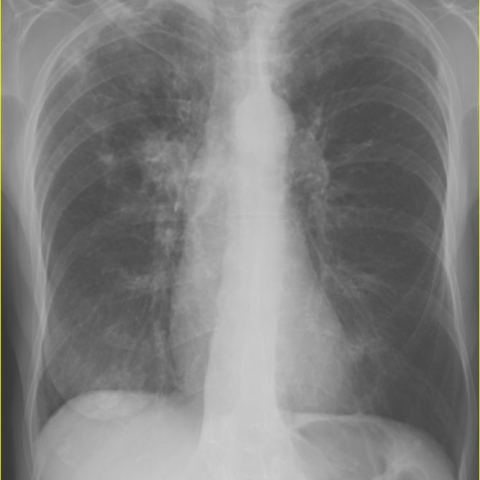
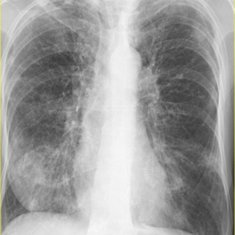

# V12：8379_8353800889338

[全部题目](README.md) · [结构化病例记录](8379_8353800889338.json)

来源：[ChestAgentBench 固定版本](https://huggingface.co/datasets/wanglab/chest-agent-bench/tree/921e60440927f9893228d843c0206b755744252a)；[Eurorad case 8379](https://www.eurorad.org/case/8379)。

参考答案只来自实验结束后的既有评分结果。模型和工具文字是可观察输出，不是人工确认的患者事实。

## 完整题干与全部选项

```text
Based on the chest X-ray findings, which statement best describes the evolution of the pulmonary findings in this patient with Churg-Strauss Syndrome?

A) The initial X-ray shows bilateral upper lobe consolidation, which resolves completely in the follow-up X-ray.
B) The initial X-ray shows right hilar parenchymal consolidation, which migrates to bilateral lower lobe consolidation in the follow-up X-ray.
C) The initial X-ray reveals left lung consolidation, which progresses to diffuse bilateral consolidation in the follow-up X-ray.
D) The initial X-ray demonstrates perihilar consolidation on the left side, with new right-sided upper lobe consolidation in the follow-up X-ray.
E) The initial X-ray demonstrates right lower lobe nodules that remain unchanged on the follow-up X-ray.
F) The initial X-ray shows right upper lobe consolidation with new left hilar consolidation in the follow-up X-ray.
```

## 原图与图号对应

**image:1 — figures/8379/figure_1.jpg**



**image:2 — figures/8379/figure_3.jpg**



## 三阶段答案与失败回退

| 组 | 首答 | 取证后候选 | 模型最终求解 | 控制器最终答案 | 状态 |
|---|---|---|---|---|---|
| B | C | C | C | C | completed |
| A | C | C | C | C | completed |

失败回退保留已有合法首答，不计作新求解成功；首答和候选均未作为最终模型输入。

## 完整调用、检索及工具记录

- [initial：实际保存的请求、响应、解析、观察、工具原始返回、费用与耗时](../traces/8379_8353800889338_initial.json)
- [B：实际保存的请求、响应、解析、观察、工具原始返回、费用与耗时](../traces/8379_8353800889338_B.json)
- [A：实际保存的请求、响应、解析、观察、工具原始返回、费用与耗时](../traces/8379_8353800889338_A.json)

图号、模态、初次/随访、比较对象以及派生图与原图关系保存在各阶段的 image registry / images.json / observation 中。Unknown 保持未知。

## 已评分结果、错误、费用与耗时

```json
{
  "scored_outcome": {
    "question_id": "8379_8353800889338",
    "official_categories": [
      "comparison",
      "localization",
      "relationship"
    ],
    "reference_answer": "B",
    "initial": {
      "answer": "C",
      "correct": false,
      "status": "completed",
      "error": null
    },
    "B": {
      "answer": "C",
      "correct": false,
      "candidate_answer": "C",
      "candidate_correct": false,
      "solver_answer": "C",
      "solver_correct": false,
      "fallback_to_initial": false,
      "status": "completed",
      "error": null,
      "transition_from_initial": "legal_wrong_to_wrong",
      "candidate_transition_from_initial": "legal_wrong_to_wrong",
      "k_ids": [
        "ACR_DLD_2026_K05"
      ],
      "e_ids": [
        "9626056ed88c9deaabfc05456a0ad2ecadcb4f685e732c860df4456b5ba8e2ef"
      ]
    },
    "A": {
      "answer": "C",
      "correct": false,
      "candidate_answer": "C",
      "candidate_correct": false,
      "solver_answer": "C",
      "solver_correct": false,
      "fallback_to_initial": false,
      "status": "completed",
      "error": null,
      "transition_from_initial": "legal_wrong_to_wrong",
      "candidate_transition_from_initial": "legal_wrong_to_wrong",
      "k_ids": [],
      "e_ids": []
    }
  },
  "initial": {
    "question_id": "8379_8353800889338",
    "first_answer": "C",
    "status": "completed",
    "error": null,
    "observation": {
      "first_answer": "C",
      "observations": [
        {
          "attribute": "left lung consolidation",
          "value": "dense, ill-defined opacity in left lower and mid zones, extending to perihilar region in Figure 1",
          "status": "observed_present",
          "evidence_refs": [
            "image:1"
          ]
        },
        {
          "attribute": "bilateral consolidation",
          "value": "diffuse, patchy opacities involving both lungs, more extensive than Figure 1; left side still prominent, right side newly involved with mid/lower zone opacities in Figure 3",
          "status": "observed_present",
          "evidence_refs": [
            "image:2"
          ]
        },
        {
          "attribute": "upper lobe predominance",
          "value": "no clear upper lobe consolidation in either image; opacities are predominantly mid-to-lower zone",
          "status": "observed_absent",
          "evidence_refs": [
            "image:1",
            "image:2"
          ]
        },
        {
          "attribute": "hilar parenchymal consolidation",
          "value": "left perihilar density present in Figure 1; no discrete right hilar mass or consolidation in either image",
          "status": "hypothesis",
          "evidence_refs": [
            "image:1"
          ]
        },
        {
          "attribute": "nodules",
          "value": "no discrete nodular opacities; opacities are confluent/patchy, not discrete",
          "status": "observed_absent",
          "evidence_refs": [
            "image:1",
            "image:2"
          ]
        },
        {
          "attribute": "resolution",
          "value": "opacities increase in extent from Figure 1 to Figure 3; no resolution observed",
          "status": "observed_absent",
          "evidence_refs": [
            "image:1",
            "image:2"
          ]
        }
      ],
      "hypotheses": [
        {
          "name": "Eosinophilic pneumonia progression in Churg-Strauss Syndrome",
          "basis": "Initial unilateral (left) consolidation progressing to bilateral diffuse involvement is classic for eosinophilic lung disease in EGPA; the pattern matches migratory pulmonary infiltrates",
          "status": "hypothesis",
          "evidence_refs": [
            "image:1",
            "image:2"
          ]
        },
        {
          "name": "Non-resolving infectious or inflammatory process",
          "basis": "Progression rather than resolution suggests active disease; however, absence of cavitation or lymphadenopathy makes infection less likely without clinical context",
          "status": "hypothesis",
          "evidence_refs": [
            "image:1",
            "image:2"
          ]
        }
      ],
      "patient_conditions": [
        {
          "name": "diagnosis",
          "value": "Churg-Strauss Syndrome",
          "source_quote": "this patient with Churg-Strauss Syndrome",
          "source": "question_stem_explicit_text"
        }
      ],
      "discriminators": [
        {
          "attribute": "laterality and progression pattern",
          "question": "Which option correctly describes unilateral left consolidation evolving to bilateral diffuse consolidation?",
          "option_labels": [
            "C"
          ],
          "image_ids": [
            "image:1",
            "image:2"
          ],
          "comparison_object": "pulmonary parenchyma"
        },
        {
          "attribute": "upper lobe involvement",
          "question": "Which options incorrectly specify upper lobe consolidation?",
          "option_labels": [
            "A",
            "D",
            "F"
          ],
          "image_ids": [
            "image:1",
            "image:2"
          ],
          "comparison_object": "upper lung zones"
        },
        {
          "attribute": "hilar migration",
          "question": "Which option falsely claims right hilar consolidation migrating to lower lobes?",
          "option_labels": [
            "B"
          ],
          "image_ids": [
            "image:1",
            "image:2"
          ],
          "comparison_object": "hilar regions"
        },
        {
          "attribute": "stability",
          "question": "Which option falsely claims unchanged nodules?",
          "option_labels": [
            "E"
          ],
          "image_ids": [
            "image:1",
            "image:2"
          ],
          "comparison_object": "right lower lobe"
        }
      ],
      "image_metadata": [
        {
          "image_id": "image:1",
          "figure_label": "Figure 1",
          "source_filename": "figures/8379/figure_1.jpg",
          "modality": "CXR",
          "anatomy": "thorax, posteroanterior view",
          "timepoint": "unknown",
          "timepoint_source_quote": "",
          "comparison_object": "pulmonary parenchyma",
          "modality_source": "first_visual_reader_report_not_clinically_adjudicated"
        },
        {
          "image_id": "image:2",
          "figure_label": "Figure 3",
          "source_filename": "figures/8379/figure_3.jpg",
          "modality": "CXR",
          "anatomy": "thorax, posteroanterior view",
          "timepoint": "unknown",
          "timepoint_source_quote": "",
          "comparison_object": "pulmonary parenchyma",
          "modality_source": "first_visual_reader_report_not_clinically_adjudicated"
        }
      ],
      "uncertainties": [
        "Exact time interval between images not provided",
        "Patient orientation (e.g., rotation, inspiration) not quantified",
        "No clinical history (e.g., symptoms, labs, treatment) supplied to confirm EGPA activity",
        "No confirmation that Figure 1 = initial and Figure 3 = follow-up beyond question stem implication"
      ],
      "parse_warnings": [
        "invalid_observation_status_as_hypothesis",
        "unsupported_timepoint_left_unknown:image:1",
        "unsupported_timepoint_left_unknown:image:2"
      ]
    },
    "accounting": {
      "input_tokens": 1693,
      "output_tokens": 1113,
      "total_tokens": 2806,
      "model_calls": 1,
      "tool_calls": 0,
      "logical_cost_cny": "0.020128",
      "incremental_cost_cny": "0.020128",
      "provider_actual_cost_cny": null,
      "cost_basis": "usage_at_existing_profile_assumed_rates_or_conservative_unknown_reservation_not_invoice",
      "usage_complete": true,
      "issues": []
    },
    "stop_run": false,
    "stop_reason": null,
    "timing": {
      "started_utc": "2026-10-31T05:54:31.380416+00:00",
      "ended_utc": "2026-10-31T05:54:56.714705+00:00",
      "elapsed_s": 25.334
    }
  },
  "branches": {
    "B": {
      "question_id": "8379_8353800889338",
      "group": "B",
      "answer": "C",
      "status": "completed",
      "error": null,
      "shared_observation_source": "shared_initial",
      "first_answer_visible": false,
      "tool_attempts": [
        {
          "evidence_ref": "B:tool:1",
          "action": {
            "kind": "visual",
            "image_id": "image:1",
            "image_ids": [
              "image:1",
              "image:2"
            ],
            "target_region": "left lung parenchyma, mid-to-lower zones including perihilar region",
            "tool": "",
            "question": "In Figure 1, is there consolidation in the left lung mid-to-lower zones extending to the perihilar region, and is it unilateral?",
            "expected_attribute": "unilateral left-sided consolidation (mid/lower zone, perihilar)",
            "comparison_object": "pulmonary parenchyma",
            "tool_args": {}
          },
          "started_utc": "2026-10-31T05:55:08.042135+00:00",
          "result": {
            "selected_images": [
              "image:1",
              "image:2"
            ]
          },
          "classification": {
            "evidence_kind": "image_pixels",
            "usable": true,
            "reason": "View selection, no independent tool inference."
          },
          "status": "returned",
          "ended_utc": "2026-10-31T05:55:08.042159+00:00"
        },
        {
          "evidence_ref": "B:tool:2",
          "action": {
            "kind": "visual",
            "image_id": "image:2",
            "image_ids": [
              "image:2",
              "image:1"
            ],
            "target_region": "bilateral lung fields, especially right mid/lower zones and left side",
            "tool": "",
            "question": "In Figure 3, has the left-sided consolidation progressed and is new right-sided consolidation present, resulting in diffuse bilateral involvement?",
            "expected_attribute": "bilateral diffuse patchy opacities, with new right mid/lower zone involvement",
            "comparison_object": "pulmonary parenchyma",
            "tool_args": {}
          },
          "started_utc": "2026-10-31T05:55:08.045432+00:00",
          "result": {
            "selected_images": [
              "image:2",
              "image:1"
            ]
          },
          "classification": {
            "evidence_kind": "image_pixels",
            "usable": true,
            "reason": "View selection, no independent tool inference."
          },
          "status": "returned",
          "ended_utc": "2026-10-31T05:55:08.045470+00:00"
        }
      ],
      "additional_observations": {
        "observations": [
          {
            "attribute": "left lung consolidation in initial X-ray (Figure 1)",
            "value": "Unilateral patchy consolidation in left mid-to-lower zones, extending to perihilar region; right lung appears clear.",
            "status": "observed_present",
            "evidence_refs": [
              "image:1"
            ]
          },
          {
            "attribute": "bilateral involvement in follow-up X-ray (Figure 3)",
            "value": "Diffuse bilateral patchy opacities; left-sided consolidation is more extensive and heterogeneous, and new consolidation is present in right mid-to-lower zones (not upper lobe or hilar-dominant).",
            "status": "observed_present",
            "evidence_refs": [
              "image:2"
            ]
          },
          {
            "attribute": "upper lobe consolidation",
            "value": "Absent in both images; no significant opacities in upper lobes.",
            "status": "observed_absent",
            "evidence_refs": [
              "image:1",
              "image:2"
            ]
          },
          {
            "attribute": "hilar-dominant consolidation",
            "value": "No discrete hilar mass or focal hilar consolidation; opacities are parenchymal and peripheral/central mixed, not strictly hilar.",
            "status": "observed_absent",
            "evidence_refs": [
              "image:1",
              "image:2"
            ]
          },
          {
            "attribute": "right lower lobe nodules (stable)",
            "value": "No discrete nodules identified in right lower lobe in either image; opacities are confluent/patchy, not nodular.",
            "status": "observed_absent",
            "evidence_refs": [
              "image:1",
              "image:2"
            ]
          }
        ],
        "hypotheses": [
          {
            "name": "Progressive eosinophilic pneumonia pattern consistent with Churg-Strauss Syndrome",
            "basis": "Unilateral consolidation evolving to bilateral diffuse patchy opacities without upper lobe predominance—typical of pulmonary vasculitis with eosinophilic infiltration.",
            "status": "hypothesis",
            "evidence_refs": [
              "image:1",
              "image:2"
            ]
          }
        ],
        "uncertainties": [
          "Exact temporal order (which is initial vs. follow-up) is not explicitly labeled in image metadata; assignment relies on clinical context implied by question stem and standard figure sequencing (Figure 1 before Figure 3).",
          "No calibration for size or density; opacities described qualitatively only.",
          "No clinical correlation (e.g., symptoms, labs, biopsy) available to confirm diagnosis or mechanism."
        ],
        "parse_warnings": [],
        "kind": "targeted_image_read_requires_independent_verification"
      },
      "candidate_answer": "C",
      "solver_answer": "C",
      "fallback_to_initial": false,
      "k_ids": [
        "ACR_DLD_2026_K05"
      ],
      "e_ids": [
        "9626056ed88c9deaabfc05456a0ad2ecadcb4f685e732c860df4456b5ba8e2ef"
      ],
      "action_suggestions": [
        {
          "experience_id": "9626056ed88c9deaabfc05456a0ad2ecadcb4f685e732c860df4456b5ba8e2ef",
          "source_question_id": "12811_8353800689121",
          "source_step_id": 3,
          "source_event_line": 825,
          "applicable_ambiguity": "Which option correctly describes unilateral left consolidation evolving to bilateral diffuse consolidation?",
          "target_image_ids": [
            "image:1",
            "image:2"
          ],
          "target_region": "region containing the named distinguishing attribute; planner must bind exact image/ROI",
          "tool": "chest_xray_expert",
          "specific_question": "Which option correctly describes unilateral left consolidation evolving to bilateral diffuse consolidation?",
          "expected_discriminating_attributes": [
            "comparison",
            "laterality",
            "morphology"
          ],
          "object_id": null,
          "comparison_object": "pulmonary parenchyma",
          "historical_execution": "returned_valid",
          "historical_whole_question_outcome": "incorrect",
          "step_credit": null,
          "step_credit_evidence": null,
          "selection_basis": "modality_and_capability_match_no_step_gain_data",
          "heuristic_capability_coverage_not_credit": 1.0,
          "caution": "Tool output is a fallible report; independently check current pixels.",
          "historical_failure_advice": null,
          "is_patient_fact": false
        }
      ],
      "decision": {
        "answer": "C",
        "uncertain": true,
        "observations": [
          {
            "attribute": "left lung consolidation in initial X-ray (Figure 1)",
            "value": "Unilateral patchy consolidation in left mid-to-lower zones, extending to perihilar region; right lung clear",
            "status": "observed_present",
            "evidence_refs": [
              "image:1"
            ]
          },
          {
            "attribute": "bilateral consolidation in follow-up X-ray (Figure 3)",
            "value": "Diffuse bilateral patchy opacities; left side more extensive, new right mid-to-lower zone involvement",
            "status": "observed_present",
            "evidence_refs": [
              "image:2"
            ]
          },
          {
            "attribute": "upper lobe predominance",
            "value": "Absent in both images; no significant upper lobe opacities",
            "status": "observed_absent",
            "evidence_refs": [
              "image:1",
              "image:2"
            ]
          },
          {
            "attribute": "hilar-dominant consolidation",
            "value": "No discrete hilar mass or focal hilar consolidation; opacities are parenchymal, not strictly hilar",
            "status": "observed_absent",
            "evidence_refs": [
              "image:1",
              "image:2"
            ]
          },
          {
            "attribute": "nodules",
            "value": "No discrete nodular opacities; opacities are confluent/patchy",
            "status": "observed_absent",
            "evidence_refs": [
              "image:1",
              "image:2"
            ]
          },
          {
            "attribute": "resolution",
            "value": "Opacities increase from Figure 1 to Figure 3; no resolution",
            "status": "observed_absent",
            "evidence_refs": [
              "image:1",
              "image:2"
            ]
          }
        ],
        "option_checks": [
          {
            "option": "A",
            "support": [],
            "conflict": [
              "Initial bilateral upper lobe consolidation not present",
              "No resolution—opacities worsen"
            ],
            "unknown": []
          },
          {
            "option": "B",
            "support": [],
            "conflict": [
              "No right hilar parenchymal consolidation in initial image",
              "No migration pattern; progression is bilateral diffuse, not lower lobe shift"
            ],
            "unknown": []
          },
          {
            "option": "C",
            "support": [
              "Initial left lung consolidation (mid/lower, perihilar) in Figure 1",
              "Progression to diffuse bilateral consolidation in Figure 3, with new right-sided involvement"
            ],
            "conflict": [],
            "unknown": []
          },
          {
            "option": "D",
            "support": [],
            "conflict": [
              "No perihilar consolidation on left as discrete entity—it’s part of larger left consolidation",
              "No new right upper lobe consolidation; right involvement is mid/lower zone"
            ],
            "unknown": []
          },
          {
            "option": "E",
            "support": [],
            "conflict": [
              "No right lower lobe nodules in either image",
              "Opacities change (increase), not unchanged"
            ],
            "unknown": []
          },
          {
            "option": "F",
            "support": [],
            "conflict": [
              "No right upper lobe consolidation in initial image",
              "No new left hilar consolidation—left consolidation is already present and expands"
            ],
            "unknown": []
          }
        ],
        "missing_option_checks": [],
        "missing_evidence": [
          "Exact temporal order (Figure 1 = initial, Figure 3 = follow-up) not explicitly labeled—assumed from figure numbering and question stem implication",
          "No clinical correlation (e.g., eosinophil count, symptoms, treatment) to confirm active EGPA",
          "No calibration for size/density; qualitative only"
        ],
        "parse_warnings": []
      },
      "action_plan": {
        "actions": [
          {
            "kind": "visual",
            "image_id": "image:1",
            "image_ids": [
              "image:1",
              "image:2"
            ],
            "target_region": "left lung parenchyma, mid-to-lower zones including perihilar region",
            "tool": "",
            "question": "In Figure 1, is there consolidation in the left lung mid-to-lower zones extending to the perihilar region, and is it unilateral?",
            "expected_attribute": "unilateral left-sided consolidation (mid/lower zone, perihilar)",
            "comparison_object": "pulmonary parenchyma",
            "tool_args": {}
          },
          {
            "kind": "visual",
            "image_id": "image:2",
            "image_ids": [
              "image:2",
              "image:1"
            ],
            "target_region": "bilateral lung fields, especially right mid/lower zones and left side",
            "tool": "",
            "question": "In Figure 3, has the left-sided consolidation progressed and is new right-sided consolidation present, resulting in diffuse bilateral involvement?",
            "expected_attribute": "bilateral diffuse patchy opacities, with new right mid/lower zone involvement",
            "comparison_object": "pulmonary parenchyma",
            "tool_args": {}
          }
        ],
        "remaining_uncertainties": [
          "Exact temporal ordering (Figure 1 = initial, Figure 3 = follow-up) is assumed from question stem but not verified by metadata",
          "No clinical correlation (e.g., eosinophil count, symptoms) to confirm EGPA activity",
          "Whether 'perihilar' in option D refers to same region as observed left perihilar density"
        ],
        "applied_context_ids": [
          "image:1",
          "image:2"
        ],
        "parse_warnings": [],
        "issues": []
      },
      "accounting": {
        "input_tokens": 11562,
        "output_tokens": 1870,
        "total_tokens": 13432,
        "model_calls": 3,
        "tool_calls": 0,
        "logical_cost_cny": "0.068688",
        "incremental_cost_cny": "0.068688",
        "provider_actual_cost_cny": null,
        "cost_basis": "usage_at_existing_profile_assumed_rates_or_conservative_unknown_reservation_not_invoice",
        "usage_complete": true,
        "issues": []
      },
      "stop_run": false,
      "stop_reason": null,
      "timing": {
        "started_utc": "2026-10-31T05:54:56.719981+00:00",
        "ended_utc": "2026-10-31T05:55:43.094727+00:00",
        "elapsed_s": 46.375
      }
    },
    "A": {
      "question_id": "8379_8353800889338",
      "group": "A",
      "answer": "C",
      "status": "completed",
      "error": null,
      "shared_observation_source": "shared_initial",
      "first_answer_visible": false,
      "tool_attempts": [
        {
          "evidence_ref": "A:tool:1",
          "action": {
            "kind": "visual",
            "image_id": "image:1",
            "image_ids": [
              "image:1",
              "image:2"
            ],
            "target_region": "left lung parenchyma (mid to lower zones)",
            "tool": "",
            "question": "In Figure 1, is the consolidation confined to the left lung, and does it involve perihilar, mid, and lower zones without upper lobe involvement?",
            "expected_attribute": "unilateral left-sided consolidation, mid-to-lower zone predominant, no upper lobe opacity",
            "comparison_object": "left pulmonary parenchyma across timepoints",
            "tool_args": {}
          },
          "started_utc": "2026-10-31T06:47:48.707829+00:00",
          "result": {
            "selected_images": [
              "image:1",
              "image:2"
            ]
          },
          "classification": {
            "evidence_kind": "image_pixels",
            "usable": true,
            "reason": "View selection, no independent tool inference."
          },
          "status": "returned",
          "ended_utc": "2026-10-31T06:47:48.707856+00:00"
        },
        {
          "evidence_ref": "A:tool:2",
          "action": {
            "kind": "visual",
            "image_id": "image:2",
            "image_ids": [
              "image:2",
              "image:1"
            ],
            "target_region": "bilateral lung fields with emphasis on right mid/lower zones",
            "tool": "",
            "question": "In Figure 3, has the left-sided consolidation persisted and expanded, and is new consolidation now present in the right mid and lower zones, resulting in diffuse bilateral involvement?",
            "expected_attribute": "bilateral diffuse patchy opacities, left still prominent, right newly involved (mid/lower), no upper lobe predominance",
            "comparison_object": "pulmonary parenchyma across timepoints",
            "tool_args": {}
          },
          "started_utc": "2026-10-31T06:47:48.711216+00:00",
          "result": {
            "selected_images": [
              "image:2",
              "image:1"
            ]
          },
          "classification": {
            "evidence_kind": "image_pixels",
            "usable": true,
            "reason": "View selection, no independent tool inference."
          },
          "status": "returned",
          "ended_utc": "2026-10-31T06:47:48.711256+00:00"
        }
      ],
      "additional_observations": {
        "observations": [
          {
            "attribute": "initial pulmonary consolidation laterality and distribution",
            "value": "Unilateral left lung consolidation, predominantly in mid-to-lower zones, with perihilar extension; no upper lobe opacity evident",
            "status": "observed_present",
            "evidence_refs": [
              "image:1"
            ]
          },
          {
            "attribute": "follow-up pulmonary consolidation pattern",
            "value": "Left-sided consolidation persists and appears more extensive; new patchy consolidation now present in right mid and lower zones, resulting in diffuse bilateral involvement; no predominant upper lobe opacities",
            "status": "observed_present",
            "evidence_refs": [
              "image:2"
            ]
          },
          {
            "attribute": "upper lobe involvement in either timepoint",
            "value": "No clear upper lobe consolidation in either image",
            "status": "observed_absent",
            "evidence_refs": [
              "image:1",
              "image:2"
            ]
          },
          {
            "attribute": "hilar migration of consolidation",
            "value": "No evidence of consolidation originating in right hilum or migrating from hilar to lower zones",
            "status": "observed_absent",
            "evidence_refs": [
              "image:1",
              "image:2"
            ]
          },
          {
            "attribute": "right lower lobe nodules (stable)",
            "value": "No discrete nodules identified in right lower lobe in either image; instead, patchy consolidation is seen in follow-up",
            "status": "observed_absent",
            "evidence_refs": [
              "image:1",
              "image:2"
            ]
          }
        ],
        "hypotheses": [
          {
            "name": "Churg-Strauss Syndrome with migratory pulmonary infiltrates",
            "basis": "Unilateral left consolidation progressing to bilateral diffuse patchy opacities aligns with classic migratory pulmonary infiltrates in eosinophilic granulomatosis with polyangiitis (Churg-Strauss)",
            "status": "hypothesis",
            "evidence_refs": [
              "image:1",
              "image:2"
            ]
          }
        ],
        "uncertainties": [
          "Exact temporal order of images (which is initial vs. follow-up) is not explicitly labeled; assignment inferred from progression pattern and standard clinical reporting convention (Figure 1 before Figure 3).",
          "No calibration for size or density; opacities are described qualitatively.",
          "No clinical correlation (e.g., symptoms, labs, biopsy) provided—findings interpreted purely radiographically."
        ],
        "parse_warnings": [],
        "kind": "targeted_image_read_requires_independent_verification"
      },
      "candidate_answer": "C",
      "solver_answer": "C",
      "fallback_to_initial": false,
      "k_ids": [],
      "e_ids": [],
      "action_suggestions": [],
      "decision": {
        "answer": "C",
        "uncertain": true,
        "observations": [
          {
            "attribute": "initial pulmonary consolidation laterality and distribution",
            "value": "Unilateral left lung consolidation, predominantly mid-to-lower zones with perihilar extension; no upper lobe opacity in Figure 1",
            "status": "observed_present",
            "evidence_refs": [
              "image:1"
            ]
          },
          {
            "attribute": "follow-up pulmonary consolidation pattern",
            "value": "Left-sided consolidation persists and appears more extensive; new patchy consolidation in right mid/lower zones → diffuse bilateral involvement in Figure 3",
            "status": "observed_present",
            "evidence_refs": [
              "image:2"
            ]
          },
          {
            "attribute": "upper lobe involvement",
            "value": "No clear upper lobe consolidation in either image",
            "status": "observed_absent",
            "evidence_refs": [
              "image:1",
              "image:2"
            ]
          },
          {
            "attribute": "hilar migration or discrete nodules",
            "value": "No evidence of hilar-originating consolidation or discrete nodules",
            "status": "observed_absent",
            "evidence_refs": [
              "image:1",
              "image:2"
            ]
          }
        ],
        "option_checks": [
          {
            "option": "A",
            "support": [],
            "conflict": [
              "bilateral upper lobe consolidation (absent)",
              "complete resolution (opacities increased)"
            ],
            "unknown": []
          },
          {
            "option": "B",
            "support": [],
            "conflict": [
              "right hilar parenchymal consolidation (not observed)",
              "migration to lower lobes (no hilar origin, no migration pattern)"
            ],
            "unknown": []
          },
          {
            "option": "C",
            "support": [
              "initial left lung consolidation (Figure 1)",
              "progression to diffuse bilateral consolidation (Figure 3, left persistent + right new)"
            ],
            "conflict": [],
            "unknown": []
          },
          {
            "option": "D",
            "support": [],
            "conflict": [
              "perihilar consolidation on left (present, but not exclusive descriptor)",
              "new right upper lobe consolidation (absent — right opacities are mid/lower zone)"
            ],
            "unknown": []
          },
          {
            "option": "E",
            "support": [],
            "conflict": [
              "right lower lobe nodules (absent — no discrete nodules)",
              "unchanged (opacities progressed)"
            ],
            "unknown": []
          },
          {
            "option": "F",
            "support": [],
            "conflict": [
              "right upper lobe consolidation (absent)",
              "new left hilar consolidation (left consolidation already present and broader than just hilar)"
            ],
            "unknown": []
          }
        ],
        "missing_option_checks": [],
        "missing_evidence": [
          "Exact temporal order (Figure 1 vs. Figure 3 as initial/follow-up) not labeled — assumed by progression pattern",
          "Clinical correlation (e.g., eosinophilia, symptoms, treatment) not provided",
          "Quantitative size/density change not measurable without scale"
        ],
        "parse_warnings": []
      },
      "action_plan": {
        "actions": [
          {
            "kind": "visual",
            "image_id": "image:1",
            "image_ids": [
              "image:1",
              "image:2"
            ],
            "target_region": "left lung parenchyma (mid to lower zones)",
            "tool": "",
            "question": "In Figure 1, is the consolidation confined to the left lung, and does it involve perihilar, mid, and lower zones without upper lobe involvement?",
            "expected_attribute": "unilateral left-sided consolidation, mid-to-lower zone predominant, no upper lobe opacity",
            "comparison_object": "left pulmonary parenchyma across timepoints",
            "tool_args": {}
          },
          {
            "kind": "visual",
            "image_id": "image:2",
            "image_ids": [
              "image:2",
              "image:1"
            ],
            "target_region": "bilateral lung fields with emphasis on right mid/lower zones",
            "tool": "",
            "question": "In Figure 3, has the left-sided consolidation persisted and expanded, and is new consolidation now present in the right mid and lower zones, resulting in diffuse bilateral involvement?",
            "expected_attribute": "bilateral diffuse patchy opacities, left still prominent, right newly involved (mid/lower), no upper lobe predominance",
            "comparison_object": "pulmonary parenchyma across timepoints",
            "tool_args": {}
          }
        ],
        "remaining_uncertainties": [
          "Exact temporal ordering (Figure 1 = initial, Figure 3 = follow-up) is implied but not confirmed by metadata",
          "No objective quantification of opacity extent or density change",
          "Hilar vs perihilar distinction remains qualitative"
        ],
        "applied_context_ids": [
          "image:1",
          "image:2"
        ],
        "parse_warnings": [],
        "issues": []
      },
      "accounting": {
        "input_tokens": 10695,
        "output_tokens": 1694,
        "total_tokens": 12389,
        "model_calls": 3,
        "tool_calls": 0,
        "logical_cost_cny": "0.063108",
        "incremental_cost_cny": "0.063108",
        "provider_actual_cost_cny": null,
        "cost_basis": "usage_at_existing_profile_assumed_rates_or_conservative_unknown_reservation_not_invoice",
        "usage_complete": true,
        "issues": []
      },
      "stop_run": false,
      "stop_reason": null,
      "timing": {
        "started_utc": "2026-10-31T06:47:36.696057+00:00",
        "ended_utc": "2026-10-31T06:48:20.308783+00:00",
        "elapsed_s": 43.613
      }
    }
  }
}
```
