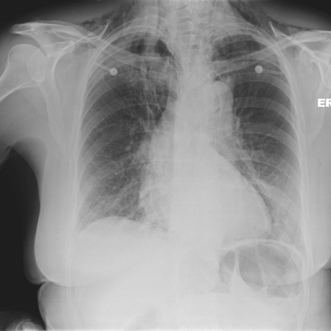

# V12：8911_8353800871456

[全部题目](README.md) · [结构化病例记录](8911_8353800871456.json)

来源：[ChestAgentBench 固定版本](https://huggingface.co/datasets/wanglab/chest-agent-bench/tree/921e60440927f9893228d843c0206b755744252a)；[Eurorad case 8911](https://www.eurorad.org/case/8911)。

参考答案只来自实验结束后的既有评分结果。模型和工具文字是可观察输出，不是人工确认的患者事实。

## 完整题干与全部选项

```text
Based on Figure 2, which statement most accurately describes the relationship between the pneumomediastinum and pneumopericardium, and what clinical insight does this provide regarding the patient's condition?

A) The pneumomediastinum is localized only to the lower mediastinum, while the pneumopericardium is extensive, indicating a high likelihood of cardiac tamponade.
B) The pneumomediastinum extends into the neck, while the pneumopericardium is confined to the cardiac silhouette, suggesting a severe rupture of the oesophagus with potential for mediastinitis.
C) Both pneumomediastinum and pneumopericardium are localized to the upper chest, indicating a minor rupture with limited risk of further complications.
D) The pneumomediastinum surrounds the heart and extends superiorly, while the pneumopericardium is minimal, suggesting the primary source of air is distal oesophageal perforation.
E) The pneumopericardium is extensive and overshadows the pneumomediastinum, indicating the air source is likely cardiac trauma rather than oesophageal perforation.
F) The pneumomediastinum is more pronounced than the pneumopericardium, extending into the neck, indicating significant oesophageal perforation consistent with Boerhaave's syndrome.
```

## 原图与图号对应

**image:1 — figures/8911/figure_2.jpg**



## 三阶段答案与失败回退

| 组 | 首答 | 取证后候选 | 模型最终求解 | 控制器最终答案 | 状态 |
|---|---|---|---|---|---|
| B | F | F | F | F | completed |
| A | F | F | F | F | completed |

失败回退保留已有合法首答，不计作新求解成功；首答和候选均未作为最终模型输入。

## 完整调用、检索及工具记录

- [initial：实际保存的请求、响应、解析、观察、工具原始返回、费用与耗时](../traces/8911_8353800871456_initial.json)
- [B：实际保存的请求、响应、解析、观察、工具原始返回、费用与耗时](../traces/8911_8353800871456_B.json)
- [A：实际保存的请求、响应、解析、观察、工具原始返回、费用与耗时](../traces/8911_8353800871456_A.json)

图号、模态、初次/随访、比较对象以及派生图与原图关系保存在各阶段的 image registry / images.json / observation 中。Unknown 保持未知。

## 已评分结果、错误、费用与耗时

```json
{
  "scored_outcome": {
    "question_id": "8911_8353800871456",
    "official_categories": [
      "comparison",
      "localization",
      "relationship"
    ],
    "reference_answer": "F",
    "initial": {
      "answer": "F",
      "correct": true,
      "status": "completed",
      "error": null
    },
    "B": {
      "answer": "F",
      "correct": true,
      "candidate_answer": "F",
      "candidate_correct": true,
      "solver_answer": "F",
      "solver_correct": true,
      "fallback_to_initial": false,
      "status": "completed",
      "error": null,
      "transition_from_initial": "correct_to_correct",
      "candidate_transition_from_initial": "correct_to_correct",
      "k_ids": [
        "BTS_PLEURAL_2023_K08"
      ],
      "e_ids": [
        "6ba5978652d9c23d65a67d58486ec71934ad5c76f2ec74f583aba5ddf9fbb7d0"
      ]
    },
    "A": {
      "answer": "F",
      "correct": true,
      "candidate_answer": "F",
      "candidate_correct": true,
      "solver_answer": "F",
      "solver_correct": true,
      "fallback_to_initial": false,
      "status": "completed",
      "error": null,
      "transition_from_initial": "correct_to_correct",
      "candidate_transition_from_initial": "correct_to_correct",
      "k_ids": [],
      "e_ids": []
    }
  },
  "initial": {
    "question_id": "8911_8353800871456",
    "first_answer": "F",
    "status": "completed",
    "error": null,
    "observation": {
      "first_answer": "F",
      "observations": [
        {
          "attribute": "pneumomediastinum extent",
          "value": "visible linear lucencies along the mediastinal borders, extending superiorly into the neck (subcutaneous air in soft tissues of neck and supraclavicular regions)",
          "status": "observed_present",
          "evidence_refs": [
            "image:1"
          ]
        },
        {
          "attribute": "pneumopericardium",
          "value": "thin rim of lucency surrounding the cardiac silhouette, consistent with small-volume pneumopericardium",
          "status": "observed_present",
          "evidence_refs": [
            "image:1"
          ]
        },
        {
          "attribute": "relative volume",
          "value": "pneumomediastinum appears more extensive than pneumopericardium",
          "status": "observed_present",
          "evidence_refs": [
            "image:1"
          ]
        },
        {
          "attribute": "air tracking pattern",
          "value": "air extends from mediastinum upward toward neck, suggesting retrograde dissection along fascial planes",
          "status": "observed_present",
          "evidence_refs": [
            "image:1"
          ]
        },
        {
          "attribute": "cardiac silhouette",
          "value": "no evidence of cardiomegaly or pericardial effusion; heart size normal",
          "status": "observed_absent",
          "evidence_refs": [
            "image:1"
          ]
        },
        {
          "attribute": "pleural air",
          "value": "no pneumothorax visible",
          "status": "observed_absent",
          "evidence_refs": [
            "image:1"
          ]
        }
      ],
      "hypotheses": [
        {
          "name": "oesophageal perforation (e.g., Boerhaave’s syndrome)",
          "basis": "Extensive pneumomediastinum with cervical extension and associated pneumopericardium is classic for spontaneous oesophageal rupture; air dissects from oesophagus into mediastinum and pericardial sac",
          "status": "hypothesis",
          "evidence_refs": [
            "image:1"
          ]
        },
        {
          "name": "traumatic or iatrogenic oesophageal injury",
          "basis": "Same imaging pattern could arise from instrumentation or trauma; however, clinical context (not provided) would be needed to distinguish",
          "status": "hypothesis",
          "evidence_refs": [
            "image:1"
          ]
        },
        {
          "name": "pulmonary alveolar rupture with mediastinal air tracking",
          "basis": "Less likely given absence of pneumothorax and presence of pneumopericardium; alveolar rupture typically causes pneumothorax first",
          "status": "hypothesis",
          "evidence_refs": [
            "image:1"
          ]
        }
      ],
      "patient_conditions": [],
      "discriminators": [
        {
          "attribute": "extent of pneumomediastinum vs pneumopericardium",
          "question": "Which option correctly identifies that pneumomediastinum is more pronounced and extends into the neck, while pneumopericardium is minimal?",
          "option_labels": [
            "F",
            "D"
          ],
          "image_ids": [
            "image:1"
          ],
          "comparison_object": "mediastinum and pericardial sac"
        },
        {
          "attribute": "clinical implication",
          "question": "Which option links extensive cervical pneumomediastinum + pneumopericardium to oesophageal perforation (Boerhaave’s)?",
          "option_labels": [
            "F",
            "B"
          ],
          "image_ids": [
            "image:1"
          ],
          "comparison_object": "air source inference"
        },
        {
          "attribute": "presence of cardiac tamponade signs",
          "question": "Which options incorrectly infer tamponade or cardiac trauma?",
          "option_labels": [
            "A",
            "E"
          ],
          "image_ids": [
            "image:1"
          ],
          "comparison_object": "cardiac silhouette and pericardial space"
        }
      ],
      "image_metadata": [
        {
          "image_id": "image:1",
          "figure_label": "Figure 2",
          "source_filename": "figures/8911/figure_2.jpg",
          "modality": "CXR",
          "anatomy": "thorax, including neck soft tissues",
          "timepoint": "unknown",
          "timepoint_source_quote": "",
          "comparison_object": "mediastinum and pericardium",
          "modality_source": "first_visual_reader_report_not_clinically_adjudicated"
        }
      ],
      "uncertainties": [
        "No clinical history provided (e.g., vomiting, trauma, procedure) to confirm etiology",
        "Exact timing of image acquisition unknown",
        "No lateral or CT view to confirm pneumopericardium extent or oesophageal defect",
        "Cannot rule out small pneumothorax obscured by overlying structures"
      ],
      "parse_warnings": []
    },
    "accounting": {
      "input_tokens": 1312,
      "output_tokens": 1022,
      "total_tokens": 2334,
      "model_calls": 1,
      "tool_calls": 0,
      "logical_cost_cny": "0.017512",
      "incremental_cost_cny": "0.017512",
      "provider_actual_cost_cny": null,
      "cost_basis": "usage_at_existing_profile_assumed_rates_or_conservative_unknown_reservation_not_invoice",
      "usage_complete": true,
      "issues": []
    },
    "stop_run": false,
    "stop_reason": null,
    "timing": {
      "started_utc": "2026-10-31T05:55:43.100930+00:00",
      "ended_utc": "2026-10-31T05:56:07.096630+00:00",
      "elapsed_s": 23.996
    }
  },
  "branches": {
    "B": {
      "question_id": "8911_8353800871456",
      "group": "B",
      "answer": "F",
      "status": "completed",
      "error": null,
      "shared_observation_source": "shared_initial",
      "first_answer_visible": false,
      "tool_attempts": [
        {
          "evidence_ref": "B:tool:1",
          "action": {
            "kind": "crop",
            "image_id": "image:1",
            "image_ids": [
              "image:1"
            ],
            "target_region": "mediastinal and pericardial region including cardiac silhouette and superior mediastinum extending to neck soft tissues",
            "tool": "",
            "question": "Is the pneumomediastinum more extensive than the pneumopericardium, and does air track superiorly into the neck?",
            "expected_attribute": "relative volume and superior extension of air in mediastinum vs thin pericardial rim",
            "comparison_object": "mediastinum and pericardial sac",
            "tool_args": {},
            "box": [
              0.2,
              0.1,
              0.8,
              0.7
            ]
          },
          "started_utc": "2026-10-31T05:56:19.000183+00:00",
          "result": {
            "image_id": "crop:35849fe50078",
            "path": "../assets/47cac607453c23b102f5f8ba5f66e93c1c3d9ba149b8ac2ca7c06c11f0c8376f.png",
            "role": "current_image_pixel_crop",
            "parent_image_id": "image:1",
            "parent_path": "../assets/de4625548d094fbe8eed260339b4f197a3eb0220677fdc6c54cac0ebac2fba6c.png",
            "source_size": [
              480,
              480
            ],
            "crop_size": [
              288,
              288
            ],
            "normalized_box": [
              0.2,
              0.1,
              0.8,
              0.7
            ],
            "pixel_box": [
              96,
              48,
              384,
              336
            ],
            "coordinate_system": "stored_pixel_coordinates_no_anatomical_orientation_inferred",
            "orientation": "unresolved",
            "timepoint": "unknown",
            "source_sha256": "de4625548d094fbe8eed260339b4f197a3eb0220677fdc6c54cac0ebac2fba6c",
            "crop_sha256": "47cac607453c23b102f5f8ba5f66e93c1c3d9ba149b8ac2ca7c06c11f0c8376f",
            "is_new_usable": null,
            "size": [
              288,
              288
            ],
            "modality": "CXR",
            "figure_label": "Figure 2",
            "source_filename": "figures/8911/figure_2.jpg",
            "timepoint_source_quote": ""
          },
          "classification": {
            "evidence_kind": "image_pixels",
            "usable": true,
            "reason": "Crop retains parent; not a clinical finding."
          },
          "status": "returned",
          "ended_utc": "2026-10-31T05:56:19.025253+00:00"
        },
        {
          "evidence_ref": "B:tool:2",
          "action": {
            "kind": "visual",
            "image_id": "image:1",
            "image_ids": [
              "image:1"
            ],
            "target_region": "cardiac silhouette and adjacent pericardial space",
            "tool": "",
            "question": "Are there signs of cardiac tamponade (e.g., globular heart, loss of cardiac borders, pericardial effusion) or traumatic cardiac injury?",
            "expected_attribute": "absence of cardiomegaly, preserved cardiac borders, no pericardial effusion",
            "comparison_object": "cardiac silhouette and pericardial space",
            "tool_args": {}
          },
          "started_utc": "2026-10-31T05:56:19.028590+00:00",
          "result": {
            "selected_images": [
              "image:1"
            ]
          },
          "classification": {
            "evidence_kind": "image_pixels",
            "usable": true,
            "reason": "View selection, no independent tool inference."
          },
          "status": "returned",
          "ended_utc": "2026-10-31T05:56:19.028619+00:00"
        }
      ],
      "additional_observations": {
        "observations": [
          {
            "attribute": "extent of pneumomediastinum vs pneumopericardium",
            "value": "Pneumomediastinum is more extensive than pneumopericardium; air is visible in the superior mediastinum and tracks into the neck soft tissues (subcutaneous emphysema), while pneumopericardium appears as a thin rim of air around the cardiac silhouette without large-volume accumulation",
            "status": "observed_present",
            "evidence_refs": [
              "image:1",
              "crop:35849fe50078"
            ]
          },
          {
            "attribute": "presence of cardiac tamponade signs",
            "value": "No globular heart, cardiac borders are preserved, no pericardial effusion visible; no evidence of tamponade",
            "status": "observed_absent",
            "evidence_refs": [
              "image:1"
            ]
          },
          {
            "attribute": "air tracking superiorly into neck",
            "value": "Subcutaneous air in neck soft tissues is visible on the full CXR (especially left side), confirming superior extension of mediastinal air",
            "status": "observed_present",
            "evidence_refs": [
              "image:1"
            ]
          },
          {
            "attribute": "localization of pneumomediastinum",
            "value": "Not confined to lower or upper chest alone; extends from cardiophrenic angles upward through mediastinum into neck — diffuse but predominantly superior and paratracheal",
            "status": "observed_present",
            "evidence_refs": [
              "image:1",
              "crop:35849fe50078"
            ]
          }
        ],
        "hypotheses": [
          {
            "name": "Boerhaave’s syndrome (spontaneous oesophageal rupture)",
            "basis": "Extensive pneumomediastinum with cervical extension + pneumopericardium is classic for oesophageal perforation, especially if associated with vomiting history (not provided but clinically typical); minimal pneumopericardium suggests air entered pericardial sac via mediastinal dissection rather than direct cardiac injury",
            "status": "hypothesis",
            "evidence_refs": [
              "image:1"
            ]
          }
        ],
        "uncertainties": [
          "Exact source of air (oesophagus vs trachea/bronchus) cannot be confirmed without contrast study or CT",
          "Time course and clinical context (e.g., vomiting, trauma) not available",
          "No measurement of air volume; qualitative assessment only",
          "Orientation of CXR (PA vs AP) not specified, though appearance suggests PA"
        ],
        "parse_warnings": [],
        "kind": "targeted_image_read_requires_independent_verification"
      },
      "candidate_answer": "F",
      "solver_answer": "F",
      "fallback_to_initial": false,
      "k_ids": [
        "BTS_PLEURAL_2023_K08"
      ],
      "e_ids": [
        "6ba5978652d9c23d65a67d58486ec71934ad5c76f2ec74f583aba5ddf9fbb7d0"
      ],
      "action_suggestions": [
        {
          "experience_id": "6ba5978652d9c23d65a67d58486ec71934ad5c76f2ec74f583aba5ddf9fbb7d0",
          "source_question_id": "12918_8353800587295",
          "source_step_id": 2,
          "source_event_line": 893,
          "applicable_ambiguity": "Which options incorrectly infer tamponade or cardiac trauma?",
          "target_image_ids": [
            "image:1"
          ],
          "target_region": "region containing the named distinguishing attribute; planner must bind exact image/ROI",
          "tool": "chest_xray_expert",
          "specific_question": "Which options incorrectly infer tamponade or cardiac trauma?",
          "expected_discriminating_attributes": [
            "presence"
          ],
          "object_id": null,
          "comparison_object": "cardiac silhouette and pericardial space",
          "historical_execution": "returned_valid",
          "historical_whole_question_outcome": "incorrect",
          "step_credit": null,
          "step_credit_evidence": null,
          "selection_basis": "modality_and_capability_match_no_step_gain_data",
          "heuristic_capability_coverage_not_credit": 1.0,
          "caution": "Tool output is a fallible report; independently check current pixels.",
          "historical_failure_advice": null,
          "is_patient_fact": false
        }
      ],
      "decision": {
        "answer": "F",
        "uncertain": true,
        "observations": [
          {
            "attribute": "pneumomediastinum extent",
            "value": "Visible linear lucencies along mediastinal borders extending superiorly into neck (subcutaneous air in supraclavicular/neck soft tissues), confirmed on full CXR and crop",
            "status": "observed_present",
            "evidence_refs": [
              "image:1",
              "crop:35849fe50078"
            ]
          },
          {
            "attribute": "pneumopericardium",
            "value": "Thin rim of lucency surrounding cardiac silhouette, minimal volume, no effusion or tamponade signs",
            "status": "observed_present",
            "evidence_refs": [
              "image:1"
            ]
          },
          {
            "attribute": "relative volume",
            "value": "Pneumomediastinum is more pronounced than pneumopericardium",
            "status": "observed_present",
            "evidence_refs": [
              "image:1",
              "crop:35849fe50078"
            ]
          },
          {
            "attribute": "air tracking pattern",
            "value": "Air dissects superiorly from mediastinum into neck, consistent with retrograde spread along fascial planes",
            "status": "observed_present",
            "evidence_refs": [
              "image:1"
            ]
          },
          {
            "attribute": "cardiac tamponade signs",
            "value": "No globular heart, preserved cardiac borders, no pericardial effusion — tamponade absent",
            "status": "observed_absent",
            "evidence_refs": [
              "image:1"
            ]
          }
        ],
        "option_checks": [
          {
            "option": "A",
            "support": [],
            "conflict": [
              "pneumomediastinum not localized only to lower mediastinum",
              "pneumopericardium is minimal, not extensive",
              "no evidence of tamponade"
            ],
            "unknown": []
          },
          {
            "option": "B",
            "support": [
              "pneumomediastinum extends into neck"
            ],
            "conflict": [
              "pneumopericardium is not confined to cardiac silhouette in a way that implies severe oesophageal rupture *without* noting relative volumes; more critically, it incorrectly suggests ‘extensive’ pneumopericardium is implied by the description, whereas it is minimal",
              "clinical inference of ‘severe rupture’ and ‘mediastinitis’ is unsupported by imaging alone"
            ],
            "unknown": [
              "oesophageal rupture etiology not confirmed"
            ]
          },
          {
            "option": "C",
            "support": [],
            "conflict": [
              "pneumomediastinum is not localized to upper chest only — extends from cardiophrenic angles upward",
              "not minor: cervical extension and pneumopericardium indicate significant air leak"
            ],
            "unknown": []
          },
          {
            "option": "D",
            "support": [
              "pneumomediastinum surrounds heart and extends superiorly",
              "pneumopericardium is minimal"
            ],
            "conflict": [
              "‘primary source is distal oesophageal perforation’ is speculative; imaging cannot localize source to distal vs proximal oesophagus without further study"
            ],
            "unknown": [
              "exact oesophageal site of perforation"
            ]
          },
          {
            "option": "E",
            "support": [],
            "conflict": [
              "pneumopericardium is not extensive nor does it overshadow pneumomediastinum",
              "no evidence of cardiac trauma; cardiac silhouette normal"
            ],
            "unknown": []
          },
          {
            "option": "F",
            "support": [
              "pneumomediastinum is more pronounced than pneumopericardium",
              "extends into neck (subcutaneous emphysema visible)",
              "pattern is classic for significant oesophageal perforation (Boerhaave’s syndrome)"
            ],
            "conflict": [],
            "unknown": [
              "Clinical history (e.g., vomiting) not provided to confirm Boerhaave’s",
              "Cannot definitively exclude other causes (e.g., iatrogenic, traumatic) without context"
            ]
          }
        ],
        "missing_option_checks": [],
        "missing_evidence": [
          "Clinical history (vomiting, trauma, instrumentation)",
          "CT or contrast study to confirm oesophageal defect",
          "Lateral CXR to better delineate pneumopericardium",
          "Exact timing of image acquisition"
        ],
        "parse_warnings": []
      },
      "action_plan": {
        "actions": [
          {
            "kind": "crop",
            "image_id": "image:1",
            "image_ids": [
              "image:1"
            ],
            "target_region": "mediastinal and pericardial region including cardiac silhouette and superior mediastinum extending to neck soft tissues",
            "tool": "",
            "question": "Is the pneumomediastinum more extensive than the pneumopericardium, and does air track superiorly into the neck?",
            "expected_attribute": "relative volume and superior extension of air in mediastinum vs thin pericardial rim",
            "comparison_object": "mediastinum and pericardial sac",
            "tool_args": {},
            "box": [
              0.2,
              0.1,
              0.8,
              0.7
            ]
          },
          {
            "kind": "visual",
            "image_id": "image:1",
            "image_ids": [
              "image:1"
            ],
            "target_region": "cardiac silhouette and adjacent pericardial space",
            "tool": "",
            "question": "Are there signs of cardiac tamponade (e.g., globular heart, loss of cardiac borders, pericardial effusion) or traumatic cardiac injury?",
            "expected_attribute": "absence of cardiomegaly, preserved cardiac borders, no pericardial effusion",
            "comparison_object": "cardiac silhouette and pericardial space",
            "tool_args": {}
          }
        ],
        "remaining_uncertainties": [
          "Exact etiology (Boerhaave vs iatrogenic vs trauma) remains unconfirmed without clinical history",
          "Pneumopericardium volume quantification is limited by 2D CXR projection",
          "No lateral view to confirm retrosternal air or exclude small pneumothorax"
        ],
        "applied_context_ids": [
          "image:1"
        ],
        "parse_warnings": [],
        "issues": []
      },
      "accounting": {
        "input_tokens": 11673,
        "output_tokens": 2016,
        "total_tokens": 13689,
        "model_calls": 3,
        "tool_calls": 1,
        "logical_cost_cny": "0.070884",
        "incremental_cost_cny": "0.070884",
        "provider_actual_cost_cny": null,
        "cost_basis": "usage_at_existing_profile_assumed_rates_or_conservative_unknown_reservation_not_invoice",
        "usage_complete": true,
        "issues": []
      },
      "stop_run": false,
      "stop_reason": null,
      "timing": {
        "started_utc": "2026-10-31T05:56:07.102443+00:00",
        "ended_utc": "2026-10-31T05:56:59.535352+00:00",
        "elapsed_s": 52.433
      }
    },
    "A": {
      "question_id": "8911_8353800871456",
      "group": "A",
      "answer": "F",
      "status": "completed",
      "error": null,
      "shared_observation_source": "shared_initial",
      "first_answer_visible": false,
      "tool_attempts": [
        {
          "evidence_ref": "A:tool:1",
          "action": {
            "kind": "crop",
            "image_id": "image:1",
            "image_ids": [
              "image:1"
            ],
            "target_region": "mediastinal and pericardial region with cervical extension",
            "tool": "",
            "question": "Is the pneumomediastinum more extensive than the pneumopericardium, and does air track superiorly into the neck soft tissues?",
            "expected_attribute": "relative volume and superior air tracking pattern distinguishing F vs D vs B",
            "comparison_object": "mediastinum and pericardial sac",
            "tool_args": {},
            "box": [
              0.2,
              0.1,
              0.8,
              0.7
            ]
          },
          "started_utc": "2026-10-31T06:48:31.712531+00:00",
          "result": {
            "image_id": "crop:f9d8bcf6d981",
            "path": "../assets/47cac607453c23b102f5f8ba5f66e93c1c3d9ba149b8ac2ca7c06c11f0c8376f.png",
            "role": "current_image_pixel_crop",
            "parent_image_id": "image:1",
            "parent_path": "../assets/de4625548d094fbe8eed260339b4f197a3eb0220677fdc6c54cac0ebac2fba6c.png",
            "source_size": [
              480,
              480
            ],
            "crop_size": [
              288,
              288
            ],
            "normalized_box": [
              0.2,
              0.1,
              0.8,
              0.7
            ],
            "pixel_box": [
              96,
              48,
              384,
              336
            ],
            "coordinate_system": "stored_pixel_coordinates_no_anatomical_orientation_inferred",
            "orientation": "unresolved",
            "timepoint": "unknown",
            "source_sha256": "de4625548d094fbe8eed260339b4f197a3eb0220677fdc6c54cac0ebac2fba6c",
            "crop_sha256": "47cac607453c23b102f5f8ba5f66e93c1c3d9ba149b8ac2ca7c06c11f0c8376f",
            "is_new_usable": null,
            "size": [
              288,
              288
            ],
            "modality": "CXR",
            "figure_label": "Figure 2",
            "source_filename": "figures/8911/figure_2.jpg",
            "timepoint_source_quote": ""
          },
          "classification": {
            "evidence_kind": "image_pixels",
            "usable": true,
            "reason": "Crop retains parent; not a clinical finding."
          },
          "status": "returned",
          "ended_utc": "2026-10-31T06:48:31.739195+00:00"
        },
        {
          "evidence_ref": "A:tool:2",
          "action": {
            "kind": "visual",
            "image_id": "image:1",
            "image_ids": [
              "image:1"
            ],
            "target_region": "cardiac silhouette and surrounding lucency",
            "tool": "",
            "question": "Does the lucency around the heart form a thin, well-defined rim (minimal pneumopericardium) without evidence of pericardial effusion or cardiac compression?",
            "expected_attribute": "pneumopericardium minimal vs extensive; rules out tamponade (A, E)",
            "comparison_object": "pericardial sac",
            "tool_args": {}
          },
          "started_utc": "2026-10-31T06:48:31.742500+00:00",
          "result": {
            "selected_images": [
              "image:1"
            ]
          },
          "classification": {
            "evidence_kind": "image_pixels",
            "usable": true,
            "reason": "View selection, no independent tool inference."
          },
          "status": "returned",
          "ended_utc": "2026-10-31T06:48:31.742539+00:00"
        }
      ],
      "additional_observations": {
        "observations": [
          {
            "attribute": "extent of pneumomediastinum vs pneumopericardium",
            "value": "Pneumomediastinum is more pronounced, with lucency extending along the mediastinal borders and clearly tracking superiorly into the neck soft tissues (visible as linear lucencies in upper thorax and suprasternal region); pneumopericardium appears as a thin, well-defined rim of lucency around the cardiac silhouette without distension or effusion.",
            "status": "observed_present",
            "evidence_refs": [
              "image:1",
              "crop:f9d8bcf6d981"
            ]
          },
          {
            "attribute": "presence of cardiac tamponade signs",
            "value": "No cardiomegaly, no globular heart contour, no pericardial effusion density; cardiac silhouette remains sharp and normal-sized — inconsistent with tamponade.",
            "status": "observed_absent",
            "evidence_refs": [
              "image:1"
            ]
          },
          {
            "attribute": "air tracking pattern",
            "value": "Air extends from lower/central mediastinum upward along trachea and into cervical soft tissues, consistent with retropleural/mediastinal air dissection from a distal source.",
            "status": "observed_present",
            "evidence_refs": [
              "image:1",
              "crop:f9d8bcf6d981"
            ]
          }
        ],
        "hypotheses": [
          {
            "name": "Boerhaave’s syndrome (spontaneous oesophageal rupture)",
            "basis": "Extensive pneumomediastinum with cervical extension + minimal pneumopericardium is classic for oesophageal perforation, especially if associated with vomiting history (not provided but clinically typical). Air enters mediastinum via oesophageal tear, tracks upward, and may dissect into pericardial sac secondarily—here only minimally involved.",
            "status": "hypothesis",
            "evidence_refs": [
              "image:1"
            ]
          }
        ],
        "uncertainties": [
          "Exact location of oesophageal rupture (proximal vs distal) cannot be determined from CXR alone.",
          "Time course and clinical context (e.g., vomiting, trauma) are not provided; diagnosis remains presumptive without history or contrast study.",
          "No direct visualization of oesophagus or pleural air to confirm rupture site."
        ],
        "parse_warnings": [],
        "kind": "targeted_image_read_requires_independent_verification"
      },
      "candidate_answer": "F",
      "solver_answer": "F",
      "fallback_to_initial": false,
      "k_ids": [],
      "e_ids": [],
      "action_suggestions": [],
      "decision": {
        "answer": "F",
        "uncertain": true,
        "observations": [
          {
            "attribute": "pneumomediastinum extent",
            "value": "Visible linear lucencies along mediastinal borders extending superiorly into neck soft tissues (supraclavicular and suprasternal regions), confirmed in both full CXR and crop",
            "status": "observed_present",
            "evidence_refs": [
              "image:1",
              "crop:f9d8bcf6d981"
            ]
          },
          {
            "attribute": "pneumopericardium",
            "value": "Thin, well-defined rim of lucency surrounding cardiac silhouette; no distension or effusion",
            "status": "observed_present",
            "evidence_refs": [
              "image:1"
            ]
          },
          {
            "attribute": "relative volume",
            "value": "Pneumomediastinum is more extensive than pneumopericardium",
            "status": "observed_present",
            "evidence_refs": [
              "image:1"
            ]
          },
          {
            "attribute": "air tracking pattern",
            "value": "Air dissects upward from mediastinum toward neck along fascial planes, consistent with retrograde spread from distal source",
            "status": "observed_present",
            "evidence_refs": [
              "image:1",
              "crop:f9d8bcf6d981"
            ]
          },
          {
            "attribute": "cardiac tamponade signs",
            "value": "No cardiomegaly, no globular contour, no pericardial effusion density — heart size normal and silhouette sharp",
            "status": "observed_absent",
            "evidence_refs": [
              "image:1"
            ]
          }
        ],
        "option_checks": [
          {
            "option": "A",
            "support": [],
            "conflict": [
              "pneumomediastinum is not localized only to lower mediastinum (extends to neck)",
              "pneumopericardium is minimal, not extensive",
              "no signs of tamponade"
            ],
            "unknown": []
          },
          {
            "option": "B",
            "support": [
              "pneumomediastinum extends into neck"
            ],
            "conflict": [
              "pneumopericardium is minimal, not confined to cardiac silhouette as 'extensive' implication suggests",
              "No evidence of oesophageal rupture site; clinical context missing; 'severe rupture' overinterprets"
            ],
            "unknown": [
              "oesophageal source not visualized"
            ]
          },
          {
            "option": "C",
            "support": [],
            "conflict": [
              "pneumomediastinum is extensive (cervical extension), not localized to upper chest only",
              "risk is not limited—cervical extension implies significant air leak"
            ],
            "unknown": []
          },
          {
            "option": "D",
            "support": [
              "pneumopericardium is minimal"
            ],
            "conflict": [
              "pneumomediastinum does not 'surround the heart'—it tracks along mediastinal borders and superiorly; pericardial air is separate and thin",
              "No evidence for 'distal oesophageal perforation' specifically; location cannot be determined from CXR alone"
            ],
            "unknown": [
              "exact rupture site"
            ]
          },
          {
            "option": "E",
            "support": [],
            "conflict": [
              "pneumopericardium is minimal, not extensive",
              "pneumomediastinum is more pronounced",
              "no evidence of cardiac trauma (e.g., sternal fracture, contusion)"
            ],
            "unknown": []
          },
          {
            "option": "F",
            "support": [
              "pneumomediastinum is more pronounced than pneumopericardium",
              "extends into neck (cervical subcutaneous air)",
              "clinical insight: consistent with significant oesophageal perforation (Boerhaave’s syndrome) — classic imaging triad"
            ],
            "conflict": [],
            "unknown": [
              "Clinical history (e.g., vomiting) not provided",
              "Cannot confirm oesophageal tear location without contrast/CT"
            ]
          }
        ],
        "missing_option_checks": [],
        "missing_evidence": [
          "Clinical history (vomiting, trauma, instrumentation)",
          "Contrast esophagram or CT to localize rupture",
          "Temporal sequence (acute vs subacute)",
          "Lateral CXR to better delineate pneumopericardium"
        ],
        "parse_warnings": []
      },
      "action_plan": {
        "actions": [
          {
            "kind": "crop",
            "image_id": "image:1",
            "image_ids": [
              "image:1"
            ],
            "target_region": "mediastinal and pericardial region with cervical extension",
            "tool": "",
            "question": "Is the pneumomediastinum more extensive than the pneumopericardium, and does air track superiorly into the neck soft tissues?",
            "expected_attribute": "relative volume and superior air tracking pattern distinguishing F vs D vs B",
            "comparison_object": "mediastinum and pericardial sac",
            "tool_args": {},
            "box": [
              0.2,
              0.1,
              0.8,
              0.7
            ]
          },
          {
            "kind": "visual",
            "image_id": "image:1",
            "image_ids": [
              "image:1"
            ],
            "target_region": "cardiac silhouette and surrounding lucency",
            "tool": "",
            "question": "Does the lucency around the heart form a thin, well-defined rim (minimal pneumopericardium) without evidence of pericardial effusion or cardiac compression?",
            "expected_attribute": "pneumopericardium minimal vs extensive; rules out tamponade (A, E)",
            "comparison_object": "pericardial sac",
            "tool_args": {}
          }
        ],
        "remaining_uncertainties": [
          "Exact etiology (Boerhaave vs iatrogenic) cannot be confirmed without clinical history",
          "No CT to confirm oesophageal defect or quantify air volumes precisely",
          "Lateral view unavailable to verify retrosternal air vs anterior mediastinal air"
        ],
        "applied_context_ids": [
          "image:1"
        ],
        "parse_warnings": [],
        "issues": []
      },
      "accounting": {
        "input_tokens": 10692,
        "output_tokens": 1926,
        "total_tokens": 12618,
        "model_calls": 3,
        "tool_calls": 1,
        "logical_cost_cny": "0.065880",
        "incremental_cost_cny": "0.065880",
        "provider_actual_cost_cny": null,
        "cost_basis": "usage_at_existing_profile_assumed_rates_or_conservative_unknown_reservation_not_invoice",
        "usage_complete": true,
        "issues": []
      },
      "stop_run": false,
      "stop_reason": null,
      "timing": {
        "started_utc": "2026-10-31T06:48:20.315089+00:00",
        "ended_utc": "2026-10-31T06:49:10.800844+00:00",
        "elapsed_s": 50.486
      }
    }
  }
}
```
