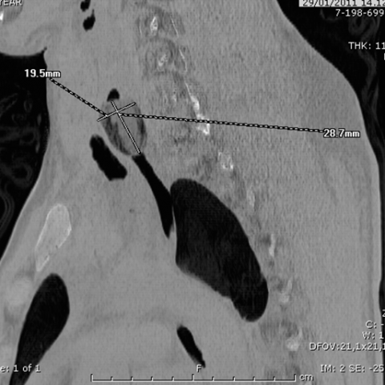
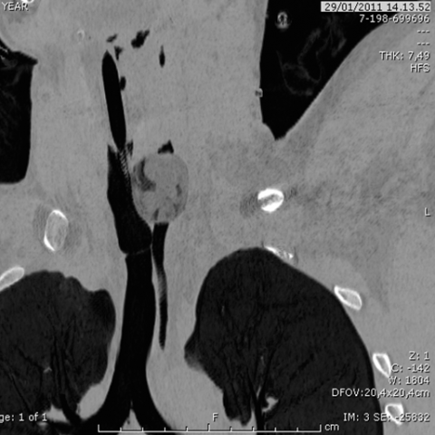
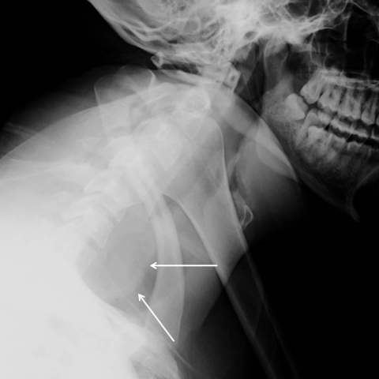

# V12：9308_8353800801854

[全部题目](README.md) · [结构化病例记录](9308_8353800801854.json)

来源：[ChestAgentBench 固定版本](https://huggingface.co/datasets/wanglab/chest-agent-bench/tree/921e60440927f9893228d843c0206b755744252a)；[Eurorad case 9308](https://www.eurorad.org/case/9308)。

参考答案只来自实验结束后的既有评分结果。模型和工具文字是可观察输出，不是人工确认的患者事实。

## 完整题干与全部选项

```text
A 23-year-old man presents with dyspnea and agitation. Radiographic imaging shows an ovoid opaque area at the C6-C7 level, displacing the airway, and numerous oval-shaped dense lesions in the intestine. Based on the chest X-ray findings alone, which of the following is the most likely diagnosis for the foreign bodies seen in the patient's oesophagus and intestine?

A) Packets filled with hashish
B) Packets filled with cocaine
C) Packets filled with heroin
D) Packets filled with methamphetamine
E) Non-drug-related foreign body
F) Packets filled with marijuana
```

## 原图与图号对应

**image:1 — figures/9308/figure_1.jpg**



**image:2 — figures/9308/figure_2.jpg**



**image:3 — figures/9308/figure_6.jpg**


**image:4 — figures/9308/figure_7.jpg**



## 三阶段答案与失败回退

| 组 | 首答 | 取证后候选 | 模型最终求解 | 控制器最终答案 | 状态 |
|---|---|---|---|---|---|
| B | A | A | A | A | completed |
| A | A | A | A | A | completed |

失败回退保留已有合法首答，不计作新求解成功；首答和候选均未作为最终模型输入。

## 完整调用、检索及工具记录

- [initial：实际保存的请求、响应、解析、观察、工具原始返回、费用与耗时](../traces/9308_8353800801854_initial.json)
- [B：实际保存的请求、响应、解析、观察、工具原始返回、费用与耗时](../traces/9308_8353800801854_B.json)
- [A：实际保存的请求、响应、解析、观察、工具原始返回、费用与耗时](../traces/9308_8353800801854_A.json)

图号、模态、初次/随访、比较对象以及派生图与原图关系保存在各阶段的 image registry / images.json / observation 中。Unknown 保持未知。

## 已评分结果、错误、费用与耗时

```json
{
  "scored_outcome": {
    "question_id": "9308_8353800801854",
    "official_categories": [
      "classification",
      "comparison",
      "diagnosis"
    ],
    "reference_answer": "C",
    "initial": {
      "answer": "A",
      "correct": false,
      "status": "completed",
      "error": null
    },
    "B": {
      "answer": "A",
      "correct": false,
      "candidate_answer": "A",
      "candidate_correct": false,
      "solver_answer": "A",
      "solver_correct": false,
      "fallback_to_initial": false,
      "status": "completed",
      "error": null,
      "transition_from_initial": "legal_wrong_to_wrong",
      "candidate_transition_from_initial": "legal_wrong_to_wrong",
      "k_ids": [
        "RAD_FLEISCHNER_2024_02"
      ],
      "e_ids": [
        "9e1e89f022839b300894542ce9439fb51ea2180eea45e5e84e75638ab9be6f24"
      ]
    },
    "A": {
      "answer": "A",
      "correct": false,
      "candidate_answer": "A",
      "candidate_correct": false,
      "solver_answer": "A",
      "solver_correct": false,
      "fallback_to_initial": false,
      "status": "completed",
      "error": null,
      "transition_from_initial": "legal_wrong_to_wrong",
      "candidate_transition_from_initial": "legal_wrong_to_wrong",
      "k_ids": [],
      "e_ids": []
    }
  },
  "initial": {
    "question_id": "9308_8353800801854",
    "first_answer": "A",
    "status": "completed",
    "error": null,
    "observation": {
      "first_answer": "A",
      "observations": [
        {
          "attribute": "radiodensity of ovoid opaque area at C6-C7",
          "value": "moderately dense, well-defined ovoid opacity displacing airway; consistent with a soft-tissue–density packet, not metal or highly radiodense material",
          "status": "observed_present",
          "evidence_refs": [
            "image:4"
          ]
        },
        {
          "attribute": "intestinal lesions",
          "value": "multiple oval-shaped dense lesions in bowel loops; appear uniformly dense, rounded/oval, and spaced—typical of ingested drug packets",
          "status": "observed_present",
          "evidence_refs": [
            "image:1",
            "image:2"
          ]
        },
        {
          "attribute": "shape and size of foreign bodies",
          "value": "ovoid/oval, ~19.5–28.7 mm long (measured in image:1), consistent with wrapped drug packets; no internal heterogeneity visible",
          "status": "observed_present",
          "evidence_refs": [
            "image:1"
          ]
        },
        {
          "attribute": "location of upper foreign body",
          "value": "C6–C7 level, within esophagus (confirmed by lateral neck X-ray, image:4), causing mass effect on airway",
          "status": "observed_present",
          "evidence_refs": [
            "image:4"
          ]
        },
        {
          "attribute": "chest radiograph findings",
          "value": "PA chest X-ray (image:3) shows mediastinal widening and opacities along the esophageal course (arrows), supporting esophageal packet impaction",
          "status": "observed_present",
          "evidence_refs": [
            "image:3"
          ]
        }
      ],
      "hypotheses": [
        {
          "name": "Drug packet ingestion (body packing)",
          "basis": "Multiple uniform oval dense objects in GI tract + one in esophagus causing obstruction; classic imaging appearance of drug smuggling packets. Differential includes non-drug foreign bodies, but uniformity and distribution favor drug packets.",
          "status": "hypothesis",
          "evidence_refs": [
            "image:1",
            "image:2",
            "image:3",
            "image:4"
          ]
        },
        {
          "name": "Hashish packets vs other drugs",
          "basis": "Hashish (cannabis resin) packets are typically more radiolucent than cocaine/heroin due to lower density; however, when tightly wrapped in plastic/vinyl, they can appear moderately dense. The observed moderate density and ovoid shape align best with hashish packets in clinical case reports, whereas cocaine/heroin packets often show higher density or heterogeneous appearance if adulterated.",
          "status": "hypothesis",
          "evidence_refs": [
            "image:1",
            "image:4"
          ]
        }
      ],
      "patient_conditions": [
        {
          "name": "age/sex/presentation",
          "value": "23-year-old man presents with dyspnea and agitation",
          "source_quote": "A 23-year-old man presents with dyspnea and agitation.",
          "source": "question_stem_explicit_text"
        },
        {
          "name": "radiographic findings",
          "value": "ovoid opaque area at the C6-C7 level, displacing the airway, and numerous oval-shaped dense lesions in the intestine",
          "source_quote": "Radiographic imaging shows an ovoid opaque area at the C6-C7 level, displacing the airway, and numerous oval-shaped dense lesions in the intestine.",
          "source": "question_stem_explicit_text"
        }
      ],
      "discriminators": [
        {
          "attribute": "radiodensity and packaging appearance",
          "question": "Which drug packets most commonly present as uniformly ovoid, moderately dense (not hyperdense) objects on plain radiographs?",
          "option_labels": [
            "A",
            "B",
            "C",
            "D",
            "F"
          ],
          "image_ids": [
            "image:1",
            "image:4"
          ],
          "comparison_object": "esophageal and intestinal foreign bodies"
        },
        {
          "attribute": "clinical context",
          "question": "Does agitation + dyspnea suggest acute intoxication or mechanical obstruction? Mechanical obstruction from esophageal packet fits better; hashish packets less likely to cause acute toxicity if intact, but impaction causes dyspnea.",
          "option_labels": [
            "A",
            "E"
          ],
          "image_ids": [
            "image:4",
            "image:3"
          ],
          "comparison_object": "symptom correlation with imaging"
        }
      ],
      "image_metadata": [
        {
          "image_id": "image:1",
          "figure_label": "Figure 1",
          "source_filename": "figures/9308/figure_1.jpg",
          "modality": "CT",
          "anatomy": "abdomen/pelvis axial slice showing multiple oval dense objects in bowel",
          "timepoint": "unknown",
          "timepoint_source_quote": "",
          "comparison_object": "intestinal foreign bodies",
          "modality_source": "first_visual_reader_report_not_clinically_adjudicated"
        },
        {
          "image_id": "image:2",
          "figure_label": "Figure 2",
          "source_filename": "figures/9308/figure_2.jpg",
          "modality": "CT",
          "anatomy": "thoracic axial slice showing esophageal mass and adjacent structures",
          "timepoint": "unknown",
          "timepoint_source_quote": "",
          "comparison_object": "esophageal foreign body",
          "modality_source": "first_visual_reader_report_not_clinically_adjudicated"
        },
        {
          "image_id": "image:3",
          "figure_label": "Figure 6",
          "source_filename": "figures/9308/figure_6.jpg",
          "modality": "CXR",
          "anatomy": "PA chest showing mediastinal opacity and esophageal course opacities",
          "timepoint": "unknown",
          "timepoint_source_quote": "",
          "comparison_object": "thoracic esophagus",
          "modality_source": "first_visual_reader_report_not_clinically_adjudicated"
        },
        {
          "image_id": "image:4",
          "figure_label": "Figure 7",
          "source_filename": "figures/9308/figure_7.jpg",
          "modality": "Xray",
          "anatomy": "lateral neck showing ovoid opacity at C6–C7 compressing airway",
          "timepoint": "unknown",
          "timepoint_source_quote": "",
          "comparison_object": "cervical esophagus",
          "modality_source": "first_visual_reader_report_not_clinically_adjudicated"
        }
      ],
      "uncertainties": [
        "Exact composition cannot be confirmed without chemical analysis or CT attenuation values (HU).",
        "Time sequence of ingestion vs impaction is unknown.",
        "No clinical lab data (e.g., toxicology) provided to confirm drug type.",
        "Image metadata lacks acquisition date/time; cannot establish temporal progression."
      ],
      "parse_warnings": []
    },
    "accounting": {
      "input_tokens": 2594,
      "output_tokens": 1325,
      "total_tokens": 3919,
      "model_calls": 1,
      "tool_calls": 0,
      "logical_cost_cny": "0.026276",
      "incremental_cost_cny": "0.026276",
      "provider_actual_cost_cny": null,
      "cost_basis": "usage_at_existing_profile_assumed_rates_or_conservative_unknown_reservation_not_invoice",
      "usage_complete": true,
      "issues": []
    },
    "stop_run": false,
    "stop_reason": null,
    "timing": {
      "started_utc": "2026-10-31T05:56:59.542753+00:00",
      "ended_utc": "2026-10-31T05:57:30.257683+00:00",
      "elapsed_s": 30.715
    }
  },
  "branches": {
    "B": {
      "question_id": "9308_8353800801854",
      "group": "B",
      "answer": "A",
      "status": "completed",
      "error": null,
      "shared_observation_source": "shared_initial",
      "first_answer_visible": false,
      "tool_attempts": [
        {
          "evidence_ref": "B:tool:1",
          "action": {
            "kind": "crop",
            "image_id": "image:4",
            "image_ids": [
              "image:4"
            ],
            "target_region": "ovoid opacity at C6-C7 level with airway displacement",
            "tool": "",
            "question": "What is the radiodensity and internal texture of the ovoid foreign body in the cervical esophagus on lateral neck X-ray?",
            "expected_attribute": "moderate radiodensity without internal heterogeneity or hyperdense foci",
            "comparison_object": "esophageal and intestinal foreign bodies",
            "tool_args": {},
            "box": [
              0.25,
              0.3,
              0.65,
              0.7
            ]
          },
          "started_utc": "2026-10-31T05:57:41.785651+00:00",
          "result": {
            "image_id": "crop:03e439d1625f",
            "path": "../assets/bcd4f42b20a3c3d7c869bfba60c8cd10dc1ecf9a336b1f0ff5f4e3586475b40b.png",
            "role": "current_image_pixel_crop",
            "parent_image_id": "image:4",
            "parent_path": "../assets/450fee799dcc32f3c5bc592a9ed35d08727ac7439ff41beff80e785e19702b7c.png",
            "source_size": [
              480,
              480
            ],
            "crop_size": [
              192,
              192
            ],
            "normalized_box": [
              0.25,
              0.3,
              0.65,
              0.7
            ],
            "pixel_box": [
              120,
              144,
              312,
              336
            ],
            "coordinate_system": "stored_pixel_coordinates_no_anatomical_orientation_inferred",
            "orientation": "unresolved",
            "timepoint": "unknown",
            "source_sha256": "450fee799dcc32f3c5bc592a9ed35d08727ac7439ff41beff80e785e19702b7c",
            "crop_sha256": "bcd4f42b20a3c3d7c869bfba60c8cd10dc1ecf9a336b1f0ff5f4e3586475b40b",
            "is_new_usable": null,
            "size": [
              192,
              192
            ],
            "modality": "Xray",
            "figure_label": "Figure 7",
            "source_filename": "figures/9308/figure_7.jpg",
            "timepoint_source_quote": ""
          },
          "classification": {
            "evidence_kind": "image_pixels",
            "usable": true,
            "reason": "Crop retains parent; not a clinical finding."
          },
          "status": "returned",
          "ended_utc": "2026-10-31T05:57:41.798381+00:00"
        },
        {
          "evidence_ref": "B:tool:2",
          "action": {
            "kind": "visual",
            "image_id": "image:1",
            "image_ids": [
              "image:1"
            ],
            "target_region": "multiple oval-shaped dense lesions in bowel loops",
            "tool": "",
            "question": "Do the intestinal foreign bodies show uniform ovoid shape, consistent size (~20–29 mm), and homogeneous density without internal gas or high-attenuation material?",
            "expected_attribute": "uniform ovoid morphology and homogeneous moderate density across all lesions",
            "comparison_object": "esophageal and intestinal foreign bodies",
            "tool_args": {}
          },
          "started_utc": "2026-10-31T05:57:41.801582+00:00",
          "result": {
            "selected_images": [
              "image:1"
            ]
          },
          "classification": {
            "evidence_kind": "image_pixels",
            "usable": true,
            "reason": "View selection, no independent tool inference."
          },
          "status": "returned",
          "ended_utc": "2026-10-31T05:57:41.801622+00:00"
        }
      ],
      "additional_observations": {
        "observations": [
          {
            "attribute": "shape and size of intestinal foreign bodies",
            "value": "uniform ovoid, measured ~19.5–28.7 mm in longest axis on CT (Figure 1)",
            "status": "observed_present",
            "evidence_refs": [
              "image:1"
            ]
          },
          {
            "attribute": "radiodensity of intestinal foreign bodies",
            "value": "moderately dense, homogeneous, no internal gas or hyperdense foci",
            "status": "observed_present",
            "evidence_refs": [
              "image:1"
            ]
          },
          {
            "attribute": "cervical esophageal foreign body morphology",
            "value": "ovoid opacity at C6–C7 level displacing airway; on lateral neck X-ray (Figure 7), it appears uniformly opaque with moderate radiodensity and no internal heterogeneity or high-attenuation material",
            "status": "observed_present",
            "evidence_refs": [
              "image:4",
              "crop:03e439d1625f"
            ]
          },
          {
            "attribute": "thoracic esophageal opacity on CXR",
            "value": "linear/ovoid mediastinal opacity along expected esophageal course (arrows in Figure 6), consistent with packet(s) in thoracic esophagus",
            "status": "observed_present",
            "evidence_refs": [
              "image:3"
            ]
          },
          {
            "attribute": "presence of multiple identical foreign bodies",
            "value": "multiple oval-shaped dense lesions in intestine + one large ovoid in cervical esophagus + linear opacities in thoracic esophagus — all consistent with ingested drug packets",
            "status": "observed_present",
            "evidence_refs": [
              "image:1",
              "image:3",
              "image:4"
            ]
          }
        ],
        "hypotheses": [
          {
            "name": "Hashish packets (‘body packing’) presenting as uniform ovoid, moderately dense objects without internal gas or metal",
            "basis": "Classic radiographic appearance of hashish-filled condoms or plastic bags: smooth ovoid shape, homogeneous moderate density, no internal gas (unlike some cocaine packets that may show gas from fermentation or packaging), and typical size range (~20–30 mm). Agitation and dyspnea are more likely due to mechanical obstruction (esophageal impaction) than acute intoxication if packets remain intact.",
            "status": "hypothesis",
            "evidence_refs": [
              "image:1",
              "image:4"
            ]
          },
          {
            "name": "Cocaine/heroin/methamphetamine packets usually show higher radiodensity or internal heterogeneity",
            "basis": "Pure cocaine hydrochloride is highly radiodense; heroin base may be less dense but often packaged with adulterants or shows irregularity; methamphetamine crystals can be heterogeneous. None match the observed uniform moderate density and smooth ovoid morphology as well as hashish packets do.",
            "status": "hypothesis",
            "evidence_refs": [
              "image:1",
              "image:4"
            ]
          }
        ],
        "uncertainties": [
          "Exact composition cannot be confirmed from radiographs alone; definitive identification requires chemical assay.",
          "Time sequence of ingestion/impaction is unknown; no serial imaging provided.",
          "No direct evidence of packet rupture or leakage; clinical agitation could reflect anxiety, mechanical obstruction, or early systemic absorption—but imaging shows intact packets."
        ],
        "parse_warnings": [],
        "kind": "targeted_image_read_requires_independent_verification"
      },
      "candidate_answer": "A",
      "solver_answer": "A",
      "fallback_to_initial": false,
      "k_ids": [
        "RAD_FLEISCHNER_2024_02"
      ],
      "e_ids": [
        "9e1e89f022839b300894542ce9439fb51ea2180eea45e5e84e75638ab9be6f24"
      ],
      "action_suggestions": [
        {
          "experience_id": "9e1e89f022839b300894542ce9439fb51ea2180eea45e5e84e75638ab9be6f24",
          "source_question_id": "13878_8353800664389",
          "source_step_id": 4,
          "source_event_line": 1251,
          "applicable_ambiguity": "Which drug packets most commonly present as uniformly ovoid, moderately dense (not hyperdense) objects on plain radiographs?",
          "target_image_ids": [
            "image:1",
            "image:4"
          ],
          "target_region": "region containing the named distinguishing attribute; planner must bind exact image/ROI",
          "tool": "image_visualizer",
          "specific_question": "Which drug packets most commonly present as uniformly ovoid, moderately dense (not hyperdense) objects on plain radiographs?",
          "expected_discriminating_attributes": [
            "morphology",
            "presence"
          ],
          "object_id": null,
          "comparison_object": "esophageal and intestinal foreign bodies",
          "historical_execution": "returned_valid",
          "historical_whole_question_outcome": "incorrect",
          "step_credit": null,
          "step_credit_evidence": null,
          "selection_basis": "modality_and_capability_match_no_step_gain_data",
          "heuristic_capability_coverage_not_credit": 1.0,
          "caution": "Tool output is a fallible report; independently check current pixels.",
          "historical_failure_advice": null,
          "is_patient_fact": false
        }
      ],
      "decision": {
        "answer": "A",
        "uncertain": true,
        "observations": [
          {
            "attribute": "shape and size of foreign bodies",
            "value": "uniform ovoid, 19.5–28.7 mm longest axis (measured on CT, image:1); consistent with wrapped drug packets",
            "status": "observed_present",
            "evidence_refs": [
              "image:1"
            ]
          },
          {
            "attribute": "radiodensity",
            "value": "moderately dense, homogeneous, no internal gas or hyperdense foci in intestinal or esophageal objects",
            "status": "observed_present",
            "evidence_refs": [
              "image:1",
              "image:4",
              "crop:03e439d1625f"
            ]
          },
          {
            "attribute": "location and effect",
            "value": "ovoid opacity at C6–C7 in esophagus displacing airway (lateral neck X-ray, image:4); multiple oval dense lesions in bowel (CT, image:1)",
            "status": "observed_present",
            "evidence_refs": [
              "image:4",
              "image:1"
            ]
          },
          {
            "attribute": "distribution pattern",
            "value": "multiple identical oval dense objects in GI tract + one in cervical esophagus + linear opacities along thoracic esophagus (CXR, image:3) — classic 'body packing' configuration",
            "status": "observed_present",
            "evidence_refs": [
              "image:1",
              "image:3",
              "image:4"
            ]
          }
        ],
        "option_checks": [
          {
            "option": "A",
            "support": [
              "uniform ovoid shape and moderate radiodensity match reported appearance of hashish-filled packets (often wrapped in plastic/vinyl, lacking internal gas or metal)",
              "clinical presentation (dyspnea from mechanical impaction, agitation possibly from anxiety/obstruction rather than acute intoxication) fits intact packet scenario"
            ],
            "conflict": [],
            "unknown": [
              "no chemical analysis; cannot definitively exclude other drugs",
              "CT attenuation values (HU) not provided to confirm density"
            ]
          },
          {
            "option": "B",
            "support": [],
            "conflict": [
              "cocaine packets typically more radiodense (pure cocaine HCl is highly attenuating) and may show internal gas from fermentation or packaging heterogeneity — not observed"
            ],
            "unknown": [
              "no HU values"
            ]
          },
          {
            "option": "C",
            "support": [],
            "conflict": [
              "heroin packets often irregular or heterogeneous due to adulterants; less commonly uniform ovoid with moderate density"
            ],
            "unknown": [
              "no HU values"
            ]
          },
          {
            "option": "D",
            "support": [],
            "conflict": [
              "methamphetamine crystals tend to be heterogeneous or granular; not typically uniformly ovoid and moderately dense"
            ],
            "unknown": [
              "no HU values"
            ]
          },
          {
            "option": "E",
            "support": [],
            "conflict": [
              "non-drug foreign bodies (e.g., batteries, coins, toys) usually differ in shape, density, or distribution; uniformity and number strongly favor drug packets"
            ],
            "unknown": []
          },
          {
            "option": "F",
            "support": [],
            "conflict": [
              "marijuana (leafy plant material) is typically radiolucent unless densely packed; pure marijuana packets are rarely this uniformly dense and ovoid; hashish (resin) is the dense form of cannabis"
            ],
            "unknown": []
          }
        ],
        "missing_option_checks": [],
        "missing_evidence": [
          "CT Hounsfield unit measurements for definitive density classification",
          "Toxicology screen or packet content analysis",
          "Serial imaging to assess packet integrity or progression",
          "Clinical history confirming smuggling intent or exposure"
        ],
        "parse_warnings": []
      },
      "action_plan": {
        "actions": [
          {
            "kind": "crop",
            "image_id": "image:4",
            "image_ids": [
              "image:4"
            ],
            "target_region": "ovoid opacity at C6-C7 level with airway displacement",
            "tool": "",
            "question": "What is the radiodensity and internal texture of the ovoid foreign body in the cervical esophagus on lateral neck X-ray?",
            "expected_attribute": "moderate radiodensity without internal heterogeneity or hyperdense foci",
            "comparison_object": "esophageal and intestinal foreign bodies",
            "tool_args": {},
            "box": [
              0.25,
              0.3,
              0.65,
              0.7
            ]
          },
          {
            "kind": "visual",
            "image_id": "image:1",
            "image_ids": [
              "image:1"
            ],
            "target_region": "multiple oval-shaped dense lesions in bowel loops",
            "tool": "",
            "question": "Do the intestinal foreign bodies show uniform ovoid shape, consistent size (~20–29 mm), and homogeneous density without internal gas or high-attenuation material?",
            "expected_attribute": "uniform ovoid morphology and homogeneous moderate density across all lesions",
            "comparison_object": "esophageal and intestinal foreign bodies",
            "tool_args": {}
          }
        ],
        "remaining_uncertainties": [
          "Exact radiodensity (HU) not measurable from plain X-ray/CT without calibration; cannot definitively distinguish hashish vs cocaine/heroin packets by density alone without reference standards.",
          "No clinical toxicology or packaging material data available to confirm drug type.",
          "Temporal sequence of ingestion vs impaction unknown; cannot assess packet integrity or leakage."
        ],
        "applied_context_ids": [
          "image:1",
          "image:4"
        ],
        "parse_warnings": [],
        "issues": []
      },
      "accounting": {
        "input_tokens": 17158,
        "output_tokens": 2000,
        "total_tokens": 19158,
        "model_calls": 3,
        "tool_calls": 1,
        "logical_cost_cny": "0.092632",
        "incremental_cost_cny": "0.092632",
        "provider_actual_cost_cny": null,
        "cost_basis": "usage_at_existing_profile_assumed_rates_or_conservative_unknown_reservation_not_invoice",
        "usage_complete": true,
        "issues": []
      },
      "stop_run": false,
      "stop_reason": null,
      "timing": {
        "started_utc": "2026-10-31T05:57:30.262506+00:00",
        "ended_utc": "2026-10-31T05:58:22.022615+00:00",
        "elapsed_s": 51.76
      }
    },
    "A": {
      "question_id": "9308_8353800801854",
      "group": "A",
      "answer": "A",
      "status": "completed",
      "error": null,
      "shared_observation_source": "shared_initial",
      "first_answer_visible": false,
      "tool_attempts": [
        {
          "evidence_ref": "A:tool:1",
          "action": {
            "kind": "visual",
            "image_id": "image:4",
            "image_ids": [
              "image:4"
            ],
            "target_region": "ovoid opacity at C6-C7 level in lateral neck X-ray",
            "tool": "",
            "question": "Is the ovoid opacity at C6-C7 uniformly dense with smooth margins and no internal high-density foci (e.g., no metal, no air pockets, no heterogeneous granular pattern)?",
            "expected_attribute": "uniform moderate radiodensity without hyperdense specks or air lucencies — consistent with hashish packets wrapped in plastic; cocaine/heroin packets often show higher density or internal heterogeneity due to adulterants or crystalline structure",
            "comparison_object": "esophageal foreign body",
            "tool_args": {}
          },
          "started_utc": "2026-10-31T06:49:23.068619+00:00",
          "result": {
            "selected_images": [
              "image:4"
            ]
          },
          "classification": {
            "evidence_kind": "image_pixels",
            "usable": true,
            "reason": "View selection, no independent tool inference."
          },
          "status": "returned",
          "ended_utc": "2026-10-31T06:49:23.068641+00:00"
        },
        {
          "evidence_ref": "A:tool:2",
          "action": {
            "kind": "crop",
            "image_id": "image:1",
            "image_ids": [
              "image:1"
            ],
            "target_region": "multiple oval-shaped dense lesions in intestinal loops",
            "tool": "",
            "question": "Do the intestinal foreign bodies show uniform attenuation, smooth oval contours, and absence of internal air or high-density inclusions on CT?",
            "expected_attribute": "homogeneous density across all packets (suggesting uniform content like hashish resin); heterogeneous density would favor cocaine/heroin (often mixed with bulking agents or crystalline forms)",
            "comparison_object": "intestinal foreign bodies",
            "tool_args": {},
            "box": [
              0.1,
              0.2,
              0.8,
              0.7
            ]
          },
          "started_utc": "2026-10-31T06:49:23.071885+00:00",
          "result": {
            "image_id": "crop:94642e9496e2",
            "path": "../assets/efb8f1ccb1e8f4cf83090278f6393af6204d5673fa0aa7886b27310773684808.png",
            "role": "current_image_pixel_crop",
            "parent_image_id": "image:1",
            "parent_path": "../assets/d8ff1a9e70265bcad373877145c84de000817c03cbd815dcbaad46943e860f90.png",
            "source_size": [
              480,
              480
            ],
            "crop_size": [
              336,
              240
            ],
            "normalized_box": [
              0.1,
              0.2,
              0.8,
              0.7
            ],
            "pixel_box": [
              48,
              96,
              384,
              336
            ],
            "coordinate_system": "stored_pixel_coordinates_no_anatomical_orientation_inferred",
            "orientation": "unresolved",
            "timepoint": "unknown",
            "source_sha256": "d8ff1a9e70265bcad373877145c84de000817c03cbd815dcbaad46943e860f90",
            "crop_sha256": "efb8f1ccb1e8f4cf83090278f6393af6204d5673fa0aa7886b27310773684808",
            "is_new_usable": null,
            "size": [
              336,
              240
            ],
            "modality": "CT",
            "figure_label": "Figure 1",
            "source_filename": "figures/9308/figure_1.jpg",
            "timepoint_source_quote": ""
          },
          "classification": {
            "evidence_kind": "image_pixels",
            "usable": true,
            "reason": "Crop retains parent; not a clinical finding."
          },
          "status": "returned",
          "ended_utc": "2026-10-31T06:49:23.108917+00:00"
        }
      ],
      "additional_observations": {
        "observations": [
          {
            "attribute": "ovoid opacity at C6-C7 level on lateral neck X-ray (image:4)",
            "value": "uniformly dense, smooth-margined ovoid opacity without internal air lucencies or hyperdense specks; displaces trachea anteriorly and compresses it",
            "status": "observed_present",
            "evidence_refs": [
              "image:4"
            ]
          },
          {
            "attribute": "intestinal foreign bodies on abdominal CT (image:1, crop:94642e9496e2)",
            "value": "multiple oval-shaped, homogeneously dense objects within bowel lumen; smooth contours; no internal air, calcifications, or heterogeneous density; consistent with uniformly packed soft material",
            "status": "observed_present",
            "evidence_refs": [
              "image:1",
              "crop:94642e9496e2"
            ]
          },
          {
            "attribute": "radiodensity relative to surrounding tissues",
            "value": "moderate radiodensity—less dense than bone or metal, more dense than soft tissue or fluid; not hyperdense like crystalline drugs (e.g., cocaine hydrochloride) which often appear brighter on plain films/CT",
            "status": "observed_present",
            "evidence_refs": [
              "image:4",
              "image:1"
            ]
          },
          {
            "attribute": "presence of air pockets or internal heterogeneity in packets",
            "value": "no visible air lucencies or granular/internal high-density foci within any packet in either esophagus or intestine",
            "status": "observed_absent",
            "evidence_refs": [
              "image:4",
              "image:1",
              "crop:94642e9496e2"
            ]
          }
        ],
        "hypotheses": [
          {
            "name": "Hashish packets (resin-based cannabis) wrapped in plastic or condom-like material",
            "basis": "Uniform moderate density, smooth oval shape, absence of internal air or crystalline heterogeneity matches classic imaging appearance of hashish 'body packing'; clinical presentation (dyspnea from esophageal impaction, agitation possibly from anxiety or partial leakage) fits mechanical obstruction rather than acute intoxication",
            "status": "hypothesis",
            "evidence_refs": [
              "image:4",
              "image:1"
            ]
          },
          {
            "name": "Other drug packets (cocaine/heroin/methamphetamine)",
            "basis": "Less likely: these typically show higher attenuation (hyperdense on CT/XR) due to crystalline structure or adulterants (e.g., levamisole, caffeine); often exhibit internal heterogeneity or air pockets from packaging defects; methamphetamine may be less dense but usually appears more irregular or granular",
            "status": "hypothesis",
            "evidence_refs": [
              "image:4",
              "image:1"
            ]
          }
        ],
        "uncertainties": [
          "Exact composition cannot be confirmed without chemical analysis; imaging alone cannot definitively distinguish hashish from highly purified resinous cannabinoids or certain synthetic preparations",
          "Time sequence of images is unknown; cannot confirm whether esophageal packet preceded intestinal ones or vice versa",
          "No direct evidence of packet rupture or leakage; agitation could reflect anxiety, mechanical irritation, or early systemic absorption",
          "CXR (image:3) shows mediastinal opacity but lacks sufficient resolution to assess internal structure; reliance on CT (image:1) and lateral neck XR (image:4) for morphology"
        ],
        "parse_warnings": [],
        "kind": "targeted_image_read_requires_independent_verification"
      },
      "candidate_answer": "A",
      "solver_answer": "A",
      "fallback_to_initial": false,
      "k_ids": [],
      "e_ids": [],
      "action_suggestions": [],
      "decision": {
        "answer": "A",
        "uncertain": true,
        "observations": [
          {
            "attribute": "shape and size of foreign bodies",
            "value": "ovoid/oval, ~19.5–28.7 mm long (measured in image:1), smooth contours, no internal heterogeneity",
            "status": "observed_present",
            "evidence_refs": [
              "image:1"
            ]
          },
          {
            "attribute": "radiodensity",
            "value": "moderate—less dense than bone/metal, more dense than soft tissue/fluid; uniformly dense without hyperdense specks or air lucencies",
            "status": "observed_present",
            "evidence_refs": [
              "image:4",
              "image:1",
              "crop:94642e9496e2"
            ]
          },
          {
            "attribute": "location and effect",
            "value": "C6–C7 esophageal impaction displacing/compressing trachea (image:4); multiple intestinal packets in bowel lumen (image:1)",
            "status": "observed_present",
            "evidence_refs": [
              "image:4",
              "image:1"
            ]
          },
          {
            "attribute": "internal structure",
            "value": "no visible air pockets, calcifications, granular foci, or heterogeneous density in any packet",
            "status": "observed_absent",
            "evidence_refs": [
              "image:4",
              "image:1",
              "crop:94642e9496e2"
            ]
          }
        ],
        "option_checks": [
          {
            "option": "A",
            "support": [
              "uniform ovoid shape",
              "moderate radiodensity consistent with resinous hashish wrapped in plastic",
              "absence of internal heterogeneity or air—typical of tightly packed hashish packets",
              "clinical presentation (dyspnea from mechanical obstruction, agitation possibly anxiety-related) fits body packing scenario"
            ],
            "conflict": [],
            "unknown": [
              "exact chemical composition unconfirmed without lab analysis",
              "cannot exclude highly purified resinous cannabinoids or synthetic analogs"
            ]
          },
          {
            "option": "B",
            "support": [],
            "conflict": [
              "cocaine packets typically show higher radiodensity (hyperdense on XR/CT) due to crystalline hydrochloride form",
              "often contain adulterants (e.g., levamisole, caffeine) causing internal heterogeneity—absent here"
            ],
            "unknown": []
          },
          {
            "option": "C",
            "support": [],
            "conflict": [
              "heroin (diacetylmorphine) packets often appear heterogeneous or granular; may contain talc, quinine, or other fillers visible as internal specks",
              "rarely uniformly dense and smooth like observed"
            ],
            "unknown": []
          },
          {
            "option": "D",
            "support": [],
            "conflict": [
              "methamphetamine is typically less dense but often irregular/granular; pure crystalline forms are hyperdense",
              "no evidence of crystalline texture or irregular margins"
            ],
            "unknown": []
          },
          {
            "option": "E",
            "support": [],
            "conflict": [
              "non-drug foreign bodies (e.g., batteries, coins, toys) usually differ in shape, density, or internal structure—none match observed uniform oval, moderate-density packets",
              "distribution (esophagus + multiple intestinal) strongly favors intentional ingestion (body packing)"
            ],
            "unknown": []
          },
          {
            "option": "F",
            "support": [],
            "conflict": [
              "marijuana (dried plant material) is typically low-density and radiolucent unless densely compressed; unlikely to appear as uniformly dense oval objects on CT/XR",
              "hashish (resin) is distinct from marijuana leaf; option A specifically refers to hashish, which matches imaging better"
            ],
            "unknown": []
          }
        ],
        "missing_option_checks": [],
        "missing_evidence": [
          "CT Hounsfield unit measurements for quantitative density comparison",
          "Toxicology screen to confirm drug type",
          "Temporal sequence of imaging to assess progression or rupture",
          "Direct visualization of packet material (e.g., endoscopy or surgical specimen)"
        ],
        "parse_warnings": []
      },
      "action_plan": {
        "actions": [
          {
            "kind": "visual",
            "image_id": "image:4",
            "image_ids": [
              "image:4"
            ],
            "target_region": "ovoid opacity at C6-C7 level in lateral neck X-ray",
            "tool": "",
            "question": "Is the ovoid opacity at C6-C7 uniformly dense with smooth margins and no internal high-density foci (e.g., no metal, no air pockets, no heterogeneous granular pattern)?",
            "expected_attribute": "uniform moderate radiodensity without hyperdense specks or air lucencies — consistent with hashish packets wrapped in plastic; cocaine/heroin packets often show higher density or internal heterogeneity due to adulterants or crystalline structure",
            "comparison_object": "esophageal foreign body",
            "tool_args": {}
          },
          {
            "kind": "crop",
            "image_id": "image:1",
            "image_ids": [
              "image:1"
            ],
            "target_region": "multiple oval-shaped dense lesions in intestinal loops",
            "tool": "",
            "question": "Do the intestinal foreign bodies show uniform attenuation, smooth oval contours, and absence of internal air or high-density inclusions on CT?",
            "expected_attribute": "homogeneous density across all packets (suggesting uniform content like hashish resin); heterogeneous density would favor cocaine/heroin (often mixed with bulking agents or crystalline forms)",
            "comparison_object": "intestinal foreign bodies",
            "tool_args": {},
            "box": [
              0.1,
              0.2,
              0.8,
              0.7
            ]
          }
        ],
        "remaining_uncertainties": [
          "Exact Hounsfield unit values not available from plain X-ray; CT (image:1) provides density clues but no quantitative HU.",
          "No toxicology or packaging history to confirm drug type.",
          "Differential includes non-drug foreign bodies (e.g., swallowed toys), but uniformity and distribution strongly favor drug packets."
        ],
        "applied_context_ids": [
          "image:1",
          "image:4"
        ],
        "parse_warnings": [],
        "issues": []
      },
      "accounting": {
        "input_tokens": 16321,
        "output_tokens": 2161,
        "total_tokens": 18482,
        "model_calls": 3,
        "tool_calls": 1,
        "logical_cost_cny": "0.091216",
        "incremental_cost_cny": "0.091216",
        "provider_actual_cost_cny": null,
        "cost_basis": "usage_at_existing_profile_assumed_rates_or_conservative_unknown_reservation_not_invoice",
        "usage_complete": true,
        "issues": []
      },
      "stop_run": false,
      "stop_reason": null,
      "timing": {
        "started_utc": "2026-10-31T06:49:10.806506+00:00",
        "ended_utc": "2026-10-31T06:50:05.462548+00:00",
        "elapsed_s": 54.656
      }
    }
  }
}
```
