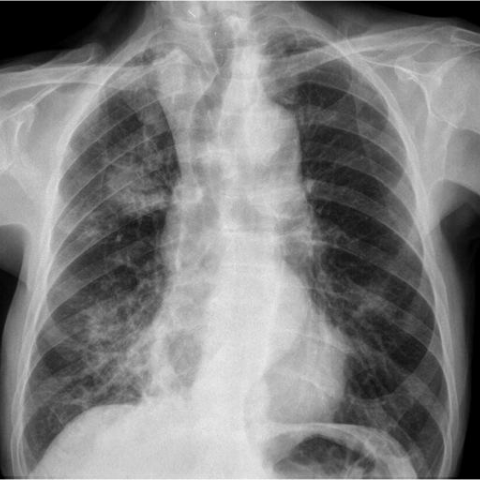

# V9 case 11801_8353800651620

[20 题导航](README.md) · [完整逐题 JSON](11801_8353800651620.json)

## 实际题干与完整选项

```text
Based on the chest radiograph findings, what is the most likely diagnosis for the patient's condition given the clinical history and imaging characteristics? Consider the patterns and changes in airspace consolidations observed in the X-ray images.

A) Chronic eosinophilic pneumonia
B) Lipoid pneumonia
C) Primary pulmonary lymphoma
D) Sarcoidosis
E) Lepidic predominant adenocarcinoma
F) Bronchiectasis
```

参考选项（完成后复盘）：**B**。任务组：detection,localization,characterization,reasoning。

## 原图

figures/11801/figure_1.jpg



figures/11801/figure_2.jpg


## 本轮答案与去向

| 组 | 初始 | 候选 | 最终 | 对错 | 回退 / 错误 |
|---|---|---|---|---|---|
| P0 | B | — | B | True | completed |
| D | B | B | B | True | 正常返回 |
| DK | B | 缺失 | B | True | candidate_uncertain |
| DKB | B | 缺失 | B | True | candidate_uncertain |
| DKC | B | 缺失 | B | True | ValueError: inconsistent_candidate_uncertainty |

## 完整可观测记录

以下 JSON 保留实际系统提示、消息、工具请求与返回、候选规划、注入的知识/经验及门控输入输出。图像 data URL 已无损解码为文件；JSON 中路径统一相对于 `reports/v9/`。模型和工具所述观察未被独立临床核实。

- [P0 提示、消息与工具原文](../traces/11801_8353800651620/P0.json)
- [D 规划、检索、消息、工具与门控](../traces/11801_8353800651620/D.json)
- [DK 规划、检索、消息、工具与门控](../traces/11801_8353800651620/DK.json)
- [DKB 规划、检索、消息、工具与门控](../traces/11801_8353800651620/DKB.json)
- [DKC 规划、检索、消息、工具与门控](../traces/11801_8353800651620/DKC.json)

## 分支候选与门控的实际输出

### D

```json
{
  "candidate_payload": {
    "answer": "B",
    "uncertain": false,
    "changed_attributes": [
      "consolidation is central (not peripheral)",
      "consolidation is resolving between images",
      "no lucent fat-density areas confirmed, but lipoid pneumonia still favored by expert"
    ],
    "evidence_refs": [
      "p0:tool:3",
      "D:tool:2"
    ],
    "observations": [
      {
        "attribute": "peripheral-predominant consolidation",
        "object": "airspace consolidation",
        "side": "right",
        "location": "upper lobe",
        "timepoint": "unresolved",
        "image_ids": [
          "image:1"
        ],
        "status": "observed_absent",
        "evidence_refs": [
          "D:tool:2"
        ],
        "value": "central distribution"
      },
      {
        "attribute": "temporal change of consolidation",
        "object": "lung opacity",
        "side": "right",
        "location": "upper lobe",
        "timepoint": "comparative",
        "image_ids": [
          "image:1",
          "image:2"
        ],
        "status": "observed_present",
        "evidence_refs": [
          "D:tool:2"
        ],
        "value": "resolving"
      },
      {
        "attribute": "mass-like opacity with ill-defined margins",
        "object": "lung opacity",
        "side": "right",
        "location": "upper-mid zone",
        "timepoint": "unresolved",
        "image_ids": [
          "image:1"
        ],
        "status": "hypothesis",
        "evidence_refs": [
          "p0:tool:3"
        ],
        "value": "suggested by expert for lipoid pneumonia"
      }
    ]
  },
  "candidate_error": null,
  "fallback": null,
  "gate": {
    "decision": "no_change"
  },
  "gate_error": null,
  "new_observations": [
    {
      "question_id": "11801_8353800651620",
      "tool_name": "chest_xray_expert",
      "tool_version": "edef4e07539dca3f6313218a8c9d9e4fbf7220a44afad6aa65d93e4ca45201af",
      "arguments": {
        "image_paths": [
          "../v11/images/originals/figures/11801/figure_1.jpg"
        ],
        "prompt": "Is the airspace consolidation in the right upper lobe peripheral or central in distribution? Describe the margins and internal characteristics (e.g., homogeneous, heterogeneous, lucent areas suggestive of fat). Also assess for associated fibrosis or architectural distortion.",
        "max_new_tokens": 512
      },
      "kind": "vqa",
      "result": [
        {
          "response": "Central"
        },
        {
          "image_paths": [
            "../v11/images/originals/figures/11801/figure_1.jpg"
          ],
          "prompt": "Is the airspace consolidation in the right upper lobe peripheral or central in distribution? Describe the margins and internal characteristics (e.g., homogeneous, heterogeneous, lucent areas suggestive of fat). Also assess for associated fibrosis or architectural distortion.",
          "max_new_tokens": 512,
          "analysis_status": "completed"
        }
      ],
      "elapsed_ms": 251,
      "phase": 2,
      "evidence_ref": "D:tool:1",
      "status": "hypothesis",
      "source": "raw_tool_report_not_verified_patient_fact",
      "is_new_usable": null,
      "collected_utc": "2026-10-30T06:54:38.774505+00:00",
      "artifacts": []
    },
    {
      "question_id": "11801_8353800651620",
      "tool_name": "chest_xray_expert",
      "tool_version": "edef4e07539dca3f6313218a8c9d9e4fbf7220a44afad6aa65d93e4ca45201af",
      "arguments": {
        "image_paths": [
          "../v11/images/originals/figures/11801/figure_1.jpg",
          "../v11/images/originals/figures/11801/figure_2.jpg"
        ],
        "prompt": "Compare the right upper lobe consolidation between the two images: is it stable, progressive, or resolving? Specifically assess for change in size, density, margins, and presence of lucent areas (suggestive of lipid content) or cavitation.",
        "max_new_tokens": 512
      },
      "kind": "vqa",
      "result": [
        {
          "response": "Resolving"
        },
        {
          "image_paths": [
            "../v11/images/originals/figures/11801/figure_1.jpg",
            "../v11/images/originals/figures/11801/figure_2.jpg"
          ],
          "prompt": "Compare the right upper lobe consolidation between the two images: is it stable, progressive, or resolving? Specifically assess for change in size, density, margins, and presence of lucent areas (suggestive of lipid content) or cavitation.",
          "max_new_tokens": 512,
          "analysis_status": "completed"
        }
      ],
      "elapsed_ms": 559,
      "phase": 3,
      "evidence_ref": "D:tool:2",
      "status": "hypothesis",
      "source": "raw_tool_report_not_verified_patient_fact",
      "is_new_usable": null,
      "collected_utc": "2026-10-30T06:54:46.981758+00:00",
      "artifacts": []
    }
  ],
  "k_ids": [],
  "e_ids": [],
  "timing": {
    "started_utc": "2026-10-30T06:54:21.518552+00:00",
    "ended_utc": "2026-10-30T06:54:58.654958+00:00",
    "elapsed_s": 37.136
  },
  "accounting": {
    "input_tokens": 21691,
    "output_tokens": 1091,
    "total_tokens": 22782,
    "model_calls": 4,
    "tool_calls": 2,
    "logical_cost_cny": "0.099856",
    "incremental_cost_cny": "0.099856",
    "provider_actual_cost_cny": null,
    "cost_basis": "usage_at_existing_profile_assumed_rates_or_conservative_unknown_reservation_not_invoice",
    "usage_complete": true,
    "issues": []
  }
}
```

### DK

```json
{
  "candidate_payload": {
    "answer": null,
    "uncertain": true,
    "changed_attributes": [
      "consolidation is central (not peripheral) in right upper lobe",
      "no confirmed fat-density/lucent areas within consolidation"
    ],
    "evidence_refs": [
      "p0:tool:3",
      "DK:tool:1"
    ],
    "observations": [
      {
        "attribute": "peripheral-predominant consolidation",
        "object": "airspace consolidation",
        "side": "right",
        "location": "upper lobe",
        "timepoint": "unresolved",
        "image_ids": [
          "image:1"
        ],
        "status": "observed_absent",
        "evidence_refs": [
          "p0:tool:3"
        ],
        "value": "central"
      },
      {
        "attribute": "mass-like opacity with ill-defined margins",
        "object": "lung opacity",
        "side": "right",
        "location": "upper lobe",
        "timepoint": "unresolved",
        "image_ids": [
          "image:1"
        ],
        "status": "hypothesis",
        "evidence_refs": [
          "p0:tool:1",
          "p0:tool:3"
        ],
        "value": "high mass probability (0.91) but unconfirmed morphology"
      },
      {
        "attribute": "fat attenuation / lucent areas within consolidation",
        "object": "consolidation internal texture",
        "side": "right",
        "location": "upper lobe",
        "timepoint": "unresolved",
        "image_ids": [
          "image:1"
        ],
        "status": "observed_absent",
        "evidence_refs": [
          "p0:tool:3"
        ],
        "value": "not identified"
      }
    ]
  },
  "candidate_error": null,
  "fallback": "candidate_uncertain",
  "gate": {
    "decision": "not_called"
  },
  "gate_error": null,
  "new_observations": [
    {
      "question_id": "11801_8353800651620",
      "tool_name": "chest_xray_expert",
      "tool_version": "edef4e07539dca3f6313218a8c9d9e4fbf7220a44afad6aa65d93e4ca45201af",
      "arguments": {
        "image_paths": [
          "../v11/images/originals/figures/11801/figure_1.jpg",
          "../v11/images/originals/figures/11801/figure_2.jpg"
        ],
        "prompt": "Describe the spatial distribution of airspace consolidations: specifically, are they peripheral or central in the right upper lobe? Are there lucent areas or fat-density regions within the consolidation suggestive of lipoid pneumonia? Compare both images for change over time if timepoints differ.",
        "max_new_tokens": 512
      },
      "kind": "vqa",
      "result": [
        {
          "response": "Central"
        },
        {
          "image_paths": [
            "../v11/images/originals/figures/11801/figure_1.jpg",
            "../v11/images/originals/figures/11801/figure_2.jpg"
          ],
          "prompt": "Describe the spatial distribution of airspace consolidations: specifically, are they peripheral or central in the right upper lobe? Are there lucent areas or fat-density regions within the consolidation suggestive of lipoid pneumonia? Compare both images for change over time if timepoints differ.",
          "max_new_tokens": 512,
          "analysis_status": "completed"
        }
      ],
      "elapsed_ms": 537,
      "phase": 2,
      "evidence_ref": "DK:tool:1",
      "status": "hypothesis",
      "source": "raw_tool_report_not_verified_patient_fact",
      "is_new_usable": null,
      "collected_utc": "2026-10-30T06:55:18.322345+00:00",
      "artifacts": []
    }
  ],
  "k_ids": [
    "RAD_FLEISCHNER_2024_02",
    "ACR_DLD_2026_K01",
    "ACR_NODULE_2023_K02"
  ],
  "e_ids": [],
  "timing": {
    "started_utc": "2026-10-30T06:54:58.659769+00:00",
    "ended_utc": "2026-10-30T06:55:38.480837+00:00",
    "elapsed_s": 39.821
  },
  "accounting": {
    "input_tokens": 22709,
    "output_tokens": 1237,
    "total_tokens": 23946,
    "model_calls": 4,
    "tool_calls": 1,
    "logical_cost_cny": "0.105680",
    "incremental_cost_cny": "0.105680",
    "provider_actual_cost_cny": null,
    "cost_basis": "usage_at_existing_profile_assumed_rates_or_conservative_unknown_reservation_not_invoice",
    "usage_complete": true,
    "issues": [
      "tool_arguments_rejected"
    ]
  }
}
```

### DKB

```json
{
  "candidate_payload": {
    "answer": null,
    "uncertain": true,
    "changed_attributes": [],
    "evidence_refs": [
      "p0:tool:1",
      "p0:tool:2",
      "p0:tool:3",
      "p0:tool:4"
    ],
    "observations": [
      {
        "attribute": "absence of hilar/mediastinal lymphadenopathy",
        "object": "hilar/mediastinal contour",
        "side": "unresolved",
        "location": "central thorax",
        "timepoint": "unresolved",
        "image_ids": [
          "image:1"
        ],
        "status": "observed_absent",
        "evidence_refs": [
          "p0:tool:2"
        ],
        "value": "hilar and mediastinal contours are unremarkable"
      },
      {
        "attribute": "mass-like opacity with ill-defined margins",
        "object": "lung opacity",
        "side": "right",
        "location": "upper lobe",
        "timepoint": "unresolved",
        "image_ids": [
          "image:1"
        ],
        "status": "hypothesis",
        "evidence_refs": [
          "p0:tool:1",
          "p0:tool:3"
        ],
        "value": "Mass probability 0.91; expert suggests lipoid pneumonia"
      },
      {
        "attribute": "peripheral-predominant consolidation",
        "object": "airspace consolidation",
        "side": "right",
        "location": "upper lobe",
        "timepoint": "unresolved",
        "image_ids": [
          "image:1"
        ],
        "status": "unresolved",
        "evidence_refs": [],
        "value": "not confirmed by descriptive analysis"
      },
      {
        "attribute": "chronic fibrotic changes adjacent to consolidation",
        "object": "parenchymal abnormality",
        "side": "unresolved",
        "location": "right upper lobe",
        "timepoint": "unresolved",
        "image_ids": [
          "image:1",
          "image:2"
        ],
        "status": "unresolved",
        "evidence_refs": [],
        "value": "not assessed in available tool outputs"
      },
      {
        "attribute": "lucent areas within consolidation (fat attenuation)",
        "object": "consolidation internal texture",
        "side": "right",
        "location": "upper lobe",
        "timepoint": "unresolved",
        "image_ids": [
          "image:1",
          "image:2"
        ],
        "status": "unresolved",
        "evidence_refs": [],
        "value": "not reported"
      }
    ]
  },
  "candidate_error": null,
  "fallback": "candidate_uncertain",
  "gate": {
    "decision": "not_called"
  },
  "gate_error": null,
  "new_observations": [
    {
      "question_id": "11801_8353800651620",
      "tool_name": "chest_xray_expert",
      "tool_version": "edef4e07539dca3f6313218a8c9d9e4fbf7220a44afad6aa65d93e4ca45201af",
      "arguments": {
        "image_paths": [
          "../v11/images/originals/figures/11801/figure_1.jpg",
          "../v11/images/originals/figures/11801/figure_2.jpg"
        ],
        "prompt": "Describe the distribution (peripheral vs central) and margins (ill-defined vs well-defined) of the airspace consolidation in the right upper lobe on both images. Also note any lucent areas within the consolidation suggestive of fat attenuation, and compare changes between the two images.",
        "max_new_tokens": 512
      },
      "kind": "vqa",
      "result": [
        {
          "response": "<|ref|> Airspace consolidation <|/ref|> <|box|> (20,30),(34,43) <|/box|>"
        },
        {
          "image_paths": [
            "../v11/images/originals/figures/11801/figure_1.jpg",
            "../v11/images/originals/figures/11801/figure_2.jpg"
          ],
          "prompt": "Describe the distribution (peripheral vs central) and margins (ill-defined vs well-defined) of the airspace consolidation in the right upper lobe on both images. Also note any lucent areas within the consolidation suggestive of fat attenuation, and compare changes between the two images.",
          "max_new_tokens": 512,
          "analysis_status": "completed"
        }
      ],
      "elapsed_ms": 873,
      "phase": 2,
      "evidence_ref": "DKB:tool:1",
      "status": "hypothesis",
      "source": "raw_tool_report_not_verified_patient_fact",
      "is_new_usable": null,
      "collected_utc": "2026-10-30T06:55:57.857929+00:00",
      "artifacts": []
    }
  ],
  "k_ids": [
    "ACR_NODULE_2023_K02",
    "RAD_FLEISCHNER_2024_02",
    "ACR_ARI_2024_K02"
  ],
  "e_ids": [
    "eace1f010ac9fca48fd65d398c9d098f3f270fdfd3020acff72d245ed9c5fe6c"
  ],
  "timing": {
    "started_utc": "2026-10-30T06:55:38.485310+00:00",
    "ended_utc": "2026-10-30T06:56:17.113479+00:00",
    "elapsed_s": 38.628
  },
  "accounting": {
    "input_tokens": 23028,
    "output_tokens": 1242,
    "total_tokens": 24270,
    "model_calls": 4,
    "tool_calls": 1,
    "logical_cost_cny": "0.107016",
    "incremental_cost_cny": "0.107016",
    "provider_actual_cost_cny": null,
    "cost_basis": "usage_at_existing_profile_assumed_rates_or_conservative_unknown_reservation_not_invoice",
    "usage_complete": true,
    "issues": []
  }
}
```

### DKC

```json
{
  "candidate_error": "ValueError: inconsistent_candidate_uncertainty",
  "fallback": "candidate_error",
  "gate": {
    "decision": "not_called"
  },
  "gate_error": null,
  "new_observations": [
    {
      "question_id": "11801_8353800651620",
      "tool_name": "xray_phrase_grounding",
      "tool_version": "cde4574547891c25d51425998cac6e1d575efdb86319a334ce560e4b33f03f22",
      "arguments": {
        "image_path": "../v11/images/originals/figures/11801/figure_1.jpg",
        "phrase": "Consolidation in right upper lobe",
        "max_new_tokens": 300
      },
      "kind": "grounding",
      "result": [
        {
          "predictions": [
            {
              "phrase": "Consolidation in right upper lobe.",
              "bounding_boxes": {
                "model_coordinates": [
                  [
                    0.075,
                    0.095,
                    0.405,
                    0.475
                  ]
                ],
                "image_coordinates": [
                  [
                    0.075,
                    0.09375,
                    0.4041666666666667,
                    0.475
                  ]
                ]
              }
            }
          ],
          "visualization_path": null
        },
        {
          "image_path": "../v11/images/originals/figures/11801/figure_1.jpg",
          "analysis_status": "completed",
          "phrase": "Consolidation in right upper lobe",
          "n_boxes": 1,
          "tool_version": "maira-2@795a2b1c+bf16+negative-safe-v1",
          "clinical_evidence": "unknown",
          "step_credit": null
        }
      ],
      "elapsed_ms": 878,
      "phase": 2,
      "evidence_ref": "DKC:tool:1",
      "status": "hypothesis",
      "source": "raw_tool_report_not_verified_patient_fact",
      "is_new_usable": null,
      "collected_utc": "2026-10-30T06:56:34.149201+00:00",
      "artifacts": []
    },
    {
      "question_id": "11801_8353800651620",
      "tool_name": "chest_xray_expert",
      "tool_version": "edef4e07539dca3f6313218a8c9d9e4fbf7220a44afad6aa65d93e4ca45201af",
      "arguments": {
        "image_paths": [
          "../v11/images/originals/figures/11801/figure_1.jpg",
          "../v11/images/originals/figures/11801/figure_2.jpg"
        ],
        "prompt": "Describe the morphology (margins, density, extent, peripheral vs central distribution) of the consolidation in the right upper lobe and left lower lobe. Specifically assess for fat lucency, ill-defined margins, fibrotic strands, or mass-like features. List top 3 differential diagnoses consistent with these imaging characteristics.",
        "max_new_tokens": 1000
      },
      "kind": "vqa",
      "result": [
        {
          "response": "Consolidation, lung cavity, lung mass"
        },
        {
          "image_paths": [
            "../v11/images/originals/figures/11801/figure_1.jpg",
            "../v11/images/originals/figures/11801/figure_2.jpg"
          ],
          "prompt": "Describe the morphology (margins, density, extent, peripheral vs central distribution) of the consolidation in the right upper lobe and left lower lobe. Specifically assess for fat lucency, ill-defined margins, fibrotic strands, or mass-like features. List top 3 differential diagnoses consistent with these imaging characteristics.",
          "max_new_tokens": 1000,
          "analysis_status": "completed"
        }
      ],
      "elapsed_ms": 716,
      "phase": 3,
      "evidence_ref": "DKC:tool:2",
      "status": "hypothesis",
      "source": "raw_tool_report_not_verified_patient_fact",
      "is_new_usable": null,
      "collected_utc": "2026-10-30T06:56:41.422352+00:00",
      "artifacts": []
    }
  ],
  "k_ids": [
    "ACR_ARI_2024_K03",
    "RAD_FLEISCHNER_2024_02",
    "ACR_NODULE_2023_K02"
  ],
  "e_ids": [
    "S001"
  ],
  "timing": {
    "started_utc": "2026-10-30T06:56:17.117861+00:00",
    "ended_utc": "2026-10-30T06:56:57.273879+00:00",
    "elapsed_s": 40.156
  },
  "accounting": {
    "input_tokens": 23537,
    "output_tokens": 1252,
    "total_tokens": 24789,
    "model_calls": 4,
    "tool_calls": 2,
    "logical_cost_cny": "0.109172",
    "incremental_cost_cny": "0.109172",
    "provider_actual_cost_cny": null,
    "cost_basis": "usage_at_existing_profile_assumed_rates_or_conservative_unknown_reservation_not_invoice",
    "usage_complete": true,
    "issues": []
  }
}
```

## 历史对照

[相同题目在 V10 / V11 的图文记录](../../v11/cases/11801_8353800651620.md)。V9 和 V10 是不同调用及协议，P0 也可能不同，不应把它们当作同一次缓存基线。

[来源与公开范围](../data-provenance.md) · [失败机制分析](../failure-analysis.md)
