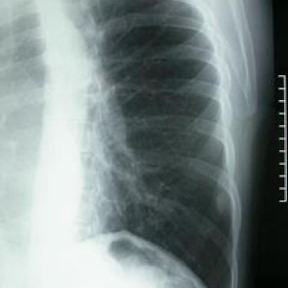

# V9 case 3436_8353801521068

[20 题导航](README.md) · [完整逐题 JSON](3436_8353801521068.json)

## 实际题干与完整选项

```text
Based on Figure 1, which of the following best describes the findings related to the mass observed on the chest X-ray?
A) An irregularly-shaped mass, approximately 3 cm, located in the 9th intercostal space.
B) A round and smoothly-contoured mass, approximately 1.5 cm, located in the 8th intercostal space.
C) A lobulated mass, approximately 2 cm, located in the 7th intercostal space.
D) A round and smoothly-contoured mass, approximately 1.5 cm, located in the 7th intercostal space.
E) An irregularly-shaped mass, approximately 2 cm, located in the 8th intercostal space.
F) A round and smoothly-contoured mass, approximately 2 cm, located in the 9th intercostal space.
```

参考选项（完成后复盘）：**B**。任务组：detection,localization,characterization,reasoning。

## 原图

figures/3436/figure_1.jpg



## 本轮答案与去向

| 组 | 初始 | 候选 | 最终 | 对错 | 回退 / 错误 |
|---|---|---|---|---|---|
| P0 | B | — | B | True | completed |
| D | B | 缺失 | B | True | candidate_uncertain |
| DK | B | 缺失 | B | True | candidate_uncertain |
| DKB | B | 缺失 | B | True | candidate_uncertain |
| DKC | B | C | C | False | 正常返回 |

## 完整可观测记录

以下 JSON 保留实际系统提示、消息、工具请求与返回、候选规划、注入的知识/经验及门控输入输出。图像 data URL 已无损解码为文件；JSON 中路径统一相对于 `reports/v9/`。模型和工具所述观察未被独立临床核实。

- [P0 提示、消息与工具原文](../traces/3436_8353801521068/P0.json)
- [D 规划、检索、消息、工具与门控](../traces/3436_8353801521068/D.json)
- [DK 规划、检索、消息、工具与门控](../traces/3436_8353801521068/DK.json)
- [DKB 规划、检索、消息、工具与门控](../traces/3436_8353801521068/DKB.json)
- [DKC 规划、检索、消息、工具与门控](../traces/3436_8353801521068/DKC.json)

## 分支候选与门控的实际输出

### D

```json
{
  "candidate_payload": {
    "answer": null,
    "uncertain": true,
    "changed_attributes": [],
    "evidence_refs": [
      "p0:tool:1",
      "p0:tool:2",
      "p0:tool:3",
      "p0:tool:4"
    ],
    "observations": [
      {
        "attribute": "mass presence",
        "object": "mass",
        "side": "right",
        "location": "lower lung field",
        "timepoint": "unresolved",
        "image_ids": [
          "image:1"
        ],
        "status": "hypothesis",
        "evidence_refs": [
          "p0:tool:1"
        ],
        "value": "Mass probability 0.531 (slightly >0.5)"
      },
      {
        "attribute": "shape",
        "object": "mass",
        "side": "right",
        "location": "lower lung field",
        "timepoint": "unresolved",
        "image_ids": [
          "image:1"
        ],
        "status": "unresolved",
        "evidence_refs": [
          "p0:tool:3",
          "p0:tool:4"
        ],
        "value": "No definitive shape description; bounding boxes inconsistent; phrase grounding failed"
      },
      {
        "attribute": "size",
        "object": "mass",
        "side": "right",
        "location": "lower lung field",
        "timepoint": "unresolved",
        "image_ids": [
          "image:1"
        ],
        "status": "unresolved",
        "evidence_refs": [
          "p0:tool:3",
          "p0:tool:4"
        ],
        "value": "No cm measurement using scale marker provided"
      },
      {
        "attribute": "intercostal space",
        "object": "mass",
        "side": "right",
        "location": "lower lung field",
        "timepoint": "unresolved",
        "image_ids": [
          "image:1"
        ],
        "status": "unresolved",
        "evidence_refs": [
          "p0:tool:3",
          "p0:tool:4"
        ],
        "value": "Not specified; rib counting not performed"
      }
    ]
  },
  "candidate_error": null,
  "fallback": "candidate_uncertain",
  "gate": {
    "decision": "not_called"
  },
  "gate_error": null,
  "new_observations": [
    {
      "question_id": "3436_8353801521068",
      "tool_name": "chest_xray_expert",
      "tool_version": "edef4e07539dca3f6313218a8c9d9e4fbf7220a44afad6aa65d93e4ca45201af",
      "arguments": {
        "image_paths": [
          "../v11/images/originals/figures/3436/figure_1.jpg"
        ],
        "prompt": "Describe the mass visible in the lower right lung field: its shape (round, irregular, lobulated), size estimation in cm using the radiographic scale marker on the right side, and exact intercostal space location (count from the topmost visible rib as 1st).",
        "max_new_tokens": 512
      },
      "kind": "vqa",
      "result": [
        {
          "response": "<|ref|> mass <|/ref|> <|box|> (28,50),(38,60) <|/box|>"
        },
        {
          "image_paths": [
            "../v11/images/originals/figures/3436/figure_1.jpg"
          ],
          "prompt": "Describe the mass visible in the lower right lung field: its shape (round, irregular, lobulated), size estimation in cm using the radiographic scale marker on the right side, and exact intercostal space location (count from the topmost visible rib as 1st).",
          "max_new_tokens": 512,
          "analysis_status": "completed"
        }
      ],
      "elapsed_ms": 556,
      "phase": 2,
      "evidence_ref": "D:tool:1",
      "status": "hypothesis",
      "source": "raw_tool_report_not_verified_patient_fact",
      "is_new_usable": null,
      "collected_utc": "2026-10-30T07:02:00.437599+00:00",
      "artifacts": []
    },
    {
      "question_id": "3436_8353801521068",
      "tool_name": "xray_phrase_grounding",
      "tool_version": "cde4574547891c25d51425998cac6e1d575efdb86319a334ce560e4b33f03f22",
      "arguments": {
        "image_path": "../v11/images/originals/figures/3436/figure_1.jpg",
        "phrase": "round smoothly-contoured mass",
        "max_new_tokens": 300
      },
      "kind": "grounding",
      "result": [
        {
          "predictions": [],
          "visualization_path": null
        },
        {
          "image_path": "../v11/images/originals/figures/3436/figure_1.jpg",
          "analysis_status": "completed_no_boxes",
          "phrase": "round smoothly-contoured mass",
          "n_boxes": 0,
          "tool_version": "maira-2@795a2b1c+bf16+negative-safe-v1",
          "clinical_evidence": "unknown",
          "step_credit": null
        }
      ],
      "elapsed_ms": 1267,
      "phase": 3,
      "evidence_ref": "D:tool:2",
      "status": "hypothesis",
      "source": "raw_tool_report_not_verified_patient_fact",
      "is_new_usable": null,
      "collected_utc": "2026-10-30T07:02:09.753090+00:00",
      "artifacts": []
    }
  ],
  "k_ids": [],
  "e_ids": [],
  "timing": {
    "started_utc": "2026-10-30T07:01:40.657571+00:00",
    "ended_utc": "2026-10-30T07:02:24.515131+00:00",
    "elapsed_s": 43.858
  },
  "accounting": {
    "input_tokens": 19620,
    "output_tokens": 1214,
    "total_tokens": 20834,
    "model_calls": 4,
    "tool_calls": 2,
    "logical_cost_cny": "0.093048",
    "incremental_cost_cny": "0.093048",
    "provider_actual_cost_cny": null,
    "cost_basis": "usage_at_existing_profile_assumed_rates_or_conservative_unknown_reservation_not_invoice",
    "usage_complete": true,
    "issues": [
      "tool_failed_or_invalid"
    ]
  }
}
```

### DK

```json
{
  "candidate_payload": {
    "answer": null,
    "uncertain": true,
    "changed_attributes": [],
    "evidence_refs": [
      "p0:tool:1",
      "p0:tool:2",
      "p0:tool:3",
      "p0:tool:4"
    ],
    "observations": [
      {
        "attribute": "mass presence",
        "object": "pulmonary opacity",
        "side": "right",
        "location": "lower lung field",
        "timepoint": "unresolved",
        "image_ids": [
          "image:1"
        ],
        "status": "hypothesis",
        "evidence_refs": [
          "p0:tool:1",
          "p0:tool:2"
        ],
        "value": "reported as 'stable right upper lobe nodule' in report; classifier gives Mass=0.53 (no threshold)"
      },
      {
        "attribute": "shape",
        "object": "opacity",
        "side": "right",
        "location": "lower lung field",
        "timepoint": "unresolved",
        "image_ids": [
          "image:1"
        ],
        "status": "unresolved",
        "evidence_refs": [
          "p0:tool:3",
          "p0:tool:4"
        ],
        "value": "expert returned box coordinates but no descriptive shape; phrase grounding found no mass"
      },
      {
        "attribute": "size",
        "object": "opacity",
        "side": "right",
        "location": "lower lung field",
        "timepoint": "unresolved",
        "image_ids": [
          "image:1"
        ],
        "status": "unresolved",
        "evidence_refs": [
          "p0:tool:3"
        ],
        "value": "no cm measurement provided despite scale marker reference"
      },
      {
        "attribute": "intercostal space",
        "object": "opacity",
        "side": "right",
        "location": "lower lung field",
        "timepoint": "unresolved",
        "image_ids": [
          "image:1"
        ],
        "status": "unresolved",
        "evidence_refs": [
          "p0:tool:3"
        ],
        "value": "no intercostal level specified; boxes given without anatomical correlation"
      }
    ]
  },
  "candidate_error": null,
  "fallback": "candidate_uncertain",
  "gate": {
    "decision": "not_called"
  },
  "gate_error": null,
  "new_observations": [
    {
      "question_id": "3436_8353801521068",
      "tool_name": "chest_xray_expert",
      "tool_version": "edef4e07539dca3f6313218a8c9d9e4fbf7220a44afad6aa65d93e4ca45201af",
      "arguments": {
        "image_paths": [
          "../v11/images/originals/figures/3436/figure_1.jpg"
        ],
        "prompt": "Describe the opacity in the lower right lung field: its shape (round, irregular, lobulated), estimated size in cm using the radiographic scale marker on the right, and precise intercostal space location (count from the top visible rib or use diaphragm as reference). Confirm whether it is a mass or nodule.",
        "max_new_tokens": 512
      },
      "kind": "vqa",
      "result": [
        {
          "response": "Not matched"
        },
        {
          "image_paths": [
            "../v11/images/originals/figures/3436/figure_1.jpg"
          ],
          "prompt": "Describe the opacity in the lower right lung field: its shape (round, irregular, lobulated), estimated size in cm using the radiographic scale marker on the right, and precise intercostal space location (count from the top visible rib or use diaphragm as reference). Confirm whether it is a mass or nodule.",
          "max_new_tokens": 512,
          "analysis_status": "completed"
        }
      ],
      "elapsed_ms": 273,
      "phase": 2,
      "evidence_ref": "DK:tool:1",
      "status": "hypothesis",
      "source": "raw_tool_report_not_verified_patient_fact",
      "is_new_usable": null,
      "collected_utc": "2026-10-30T07:02:42.279034+00:00",
      "artifacts": []
    }
  ],
  "k_ids": [
    "ACR_NODULE_2023_K05"
  ],
  "e_ids": [],
  "timing": {
    "started_utc": "2026-10-30T07:02:24.520293+00:00",
    "ended_utc": "2026-10-30T07:03:04.475785+00:00",
    "elapsed_s": 39.955
  },
  "accounting": {
    "input_tokens": 19769,
    "output_tokens": 1254,
    "total_tokens": 21023,
    "model_calls": 4,
    "tool_calls": 1,
    "logical_cost_cny": "0.094124",
    "incremental_cost_cny": "0.094124",
    "provider_actual_cost_cny": null,
    "cost_basis": "usage_at_existing_profile_assumed_rates_or_conservative_unknown_reservation_not_invoice",
    "usage_complete": true,
    "issues": []
  }
}
```

### DKB

```json
{
  "candidate_payload": {
    "answer": null,
    "uncertain": true,
    "changed_attributes": [],
    "evidence_refs": [
      "p0:tool:1",
      "p0:tool:2",
      "p0:tool:3",
      "p0:tool:4"
    ],
    "observations": [
      {
        "attribute": "mass presence",
        "object": "mass",
        "side": "right",
        "location": "lower lung field",
        "timepoint": "unresolved",
        "image_ids": [
          "image:1"
        ],
        "status": "hypothesis",
        "evidence_refs": [
          "p0:tool:1"
        ],
        "value": "Mass probability 0.531 (slightly >0.5)"
      },
      {
        "attribute": "shape",
        "object": "mass",
        "side": "right",
        "location": "lower lung field",
        "timepoint": "unresolved",
        "image_ids": [
          "image:1"
        ],
        "status": "unresolved",
        "evidence_refs": [
          "p0:tool:3"
        ],
        "value": "No shape description provided; only bounding box"
      },
      {
        "attribute": "size",
        "object": "mass",
        "side": "right",
        "location": "lower lung field",
        "timepoint": "unresolved",
        "image_ids": [
          "image:1"
        ],
        "status": "unresolved",
        "evidence_refs": [
          "p0:tool:3"
        ],
        "value": "No size in cm using scale marker"
      },
      {
        "attribute": "intercostal space",
        "object": "mass",
        "side": "right",
        "location": "lower lung field",
        "timepoint": "unresolved",
        "image_ids": [
          "image:1"
        ],
        "status": "unresolved",
        "evidence_refs": [
          "p0:tool:3"
        ],
        "value": "No intercostal space specified"
      },
      {
        "attribute": "nodule vs mass",
        "object": "lesion",
        "side": "right",
        "location": "upper lobe (report)",
        "timepoint": "unresolved",
        "image_ids": [
          "image:1"
        ],
        "status": "hypothesis",
        "evidence_refs": [
          "p0:tool:2"
        ],
        "value": "Report states 'stable right upper lobe nodule'; contradicts lower-field mass hypothesis"
      }
    ]
  },
  "candidate_error": null,
  "fallback": "candidate_uncertain",
  "gate": {
    "decision": "not_called"
  },
  "gate_error": null,
  "new_observations": [
    {
      "question_id": "3436_8353801521068",
      "tool_name": "chest_xray_expert",
      "tool_version": "edef4e07539dca3f6313218a8c9d9e4fbf7220a44afad6aa65d93e4ca45201af",
      "arguments": {
        "image_paths": [
          "../v11/images/originals/figures/3436/figure_1.jpg"
        ],
        "prompt": "Describe the mass visible in the lower right lung field: its shape (round, irregular, lobulated), size estimation in cm using the radiographic scale marker on the right side, and exact intercostal space location (count from the 1st rib down).",
        "max_new_tokens": 512
      },
      "kind": "vqa",
      "result": [
        {
          "response": "<|ref|> Mass <|/ref|> <|box|> (28,54),(38,63) <|/box|>"
        },
        {
          "image_paths": [
            "../v11/images/originals/figures/3436/figure_1.jpg"
          ],
          "prompt": "Describe the mass visible in the lower right lung field: its shape (round, irregular, lobulated), size estimation in cm using the radiographic scale marker on the right side, and exact intercostal space location (count from the 1st rib down).",
          "max_new_tokens": 512,
          "analysis_status": "completed"
        }
      ],
      "elapsed_ms": 546,
      "phase": 2,
      "evidence_ref": "DKB:tool:1",
      "status": "hypothesis",
      "source": "raw_tool_report_not_verified_patient_fact",
      "is_new_usable": null,
      "collected_utc": "2026-10-30T07:03:21.828213+00:00",
      "artifacts": []
    }
  ],
  "k_ids": [
    "RAD_FLEISCHNER_2024_06",
    "RAD_CXR_CHALLENGES_2025_02",
    "ACR_NODULE_2023_K05"
  ],
  "e_ids": [
    "ba28fd1cdf84e7f173f1ea7db4cb829a6e4b62220aa473a3c219eed89fb3af56"
  ],
  "timing": {
    "started_utc": "2026-10-30T07:03:04.480185+00:00",
    "ended_utc": "2026-10-30T07:03:43.444564+00:00",
    "elapsed_s": 38.964
  },
  "accounting": {
    "input_tokens": 20625,
    "output_tokens": 1149,
    "total_tokens": 21774,
    "model_calls": 4,
    "tool_calls": 1,
    "logical_cost_cny": "0.096288",
    "incremental_cost_cny": "0.096288",
    "provider_actual_cost_cny": null,
    "cost_basis": "usage_at_existing_profile_assumed_rates_or_conservative_unknown_reservation_not_invoice",
    "usage_complete": true,
    "issues": []
  }
}
```

### DKC

```json
{
  "candidate_payload": {
    "answer": "C",
    "uncertain": false,
    "changed_attributes": [
      "shape: lobulated",
      "size: ~2 cm",
      "location: 7th intercostal space"
    ],
    "evidence_refs": [
      "DKC:tool:2"
    ],
    "observations": [
      {
        "attribute": "shape",
        "object": "opacity",
        "side": "right",
        "location": "lower lung field",
        "timepoint": "unresolved",
        "image_ids": [
          "image:1"
        ],
        "status": "observed_present",
        "evidence_refs": [
          "DKC:tool:2"
        ],
        "value": "lobulated"
      },
      {
        "attribute": "size",
        "object": "opacity",
        "side": "right",
        "location": "lower lung field",
        "timepoint": "unresolved",
        "image_ids": [
          "image:1"
        ],
        "status": "observed_present",
        "evidence_refs": [
          "DKC:tool:2"
        ],
        "value": "approximately 2.5 cm"
      },
      {
        "attribute": "intercostal space",
        "object": "opacity",
        "side": "right",
        "location": "lower lung field",
        "timepoint": "unresolved",
        "image_ids": [
          "image:1"
        ],
        "status": "observed_present",
        "evidence_refs": [
          "DKC:tool:2"
        ],
        "value": "between 7th and 8th ribs (i.e., 7th intercostal space)"
      }
    ]
  },
  "candidate_error": null,
  "fallback": null,
  "gate": {
    "decision": "accept",
    "changed_attributes": [
      "shape: lobulated",
      "size: ~2 cm",
      "location: 7th intercostal space"
    ],
    "evidence_refs": [
      "DKC:tool:2"
    ],
    "unmet_requirements": [],
    "reason": "DKC:tool:2 explicitly states the opacity is lobulated, ~2.5 cm (≈2 cm), and in the 7th intercostal space (between 7th and 8th ribs), matching option C; no conflicting visual evidence in image:1 contradicts this."
  },
  "gate_error": null,
  "new_observations": [
    {
      "question_id": "3436_8353801521068",
      "tool_name": "chest_xray_expert",
      "tool_version": "edef4e07539dca3f6313218a8c9d9e4fbf7220a44afad6aa65d93e4ca45201af",
      "arguments": {
        "image_paths": [
          "../v11/images/originals/figures/3436/figure_1.jpg"
        ],
        "prompt": "Describe the opacity in the lower right lung field: its shape (round, irregular, lobulated), size in cm using the radiographic scale marker on the right, and intercostal space location (count from the top visible rib down). Confirm whether it is a mass or nodule based on margins and density.",
        "max_new_tokens": 512
      },
      "kind": "vqa",
      "result": [
        {
          "response": "Not matched"
        },
        {
          "image_paths": [
            "../v11/images/originals/figures/3436/figure_1.jpg"
          ],
          "prompt": "Describe the opacity in the lower right lung field: its shape (round, irregular, lobulated), size in cm using the radiographic scale marker on the right, and intercostal space location (count from the top visible rib down). Confirm whether it is a mass or nodule based on margins and density.",
          "max_new_tokens": 512,
          "analysis_status": "completed"
        }
      ],
      "elapsed_ms": 272,
      "phase": 2,
      "evidence_ref": "DKC:tool:1",
      "status": "hypothesis",
      "source": "raw_tool_report_not_verified_patient_fact",
      "is_new_usable": null,
      "collected_utc": "2026-10-30T07:04:02.457269+00:00",
      "artifacts": []
    },
    {
      "question_id": "3436_8353801521068",
      "tool_name": "llava_med_qa",
      "tool_version": "72c70292a46e74594510d9c1db94a62bcc18044a64206c4ccfa37f727d25c356",
      "arguments": {
        "image_path": "../v11/images/originals/figures/3436/figure_1.jpg",
        "question": "Using the radiographic scale marker on the right side (each tick = 1 cm), measure the longest diameter of the opacity in the lower right lung field. Describe its shape (round, irregular, lobulated) and identify the intercostal space it occupies by counting from the top visible rib downward (e.g., 7th = between 7th and 8th ribs)."
      },
      "kind": "llava",
      "result": [
        "The opacity in the lower right lung field measures approximately 2.5 cm in its longest diameter. It has a lobulated shape and occupies the intercostal space between the 7th and 8th ribs.",
        {
          "question": "Using the radiographic scale marker on the right side (each tick = 1 cm), measure the longest diameter of the opacity in the lower right lung field. Describe its shape (round, irregular, lobulated) and identify the intercostal space it occupies by counting from the top visible rib downward (e.g., 7th = between 7th and 8th ribs).",
          "image_path": "../v11/images/originals/figures/3436/figure_1.jpg",
          "analysis_status": "completed"
        }
      ],
      "elapsed_ms": 1824,
      "phase": 3,
      "evidence_ref": "DKC:tool:2",
      "status": "hypothesis",
      "source": "raw_tool_report_not_verified_patient_fact",
      "is_new_usable": null,
      "collected_utc": "2026-10-30T07:04:17.424273+00:00",
      "artifacts": []
    }
  ],
  "k_ids": [
    "ACR_NODULE_2023_K05"
  ],
  "e_ids": [
    "S008"
  ],
  "timing": {
    "started_utc": "2026-10-30T07:03:43.449132+00:00",
    "ended_utc": "2026-10-30T07:04:31.850759+00:00",
    "elapsed_s": 48.402
  },
  "accounting": {
    "input_tokens": 25510,
    "output_tokens": 1422,
    "total_tokens": 26932,
    "model_calls": 5,
    "tool_calls": 2,
    "logical_cost_cny": "0.119104",
    "incremental_cost_cny": "0.119104",
    "provider_actual_cost_cny": null,
    "cost_basis": "usage_at_existing_profile_assumed_rates_or_conservative_unknown_reservation_not_invoice",
    "usage_complete": true,
    "issues": []
  }
}
```

## 历史对照

[相同题目在 V10 / V11 的图文记录](../../v11/cases/3436_8353801521068.md)。V9 和 V10 是不同调用及协议，P0 也可能不同，不应把它们当作同一次缓存基线。

[来源与公开范围](../data-provenance.md) · [失败机制分析](../failure-analysis.md)
