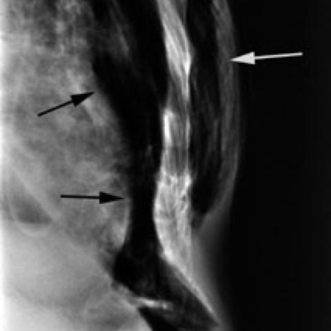

# V9 case 562_8353802023537

[20 题导航](README.md) · [完整逐题 JSON](562_8353802023537.json)

## 实际题干与完整选项

```text
A 61-year-old male patient involved in a high-speed deceleration traffic accident has been admitted for evaluation. Based on the chest X-rays provided:
Which of the following sets of findings most accurately supports the diagnosis of blunt tracheal rupture with subsequent pneumomediastinum, pneumoperitoneum, and subcutaneous emphysema?
A) Presence of pneumothorax and hemothorax with a tracheal shift
B) Subcutaneous emphysema, pneumopericardium, and bilateral pulmonary contusions
C) Pneumomediastinum, pneumothorax, and widened mediastinum
D) Interruption of radiolucent lumen and sharp angulation of trachea
E) Pneumopericardium, pneumothorax persisting despite chest tube drainage, and tension pneumothorax
F) Subcutaneous emphysema, pneumoperitoneum, and anterior pneumomediastinum delineated by xiphoid attachment
```

参考选项（完成后复盘）：**F**。任务组：classification,characterization,diagnosis,reasoning。

## 原图

figures/562/figure_1a.jpg


figures/562/figure_1b.jpg



## 本轮答案与去向

| 组 | 初始 | 候选 | 最终 | 对错 | 回退 / 错误 |
|---|---|---|---|---|---|
| P0 | F | — | F | True | completed |
| D | F | F | F | True | 正常返回 |
| DK | F | F | F | True | 正常返回 |
| DKB | F | 缺失 | F | True | ValueError: inconsistent_candidate_uncertainty |
| DKC | F | F | F | True | 正常返回 |

## 完整可观测记录

以下 JSON 保留实际系统提示、消息、工具请求与返回、候选规划、注入的知识/经验及门控输入输出。图像 data URL 已无损解码为文件；JSON 中路径统一相对于 `reports/v9/`。模型和工具所述观察未被独立临床核实。

- [P0 提示、消息与工具原文](../traces/562_8353802023537/P0.json)
- [D 规划、检索、消息、工具与门控](../traces/562_8353802023537/D.json)
- [DK 规划、检索、消息、工具与门控](../traces/562_8353802023537/DK.json)
- [DKB 规划、检索、消息、工具与门控](../traces/562_8353802023537/DKB.json)
- [DKC 规划、检索、消息、工具与门控](../traces/562_8353802023537/DKC.json)

## 分支候选与门控的实际输出

### D

```json
{
  "candidate_payload": {
    "answer": "F",
    "uncertain": false,
    "changed_attributes": [
      "tracheal lumen interruption/angulation",
      "anterior pneumomediastinum delineated by xiphoid",
      "pneumoperitoneum",
      "subcutaneous emphysema"
    ],
    "evidence_refs": [
      "p0:tool:6",
      "p0:tool:7",
      "p0:tool:8",
      "p0:tool:9",
      "D:tool:1"
    ],
    "observations": [
      {
        "attribute": "pneumoperitoneum",
        "object": "free air",
        "side": "unresolved",
        "location": "subdiaphragmatic",
        "timepoint": "unresolved",
        "image_ids": [
          "image:1"
        ],
        "status": "observed_present",
        "evidence_refs": [
          "p0:tool:8"
        ],
        "value": "black arrows indicate air beneath diaphragm"
      },
      {
        "attribute": "subcutaneous emphysema",
        "object": "air in soft tissues",
        "side": "unresolved",
        "location": "neck and chest wall",
        "timepoint": "unresolved",
        "image_ids": [
          "image:2"
        ],
        "status": "observed_present",
        "evidence_refs": [
          "p0:tool:7",
          "p0:tool:9"
        ],
        "value": "black arrows in figure 1b"
      },
      {
        "attribute": "anterior pneumomediastinum",
        "object": "mediastinal air",
        "side": "unresolved",
        "location": "anterior mediastinum, delineated by xiphoid attachment",
        "timepoint": "unresolved",
        "image_ids": [
          "image:2"
        ],
        "status": "observed_present",
        "evidence_refs": [
          "p0:tool:9"
        ],
        "value": "white arrow in figure 1b"
      },
      {
        "attribute": "interruption of radiolucent lumen and sharp angulation of trachea",
        "object": "trachea",
        "side": "unresolved",
        "location": "cervicothoracic trachea",
        "timepoint": "unresolved",
        "image_ids": [
          "image:1"
        ],
        "status": "observed_present",
        "evidence_refs": [
          "D:tool:1"
        ],
        "value": "bounding box [0.425, 0.005, 0.615, 0.225]"
      }
    ]
  },
  "candidate_error": null,
  "fallback": null,
  "gate": {
    "decision": "no_change"
  },
  "gate_error": null,
  "new_observations": [
    {
      "question_id": "562_8353802023537",
      "tool_name": "xray_phrase_grounding",
      "tool_version": "cde4574547891c25d51425998cac6e1d575efdb86319a334ce560e4b33f03f22",
      "arguments": {
        "image_path": "../v11/images/originals/figures/562/figure_1a.jpg",
        "phrase": "Interruption of radiolucent lumen and sharp angulation of trachea"
      },
      "kind": "grounding",
      "result": [
        {
          "predictions": [
            {
              "phrase": "Interruption of radiolucent lumen and sharp angulation of trachea.",
              "bounding_boxes": {
                "model_coordinates": [
                  [
                    0.425,
                    0.005,
                    0.615,
                    0.225
                  ]
                ],
                "image_coordinates": [
                  [
                    0.425,
                    0.004166666666666667,
                    0.6145833333333334,
                    0.225
                  ]
                ]
              }
            }
          ],
          "visualization_path": null
        },
        {
          "image_path": "../v11/images/originals/figures/562/figure_1a.jpg",
          "analysis_status": "completed",
          "phrase": "Interruption of radiolucent lumen and sharp angulation of trachea",
          "n_boxes": 1,
          "tool_version": "maira-2@795a2b1c+bf16+negative-safe-v1",
          "clinical_evidence": "unknown",
          "step_credit": null
        }
      ],
      "elapsed_ms": 1096,
      "phase": 2,
      "evidence_ref": "D:tool:1",
      "status": "hypothesis",
      "source": "raw_tool_report_not_verified_patient_fact",
      "is_new_usable": null,
      "collected_utc": "2026-10-30T06:26:44.215901+00:00",
      "artifacts": []
    }
  ],
  "k_ids": [],
  "e_ids": [],
  "timing": {
    "started_utc": "2026-10-30T06:26:27.101203+00:00",
    "ended_utc": "2026-10-30T06:27:06.003115+00:00",
    "elapsed_s": 38.902
  },
  "accounting": {
    "input_tokens": 32657,
    "output_tokens": 1220,
    "total_tokens": 33877,
    "model_calls": 4,
    "tool_calls": 1,
    "logical_cost_cny": "0.145268",
    "incremental_cost_cny": "0.145268",
    "provider_actual_cost_cny": null,
    "cost_basis": "usage_at_existing_profile_assumed_rates_or_conservative_unknown_reservation_not_invoice",
    "usage_complete": true,
    "issues": []
  }
}
```

### DK

```json
{
  "candidate_payload": {
    "answer": "F",
    "uncertain": false,
    "changed_attributes": [
      "tracheal lumen interruption and sharp angulation",
      "pneumoperitoneum",
      "subcutaneous emphysema",
      "anterior pneumomediastinum"
    ],
    "evidence_refs": [
      "p0:tool:6",
      "p0:tool:7",
      "p0:tool:8",
      "p0:tool:9",
      "DK:tool:1"
    ],
    "observations": [
      {
        "attribute": "pneumoperitoneum",
        "object": "free air",
        "side": "unresolved",
        "location": "subdiaphragmatic",
        "timepoint": "unresolved",
        "image_ids": [
          "image:1"
        ],
        "status": "observed_present",
        "evidence_refs": [
          "p0:tool:8"
        ],
        "value": "black arrows indicate air beneath diaphragm"
      },
      {
        "attribute": "subcutaneous emphysema",
        "object": "air in soft tissues",
        "side": "unresolved",
        "location": "neck and chest wall",
        "timepoint": "unresolved",
        "image_ids": [
          "image:2"
        ],
        "status": "observed_present",
        "evidence_refs": [
          "p0:tool:7",
          "p0:tool:9"
        ],
        "value": "black arrows show subcutaneous air; report confirms"
      },
      {
        "attribute": "anterior pneumomediastinum",
        "object": "mediastinal air",
        "side": "unresolved",
        "location": "anterior mediastinum, delineated by xiphoid attachment",
        "timepoint": "unresolved",
        "image_ids": [
          "image:2"
        ],
        "status": "observed_present",
        "evidence_refs": [
          "p0:tool:9"
        ],
        "value": "white arrow points to anterior pneumomediastinum"
      },
      {
        "attribute": "tracheal lumen interruption and sharp angulation",
        "object": "trachea",
        "side": "unresolved",
        "location": "cervicothoracic trachea",
        "timepoint": "unresolved",
        "image_ids": [
          "image:1"
        ],
        "status": "observed_present",
        "evidence_refs": [
          "DK:tool:1"
        ],
        "value": "bounding box [0.425, 0.005, 0.615, 0.225] confirms"
      }
    ]
  },
  "candidate_error": null,
  "fallback": null,
  "gate": {
    "decision": "no_change"
  },
  "gate_error": null,
  "new_observations": [
    {
      "question_id": "562_8353802023537",
      "tool_name": "xray_phrase_grounding",
      "tool_version": "cde4574547891c25d51425998cac6e1d575efdb86319a334ce560e4b33f03f22",
      "arguments": {
        "image_path": "../v11/images/originals/figures/562/figure_1a.jpg",
        "phrase": "Interruption of radiolucent lumen and sharp angulation of trachea"
      },
      "kind": "grounding",
      "result": [
        {
          "predictions": [
            {
              "phrase": "Interruption of radiolucent lumen and sharp angulation of trachea.",
              "bounding_boxes": {
                "model_coordinates": [
                  [
                    0.425,
                    0.005,
                    0.615,
                    0.225
                  ]
                ],
                "image_coordinates": [
                  [
                    0.425,
                    0.004166666666666667,
                    0.6145833333333334,
                    0.225
                  ]
                ]
              }
            }
          ],
          "visualization_path": null
        },
        {
          "image_path": "../v11/images/originals/figures/562/figure_1a.jpg",
          "analysis_status": "completed",
          "phrase": "Interruption of radiolucent lumen and sharp angulation of trachea",
          "n_boxes": 1,
          "tool_version": "maira-2@795a2b1c+bf16+negative-safe-v1",
          "clinical_evidence": "unknown",
          "step_credit": null
        }
      ],
      "elapsed_ms": 1073,
      "phase": 2,
      "evidence_ref": "DK:tool:1",
      "status": "hypothesis",
      "source": "raw_tool_report_not_verified_patient_fact",
      "is_new_usable": null,
      "collected_utc": "2026-10-30T06:27:22.448414+00:00",
      "artifacts": []
    }
  ],
  "k_ids": [
    "RAD_PNEUMOTHORAX_IMAGING_2016_02",
    "ACR_ARI_2024_K01"
  ],
  "e_ids": [],
  "timing": {
    "started_utc": "2026-10-30T06:27:06.007821+00:00",
    "ended_utc": "2026-10-30T06:27:41.654363+00:00",
    "elapsed_s": 35.647
  },
  "accounting": {
    "input_tokens": 33287,
    "output_tokens": 1229,
    "total_tokens": 34516,
    "model_calls": 4,
    "tool_calls": 1,
    "logical_cost_cny": "0.147896",
    "incremental_cost_cny": "0.147896",
    "provider_actual_cost_cny": null,
    "cost_basis": "usage_at_existing_profile_assumed_rates_or_conservative_unknown_reservation_not_invoice",
    "usage_complete": true,
    "issues": []
  }
}
```

### DKB

```json
{
  "candidate_error": "ValueError: inconsistent_candidate_uncertainty",
  "fallback": "candidate_error",
  "gate": {
    "decision": "not_called"
  },
  "gate_error": null,
  "new_observations": [
    {
      "question_id": "562_8353802023537",
      "tool_name": "chest_xray_expert",
      "tool_version": "edef4e07539dca3f6313218a8c9d9e4fbf7220a44afad6aa65d93e4ca45201af",
      "arguments": {
        "image_paths": [
          "../v11/images/originals/figures/562/figure_1a.jpg",
          "../v11/images/originals/figures/562/figure_1b.jpg"
        ],
        "prompt": "Specifically identify any interruption of the tracheal radiolucent lumen or sharp angulation of the trachea in the provided chest X-rays. Describe the location and appearance of these findings if present.",
        "max_new_tokens": 512
      },
      "kind": "vqa",
      "result": [
        {
          "response": "<|ref|> Interval extubation has occurred. The trachea is midline."
        },
        {
          "image_paths": [
            "../v11/images/originals/figures/562/figure_1a.jpg",
            "../v11/images/originals/figures/562/figure_1b.jpg"
          ],
          "prompt": "Specifically identify any interruption of the tracheal radiolucent lumen or sharp angulation of the trachea in the provided chest X-rays. Describe the location and appearance of these findings if present.",
          "max_new_tokens": 512,
          "analysis_status": "completed"
        }
      ],
      "elapsed_ms": 878,
      "phase": 2,
      "evidence_ref": "DKB:tool:1",
      "status": "hypothesis",
      "source": "raw_tool_report_not_verified_patient_fact",
      "is_new_usable": null,
      "collected_utc": "2026-10-30T06:27:59.879618+00:00",
      "artifacts": []
    }
  ],
  "k_ids": [
    "RAD_PNEUMOTHORAX_IMAGING_2016_01",
    "ACR_ARI_2024_K01"
  ],
  "e_ids": [
    "822afbda6ea9eabf7b1aa28f88c131b67dcbf65bd64ee9ca87d45c0ac992de8c"
  ],
  "timing": {
    "started_utc": "2026-10-30T06:27:41.659556+00:00",
    "ended_utc": "2026-10-30T06:28:17.102113+00:00",
    "elapsed_s": 35.443
  },
  "accounting": {
    "input_tokens": 33915,
    "output_tokens": 1274,
    "total_tokens": 35189,
    "model_calls": 4,
    "tool_calls": 1,
    "logical_cost_cny": "0.150948",
    "incremental_cost_cny": "0.150948",
    "provider_actual_cost_cny": null,
    "cost_basis": "usage_at_existing_profile_assumed_rates_or_conservative_unknown_reservation_not_invoice",
    "usage_complete": true,
    "issues": []
  }
}
```

### DKC

```json
{
  "candidate_payload": {
    "answer": "F",
    "uncertain": false,
    "changed_attributes": [
      "tracheal lumen interruption (observed on image:1)",
      "anterior pneumomediastinum (observed on image:2)",
      "subcutaneous emphysema (observed on image:2)",
      "pneumoperitoneum (observed on image:1)"
    ],
    "evidence_refs": [
      "p0:tool:8",
      "p0:tool:7",
      "p0:tool:9",
      "DKC:tool:2"
    ],
    "observations": [
      {
        "attribute": "pneumoperitoneum",
        "object": "free air",
        "side": "unresolved",
        "location": "subdiaphragmatic",
        "timepoint": "unresolved",
        "image_ids": [
          "image:1"
        ],
        "status": "observed_present",
        "evidence_refs": [
          "p0:tool:8"
        ],
        "value": "black arrows indicate air beneath diaphragm"
      },
      {
        "attribute": "subcutaneous emphysema",
        "object": "air in soft tissues",
        "side": "unresolved",
        "location": "neck and chest wall",
        "timepoint": "unresolved",
        "image_ids": [
          "image:2"
        ],
        "status": "observed_present",
        "evidence_refs": [
          "p0:tool:7",
          "p0:tool:9"
        ],
        "value": "black arrows show subcutaneous air; white arrow shows anterior pneumomediastinum"
      },
      {
        "attribute": "anterior pneumomediastinum",
        "object": "mediastinal air",
        "side": "anterior",
        "location": "mediastinum, delineated by xiphoid attachment",
        "timepoint": "unresolved",
        "image_ids": [
          "image:2"
        ],
        "status": "observed_present",
        "evidence_refs": [
          "p0:tool:9"
        ],
        "value": "white arrow points to anterior pneumomediastinum"
      },
      {
        "attribute": "tracheal lumen interruption",
        "object": "trachea",
        "side": "unresolved",
        "location": "cervicothoracic trachea (mid-upper mediastinum)",
        "timepoint": "unresolved",
        "image_ids": [
          "image:1"
        ],
        "status": "observed_present",
        "evidence_refs": [
          "DKC:tool:2"
        ],
        "value": "bounding box [0.425, 0.005, 0.615, 0.225] localizes lumen interruption"
      }
    ]
  },
  "candidate_error": null,
  "fallback": null,
  "gate": {
    "decision": "no_change"
  },
  "gate_error": null,
  "new_observations": [
    {
      "question_id": "562_8353802023537",
      "tool_name": "chest_xray_expert",
      "tool_version": "edef4e07539dca3f6313218a8c9d9e4fbf7220a44afad6aa65d93e4ca45201af",
      "arguments": {
        "image_paths": [
          "../v11/images/originals/figures/562/figure_1a.jpg",
          "../v11/images/originals/figures/562/figure_1b.jpg"
        ],
        "prompt": "Examine the tracheal air column in both images. Specifically, identify any interruption of the radiolucent lumen or sharp angulation of the trachea that would suggest blunt tracheal rupture. Describe the location and appearance.",
        "max_new_tokens": 512
      },
      "kind": "vqa",
      "result": [
        {
          "response": "<|ref|> Blunting <|/ref|> <|box|> (40,20),(48,32) <|/box|>"
        },
        {
          "image_paths": [
            "../v11/images/originals/figures/562/figure_1a.jpg",
            "../v11/images/originals/figures/562/figure_1b.jpg"
          ],
          "prompt": "Examine the tracheal air column in both images. Specifically, identify any interruption of the radiolucent lumen or sharp angulation of the trachea that would suggest blunt tracheal rupture. Describe the location and appearance.",
          "max_new_tokens": 512,
          "analysis_status": "completed"
        }
      ],
      "elapsed_ms": 883,
      "phase": 2,
      "evidence_ref": "DKC:tool:1",
      "status": "hypothesis",
      "source": "raw_tool_report_not_verified_patient_fact",
      "is_new_usable": null,
      "collected_utc": "2026-10-30T06:28:35.671004+00:00",
      "artifacts": []
    },
    {
      "question_id": "562_8353802023537",
      "tool_name": "xray_phrase_grounding",
      "tool_version": "cde4574547891c25d51425998cac6e1d575efdb86319a334ce560e4b33f03f22",
      "arguments": {
        "image_path": "../v11/images/originals/figures/562/figure_1a.jpg",
        "phrase": "Interruption of radiolucent tracheal lumen",
        "max_new_tokens": 300
      },
      "kind": "grounding",
      "result": [
        {
          "predictions": [
            {
              "phrase": "Interruption of radiolucent tracheal lumen.",
              "bounding_boxes": {
                "model_coordinates": [
                  [
                    0.425,
                    0.005,
                    0.615,
                    0.225
                  ]
                ],
                "image_coordinates": [
                  [
                    0.425,
                    0.004166666666666667,
                    0.6145833333333334,
                    0.225
                  ]
                ]
              }
            }
          ],
          "visualization_path": null
        },
        {
          "image_path": "../v11/images/originals/figures/562/figure_1a.jpg",
          "analysis_status": "completed",
          "phrase": "Interruption of radiolucent tracheal lumen",
          "n_boxes": 1,
          "tool_version": "maira-2@795a2b1c+bf16+negative-safe-v1",
          "clinical_evidence": "unknown",
          "step_credit": null
        }
      ],
      "elapsed_ms": 956,
      "phase": 3,
      "evidence_ref": "DKC:tool:2",
      "status": "hypothesis",
      "source": "raw_tool_report_not_verified_patient_fact",
      "is_new_usable": null,
      "collected_utc": "2026-10-30T06:28:42.346694+00:00",
      "artifacts": []
    }
  ],
  "k_ids": [
    "RAD_PNEUMOTHORAX_IMAGING_2016_01",
    "ACR_ARI_2024_K01"
  ],
  "e_ids": [
    "S014"
  ],
  "timing": {
    "started_utc": "2026-10-30T06:28:17.106250+00:00",
    "ended_utc": "2026-10-30T06:28:59.277753+00:00",
    "elapsed_s": 42.172
  },
  "accounting": {
    "input_tokens": 34779,
    "output_tokens": 1430,
    "total_tokens": 36209,
    "model_calls": 4,
    "tool_calls": 2,
    "logical_cost_cny": "0.156276",
    "incremental_cost_cny": "0.156276",
    "provider_actual_cost_cny": null,
    "cost_basis": "usage_at_existing_profile_assumed_rates_or_conservative_unknown_reservation_not_invoice",
    "usage_complete": true,
    "issues": []
  }
}
```

## 历史对照

[相同题目在 V10 / V11 的图文记录](../../v11/cases/562_8353802023537.md)。V9 和 V10 是不同调用及协议，P0 也可能不同，不应把它们当作同一次缓存基线。

[来源与公开范围](../data-provenance.md) · [失败机制分析](../failure-analysis.md)
